# 🏛 مستر مادر (والد): بازطراحی کامل پنل مدیریت و پنل سازندهٔ ختم‌ساز (نسخهٔ جامع نسل جدید)
**(Parent Master — Complete Ground-Up Admin & Creator Panel Redesign)**

> **📅 تاریخ تدوین:** `2026-10-10` · **وضعیت:** `تحلیل و طراحی کامل (فاز ۰ — بدون تغییر کد)` · **نگارنده:** `Antigravity`

---

## 🌳 ۱. نقشهٔ درختی اسناد «والد و ولید» (مادر و فرزندی)

این سند **ریشه و مادر (Parent Master)** کل معماری پنل مدیریت جدید و مستندات سیستم است. تمام جزئیات تخصصی هر زیرسیستم در **۱۰ مستر فرزند (Child Masters)** و **۱ مستر گزارش باگ‌ها** تفکیک و لینک‌دهی شده‌اند:

```mermaid
flowchart TD
    P["🏛 مستر مادر (همین سند)\ndocs/ai/ADMIN_PANEL_REDESIGN_MASTER.md\nمعماری کلان کوبیدن و نوسازی ۱۰۰٪ پنل ادمین و پنل سازنده"]
    C1["📘 مستر فرزند ۰۱\nMASTER_01_KHATM_ENGINE_AND_MODES.md\nموتور ختم‌ها، انواع ختم، تعهدی/آزاد و سهم‌بندی"]
    C2["📗 مستر فرزند ۰۲\nMASTER_02_CONTENT_DEVOTIONALS_AND_MEDIA.md\nمدیریت محتوا، ادعیه، خطبه، صفحات قرآن و رسانه"]
    C3["📙 مستر فرزند ۰۳\nMASTER_03_PLANS_BILLING_WALLET_AND_ADS.md\nپلن‌های پولی/رایگان، کیف پول، درگاه و تبلیغات"]
    C4["📕 مستر فرزند ۰۴\nMASTER_04_BOTS_USERS_MODERATION_AND_OPS.md\nمعماری مولتی‌بات، کاربران و عملیات سرور"]
    C5["📜 مستر فرزند ۰۵\nMASTER_05_OPEN_KHATM_AND_KHUTBAH_FLOW.md\nختم آزاد، خطبه‌های تدریجی و کپشن ویدیوها"]
    C6["💳 مستر فرزند ۰۶\nMASTER_06_PAYMENT_GATEWAY_AND_CALLBACK_ARCHITECTURE.md\nدرگاه پرداخت، پورت‌ها و ریورس‌پروکسی"]
    C7["📙 مستر فرزند ۰۷\nMASTER_07_MEMBER_DAILY_DIGEST_AND_MOTIVATIONAL_PROGRESS.md\nتفکیک پیام تأیید، لینک دعوت و پیشرفت روزانه"]
    C8["🎛 مستر فرزند ۰۸\nMASTER_08_CREATOR_PANEL_AND_USER_EXPERIENCE.md\nبازطراحی کامل پنل سازندگان و مینی‌اپ"]
    C9["📱 مستر فرزند ۰۹\nMASTER_09_BALE_ADAPTER_AND_MARKDOWN_COMPATIBILITY.md\nمبدل مارک‌داون بله و سازگاری پیام‌رسان بله"]
    C10["💰 مستر فرزند ۱۰\nMASTER_10_PLANS_BROADCAST_RECEIPT_PAYMENT_AND_CREATOR_PANEL_GUARD.md\nپیام ۱۰۰۰ تایی، فیش بانکی، دوره ۳۰ روزه پرو و هشدارهای انقضا"]
    B["🐛 مستر گزارش باگ‌ها\nMASTER_BUG_AND_GAP_REPORT.md\nلیست خط‌به‌خط باگ‌ها و شکاف‌ها"]

    P --> C1
    P --> C2
    P --> C3
    P --> C4
    P --> C5
    P --> C6
    P --> C7
    P --> C8
    P --> C9
    P --> C10
    P --> B
```

### فهرست لینک‌های مستقیم به فرزندان:
1. 📘 **[مستر فرزند ۰۱ — موتور ختم‌ها، انواع ختم، تعهدی/آزاد و سهم‌بندی](masters/MASTER_01_KHATM_ENGINE_AND_MODES.md)**
2. 📗 **[مستر فرزند ۰۲ — مدیریت محتوا، ادعیه، خطبه‌ها، قرآن، قالب‌های پیام و رسانه](masters/MASTER_02_CONTENT_DEVOTIONALS_AND_MEDIA.md)**
3. 📙 **[مستر فرزند ۰۳ — پلن‌های پولی و رایگان، کیف پول، درگاه پرداخت، کد تخفیف و تبلیغات](masters/MASTER_03_PLANS_BILLING_WALLET_AND_ADS.md)**
4. 📕 **[مستر فرزند ۰۴ — معماری مولتی‌بات، کاربران، احراز شماره، ۸ صف تأیید و عملیات سرور](masters/MASTER_04_BOTS_USERS_MODERATION_AND_OPS.md)**
5. 📜 **[مستر فرزند ۰۵ — جریان ختم آزاد، موتور دورهای ۵ بخشی خطبه فدکیه و سامانهٔ کپشن ویدیوها](masters/MASTER_05_OPEN_KHATM_AND_KHUTBAH_FLOW.md)**
6. 💳 **[مستر فرزند ۰۶ — معماری جامع درگاه پرداخت، کال‌بک بانکی، ریورس‌پروکسی آپاچی و ثبات پورت‌ها](masters/MASTER_06_PAYMENT_GATEWAY_AND_CALLBACK_ARCHITECTURE.md)**
7. 📙 **[مستر فرزند ۰۷ — خلاصه روزانه اعضا در ساعت ۱۴ و موتور پیشرفت انگیزشی](masters/MASTER_07_MEMBER_DAILY_DIGEST_AND_MOTIVATIONAL_PROGRESS.md)**
8. 🎛 **[مستر فرزند ۰۸ — معماری، بازطراحی و تجربهٔ کاربری پنل سازندگان ختم](masters/MASTER_08_CREATOR_PANEL_AND_USER_EXPERIENCE.md)**
9. 📱 **[مستر فرزند ۰۹ — مبدل مارک‌داون بله و سازگاری پیام‌رسان بله در ناوگان ربات‌ها](masters/MASTER_09_BALE_ADAPTER_AND_MARKDOWN_COMPATIBILITY.md)**
10. 💰 **[مستر فرزند ۱۰ — مهندسی مجدد پیام‌های گروهی، بسته‌های ۱۰۰۰ نفری، شارژ با فیش بانکی/پی‌پینگ مستقیم و قفل پنل سازندگان](masters/MASTER_10_PLANS_BROADCAST_RECEIPT_PAYMENT_AND_CREATOR_PANEL_GUARD.md)**
11. 🐛 **[مستر گزارش باگ‌ها، دکمه‌های مرده و شکاف‌های پنل ادمین](MASTER_BUG_AND_GAP_REPORT.md)**

---

## 🎯 ۲. فلسفهٔ کوبیدن و از نو ساختن پنل ادمین (چرا پنل فعلی جوابگو نیست؟)

در کالبدشکافی خط‌به‌خط فایل [src/khatmsaz/web/app.py](../../src/khatmsaz/web/app.py) (۲۹۲۲ خط) و ۲۸ قالب HTML فعلی، مشخص شد که پنل فعلی به صورت تکه‌تکه در طول زمان رشد کرده و مشکلات اساسی زیر را دارد:
1. **عدم امکان مدیریت ۱۰۰٪ بات از داخل پنل وب:** برای کارهای اصلی مثل آپلود ویدیوی ۵ بخش خطبه، آپلود صوت چند مداح، آپلود PDF دعا، مدیریت ۶۰۴ صفحهٔ قرآن، تأیید لعن سفارشی، تأیید کاور ختم، شارژ دستی کیف پول، تغییر پلن کاربر و ویرایش متن قالب‌های پیام، ادمین هیچ دکمه‌ای در پنل ندارد و مجبور به تایپ دستورات متنی در بات بوده است!
2. **سردرگمی و نبود راهنمای درون‌برنامه‌ای:** بخش‌ها بدون توضیح رها شده‌اند و مشخص نیست هر فیلد دقیقاً کجای بات را تغییر می‌دهد.
3. **پراکندگی صف‌های تأیید:** ۸ صف مختلف تأیید (شماره موبایل، پیام گروهی، لعن سفارشی، کاور ختم، درخواست دعای جدید، درخواست نوع ختم، درخواست سازنده‌شدن، تیکت‌ها) یا صفحه ندارند، یا در منوها لینک نشده‌اند (`Orphan Routes`)، یا شمارنده‌شان به صفحهٔ اشتباهی لینک شده است!

### ✨ ویژگی‌های کلیدی پنل مدیریت نسل جدید:
- **اصل اول — مدیریت ۱۰۰٪ بدون نیاز به دستور متنی در بات یا دیتابیس:** هر چیزی که در بات وجود دارد، در پنل وب دارای فرم گرافیکی، دکمه، پیش‌نمایش و آپلودر مستقیم فایل است.
- **اصل دوم — دکمهٔ علامت سؤال `[؟]` (پاپ‌آپ راهنمای به زبان ساده) در بالای تمام کارت‌ها و بخش‌ها:**
  کنار عنوان هر بخش و هر فرم، یک دکمهٔ **`[؟ راهنمای این بخش]`** وجود دارد. وقتی ادمین روی آن کلیک می‌کند، یک پنجرهٔ پاپ‌آپ (Modal) باز می‌شود که به ساده‌ترین زبان می‌گوید:
  *«این بخش چیست؟»، «کجای بات را تغییر می‌دهد؟» و «قدم‌به‌قدم مثل روشن کردن کامپیوتر چطور با آن کار کنید؟»*

---

## 🗺 ۳. معماری منوها و ۱۰ ماژول اصلی پنل ادمین جدید

پنل ادمین جدید دارای یک **نوار کناری هوشمند (Sidebar در دسکتاپ و Bottom Drawer کامل در موبایل/مینی‌اپ)** با شمارنده‌های زنده (Badge) است که از ۱۰ بخش اصلی تشکیل شده است:

| شماره | نام بخش در منوی پنل جدید | مسیر URL پایه | زیربخش‌ها (تب‌های داخلی) | مستر فرزند مرتبط |
| :---: | :--- | :--- | :--- | :--- |
| **۱** | **🏠 پیشخوان و نبض سیستم (Dashboard)** | `/` | آمار زنده، نمودار رشد، هشدارهای فوری، دسترسی سریع به صف‌های منتظر تأیید | [فرزند ۰۴](masters/MASTER_04_BOTS_USERS_MODERATION_AND_OPS.md) |
| **۲** | **🔔 مرکز نظارت و صف‌های تأیید (۸ صف)** | `/moderation` | ۱) لعن سفارشی ۲) پیام‌های گروهی ۳) کاور ختم‌ها ۴) شماره‌های موبایل ۵) درخواست دعای جدید ۶) درخواست نوع ختم ۷) درخواست سازنده‌شدن ۸) تیکت‌های پشتیبانی | [فرزند ۰۴](masters/MASTER_04_BOTS_USERS_MODERATION_AND_OPS.md) |
| **۳** | **📿 مدیریت کامل ختم‌ها و سهم‌ها** | `/khatms` | لیست و فیلتر پیشرفته ختم‌ها، ساخت ختم توسط ادمین، ویرایش کامل ختم، مدیریت اعضا، ثبت/آزادسازی دستی سهم، لیست انتظار و خروجی اکسل | [فرزند ۰۱](masters/MASTER_01_KHATM_ENGINE_AND_MODES.md) |
| **۴** | **📚 استودیو محتوا، ادعیه، خطبه و دسته‌بندی‌ها** | `/content` | ۱) دسته‌بندی‌های ویزارد (`DUA`, `ZIYARAT`, `LAAN`, `KHUTBAH`, `SALAWAT`) ۲) متن کامل ادعیه و خطبه‌ها ۳) مدیریت فایل‌های چندرسانه‌ای (ویدیوی بخش‌های خطبه، چند مداح، تصاویر، PDF) با آپلود مستقیم از وب | [فرزند ۰۲](masters/MASTER_02_CONTENT_DEVOTIONALS_AND_MEDIA.md) |
| **۵** | **📖 بانک قرآن کریم و قاریان (۶۰۴ صفحه)** | `/quran` | وضعیت ۶۰۴ صفحه در تلگرام و بله، بارگذاری خودکار از کانال منبع، آپلود/ویرایش تصویر و صوت هر صفحه، مدیریت قاریان (`parhizgar`, `mansouri`, `afasy` و...) | [فرزند ۰۲](masters/MASTER_02_CONTENT_DEVOTIONALS_AND_MEDIA.md) |
| **۶** | **💳 امور مالی، پلن‌ها، کیف پول و کوپن‌ها** | `/finance` | ۱) تنظیمات ۳ پلن (`FREE`, `BASIC`, `PRO`) ۲) مدیریت کیف پول و فاکتورها (شارژ/کسر دستی و استرداد وجه) ۳) کدهای تخفیف ۴) بسته‌های اشتراک پیامک ۵) تعرفه ارسال گروهی ۶) نرخ پاداش تبلیغات | [فرزند ۰۳](masters/MASTER_03_PLANS_BILLING_WALLET_AND_ADS.md) |
| **۷** | **📢 تبلیغات سراسری خدمتگزاران و اعلان همگانی** | `/campaigns` | تنظیم متن و رسانهٔ تبلیغ خدمتگزاران (مخصوص مخاطبان پلن `BASIC`)، ارسال در پس‌زمینه از طریق بات عضو، و ارسال اطلاعیهٔ سیستمی به سازندگان یا اعضا | [فرزند ۰۳](masters/MASTER_03_PLANS_BILLING_WALLET_AND_ADS.md) |
| **۸** | **👥 مدیریت کاربران و پروفایل ۳۶۰ درجه** | `/users` | جستجوی پیشرفته، مشاهده تمام اکانت‌های لینک‌شده (تلگرام + بله)، تغییر نقش/پلن/وضعیت، شارژ کیف پول، مشاهده ختم‌ها و سهم‌های کاربر، ارسال پیام مستقیم به کاربر | [فرزند ۰۴](masters/MASTER_04_BOTS_USERS_MODERATION_AND_OPS.md) |
| **۹** | **🤖 مدیریت ۱۴ ربات، قالب‌های پیام و تنظیمات سیستم** | `/system` | ۱) مدیریت ۱۴ بات (توکن، نام کاربری، فعال/غیرفعال، تصاویر معرفی ۵ خانواده از جمله `khutbah`) ۲) ویرایشگر قالب‌های پیام ۳ زبانه (`fa`/`ar`/`en`) ۳) تنظیمات سراسری سیستم (`default_reminder_hour`, `inactivity_days`, لوگو، شماره پشتیبانی) | [فرزند ۰۲](masters/MASTER_02_CONTENT_DEVOTIONALS_AND_MEDIA.md) و [فرزند ۰۴](masters/MASTER_04_BOTS_USERS_MODERATION_AND_OPS.md) |
| **۱۰** | **🛡 مدیران، دسترسی‌ها و گزارش ممیزی (Audit)** | `/security` | ۱) اعطا و لغو ۶ نقش مدیریتی به همکاران ۲) جدول کامل تاریخچهٔ ممیزی (`AuditLog`) با صفحه‌بندی و فیلتر بر اساس ادمین و نوع عملیات | [فرزند ۰۴](masters/MASTER_04_BOTS_USERS_MODERATION_AND_OPS.md) |

---

## 🔍 ۴. تشریح تک‌به‌تک بخش‌های پنل ادمین جدید (همراه با پاپ‌آپ `[؟]` و گام‌به‌گام «مثل روشن کردن کامپیوتر»)

در این بخش، ریزترین جزئیات هر ۱۰ ماژول پنل مدیریت جدید طراحی شده است. در پیاده‌سازی رابط کاربری (UI)، کنار تیتر هر یک از این بخش‌ها یک دکمهٔ **`[؟]`** قرار می‌گیرد که با کلیک روی آن، دقیقاً متنِ باکس «پاپ‌آپ علامت سؤال `[؟]`» زیر برای ادمین باز می‌شود:

---

### بخش ۱: 🏠 پیشخوان و نبض سیستم (`GET /`)

#### 💬 متن پاپ‌آپ علامت سؤال `[؟]`:
> **این صفحه چیست؟**
> اینجا اتاق فرمان اصلی شماست! در یک نگاه می‌بینید چند نفر در ربات عضو هستند، چند ختم فعال در حال برگزاری است، آیا تمام سرویس‌ها (دیتابیس، بات تلگرام، بات بله، درگاه پی‌پینگ و پیامک کاوه‌نگار) به برق وصل و روشن هستند یا نه، و چند درخواست از طرف کاربران منتظر تأیید شماست.

#### 🔌 چطور با آن کار کنیم؟ (مثل روشن کردن کامپیوتر):
1. **قدم اول:** به محض ورود به پنل، به ردیف بالای صفحه (**چراغ‌های وضعیت سرویس**) نگاه کنید. اگر هر ۵ چراغ سبز بودند، یعنی همه چیز سالم است. اگر چراغی قرمز بود، روی آن کلیک کنید تا علت دقیق را به شما بگوید.
2. **قدم دوم:** به کارت‌های **«صف‌های منتظر اقدام شما»** نگاه کنید. هر کارتی که عدد بالای صفر دارد (مثلاً «۲ لعن سفارشی منتظر تأیید» یا «۱ شماره خارج از کشور»)، مستقیماً روی همان کارت کلیک کنید تا وارد صفحهٔ تأیید همان مورد شوید.

#### ⚙️ مشخصات فنی و اصلاحات نسبت به نسخهٔ قبلی:
- تفکیک دقیق شمارنده‌های ۸ صف نظارت (رفع باگ `BUG-09` که `KhatmRequest` را به `/categories` لینک می‌کرد).
- نمایش وضعیت آخرین اجرای اسکنر دقیقه‌ای (`runtime_status.snapshot()`) مستقیم در بالای پیشخوان.

---

### بخش ۲: 🔔 مرکز نظارت و صف‌های تأیید (`GET /moderation`)

#### 💬 متن پاپ‌آپ علامت سؤال `[؟]`:
> **این بخش چیست؟**
> هر وقت کاربری در ربات کاری انجام دهد که قبل از پخش شدن نیاز به اجازهٔ مدیر دارد، درخواستش به این صفحه می‌آید. به جای اینکه در صفحات مختلف دنبال درخواست‌ها بگردید، هر ۸ صف تأیید در اینجا کنار هم هستند:
> ۱. **لعن‌های سفارشی:** وقتی سازنده‌ای متن لعن دلخواه خودش را نوشته است.
> ۲. **پیام‌های گروهی:** وقتی سازنده‌ای می‌خواهد به همهٔ اعضای ختمش پیام، عکس یا ویدیو بفرستد.
> ۳. **کاورهای ختم:** وقتی سازنده‌ای تصویر اختصاصی برای ختمش آپلود کرده است.
> ۴. **شماره‌های موبایل دستی:** شماره‌های خارج از کشور یا کاربرانی که پیامک کد تأیید برایشان نرفته است.
> ۵. **درخواست دعای جدید (در ویزارد):** وقتی سازنده دعایی خواسته که در لیست نبوده است.
> ۶. **پیشنهاد نوع ختم جدید:** پیشنهادهای کلی کاربران برای اضافه شدن ختم جدید.
> ۷. **درخواست سازنده شدن:** کاربرانی که درخواست ارتقا به نقش بانی/سازنده داده‌اند.
> ۸. **تیکت‌ها و پیام‌های پشتیبانی:** پیام‌هایی که کاربران برای مدیریت فرستاده‌اند.

#### 🔌 چطور با آن کار کنیم؟ (مثل روشن کردن کامپیوتر):
1. **قدم اول:** روی تبِ صفی که کنارش عدد قرمز دارد (مثلاً تب **«🔥 لعن‌های سفارشی»**) کلیک کنید.
2. **قدم دوم:** کارت درخواست را بخوانید (نام سازنده، شماره موبایل، عنوان ختم و متن کامل لعن یا پیام گروهی به همراه پیش‌نمایش عکس/ویدیو/صوت).
3. **قدم سوم:**
   - اگر متن ایراد املایی داشت، در همان کادر متنی اصلاحش کنید.
   - اگر مورد تأیید است، دکمهٔ سبز **«✅ تأیید و انتشار»** را بزنید.
   - اگر مورد تأیید نیست، در کادر کوچک «علت رد» یک جمله بنویسید و دکمهٔ قرمز **«❌ رد درخواست»** را بزنید.
4. **پشت صحنه چه می‌شود؟** وضعیت در دیتابیس عوض می‌شود، در `audit_logs` ثبت می‌گردد و ربات همان لحظه به کاربر پیام می‌دهد که درخواستش تأیید یا رد شده است!

#### ⚙️ روت‌های جدید و اصلاح‌شده در این بخش:
- `GET /moderation?tab=lan|broadcasts|covers|phones|category_requests|khatm_requests|creator_requests|tickets`
- `POST /moderation/lan/{khatm_id}/decide` (تأیید/رد/ویرایش متن `pending_lan_approval` — رفع کامل `BUG-03`)
- `POST /moderation/broadcasts/{broadcast_id}/decide` (به همراه پیش‌نمایش رسانه و ارسال در `asyncio.create_task` پس‌زمینه برای جلوگیری از Timeout — رفع `BUG-10`)
- `POST /moderation/covers/{khatm_id}/decide` (تأیید یا رد `cover_status` همراه با نمایش تصویر کاور — رفع `BUG-09`)
- `POST /moderation/khatm-requests/{request_id}/decide` (تأیید یا رد `KhatmRequest` از پنل وب — رفع `BUG-09`)
- `POST /moderation/tickets/{user_id}/reply` (ارسال پاسخ مستقیم از پنل وب به چت کاربر در تلگرام/بله)

---

### بخش ۳: 📿 مدیریت کامل ختم‌ها و سهم‌ها (`GET /khatms` و `/khatms/{id}`)

#### 💬 متن پاپ‌آپ علامت سؤال `[؟]`:
> **این بخش چیست؟**
> اینجا لیست تمام ختم‌های ساخته شده در سیستم (قرآن، صلوات، دعا، زیارت، لعن و خطبه) را می‌بینید. برخلاف پنل قبلی که فقط لیست را نشان می‌داد و هیچ دکمه‌ای نداشت، در اینجا شما به عنوان مدیر کل می‌توانید:
> - خودتان مستقیم از پنل وب یک ختم جدید بسازید.
> - تنظیمات هر ختمی را ویرایش کنید (عنوان، نیت، هدف کل، حالت تعهدی/آزاد، سهم ثابت روزانه، عمومی/خصوصی بودن).
> - وضعیت ختم را تغییر دهید (فعال، متوقف، تکمیل‌شده، لغوشده با بازگشت وجه).
> - لیست تمام اعضای ختم را جستجو کنید، فایل اکسل کامل اعضا را دانلود کنید، سهم عقب‌افتادهٔ یک عضو را دستی ثبت کنید، یا عضوی را از ختم خارج کنید.

#### 🔌 چطور با آن کار کنیم؟ (مثل روشن کردن کامپیوتر):
1. **قدم اول:** در صفحهٔ **«📿 مدیریت ختم‌ها»**، با فیلترهای بالای صفحه (نوع ختم: `همه / قرآن / صلوات / دعا / زیارت / لعن / خطبه` و وضعیت: `فعال / تکمیل‌شده / لغوشده`) ختم مورد نظر را پیدا کرده و روی **«مدیریت ختم»** کلیک کنید.
2. **قدم دوم (تب تنظیمات ختم):** هر فیلدی از ختم را که می‌خواهید تغییر دهید و **«💾 ذخیره تغییرات ختم»** را بزنید.
3. **قدم سوم (تب اعضا و سهم‌ها):**
   - کنار نام هر عضو، وضعیت سهم‌های او (`خوانده‌شده` و `بدهی باز`) را می‌بینید.
   - برای ثبت دستی سهم عضو، روی **«✅ ثبت انجام سهم»** بزنید.
   - برای ارسال دوبارهٔ پیام سهم امروز به چت عضو، روی **«📲 ارسال مجدد سهم به بات»** بزنید.
   - برای حذف عضو و آزاد کردن صفحاتش، روی **«🚪 حذف عضو»** بزنید.
4. **قدم چهارم (تب لینک دعوت و خروجی):** لینک دعوت تلگرام و بله را کپی کنید یا روی **«📥 دانلود اکسل کامل اعضا (.xlsx)»** کلیک کنید.

#### ⚙️ روت‌های جدید در این بخش:
- `GET /khatms` (با فیلتر بر اساس خانوادهٔ واقعی ختم شامل `KHUTBAH` و وضعیت)
- `POST /khatms/create` (ساخت ختم جدید توسط ادمین برای هر ۶ خانواده از جمله `KHUTBAH`)
- `GET /khatms/{khatm_id}` (صفحه‌بندی کامل اعضا + جستجو + لیست انتظار + تاریخچهٔ سهم‌ها `ShareOccurrence`)
- `POST /khatms/{khatm_id}/update` (ویرایش کامل تنظیمات ختم توسط ادمین)
- `POST /khatms/{khatm_id}/status` (تغییر وضعیت ختم: فعال‌سازی، تکمیل، یا لغو همراه با بازپرداخت اختیاری)
- `POST /khatms/{khatm_id}/members/{participation_id}/complete-share` (ثبت دستی سهم باز عضو)
- `POST /khatms/{khatm_id}/members/{participation_id}/resend-share` (ارسال مجدد سهم امروز عضو در بات)
- `POST /khatms/{khatm_id}/members/{participation_id}/remove` (حذف عضو و ارتقای خودکار نفر بعدی از لیست انتظار)
- `GET /khatms/{khatm_id}/export.xlsx` (خروجی اکسل کامل اعضا برای ادمین)

---

### بخش ۴: 📚 استودیو محتوا، ادعیه، خطبه و دسته‌بندی‌ها (`GET /content`)

*(جزئیات کامل منطق فنی در [مستر فرزند ۰۲](masters/MASTER_02_CONTENT_DEVOTIONALS_AND_MEDIA.md) تشریح شده است).*

#### 💬 متن پاپ‌آپ علامت سؤال `[؟]`:
> **این بخش چیست؟**
> اینجا کتابخانهٔ تمام متون و فایل‌های معنوی ربات است (دعاها، زیارت‌ها، خطبه‌ها مثل خطبهٔ فدکیه، لعن‌ها و صلوات).
> در طراحی جدید، دیگر نیازی نیست یک بار در «دسته‌بندی‌ها» و یک بار در «متون ادعیه» و یک بار با دستور `/manage_content` در بات کار کنید! همه چیز در همین یک صفحه جمع شده است:
> شما می‌توانید یک دعا یا خطبهٔ جدید تعریف کنید، متن کامل آن را بگذارید، و **مستقیم از روی کامپیوتر یا گوشی خودتان** فایل صوتی (حتی با صدای چند مداح مختلف)، فایل PDF، عکس صفحات یا **ویدیوهای بخش‌بندی‌شده (مثل ۵ بخش ویدیوی خطبه)** را آپلود کنید!

#### 🔌 چطور با آن کار کنیم؟ (مثل روشن کردن کامپیوتر):
1. **قدم اول:** وارد **«📚 استودیو محتوا»** شوید. در بالای صفحه ۴ تب می‌بینید: `🤲 دعاها و زیارات` | `🎤 خطبه‌ها (مثل خطبه فدکیه)` | `🔥 لعن‌ها` | `🕊 صلوات`.
2. **قدم دوم:** برای افزودن مورد جدید روی **«➕ افزودن محتوای جدید»** (یا برای تغییر مورد قبلی روی **«✏️ ویرایش و مدیریت فایل‌ها»**) کلیک کنید.
3. **قدم سوم (متن و تنظیمات دکمه):** عنوان فارسی، گروه (`DUA`, `ZIYARAT`, `KHUTBAH`, `LAAN`)، ترتیب نمایش در منوی بات و متن کامل را وارد کنید.
4. **قدم چهارم (آپلود مستقیم فایل از کامپیوتر/گوشی):** در بخش **«فایل‌های ضمیمه (`DevotionalMedia`)»**:
   - روی **«📤 آپلود فایل جدید»** کلیک کنید.
   - نوع فایل را انتخاب کنید: `ویدیو (بخش خطبه)` | `صوت مداح` | `تصویر صفحه` | `فایل PDF`.
   - اگر ویدیوی خطبه یا تصویر صفحه‌ای است، **شماره بخش/صفحه** (مثلاً `1` تا `5`) و **کپشن ویدیو** (که دقیقاً زیر ویدیو برای کاربر ارسال می‌شود، مثل کپشن اصلی ۵ قسمت خطبه فدک) را وارد کنید.
   - اگر صوت است، **نام مداح** (مثلاً `فرهمند`) را بنویسید.
   - فایل را از کامپیوتر/گوشی انتخاب کرده (یا `file_id`/لینک پیام را وارد کرده) و **«آپلود و ثبت»** را بزنید. سرور خودش فایل را به بات می‌فرستد، `file_id` را می‌گیرد و به همراه کپشن در جدول `devotional_media` ذخیره می‌کند!

#### ⚙️ روت‌های جدید در این بخش:
- `GET /content` و `GET /devotionals` (یکپارچه‌سازی با نمایش کامل `KHUTBAH` و تمام ردیف‌های `DevotionalMedia` — رفع `BUG-02`، `BUG-06`، `BUG-07` و `BUG-17`)
- `POST /content/item/save` و `POST /devotionals/save` (ذخیرهٔ هم‌زمان یا مجزای `KhatmCategory` و `DevotionalAsset`)
- `POST /devotionals/media/save` (آپلود مستقیم فایل `Multipart/Form-Data` یا ثبت `file_id` به همراه کپشن اختصاصی ویدیو / نام مداح برای `VIDEO`, `AUDIO`, `IMAGE`, `PDF` در جدول `devotional_media` با منطق Upsert ایمن)
- `POST /devotionals/media/{media_id}/delete` (حذف یک فایل صوت/ویدیو/تصویر/PDF خاص از یک دعا یا خطبه)
- `POST /devotionals/{slug}/test-send` (ارسال تستی آن دعا/خطبه به چت تلگرام/بله خود ادمین برای تست زنده)

---

### بخش ۵: 📖 بانک قرآن کریم و قاریان (`GET /quran`)

#### 💬 متن پاپ‌آپ علامت سؤال `[؟]`:
> **این بخش چیست؟**
> ختم قرآن کریم در ربات بر پایهٔ قرآن ۶۰۴ صفحه‌ای (رسم‌الخط عثمان‌طه) کار می‌کند. در این صفحه می‌توانید ببینید از ۶۰۴ صفحهٔ قرآن، تصویر، متن و صوت چند صفحه در تلگرام و بله ثبت شده است، قاریان قرآن را مدیریت کنید و اگر صفحه‌ای نیاز به جایگزینی تصویر یا صوت داشت، مستقیم از همین‌جا آپلود یا اصلاح کنید.

#### 🔌 چطور با آن کار کنیم؟ (مثل روشن کردن کامپیوتر):
1. **قدم اول:** وارد **«📖 بانک قرآن کریم»** شوید. در بالای صفحه نوار پیشرفت پوشش ۶۰۴ صفحه (تصویر و صوت در تلگرام و بله) را می‌بینید.
2. **قدم دوم:** اگر روی سرور جدید هستید، با یک کلیک روی دکمهٔ **«🔄 بارگذاری خودکار نقشهٔ ۶۰۴ صفحه از کانال منبع»**، تمام ۶۰۴ صفحه را ثبت کنید.
3. **قدم سوم:** برای بررسی یا تغییر یک صفحهٔ خاص (مثلاً صفحهٔ `124`)، شماره صفحه را در کادر جستجو بنویسید تا تصویر، متن و صوت قاریان آن صفحه نمایش داده شود و بتوانید فایل جدیدی برایش آپلود کنید.

---

### بخش ۶: 💳 امور مالی، پلن‌ها، کیف پول و کوپن‌ها (`GET /finance`)

*(جزئیات کامل منطق فنی در [مستر فرزند ۰۳](masters/MASTER_03_PLANS_BILLING_WALLET_AND_ADS.md) تشریح شده است).*

#### 💬 متن پاپ‌آپ علامت سؤال `[؟]`:
> **این بخش چیست؟**
> تمام تنظیمات پولی، سقف‌های رایگان، کیف پول کاربران، فاکتورهای درگاه پی‌پینگ، کدهای تخفیف، بسته‌های پیامک و تعرفهٔ ارسال پیام گروهی در این صفحه قرار دارد.

#### 🔌 چطور با آن کار کنیم؟ (مثل روشن کردن کامپیوتر):
1. **تب ۱ — پلن‌های سازندگان (`FREE`, `BASIC`, `PRO`):** سقف نفرات رایگان (`free_total_member_cap`)، سقف نفرات قرآن و دعا (`max_quran_members`, `max_devotional_members`)، وضعیت تبلیغات و قیمت پلن `PRO` را تنظیم و ذخیره کنید (با حفظ کامل تمام فیلدها — رفع `BUG-08`).
2. **تب ۲ — عملیات کیف پول و تغییر پلن کاربر:** کاربر را با نام یا شماره جستجو کنید -> موجودی نقدی یا اعتبار هدیه‌اش را افزایش/کاهش دهید، یا پلن او را دستی روی `FREE`، `BASIC` یا `PRO` بگذارید.
3. **تب ۳ — فاکتورها و استرداد وجه (Refund):** لیست صفحه‌بندی‌شدهٔ تمام فاکتورها با قابلیت جستجو و دکمهٔ **«↩️ استرداد وجه»** کنار هر فاکتور.
4. **تب ۴ — کدهای تخفیف:** ساخت کد تخفیف درصدی یا مبلغ ثابت (با اعمال صحیح تیک فعال/غیرفعال اولیه) و مشاهده تعداد دفعات استفاده شده از هر کد.
5. **تب ۵ — تعرفه اشتراک پیامک، ارسال گروهی و پاداش تبلیغات:** تنظیم قیمت بسته‌های ۱/۳/۶/۱۲ ماهه پیامک، سهمیه رایگان و تعرفه ارسال گروهی در هر ۳ کانال (`تلگرام`، `بله`، `پیامک`) و نرخ پاداش تبلیغات (`AdRewardRate`).

---

### بخش ۷ تا ۱۰: تبلیغات خدمتگزاران، مدیریت کاربران ۳۶۰ درجه، مدیریت ۱۴ ربات/قالب‌ها، و امنیت/لاگ ممیزی

*(جزئیات کامل در [مستر فرزند ۰۴](masters/MASTER_04_BOTS_USERS_MODERATION_AND_OPS.md) تشریح شده است).*

- **در بخش ۷ (`/campaigns` — تبلیغ خدمتگزاران):** آپلود مستقیم عکس/ویدیوی تبلیغ، مشاهده تعداد مخاطبان پلن `BASIC` و ارسال در پس‌زمینه از طریق **بات عضوِ هر شرکت‌کننده** (`joined_via_bot_instance_id`) به جای بات سازنده (رفع کامل `BUG-10`).
- **در بخش ۸ (`/users` — پروفایل ۳۶۰ درجه کاربران):** نمایش تمام اکانت‌های لینک‌شدهٔ کاربر (هم تلگرام و هم بله)، نمایش شماره موبایل تأییدشده، شهر، استان، جنسیت، پلن، موجودی کیف پول، لیست ختم‌های ساخته شده و عضو شده، دکمه‌های اخطار/تعلیق/مسدودسازی/ارتقا به سازنده، و دکمهٔ ارسال پیام مستقیم به چت کاربر.
- **در بخش ۹ (`/system` — مدیریت ۱۴ ربات، قالب‌های پیام و تنظیمات سیستم):**
  - مدیریت توکن‌ها و تصاویر معرفی هر ۵ خانواده (`quran`, `salawat`, `dua_ziyarat`, `laan`, `khutbah` — با رفع کامل کرش ۵۰۰ در `BUG-01`).
  - **ویرایشگر کامل قالب‌های پیام (`MessageTemplate`):** امکان ساخت نسخهٔ جدید و ویرایش متن فارسی، عربی و انگلیسی تمام پیام‌های قالب‌بندی‌شده مستقیم از پنل وب.
  - **فرم تنظیمات سراسری سیستم:** ویرایش گرافیکی `default_reminder_hour`، `inactivity_days`، `panel_logo_url` و `custom_khatm_admin_phone`.
- **در بخش ۱۰ (`/security` — مدیران و تاریخچهٔ ممیزی):** مدیریت ۶ نقش ادمین و جدول صفحه‌بندی‌شدهٔ `AuditLog`.

---

## 🎨 ۵. بازطراحی پنل وب سازنده (`/creator/*` — مینی‌اپ و وب‌پنل بانیان)

علاوه بر پنل ادمین کل، پنل وب سازنده (`/creator`) نیز با اصلاحات زیر هم‌تراز با ویزارد بات می‌شود:
1. **رفع قفل ورود سازندهٔ جدید (`BUG-12`):** هر کاربری که در بات سازنده احراز هویت شده است، حتی قبل از ساخت اولین ختم خود، می‌تواند وارد مینی‌اپ `/creator` شود و اولین ختمش را بسازد.
2. **پشتیبانی از تمام ۶ خانواده در `/creator/khatms` و `/creator/khatms/new` (`BUG-02`):**
   - اضافه شدن امکان ساخت ختم **خطبه (`KHUTBAH`)** و زیارت به فرم ساخت ختم در پنل وب سازنده.
   - اضافه شدن تنظیمات **نیت (`niyyat`)**، **سیاست تعهد (`MEMBER_CHOICE` در برابر `FIXED_DAILY`)**، **کد تخفیف (`coupon_code`)** و **متن خوش‌آمدگویی** به فرم ساخت ختم وب.
   - اصلاح دسته‌بندی لیست ختم‌های سازنده در `/creator/khatms` بر اساس خانوادهٔ واقعی (تا دعا، لعن و خطبه به اشتباه زیرمجموعهٔ صلوات نشوند).
3. **پشتیبانی از پیوست فایل در ارسال پیام گروهی وب (`/creator/broadcasts`):** امکان آپلود عکس/ویدیو/صوت همراه با پیام گروهی در پنل وب سازنده.

---

## 🛣 ۶. نقشهٔ راه و فازبندی اجرایی (وقتی دستور شروع کدنویسی را صادر فرمایید)

این مستر و ۴ مستر فرزند آن، نقشهٔ کامل مهندسی را آماده کرده‌اند. به محض اینکه دستور شروع کدنویسی را صادر فرمایید، کار در **۵ فاز منظم و تست‌شده** انجام خواهد شد:

| فاز | عنوان فاز اجرایی | خروجی و فایل‌های هدف |
| :---: | :--- | :--- |
| **فاز ۱** | **رفع فوری ۱۶ باگ بحرانی و مهم (`MASTER_BUG_AND_GAP_REPORT.md`)** | رفع کرش `/bots` (`intro_image_khutbah`)، رفع دکمهٔ مردهٔ `jhour:`، رفع کرش `/report`، رفع بازنویسی Seed در ری‌استارت، رفع باگ `KHUTBAH` در ۷ نقطه، و رفع باگ‌های کیف پول و گزارش ماهانه |
| **فاز ۲** | **ساخت قالب پایهٔ نسل جدید پنل ادمین (`base_v2.html`) با سیستم پاپ‌آپ راهنمای `[؟]`** | طراحی رابط کاربری مدرن، ریسپانسیو (دسکتاپ + مینی‌اپ موبایل)، منوی ۱۰ بخشی با شمارندهٔ زنده و کامپوننت پاپ‌آپ راهنمای `[؟]` (به زبان ساده و گام‌به‌گام) در بالای تمام کارت‌ها |
| **فاز ۳** | **پیاده‌سازی مرکز نظارت ۸ گانه (`/moderation`) و استودیو محتوا و قرآن (`/content` و `/quran`)** | ساخت صف تأیید لعن سفارشی، کاورها، درخواست‌ها، تیکت‌ها + آپلودر مستقیم ویدیو/صوت/عکس/PDF از وب به `DevotionalMedia` و مدیریت ۶۰۴ صفحهٔ قرآن |
| **فاز ۴** | **پیاده‌سازی مدیریت کامل ختم‌ها (`/khatms`)، امور مالی و پلن‌ها (`/finance`) و کاربران ۳۶۰ درجه (`/users`)** | کنترل کامل ادمین روی ختم‌ها و سهم‌ها، شارژ/کسر دستی کیف پول، استرداد فاکتور، تغییر پلن کاربر، ویرایشگر قالب‌های پیام و تنظیمات سراسری سیستم |
| **فاز ۵** | **تکمیل پنل وب سازنده (`/creator`)، نوشتن تست‌های جامع (`pytest`) و استقرار روی سرور** | هم‌ترازسازی کامل پنل سازنده با ویزارد بات، اجرای کامل تست‌ها بدون خطا و تحویل نهایی |
