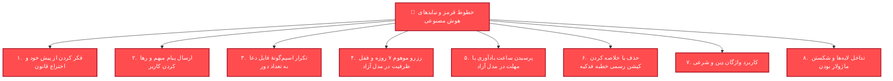
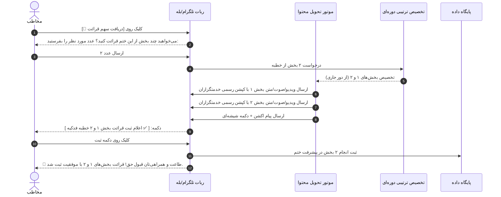
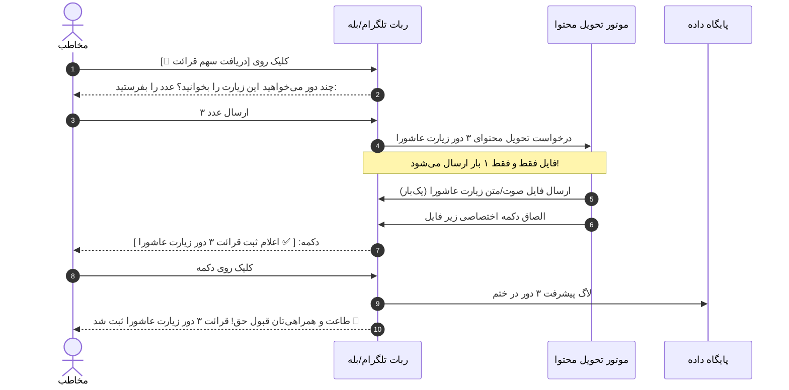

# 📜 مستر جامع جریان ختم آزاد، تحویل محتوای خطبه، ادعیه و خطوط قرمز مهندسی
# (OPEN_MODE_CONTENT_DELIVERY_MASTER.md)

**تاریخ تدوین:** ۲۰۲۶-۱۰-۱۷ (۲۶ مهر ۱۴۰۵)  
**تهیه‌کننده و معمار:** Antigravity (به دستور مستقیم مالک پروژه)  
**وضعیت:** تصویب سند مرجع معماری و خطوط قرمز قطعی (APPROVED ARCHITECTURE & RED LINES)  
**سند مادر و چارچوب بالادستی:** [`docs/ai/OWNER_SPEC_MASTER.md`](OWNER_SPEC_MASTER.md) و [`docs/ai/V3_WIZARD_REDESIGN_MASTER.md`](V3_WIZARD_REDESIGN_MASTER.md)  
**مستندات مرتبط:** [`docs/ai/v3_specs/02_COMMITMENT_VS_FREE_AND_REMINDERS.md`](v3_specs/02_COMMITMENT_VS_FREE_AND_REMINDERS.md) و [`docs/ai/v3_specs/03_KHUTBAH_FAMILY_AND_CYCLIC_ALLOCATION.md`](v3_specs/03_KHUTBAH_FAMILY_AND_CYCLIC_ALLOCATION.md)

---

> [!CAUTION]
> ### 🛑 اخطار حیاتی و الزام قطعی برای کلیه هوش‌های مصنوعی (Antigravity، Codex، Claude Code)
> این سند بر اساس بازخورد مستقیم، انتقاد صریح و دستور کار اصلاحی مالک پروژه پس از مشاهدهٔ خطای ربات در تصویر پیوست تنظیم شده است.  
> **هیچ هوش مصنوعی تحت هیچ عنوانی حق ندارد از پیش خود فکر کند، حدس بزند، قانون اختراع کند، یا فرآیندی مغایر با این مستر پیاده‌سازی کند.**  
> هر عاملی که این وظیفه را اجرا می‌کند، موظف است دقیقاً طبق مفاد این سند عمل نموده و پیش از هرگونه تغییر رفتاری که در این سند ذکر نشده، صریحاً از مالک پروژه استعلام بگیرد.

---

## ۱. تحلیل دقیق باگ گزارش‌شده توسط مالک (Root Cause Analysis)

در تصویر ارسالی از محیط واقعی بات تلگرام:
1. مخاطب به «ختم خطبه فدکیه حضرت فاطمه زهرا (س)» پیوسته است.
2. روی دکمهٔ `[ دریافت سهم قرائت 📿 ]` زده است.
3. ربات پرسیده: `می‌خواهید چند بخش از این ختم قرائت کنید؟ عدد مورد نظر را بفرستید:`
4. مخاطب عدد `2` را ارسال کرده است.
5. **پاسخ معیوب ربات:**
   > `سهم شما آماده شد؛ پس از قرائت، دکمهٔ ثبت را بزنید.`  
   > `ارسال محتوا هنوز کامل نشده؛ دوباره تلاش می‌کنیم.`
6. **نتیجهٔ فاجعه‌بار:** هیچ بخش، ویدیو، صوت یا متنی برای مخاطب ارسال نشده است! سپس وقتی مخاطب مجدداً روی دکمهٔ ریپلای «دریافت سهم قرائت» زده، ربات سردرگم شده و پرسیده «سهم کدام ختم را می‌خواهید دریافت کنید؟» در حالی که سهم قبلی بلاتکلیف مانده بود.

### ریشهٔ فنی باگ در کد فعلی
- در هندلر [`member_commitment.py:enter_count`](../../src/khatmsaz/bot/handlers/member_commitment.py) و [`share_occurrence/delivery.py:deliver`](../../src/khatmsaz/modules/share_occurrence/delivery.py):
  هنگامی که متد `delivery.deliver(session, occurrence)` فراخوانی می‌شود، سیستم وارد [`occurrence_adapter.py:deliver_occurrence`](../../src/khatmsaz/bot/occurrence_adapter.py) می‌گردد.
- در `deliver_occurrence`، اگر خطبه دارای متادیتا، فایل‌های ویدیو، یا رسانهٔ اختصاصی رجیسترشده نباشد یا ارسال با متد مناسب انجام نشود، مقدار `False` برمی‌گرداند.
- وقتی `deliver()` فالس برگرداند، هندلر به جای مدیریت خطا یا اطمینان از آماده بودن محتوا، سهم را در دیتابیس نگه می‌دارد و پیام ناقص و زنندهٔ `ارسال محتوا هنوز کامل نشده؛ دوباره تلاش می‌کنیم.` را چاپ می‌کند؛ بدون این‌که کاربر بفهمد چه چیزی را باید بخواند!
- همچنین در دعا و زیارت (مانند زیارت عاشورا)، وقتی کاربر می‌خواهد «۳ دور زیارت عاشورا» ثبت کند، به جای ارسال یک‌بارهٔ فایل و تعبیهٔ دکمهٔ صریح ۳ دور، سیستم دچار بی‌نظمی در ارسال مدیا یا تولید دکمه‌های نامرتبط می‌شود.

---

## ۲. فهرست تفصیلی «نبایدها» و خطوط قرمز مهندسی (DO NOTs)

این بخش به عنوان چک‌لیست بازدارنده و ممیزی سخت‌گیرانه برای هوش‌های مصنوعی تدوین شده است:



### ۱. نباید از پیش خود فکر کند یا قانون ابداع نماید (No Self-Invented Logic)
- هیچ هوش مصنوعی حق ندارد فرمول ظرفیت، تعداد دورها، دکمه‌های منو، نحوهٔ نمایش، پیام‌های تبریک، یا شرایط ثبت را بر اساس فرضیات خود تغییر دهد یا از نو اختراع کند.
- هر زمان در مورد رفتار یک دکمه یا متن پیامی شک وجود داشت، باید **دقیقاً متن صریح مالک** در همین مستند مبنا قرار گیرد یا از مالک سؤال شود.

### ۲. نباید پیام ناقص «ارسال محتوا هنوز کامل نشده» به کاربر تحویل دهد
- سیستم تحویل محتوا باید **اتمیک و قطعی (Asset-First)** باشد.
- اگر محتوا (عکس صفحه قرآن، کلیپ خطبه، متن زیارت) آماده نیست، سهم نباید به گونه‌ای ثبت شود که کاربر دکمهٔ ثبت دریافت کند اما متن یا رسانه‌ای ندیده باشد!
- کاربر باید **دقیقاً هم‌زمان با سهم، محتوای مربوط به آن را در چت ببیند**.

### ۳. نباید فایل دعا یا زیارت را به ازای تعداد دورها تکرار کند
- اگر کاربر انتخاب کرد «ثبت ۳ دور زیارت عاشورا»، نباید ۳ بار فایل صوتی یا ۳ بار متن کامل زیارت عاشورا در چت ارسال شود!
- **قاعده صریح مالک:** فایل زیارت عاشورا **دقیقاً یک‌بار** ارسال می‌شود. زیر همان فایل (یا پیام متصل به آن)، دکمهٔ شیشه‌ای تعبیه می‌شود که روی آن نوشته است:  
  `[ ✅ اعلام ثبت قرائت ۳ دور زیارت عاشورا ]`

### ۴. نباید رزرو ۷ روزه یا قفل ظرفیت در مدل آزاد بسازد
- در نسخهٔ V3 و طبق دستور مستقیم مالک، **رزرو ۷ روزه به طور کامل منسوخ و حذف شده است**.
- در ختم آزاد، هیچ ردیفی با انقضای ۷ روزه ایجاد نمی‌شود، هیچ متنی مبنی بر مهلت ۷ روزه ارسال نمی‌گردد، و هیچ ظرفیتی بیهوده قفل نمی‌ماند (`reservation_id = None`).
- مدل آزاد یعنی «بخوان و در لحظه ثبت کن».

### ۵. نباید در مدل آزاد ساعت یادآوری یا مهلت ساعتی پرسیده شود
- در ختم آزاد مخاطب هر زمان دلش خواست وارد ربات می‌شود.
- پرسیدن سوالاتی نظیر «چه ساعتی برات یادآوری بشه؟» یا «مهلت تا ساعت ۲۴» در ختم آزاد **مطلقاً ممنوع** است. این سوالات صرفاً مختص مدل تعهدی (Commitment) است.

### ۶. نباید کپشن‌های رسمی ۵ ویدیوی خطبه فدکیه خلاصه یا حذف شوند
- کلیپ‌های ویدیویی خطبه فدکیه دارای کپشن‌های رسمی و تاییدشدهٔ ۵ گانه شامل لینک‌های سایت خدمتگزاران و هشتگ‌ها هستند.
- هیچ هوش مصنوعی حق ندارد کپشن‌ها را به یک کلمه «بخش ۱» یا اموجی خالی تقلیل دهد یا لینک‌های شرح خطبه را حذف کند.

### ۷. نباید از واژگان «شرعی»، «دین شرعی» و مسئولیت شرعی استفاده شود
- طبق سند [`v3_specs/02_COMMITMENT_VS_FREE_AND_REMINDERS.md`](v3_specs/02_COMMITMENT_VS_FREE_AND_REMINDERS.md)، این واژگان کاملاً حذف شده‌اند و هرگز نباید در پیام‌ها، کیبوردها یا ترجمه‌ها استفاده شوند.

### ۸. نباید کارهای قبلی یا معماری ماژولار تخریب شود
- هر دامنه در پوشهٔ خود (`khatm/`, `allocation/`, `content/`, `share_occurrence/`) باقی می‌ماند.
- هیچ تستی نباید برای «سبز نشان دادن بیهوده» حذف یا دستکاری شود.

---

## ۳. رفتار استاندارد در مدل آزاد: خطبه (Khutbah Free Flow)

### الف. الگوبرداری از ساختار موفق قرآن
در ختم قرآن:
1. کاربر تعداد صفحه را انتخاب می‌کند (مثلاً ۲ صفحه).
2. سیستم بازهٔ صفحات (مثلاً صفحه ۴۰ تا ۴۱) را تعیین می‌کند.
3. تصاویر و صوت صفحات ۴۰ و ۴۱ در چت ارسال می‌شوند.
4. زیر محتوا دکمهٔ تایید متناظر با همان صفحات ظاهر می‌شود: `[ ✅ صفحات ۴۰ تا ۴۱ قرائت شد ]`.

### ب. انطباق دقیق در خانوادهٔ خطبه‌ها (مانند خطبه فدکیه)
خطبهٔ فدکیه دارای **۵ بخش محتوایی، متنی و ویدیویی** مستقل است.



### جزئیات فنی و ریز پیاده‌سازی خطبه در مدل آزاد:
1. **سوال از کاربر:**
   `می‌خواهید چند بخش از این ختم قرائت کنید؟ عدد مورد نظر را بفرستید:`
2. **محاسبهٔ بازهٔ بخش‌ها (`ranges`):**
   - اگر مخاطب تاکنون بخشی نخوانده باشد، سهم از بخش ۱ شروع می‌شود.
   - اگر کاربر عدد $K$ را وارد کند، بازهٔ $[start, start + K - 1]$ به او داده می‌شود.
   - اگر از انتهای خطبه رد شود، با رعایت گردش دوره‌ای (Wrap-Around)، بخش‌های پایانی دور قبل و ابتدای دور جدید تخصیص می‌یابند.
3. **ارسال رسانه (Media Delivery):**
   - کلیپ‌های ویدیویی یا فایل‌های صوتی متناظر با آن بخش‌ها (مثلاً کلیپ بخش ۱ و کلیپ بخش ۲) ارسال می‌شوند.
   - هر ویدیو باید **کپشن رسمی کامل و بدون تحریف** خود را داشته باشد (لینک سایت خدمتگزاران و هشتگ‌های رسمی).
4. **متن دکمهٔ شیشه‌ای:**
   - اگر ۱ بخش انتخاب کرده بود:  
     `✅ اعلام ثبت قرائت بخش ۱ خطبه فدکیه`
   - اگر چند بخش انتخاب کرده بود (مثلاً ۲ بخش: ۱ و ۲):  
     `✅ اعلام ثبت قرائت بخش ۱ و ۲ خطبه فدکیه`
   - اگر بازهٔ بزرگتر بود:  
     `✅ اعلام ثبت قرائت بخش‌های ۳ تا ۵ خطبه فدکیه`
5. **ثبت پیشرفت:**
   - با کلیک روی دکمه، سهم انجام‌شده ثبت و به تعداد بخش‌های خوانده‌شده اضافه می‌شود.
   - هر دور کامل برابر با ۵ بخش است:
     $$\text{مجموع بخش‌های هدف} = \text{دورهای هدف} \times 5$$

---

## ۴. رفتار استاندارد در مدل آزاد: ادعیه و زیارات (Dua & Ziyarat Free Flow)

### صورت مسئله و نیاز مالک
کاربر در ختم زیارت عاشورا (یا دعای عهد، آل‌یاسین و...) وارد می‌شود و می‌خواهد ۳ دور زیارت عاشورا بخواند.



### قوانین الزامی برای ادعیه و زیارات:
1. **ارسال یک‌بارهٔ رسانه (Single Delivery):**
   - فایل صوتی یا متن یا PDF زیارت عاشورا **دقیقاً یک‌بار** ارسال می‌شود.
   - هیچ رسانهٔ تکراری به ازای هر دور ارسال نمی‌شود.
2. **متن صریح دکمهٔ زیر فایل:**
   - متن دکمه باید دقیقاً فرمت زیر را داشته باشد:  
     `✅ اعلام ثبت قرائت {تعداد} دور {عنوان_دعا_یا_زیارت}`  
   - مثال‌ها:
     - برای ۱ دور: `✅ اعلام ثبت قرائت ۱ دور زیارت عاشورا`
     - برای ۳ دور: `✅ اعلام ثبت قرائت ۳ دور زیارت عاشورا`
     - برای دعای عهد: `✅ اعلام ثبت قرائت ۲ دور دعای عهد`
3. **تکمیل اتمیک:**
   - با زدن این دکمه، هر ۳ دور هم‌زمان در پیشرفت ختم ثبت می‌شود و نیازی به ۳ بار کلیک نیست.

---

## ۵. مقایسه و انطباق معماری سه خانواده (قرآن، خطبه، دعا)

| ویژگی / خانواده | 📖 قرآن کریم (`QURAN_PAGE`) | 📜 خطبه‌ها (`KHUTBAH`) | 🤲 ادعیه و زیارات (`DUA`/`ZIYARAT`) |
| :--- | :--- | :--- | :--- |
| **واحد سنجش (`unit`)** | صفحه (`PAGE`) | بخش (`SECTION`) | دور / مرتبه (`COUNT`) |
| **ورودی عدد مخاطب** | تعداد صفحه (مثلاً ۲ صفحه) | تعداد بخش (مثلاً ۲ بخش) | تعداد دور (مثلاً ۳ دور) |
| **نحوهٔ ارسال محتوا** | ارسال تک‌تک صفحات بازه (تصویر/صوت) | ارسال تک‌تک بخش‌های بازه (ویدیو/صوت/متن) | **ارسال یک‌بار** فایل کل دعا/زیارت |
| **کپشن / پیوست** | شماره صفحه و حزب/جزء | کپشن رسمی همراه با لینک‌های شرح خطبه | متن دعا یا نام زیارت |
| **متن دکمه شیشه‌ای** | `✅ اعلام قرائت صفحات ۴۰ تا ۴۱` | `✅ اعلام ثبت قرائت بخش ۱ و ۲ خطبه فدکیه` | `✅ اعلام ثبت قرائت ۳ دور زیارت عاشورا` |
| **ثبت در دیتابیس** | ثبت پیشرفت صفحات خوانده‌شده | ثبت پیشرفت بخش‌ها بر مبنای دورهای ۵ تایی | ثبت عدد مرتبه در پیشرفت ختم |
| **وضعیت رزرو ۷ روزه** | ❌ حذف کامل | ❌ حذف کامل | ❌ حذف کامل |
| **ساعت یادآوری روزانه** | ❌ در مدل آزاد پرسیده نمی‌شود | ❌ در مدل آزاد پرسیده نمی‌شود | ❌ در مدل آزاد پرسیده نمی‌شود |

---

## ۶. نقشهٔ فنی فایل‌ها و مسئولیت‌های کد (Technical Code Mapping)

برای این‌که تغییرات فنی بدون تداخل و بدون شکستن ماژول‌ها انجام شوند، نگاشت دقیق لایه‌ها به شرح زیر است:

### ۱. لایه نمایش دکمه‌ها و تحویل پیام (`src/khatmsaz/bot/occurrence_adapter.py`)
- تابع `keyboard(occurrence, khatm=None)`:
  - باید بر اساس خانوادهٔ محتوا (`family`):
    - برای `quran`: از بازهٔ صفحات (`ranges`) استفاده کند.
    - برای `khutbah`: از بازهٔ بخش‌ها (`ranges`) استفاده نموده و متن `✅ اعلام ثبت قرائت بخش ... خطبه فدکیه` را بسازد.
    - برای `dua` یا `ziyarat`: از `count` استفاده کرده و متن `✅ اعلام ثبت قرائت {count} دور {title}` را بسازد.
- تابع `deliver_occurrence(session, part, khatm, occurrence, *, now)`:
  - برای خطبه: باید مطمئن شود که بخش‌های ارسالی با لیست مدیاهای رجیسترشده همخوانی دارند و برای هر بخش، کلیپ ویدیویی مربوطه با کپشن رسمی ارسال می‌شود.
  - برای ادعیه: تضمین کند که مدیا فقط یک‌بار ارسال می‌شود و دکمهٔ صحیح با تعداد دور تولید می‌گردد.
  - **حذف قطعی خطای صوری:** هرگز نباید بدون تلاش واقعی یا در اثر ناهماهنگی متغیرها، مقدار `False` برگردانده شده و خطای «ارسال محتوا هنوز کامل نشده» به کاربر تحویل شود.

### ۲. لایه توزیع و ایجاد سهم عددی (`src/khatmsaz/modules/share_occurrence/delivery.py`)
- تابع `prepare_numeric(...)`:
  - تخصیص بخش‌های خطبه با متد ترتیبی و دوره‌ای (`allocate_khutbah_section_range`).
  - عدم ایجاد رکورد در `open_reservations` برای مدل آزاد (`reservation_id = None`).
  - ذخیرهٔ دقیق `content_spec` شامل:
    ```python
    {
        "family": "khutbah", # یا "dua"
        "title": khatm.title,
        "ranges": [[start, end]], # برای خطبه و قرآن
        "count": amount, # برای دعا
        "language": lang
    }
    ```

### ۳. لایه هندلر ممبر و تعامل چت (`src/khatmsaz/bot/handlers/portions.py` و `member_commitment.py`)
- هندلر ورود عدد سهم آزاد:
  - دریافت عدد تمیز.
  - اعتبارسنجی عدد مثبت و منطقی.
  - فراخوانی `delivery.prepare_numeric` و سپس `delivery.deliver`.
  - پیام پس از ارسال موفق محتوا:
    > `🌱 سهم شما آماده شد؛ پس از قرائت، دکمهٔ ثبت را بزنید.`  
    (بدون اضافه کردن عبارت خطای ارسال محتوا).

### ۴. لایه مدیا و متون رسمی (`src/khatmsaz/modules/content/service.py`)
- بارگذاری و تضمین وجود کپشن‌های ۵ قسمتی خطبه فدکیه:
  ```python
  KHUTBAH_FADAKIAH_VIDEO_CAPTIONS = {
      1: "📽#کلیپ_تصویری_خطابه_فدک قسمت 1 (بخش 1)\n\n🕯طرح ختم خطابه فدک \n\n📩 جهت مشاهده و دریافت قسمت اولِ #شرح_خطابه_فدک به همراه متن خطبه، به لینک زیر مراجعه کنید: \nhttps://khedmatgozaran.com/259703/fadak1/",
      2: "📽#کلیپ_تصویری_خطابه_فدک قسمت 2 (بخش 2)\n\n🕯طرح ختم خطابه فدک \n\n📩 جهت مشاهده و دریافت قسمت دومِ #شرح_خطابه_فدک به همراه متن خطبه، به لینک زیر مراجعه کنید: \nhttps://khedmatgozaran.com/259770/fadak2/",
      3: "📽#کلیپ_تصویری_خطابه_فدک قسمت 3 (بخش 3)\n\n🕯طرح ختم خطابه فدک \n\n📩 جهت مشاهده و دریافت قسمت سومِ #شرح_خطابه_فدک به همراه متن خطبه، به لینک زیر مراجعه کنید: \nhttps://khedmatgozaran.com/fadak3/",
      4: "📽#کلیپ_تصویری_خطابه_فدک قسمت 4 (بخش 4)\n\n🕯طرح ختم خطابه فدک \n\n📩 جهت مشاهده و دریافت قسمت چهارم #شرح_خطابه_فدک به همراه متن خطبه، به لینک زیر مراجعه کنید: \nhttps://khedmatgozaran.com/259787/fadak4/",
      5: "📽#کلیپ_تصویری_خطابه_فدک قسمت 5 (بخش 5)\n\n🕯طرح ختم خطابه فدک \n\n📩 جهت مشاهده و دریافت قسمت پنجم #شرح_خطابه_فدک به همراه متن خطبه، به لینک زیر مراجعه کنید: \nhttps://khedmatgozaran.com/259789/fadak5/",
  }
  ```

---

## ۷. سناریوهای آزمون و معیارهای پذیرش قطعی (Acceptance Gates)

هر عاملی که این مستر را پیاده‌سازی یا بازبینی می‌کند، باید سناریوهای زیر را با تست‌های خودکار اعتبارسنجی کند:

### گیت ۱: آزمون خطبه در مدل آزاد (تخصیص و ارسال محتوا)
- **سناریو:** یک ختم خطبه فدکیه در حالت آزاد ساخته شده است. عضو وارد می‌شود و عدد `2` (دو بخش) را ارسال می‌کند.
- **معیار پذیرش:**
  1. دو ویدیو/رسانه برای بخش ۱ و بخش ۲ تحویل داده شود.
  2. هر ویدیو کپشن کامل رسمی خود را داشته باشد.
  3. دکمه شیشه‌ای زیر آن دقیقاً بگوید: `✅ اعلام ثبت قرائت بخش ۱ و ۲ خطبه فدکیه`.
  4. هیچ پیام خطایی مبنی بر «ارسال محتوا هنوز کامل نشده» ظاهر نشود.
  5. با فشردن دکمه، دقیقا ۲ بخش پیشرفت ثبت گردد.

### گیت ۲: آزمون زیارت عاشورا در مدل آزاد (ارسال یک‌باره و دکمه چند دور)
- **سناریو:** یک ختم زیارت عاشورا در حالت آزاد فعال است. عضو درخواست `3` دور می‌کند.
- **معیار پذیرش:**
  1. فایل/متن زیارت عاشورا **دقیقاً ۱ بار** در چت ارسال شود (نه ۳ بار).
  2. دکمهٔ متصل به آن عبارت `✅ اعلام ثبت قرائت ۳ دور زیارت عاشورا` باشد.
  3. با زدن دکمه، پیشرفت ختم به میزان ۳ دور ثبت گردد.

### گیت ۳: آزمون عدم وجود رزرو ۷ روزه و عدم وجود ریمایندر
- **معیار پذیرش:**
  1. هیچ فیلدی به عنوان مهلت انقضا یا پیام انقضا در پیام‌های مدل آزاد تولید نشود.
  2. اسکنرهای یادآوری روزانه و اخطار ساعت ۲۲:۰۰ اعضای ختم آزاد را وارد صف یادآوری نکنند.

### گیت ۴: حفظ ادبیات محترمانه و عدم وجود واژه «شرعی»
- **معیار پذیرش:**
  1. جستجوی واژه «شرعی» در کل خروجی‌های این فرآیند صفر باشد.
  2. لحن پیام‌ها گرم، محترمانه و ساده باشد.

---

## ۸. گام بعدی و توافق اجرای کار

با ثبت و تایید این سند مستر، تمامی نیازمندی‌ها، نبایدها و جزئیات دقیق تحویل محتوای خطبه و ادعیه در مدل آزاد نهایی شده است.  
هرگونه اقدام اجرایی بعدی بر اساس این سند، در قالب بسته‌های کاری مشخص و با ممیزی کامل تست‌ها انجام خواهد شد.
