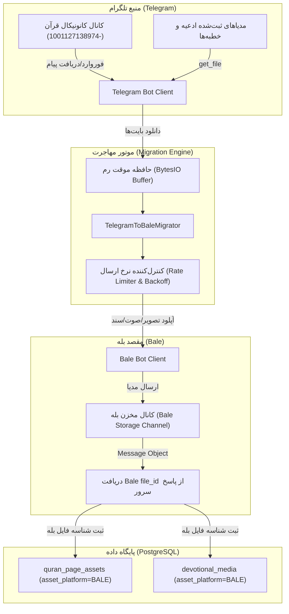

# TELEGRAM_TO_BALE_MIGRATION_MASTER — سند جامع مهاجرت خودکار محتوا از تلگرام به بله

**تاریخ:** ۲۰۲۶-۱۰-۱۳ (۲۲ مهر ۱۴۰۵) · **عامل:** Antigravity  
**وضعیت:** تصویب و تدوین شده؛ در حال اجرای بسته‌های کاری WP-M01 تا WP-M07

---

## ۱. هشدار بنیادین و پروتکل مشترک هوش مصنوعی

> [!CAUTION]
> **قانون قطعی و بدون استثنا برای کلیه هوش‌های مصنوعی (Antigravity، Codex، Claude Code):**  
> هیچ هوش مصنوعی حق تصمیم‌گیری اختیاری، تخیل یا ابداع قوانین محصول را ندارد.  
> این سند نقشهٔ راه جامع و قرارداد فنی پیاده‌سازی زیرساخت انتقال و همگام‌سازی خودکار محتوا (قرآن، خطبه، ادعیه و زیارات) از تلگرام به پیام‌رسان بله است.
> تمامی مراحل باید بر اساس اصول ایمنی حافظه، عدم قطعی در سرویس زنده (Zero Downtime)، خاصیت پادمصلحت (Idempotency) و مدیریت نرخ ارسال (Rate Limiting) اجرا شوند.

---

## ۲. ریشه‌یابی مسئله و تحلیل دامنه (Domain & Problem Analysis)

### ۲.۱. تفاوت بنیادین تلگرام و بله در مدیریت مدیا
1. **سرورها و شناسه‌ها:** تلگرام و بله پلتفرم‌های کاملاً مجزا هستند. شناسه فایل (`file_id`) در تلگرام صرفاً در سرورهای تلگرام معتبر است و بله هیچ شناختی از آن ندارد.
2. **عدم پشتیبانی از فوروارد فرامرزی:** قرآن در تلگرام با استفاده از فوروارد مستقیم از کانال کانونیکال `-1001127138974` ارسال می‌شود (`telegram-forward:-1001127138974:<msg_id>`). بله نمی‌تواند پیامی را از یک کانال تلگرام فوروارد کند.
3. **مزیت حیاتی `file_id` در بله:** اگر ربات بخواهد برای هر کاربر فایل را مجدداً آپلود کند، پهنای باند و منابع پردازشی سرور اشباع شده و سرعت تحویل به کاربر بسیار کند خواهد شد. اما اگر فایل **یک‌بار** در سرور بله آپلود شود و `file_id` اختصاصی بله دریافت و در دیتابیس ذخیره گردد، تحویل‌های بعدی برای کلیه کاربران بله در کسری از ثانیه (زیر چند میلی‌ثانیه) و با ترافیک صفر سرور انجام خواهد شد.

### ۲.۲. موجودیت‌های دیتابیس و وضعیت فعلی
* **`quran_page_assets`:**
  - کلید هویتی: `(edition_id, page_number, kind, reciter_id, asset_platform)`.
  - ستون `asset_platform`: مقادیر `TELEGRAM` یا `BALE`.
  - ستون `asset_ref`: در تلگرام شناسه فوروارد یا file_id است؛ در بله شناسه فایل `file_id` بله ذخیره خواهد شد.
  - **وضعیت کنونی:** ۶۰۴ صفحه تصویر و ۶۰۴ صفحه صوت پرهیزگار فقط برای `TELEGRAM` در دیتابیس ثبت شده‌اند و برای `BALE` خالی هستند.
* **`devotional_media` و `devotional_assets`:**
  - کلید هویتی: `(devotional_asset_id, kind, reciter_id, page_number, asset_platform)`.
  - مدیاها (عکس، صوت، PDF، متن) ادعیه و زیارات و خطبه‌ها.
  - **وضعیت کنونی:** فایل‌های ثبت‌شده عمدتاً دارای `asset_platform="TELEGRAM"` هستند.

---

## ۳. معماری سیستم مهاجرت خودکار (Architecture Overview)

---

## ۴. اصول ایمنی و الزامات فنی (Non-Negotiable Rules)

1. **پادمصلحت بودن (Idempotency):**
   اسکریپت قبل از هر اقدامی بررسی می‌کند آیا برای صفحه یا مدیای موردنظر، رکوردی با `asset_platform="BALE"` وجود دارد یا خیر. رکوردهای موجود هرگز دوباره دانلود و آپلود نمی‌شوند.
2. **مدیریت رم و عدم وابستگی به دیسک فیزیکی:**
   فایل‌ها به صورت موقت در حافظه رم (`io.BytesIO`) خوانده شده و مستقیماً به بله استریم می‌شوند و پس از اتمام بسته می‌شوند. هیچ فایل موقتی روی دیسک جا نمی‌ماند.
3. **کنترل نرخ ارسال بله (Throttling & Rate Limiting):**
   برای جلوگیری از خطای `429 Too Many Requests` از طرف API بله، بین هر درخواست موفق حداقل ۰.۵ الی ۱.۰ ثانیه تاخیر هوشمند اعمال می‌شود.
4. **قابلیت بازگشت و ادامه (Resume Capability):**
   در صورت قطعی اینترنت یا توقف فرایند، اجرای مجدد اسکریپت دقیقاً از اولین رکورد منتقل‌نشده ادامه پیدا می‌کند.
5. **حالت شبیه‌سازی (Dry-Run Mode):**
   امکان اجرای تست و ممیزی بدون ارسال فایل به بله (`--dry-run`).
6. **پوشش تست ۱۰۰٪ بدون نیاز به اینترنت زنده:**
   موتور مهاجرت به صورت Dependency Injection طراحی می‌شود تا کلیه متدها با Mock Bot بدون نیاز به شبکه در pytest تست شوند.

---

## ۵. جدول بسته‌های کاری (Work Packages Ledger)

| کد بسته | عنوان کار | وضعیت | فایل‌های درگیر | نوع اعتبارسنجی |
|---|---|---|---|---|
| **WP-M01** | تنظیمات و متغیرهای پیکربندی مقصد بله | ✅ انجام شد | `src/khatmsaz/config.py` | تست لود تنظیمات و مقادیر پیش‌فرض |
| **WP-M02** | موتور هسته دانلود و آپلود بین‌پلتفرمی | ✅ انجام شد | `src/khatmsaz/modules/content/migrator.py` | تست یونیت استریم و استخراج `file_id` |
| **WP-M03** | پایپ‌لاین مهاجرت کانونیکال قرآن (۶۰۴ صفحه عکس و صوت) | ✅ انجام شد | `src/khatmsaz/modules/content/migrator.py` | تست صحت نگاشت صفحات و صوت‌های چندصفحه‌ای |
| **WP-M04** | پایپ‌لاین مهاجرت ادعیه، زیارات و خطبه‌ها | ✅ انجام شد | `src/khatmsaz/modules/content/migrator.py` | تست مهاجرت انواع `IMAGE`, `AUDIO`, `PDF` |
| **WP-M05** | اسکریپت خط فرمان CLI با گزارش زنده پیشرفت | ✅ انجام شد | `scripts/migrate_telegram_to_bale.py` | اجرای تست CLI با آرگومان‌های `--dry-run` و `--target` |
| **WP-M06** | هندلر دستوری ادمین در بات برای بررسی وضعیت و تحریک | ✅ انجام شد | `src/khatmsaz/bot/handlers/admin.py` | تست فیلتر سطح دسترسی ادمین و پاسخ |
| **WP-M07** | سوئیت تست‌های جامع خودکار (Pytest) | ✅ انجام شد | `tests/test_telegram_to_bale_migration.py` | اجرای کامل تست‌ها بدون خطا و بدون ریگرشن |

---

## ۶. جزئیات اجرایی بسته‌ها

### بسته WP-M01: پیکربندی مقصد بله
* افزودن `bale_storage_channel_id: int | None = None` به `src/khatmsaz/config.py`.
* کانال یا گروهی در بله که مدیاها در آن نگهداری می‌شوند تا ماندگار باشند.

### بسته WP-M02: موتور هسته `TelegramToBaleMigrator`
* کلاس `TelegramToBaleMigrator(tg_bot: Bot, bale_bot: Bot, storage_chat_id: int)`:
  - `download_telegram_media(file_id: str) -> bytes`
  - `download_telegram_forward_media(chat_id: int, message_id: int, scratch_chat_id: int) -> tuple[bytes, str]`
  - `upload_to_bale(file_bytes: bytes, kind: str, filename: str, caption: str | None) -> str` (برگرداندن `bale_file_id`)

### بسته WP-M03: مهاجرت کامل قرآن
* متد `migrate_quran(session, scratch_chat_id: int, delay_seconds: float = 0.5)`:
  - پیمایش ۶۰۴ صفحه از `IMAGE_MESSAGE_IDS`
  - پیمایش بازه‌های صوتی از `AUDIO_MESSAGE_RANGES` (استاد پرهیزگار)
  - ذخیره در `QuranPageAsset` با `asset_platform="BALE"`

### بسته WP-M04: مهاجرت ادعیه، زیارات و خطبه‌ها
* متد `migrate_devotionals(session, delay_seconds: float = 0.5)`:
  - خواندن رکوردهای فعال با `asset_platform="TELEGRAM"`
  - آپلود و ثبت رکوردهای متناظر با `asset_platform="BALE"` در `devotional_media`

### بسته WP-M05: اسکریپت اجرایی مستقل
* `scripts/migrate_telegram_to_bale.py`:
  - فلگ‌ها:
    - `--target`: `all`, `quran`, `devotional`
    - `--dry-run`: شبیه‌سازی بدون آپلود واقعی
    - `--limit`: محدود کردن تعداد جهت تست اولیه
    - `--delay`: تنظیم فاصله زمانی بین درخواست‌ها
    - `--storage-chat-id`: امکان بازنویسی کانال مقصد از خط فرمان

### بسته WP-M06: هندلرهای ادمین
* دستور `/admin_bale_migration_status`: نمایش تعداد صفحات قرآن و ادعیه موجود برای بله در مقایسه با تلگرام.
* دستور `/admin_sync_bale [quran|devotional]`: اجرای فرایند در پس‌زمینه توسط ادمین ارشد.

### بسته WP-M07: آزمون‌های جامع
* فایل `tests/test_telegram_to_bale_migration.py` شامل تست سناریوهای:
  1. مهاجرت موفق و ذخیره `file_id`
  2. خاصیت پادمصلحت (نادیده گرفتن فایل‌هایی که قبلاً بله را دارند)
  3. تاب‌آوری در برابر خطاهای شبکه‌ای و بازگشت تمیز
  4. تطابق انواع فایل (عکس، صوت، سند)
