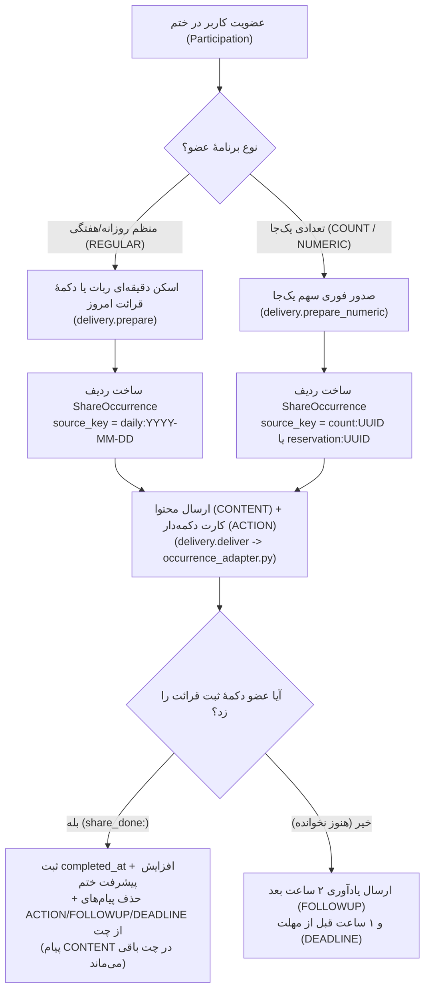

# 📘 مستر فرزند ۰۱: موتور ختم‌ها، انواع ختم، حالت تعهدی/آزاد و مکانیزم سهم‌بندی
**(Child Master 01 — Khatm Engine, Types, Modes & Share Occurrence Lifecycle)**

> **🔗 موقعیت در درختوارهٔ اسناد (والد و فرزندی):**
> - **⬆️ سند مادر (والد):** [ADMIN_PANEL_REDESIGN_MASTER.md](../ADMIN_PANEL_REDESIGN_MASTER.md) (مستر اصلی بازطراحی کامل پنل مدیریت)
> - **⬅️ اسناد هم‌خانواده (فرزندان دیگر):**
>   - **[مستر فرزند ۰۱ (همین فایل)](MASTER_01_KHATM_ENGINE_AND_MODES.md):** موتور ختم‌ها، تعهدی/آزاد و سهم‌بندی
>   - **[مستر فرزند ۰۲](MASTER_02_CONTENT_DEVOTIONALS_AND_MEDIA.md):** مدیریت محتوا، ادعیه، خطبه، قرآن و فایل‌های چندرسانه‌ای
>   - **[مستر فرزند ۰۳](MASTER_03_PLANS_BILLING_WALLET_AND_ADS.md):** پلن‌های پولی/رایگان، کیف پول، درگاه پرداخت، کد تخفیف و تبلیغات
>   - **[مستر فرزند ۰۴](MASTER_04_BOTS_USERS_MODERATION_AND_OPS.md):** معماری مولتی‌بات، کاربران، احراز شماره، صف‌های تأیید و عملیات سرور
>   - **[مستر فرزند ۰۵](MASTER_05_OPEN_KHATM_AND_KHUTBAH_FLOW.md):** جریان ختم آزاد، موتور دورهای ۵ بخشی خطبه فدکیه و سامانهٔ کپشن ویدیوها
> - **🐛 مرجع باگ‌ها و نواقص کد:** [MASTER_BUG_AND_GAP_REPORT.md](../MASTER_BUG_AND_GAP_REPORT.md)

---

## ۱. راهنمای فوق‌ساده (جعبهٔ علامت سؤال `[؟]`)

### ❓ اصلاً «ختم» در ختم‌ساز چیست و چطور کار می‌کند؟
تصور کنید یک گروه از افراد می‌خواهند با هم یک کار معنوی بزرگ (مثلاً خواندن کل ۶۰۴ صفحهٔ قرآن کریم، یا فرستادن ۱۰۰ هزار صلوات، یا خواندن ۵ بخش خطبهٔ فدکیه) را انجام دهند.
- **سازندهٔ ختم (بانی):** وارد «بات ختم‌ساز» (یا پنل وب سازنده) می‌شود، نوع ختم و هدف آن را مشخص می‌کند و یک **لینک دعوت** می‌گیرد.
- **عضو ختم (شرکت‌کننده):** روی لینک دعوت می‌زند، وارد «بات عضو» (مخصوص همان خانوادهٔ ختم) می‌شود و اعلام می‌کند که چقدر و در چه روزهایی می‌خواهد بخواند.
- **موتور زمان‌بندی (ربات):** سرِ ساعت مقرر، سهم آن روز (صفحهٔ قرآن، متن دعا، ویدیوی بخش خطبه یا تعداد صلوات) را همراه با دکمهٔ **«✅ اعلام ثبت قرائت ...»** برای عضو می‌فرستد. وقتی عضو آن را خواند و روی دکمه زد، سهم او ثبت می‌شود و پیشرفت کل ختم جلو می‌رود.

---

## ۲. کالبدشکافی دقیق انواع ختم در دیتابیس و کد

در کد فعلی ([src/khatmsaz/modules/khatm/models.py](../../src/khatmsaz/modules/khatm/models.py#L67-L75) و [src/khatmsaz/modules/khatm_category/models.py](../../src/khatmsaz/modules/khatm_category/models.py#L24-L28))، انواع ختم در دو لایه ذخیره می‌شوند:

### جدول مقایسهٔ انواع ختم و نحوهٔ ذخیره در دیتابیس

| نام محصولی نوع ختم | مقدار `Khatm.template_type` در جدول `khatms` | مقدار `Khatm.content_category_id` | مقدار `KhatmCategory.group` | واحد شمارش (`unit`) | توضیح نحوهٔ تحویل محتوا به عضو |
| :--- | :--- | :--- | :--- | :--- | :--- |
| **۱. ختم قرآن کریم (صفحه‌ای)** | `QURAN_PAGE` | `NULL` | — | صفحه (`PAGE` از ۱ تا ۶۰۴) | ارسال تصویر صفحهٔ قرآن (عثمان طه ۶۰۴ صفحه‌ای `madina-hafs`) + صوت قاری انتخابی + متن صفحه از جدول `quran_page_assets` |
| **۲. ختم صلوات** | `SALAWAT` | `NULL` | `SALAWAT` (در ویزارد) | مرتبه (`COUNT`) | ارسال تصویر صلوات (از `devotional_assets` با `slug='salawat'`) + ذکر صلوات |
| **۳. ختم دعا** (عهد، فرج، آل‌یاسین و...) | `SALAWAT` | شناسهٔ ردیف در `khatm_categories` | `DUA` | مرتبه (`COUNT`) | ارسال تصویر، صوت (تک یا چند مداح)، PDF و تکه‌های متن از جداول `khatm_categories` + `devotional_assets` + `devotional_media` |
| **۴. ختم زیارت** (عاشورا، وارث و...) | `SALAWAT` | شناسهٔ ردیف در `khatm_categories` | `DUA` *(تشخیص با کلمهٔ «زیارت» در عنوان)* | مرتبه (`COUNT`) | مشابه دعا؛ در [`member_copy.py`](../../src/khatmsaz/bot/member_copy.py#L37) اگر در عنوان دسته‌بندی کلمهٔ «زیارت» باشد، لحن پیام‌ها «زیارت» می‌شود |
| **۵. ختم لعن** (پیش‌فرض یا سفارشی) | `SALAWAT` | شناسهٔ ردیف در `khatm_categories` | `LAAN` | مرتبه (`COUNT`) | اگر سازنده گزینهٔ «سایر» را بزند، متن لعن در `Khatm.description` ذخیره شده و فلگ `pending_lan_approval = True` می‌خورد تا ادمین تأیید کند |
| **۶. ختم خطبه** (خطبهٔ فدکیه و...) | `SALAWAT` | شناسهٔ ردیف در `khatm_categories` | `KHUTBAH` | بخش (`COUNT` ولی در `content_spec.ranges` بازهٔ بخش ۱ تا ۵ دارد) | خطبه به ۵ بخش تقسیم شده است؛ در هر نوبت بازهٔ بخش‌های نوبت جاری (مثلاً بخش ۱ تا ۲، سپس ۳ تا ۴، سپس ۵) از جدول `devotional_media` (ویدیو/تصویر بخش مربوطه) + تکهٔ متناظر متن ارسال می‌شود |

> [!WARNING]
> **نکتهٔ معماری بسیار مهم برای بازطراحی پنل ادمین:**
> در دیتابیس فعلی، تمام ختم‌های صلوات، دعا، زیارت، لعن و خطبه با `template_type = 'SALAWAT'` ذخیره می‌شوند و تفاوت آن‌ها فقط از روی ستون `content_category_id` (و گروه دسته‌بندی متصل به آن در جدول `khatm_categories`) مشخص می‌گردد. در پنل ادمین جدید، نمایش نوع ختم **هرگز نباید فقط ستون `template_type` را بخواند**، بلکه باید از تابع یکپارچهٔ تشخیص خانواده استفاده کند تا ختم دعا یا خطبه به اشتباه «صلوات» نمایش داده نشود! (نگاه کنید به `BUG-02` در مستر گزارش باگ‌ها).

---

## ۳. تفاوت دقیق «ختم تعهدی» (`COMMITMENT`) و «ختم آزاد» (`OPEN`) (نسخهٔ بازطراحی‌شده V3)

### 💬 توضیح علامت سؤال `[؟]` برای پنل ادمین:
> **تفاوت ختم تعهدی و آزاد چیست؟**
> - **🔒 ختم تعهدی (`COMMITMENT`):** ایجاد یک روتین و تعهد منظم روزانه برای مخاطب است. وقتی عضوی وارد می‌شود و سهمی برمی‌دارد (یا سهم ثابت توسط سازنده تعیین شده)، سر ساعت انتخابی برایش ارسال می‌شود و تا پایان روز فرصت قرائت دارد. ربات برای او یادآوری روزانه و اخطار مهلت (ساعت ۲۲:۰۰) ارسال می‌کند تا دور ختم متوقف نماند.
> - **🌿 ختم آزاد (`OPEN`):** مشارکت داوطلبانه و دلخواه بدون ارسال منظم ساعتی و بدون هیچ‌گونه الزام و یادآوری است. اعضا هر زمان تمایل داشتند وارد ربات شده، تعداد سهم دلخواه را مشخص می‌کنند، محتوا بلافاصله تحویل داده می‌شود و پس از قرائت دکمهٔ ثبت را می‌زنند.
> 
> > [!IMPORTANT]
> > **قانون قطعی V3 (حذف کامل سیستم رزرو ۷ روزه):**
> > سیستم قدیمی رزرو ۷ روزه، قفل ظرفیت و انقضای سهم در ختم آزاد کلاً حذف شده است. هیچ ظرفیتی برای ۷ روز معطل رزرو یک نفر نمی‌ماند. همچنین ختم آزاد هیچ پیام یادآوری، هشدار انقضا، یا پیامی مبنی بر «این رزرو ۷ روز اعتبار دارد» ندارد.
> > *(جزئیات کامل جریان ختم آزاد و خطبه فدکیه در [مستر فرزند ۰۵](MASTER_05_OPEN_KHATM_AND_KHUTBAH_FLOW.md) مستند شده است).*

### جدول مقایسهٔ قوانین کسب‌وکار تعهدی و آزاد (طبق مشخصات V3)

| ویژگی | 🔒 حالت تعهدی (`COMMITMENT`) | 🌿 حالت آزاد (`OPEN`) |
| :--- | :--- | :--- |
| **مقدار ستون `Khatm.khatm_type`** | `COMMITMENT` | `OPEN` |
| **سیاست تعیین مقدار (`commitment_policy`)** | دو حالت: ۱) `MEMBER_CHOICE` (انتخاب منظم/تعدادی توسط عضو) ۲) `FIXED_DAILY` (سهم ثابت روزانه توسط سازنده) | همیشه `MEMBER_CHOICE` (دریافت سهم دلخواه همان لحظه) |
| **ارسال منظم ساعتی سر وقت** | بله؛ رأس ساعت انتخابی عضو (`schedule_hour`) در جاب‌های پس‌زمینه تحویل می‌شود | خیر؛ ارسال منظم ساعتی وجود ندارد (فقط مراجعهٔ داوطلبانه کاربر) |
| **سیستم یادآوری و ریمایندرها** | ۱) تحویل سر ساعت انتخابی ۲) یادآوری ساعت ۲۲:۰۰ (۲ ساعت مانده به مهلت ۲۴:۰۰ در صورت نخواندن) | **کاملاً غیرفعال!** هیچ ریمایندر روزانه، پیگیری یا انقضایی ارسال نمی‌شود |
| **رزرو و انقضای سهم** | سهم تا زمان انجام بر عهدهٔ عضو باقی می‌ماند (بدون انقضا) | **سیستم رزرو ۷ روزه کلاً حذف است**؛ سهم بلافاصله صادر شده و ظرفیتی قفل نمی‌شود |
| **خروج عضو از ختم (`leave`)** | اگر عضو سهم باز داشته باشد، می‌تواند درخواست خروج دهد تا نفر بعدی از **لیست انتظار (`WaitingList`)** جایگزین شود | خروج فوری و بدون نیاز به تأیید؛ هیچ رزرو یا قفل ظرفیتی معطل نمی‌ماند |
| **پیام انتخاب شیوه در ورود** | نمایش کیبورد تعهد منظم vs تعهد تعدادی («این ختم تعهدی است 🌱 دو راه برای شرکت داری...») | **عدم نمایش پیام تعهدی**؛ مستقیماً پرسش: «می‌خواهید چند {واحد} از این ختم قرائت کنید؟» |

---

## ۴. سیاست سهم روزانه: «انتخاب توسط عضو» (`MEMBER_CHOICE`) در برابر «سهم ثابت روزانه» (`FIXED_DAILY`)

در جدول `khatms` دو ستون به نام‌های `commitment_policy` و `daily_commitment_amount` وجود دارد ([src/khatmsaz/modules/khatm/commitment_policy.py](../../src/khatmsaz/modules/khatm/commitment_policy.py#L1-L25)):

1. **`MEMBER_CHOICE` (انتخاب توسط خود عضو — پیش‌فرض):**
   - ستون `daily_commitment_amount` حتماً `NULL` است.
   - وقتی عضو وارد ختم می‌شود، ربات از او می‌پرسد:
     - **حالت ۱: برنامهٔ منظم (`REGULAR`)**: هر روز یا چه روزهایی از هفته؟ هر بار چند صفحه/مرتبه/بخش؟ چه ساعتی یادآوری بفرستم؟
     - **حالت ۲: سهم یک‌جای تعدادی (`COUNT` / `NUMERIC`)**: در مجموع چند صفحه/مرتبه/بخش می‌خواهی یک‌جا برداری؟ (بلافاصله همان لحظه تحویل می‌شود).
2. **`FIXED_DAILY` (سهم ثابت روزانه تعیین‌شده توسط سازنده):**
   - فقط برای ختم‌های `COMMITMENT` مجاز است و ستون `daily_commitment_amount` یک عدد صحیح بزرگ‌تر از صفر است (مثلاً روزی ۲ صفحه یا روزی ۱۰۰ صلوات).
   - وقتی عضو وارد ختم می‌شود، **دیگر نمی‌تواند مقدار یا حالت تعدادی را انتخاب کند**؛ فقط **ساعت دریافت روزانه** را انتخاب می‌کند (`AskDeliveryHour`) و هر روز رأس همان ساعت، دقیقاً به اندازهٔ `daily_commitment_amount` برایش سهم صادر می‌شود.

---

## ۵. چرخهٔ حیات هر نوبت سهم (`ShareOccurrence` و `ShareMessage`)

تمام سهم‌های صادرشده در جدول `share_occurrences` و پیام‌های ارسال‌شده در جدول `share_messages` نگهداری می‌شوند ([src/khatmsaz/modules/share_occurrence/models.py](../../src/khatmsaz/modules/share_occurrence/models.py#L1-L95)):

### منطق پیشروی محتوا در هر خانواده هنگام صدور `ShareOccurrence`:
1. **قرآن کریم (تعهدی):** از طریق `allocation.allocate_page_amount` صفحات را به ترتیب از ۱ تا ۶۰۴ از جدول `khatm_portions` تخصیص می‌دهد و وقتی به ۶۰۴ رسید، برای دور بعدی دوباره از صفحهٔ ۱ شروع می‌کند (`(start - 1) % 604 + 1`).
2. **قرآن کریم (آزاد):** نشانگر شخصی عضو (`participation.open_reading_next_page`) را به اندازهٔ سهم جلو می‌برد.
3. **خطبه (فدکیه و...):** از طریق [`allocate_khutbah_section_range`](../../src/khatmsaz/modules/share_occurrence/delivery.py#L64-L145) تمام سهم‌های صادرشدهٔ قبلی آن عضو را به ترتیب زمانی بررسی می‌کند و بخش بعدی خطبه (از ۱ تا ۵) را اختصاص می‌دهد (مثلاً نوبت اول: بخش ۱ تا ۲، نوبت دوم: بخش ۳ تا ۴، نوبت سوم: بخش ۵، نوبت چهارم: شروع دور جدید از بخش ۱ تا ۲) — حتی اگر عضو دکمهٔ ثبت نوبت قبلی را هنوز نزده باشد.
4. **صلوات، دعا، زیارت و لعن:** مقدار عددی (`amount`) در `ShareOccurrence.amount` ذخیره می‌شود و کل متن/صوت/تصویر دعا همراه با دکمهٔ `✅ اعلام ثبت قرائت {amount} مرتبه {title}` ارسال می‌گردد.

---

## ۶. آموزش گام‌به‌گام («مثل روشن کردن کامپیوتر») برای مدیریت ختم‌ها در پنل ادمین جدید

در پنل ادمین بازطراحی‌شده، ادمین باید بتواند **هر ختمی را از صفر تا صد بسازد، ویرایش کند، ببندد، باز کند، یا سهم اعضای آن را مدیریت نماید**:

### 🔌 سناریوی ۱: ساخت یا ویرایش کامل یک ختم از پنل ادمین
1. **قدم اول (بررسی پیش‌نیاز):** وارد منوی **«📿 مدیریت ختم‌ها»** در پنل ادمین شوید. اگر می‌خواهید ختم دعا، لعن یا خطبه بسازید، مطمئن شوید آن دعا/خطبه در بخش «📚 دسته‌بندی‌ها و محتوا» فعال است.
2. **قدم دوم (انتخاب خانواده و حالت):** روی دکمهٔ **«➕ ساخت ختم جدید»** (یا دکمهٔ **«✏️ ویرایش»** کنار یک ختم موجود) کلیک کنید.
   - خانوادهٔ ختم را انتخاب کنید: `قرآن کریم` | `صلوات` | `دعا و زیارت` | `لعن` | `خطبه`.
   - حالت ختم را انتخاب کنید: `تعهدی (COMMITMENT)` یا `آزاد (OPEN)`.
3. **قدم سوم (تنظیم ظرفیت، هدف و سیاست روزانه):**
   - برای قرآن: تعداد دور ختم (مثلاً ۱ دور = ۶۰۴ صفحه) را وارد کنید.
   - برای صلوات/دعا/لعن/خطبه: هدف کل ختم (مثلاً ۱۴,۰۰۰ صلوات یا ۱۰۰ بار خطبه) را وارد کنید.
   - اگر حالت «تعهدی» است، مشخص کنید آیا **«مقدار به انتخاب عضو (`MEMBER_CHOICE`)»** باشد یا **«مقدار ثابت روزانه (`FIXED_DAILY`)»** (و عدد روزانه را بنویسید).
4. **قدم چهارم (ثبت نهایی):** روی دکمهٔ **«💾 ذخیره و فعال‌سازی»** بزنید.
   - **پشت صحنه چه می‌شود؟** ردیف ختم در جدول `khatms` ذخیره می‌شود، برنامهٔ تخصیص (`KhatmAllocationPlan`) ساخته می‌شود، لینک دعوت مخصوص بات‌های عضو تلگرام و بله تولید می‌گردد و در جدول `audit_logs` ثبت می‌شود.

### 🔌 سناریوی ۲: بررسی و مدیریت اعضا و سهم‌های یک ختم از پنل ادمین
1. **قدم اول:** در لیست **«📿 مدیریت ختم‌ها»** روی عنوان ختم کلیک کنید تا وارد صفحهٔ **«جزئیات کامل ختم»** شوید.
2. **قدم دوم:** در تب **«👥 اعضا و سهم‌ها»**، لیست تمام شرکت‌کنندگان را به همراه:
   - نام، شماره تلفن، پلتفرم (تلگرام/بله)، بات عضو (`joined_via_bot_instance_id`)
   - نوع برنامه (`منظم روزانه/هفتگی` یا `تعدادی`) و ساعت یادآوری
   - تعداد سهم‌های خوانده‌شده و **سهم‌های عقب‌افتاده (بدهی‌های باز)**
   مشاهده می‌کنید.
3. **قدم سوم (عملیات مدیریتی روی عضو):**
   - با دکمهٔ **«✅ ثبت دستی سهم»**: اگر عضوی تلفنی یا در پشتیبانی اعلام کرد سهمش را خوانده اما نتوانسته دکمه را بزند، ادمین با یک کلیک سهم بازِ او (`ShareOccurrence`) را تکمیل (`complete`) می‌کند.
   - با دکمهٔ **«🔄 ارسال مجدد سهم امروز»**: سهم امروز عضو دوباره در بات برایش ارسال می‌شود.
   - با دکمهٔ **«🚪 حذف عضو و آزادسازی سهم»**: عضو از ختم خارج شده (`leave_khatm`)، صفحات ناتمامش آزاد می‌شود و نفر اولِ لیست انتظار (`WaitingList`) به‌صورت خودکار جایگزین می‌گردد.
