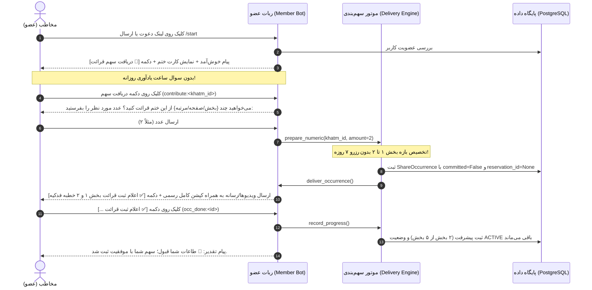

# 📜 مستر فرزند ۰۵: جریان ختم آزاد، موتور دورهای ۵ بخشی خطبه فدکیه و سامانهٔ کپشن ویدیوها
**(Child Master 05 — Open Khatm Flow, Khutbah Fadakiyyah 5-Part Round Engine & Video Caption System)**

> **🔗 موقعیت در درختوارهٔ اسناد (والد و فرزندی):**
> - **⬆️ سند مادر (والد):** [ADMIN_PANEL_REDESIGN_MASTER.md](../ADMIN_PANEL_REDESIGN_MASTER.md) (مستر اصلی بازطراحی کامل پنل مدیریت)
> - **⬅️ اسناد هم‌خانواده (فرزندان دیگر):**
>   - **[مستر فرزند ۰۱](MASTER_01_KHATM_ENGINE_AND_MODES.md):** موتور ختم‌ها، انواع ختم، تعهدی/آزاد و چرخهٔ سهم‌بندی
>   - **[مستر فرزند ۰۲](MASTER_02_CONTENT_DEVOTIONALS_AND_MEDIA.md):** مدیریت محتوا، ادعیه، خطبه‌ها، قرآن و رسانه‌ها
>   - **[مستر فرزند ۰۳](MASTER_03_PLANS_BILLING_WALLET_AND_ADS.md):** پلن‌ها، پرداخت، کیف پول و تخفیف‌ها
>   - **[مستر فرزند ۰۴](MASTER_04_BOTS_USERS_MODERATION_AND_OPS.md):** مولتی‌بات، کاربران، ۸ صف تأیید و عملیات
>   - **[مستر فرزند ۰۵ (همین فایل)](MASTER_05_OPEN_KHATM_AND_KHUTBAH_FLOW.md):** جریان ختم آزاد، خطبه فدکیه و کپشن ویدیوها
> - **🐛 مرجع باگ‌ها و نواقص کد:** [MASTER_BUG_AND_GAP_REPORT.md](../MASTER_BUG_AND_GAP_REPORT.md)
> - **📋 سند مشخصات مبنا:** [02_COMMITMENT_VS_FREE_AND_REMINDERS.md](../v3_specs/02_COMMITMENT_VS_FREE_AND_REMINDERS.md)

---

## ۱. راهنمای فوق‌ساده (جعبهٔ علامت سؤال `[؟]`)

### ❓ ختم آزاد (`OPEN`) چیست و با ختم تعهدی چه فرقی دارد؟
- **🔒 در ختم تعهدی:** مخاطب یک روتین برمی‌دارد (مثلاً هر روز ساعت ۹ صبح یا روزی ۲ صفحه). ربات سر ساعت برایش سهم را می‌فرستد و اگر نخواند، ساعت ۲۲:۰۰ به او یادآوری می‌کند تا دور ختم معطل نماند.
- **🌿 در ختم آزاد:** هیچ روتین یا ساعت ثابتی وجود ندارد! مخاطب هر وقت مایل بود و دلش خواست وارد ربات می‌شود، می‌گوید «من الان می‌خواهم ۲ بخش بخوانم»، همان لحظه سهم و ویدیوی بخش‌ها را دریافت می‌کند، می‌خواند و دکمهٔ «✅ اعلام ثبت قرائت» را می‌زند.
- **❌ اشتباه قدیمی (حذف کامل رزرو ۷ روزه):** در سیستم قدیمی، کاربر وقتی سهم می‌خواست، سیستم یک «رزرو ۷ روزه» می‌ساخت و ظرفیت ختم را ۷ روز قفل می‌کرد! در نسخهٔ V3 و طبق دستور مستقیم مالک، **رزرو ۷ روزه و انقضای سهم کلاً حذف شده است**. هیچ پیامی مبنی بر «این رزرو ۷ روز مهلت دارد» وجود ندارد و هیچ ظرفیتی بیهوده قفل نمی‌شود.
- **🔕 بدون ریمایندر:** در ختم آزاد، چون ساعتی برای تحویل روزانه تنظیم نشده، هیچ یادآوری روزانه، هشدار ساعت ۲۲:۰۰ یا پیام انقضایی فرستاده نمی‌شود.

### ❓ خطبهٔ فدکیه چطور محاسبه می‌شود و چرا هدف «دور» است؟
- خطبهٔ فدکیه حضرت زهرا (س) یک متن پیوسته است که به **۵ بخش مستقل** (همراه با ۵ کلیپ ویدیویی رسمی) تقسیم شده است.
- وقتی سازنده در ویزارد هدف کل ختم را **«۱»** می‌نویسد، منظورش **۱ دور کامل خطبه (خوانده‌شدن هر ۵ بخش)** است؛ نه این‌که با خواندن بخش اول، کل ختم تمام شده و بسته شود!
- بنابراین:
  - **هدف ۱ دور = ۵ بخش.**
  - **هدف ۲ دور = ۱۰ بخش.**
  - **هدف N دور = `N * 5` بخش.**
- ختم زمانی «تکمیل‌شده (`COMPLETED`)» می‌شود که تمام ۵ بخش دور آخر توسط اعضا خوانده و ثبت شده باشد.

---

## ۲. جریان دقیق مخاطب در ختم آزاد (Step-by-Step Open Flow)



### مقایسهٔ تفاوت‌های کلیدی ورود در تعهدی و آزاد:

| گام ویزارد ورود | 🔒 ختم تعهدی (`COMMITMENT`) | 🌿 ختم آزاد (`OPEN`) |
| :--- | :--- | :--- |
| **۱. سوال ساعت تحویل روزانه (`AskDeliveryHour`)** | دارد؛ ساعت دلخواه مخاطب برای ارسال خودکار پرسیده می‌شود | **حذف کامل!** ساعت تحویل روزانه پرسیده نمی‌شود |
| **۲. پیام انتخاب نحوهٔ تعهد (`start_commitment_mode_picker`)** | پیام: «این ختم تعهدی است 🌱 دو راه برای شرکت داری: تعهد منظم / تعهد تعدادی» | **حذف کامل!** مستقیماً سوال پرسیده می‌شود: «می‌خواهید چند بخش از این ختم قرائت کنید؟» |
| **۳. متن بعد از صدور سهم** | «سهم شما آماده شد؛ تعهد این سهم تا انجام باقی می‌ماند.» | «سهم شما آماده شد؛ پس از قرائت، دکمهٔ ثبت را بزنید.» |
| **۴. ایجاد رزرو ۷ روزه در دیتابیس** | خیر (تعهد باز دائمی) | **حذف کامل!** هیچ ردیفی در `open_reservations` ساخته نمی‌شود و `reservation_id = None` است |
| **۵. ارسال ریمایندرها** | ۱) تحویل سر ساعت ۲) هشدار ۲ ساعت مانده در ساعت ۲۲:۰۰ | **هیچ ریمایندری ارسال نمی‌شود** |

---

## ۳. موتور دورهای ۵ بخشی خطبه فدکیه (Khutbah 5-Part Engine)

### الف. فرمول محاسبهٔ هدف کل ختم
خطبهٔ فدکیه دارای ۵ بخش محتوایی و ویدیویی است:
$$\text{Total Target Sections} = \text{Rounds} \times 5$$

- هنگام ساخت ختم در ویزارد ربات سازنده (`create_khatm.py`):
  واحد پرسش «دور» است: `«هدف کل ختم: چند دور خوانده شود؟ (هر دور = ۵ بخش)»`
- در لایهٔ سرویس (`khatm_workflow/service.py`):
  هنگام ذخیره در دیتابیس، عدد واردشده در ۵ ضرب می‌شود:
  ```python
  if fam == "khutbah":
      target_val = int(target_val) * 5
  ```
- هنگام ویرایش هدف توسط سازنده در منوی ختم‌های من (`my_khatms.py`):
  عدد دور ورودی سازنده مجدداً در ۵ ضرب شده و در `Khatm.repetition_target` ذخیره می‌شود.

### ب. مکانیسم خودترمیمی برای ختم‌های موجود (Self-Healing)
برای ختم‌هایی که قبلاً با هدف عددی ۱ (به جای ۵) ثبت شده‌اند:
در دو تابع حیاتی لایهٔ تحویل سهم (`delivery.py`):
1. **در `prepare_numeric`:**
   ```python
   effective_target = khatm.repetition_target
   if fam == "khutbah" and effective_target is not None and effective_target < 5:
       effective_target *= 5
   if effective_target is not None and total >= effective_target:
       return None
   ```
2. **در `record_progress`:**
   ```python
   target = khatm.repetition_target
   if fam == "khutbah" and target is not None and target < 5:
       target = target * 5
   _, _, total = await progress.log_contribution(session, khatm.id, part.id, occurrence.amount, target)
   goal_reached = target is not None and total >= target
   if goal_reached and khatm.status == "ACTIVE":
       await khatms.complete_khatm(session, khatm.id)
   ```
این دو مکانیسم مانع از آن می‌شوند که با خواندن بخش اول، ظرفیت ختم پر اعلام شود یا ختم به اشتباه بسته شود.

### ج. الگوریتم تخصیص چند بخش (`allocate_khutbah_section_range`)
اگر مخاطب در ختم آزاد درخواست ۲ بخش کرد:
- تابع تمام سهم‌های قبلی مخاطب را بررسی می‌کند.
- اگر کاربر تاکنون بخشی نگرفته باشد، بازهٔ `[1, 2]` به او داده می‌شود.
- مقدار `amount = 2` و `ranges = [[1, 2]]` تنظیم می‌شود.
- دکمهٔ شیشه‌ای تولیدشده:
  `✅ اعلام ثبت قرائت بخش ۱ و ۲ خطبه فدکیه`
- با زدن دکمه، هر دو بخش در پیشرفت ختم ثبت می‌شود و نوبت بعدی از بخش ۳ آغاز می‌گردد.

---

## ۴. سامانهٔ کپشن رسمی ویدیوهای خطبه فدکیه (Video Caption System)

### قانون طلایی
کپشن‌های رسمی ۵ کلیپ تصویری خطبهٔ فدکیه شامل لینک‌های اختصاصی شرح خطبه در سایت «خدمتگزاران» و هشتگ‌های رسمی است.
**این کپشن‌ها هرگز نباید تحت هیچ شرایطی توسط هیچ واسط یا رباتی حذف، خلاصه یا فیلتر شوند.**

### جدول کپشن‌های رسمی ۵ بخش خطبه فدکیه:

```python
KHUTBAH_FADAKIAH_VIDEO_CAPTIONS: dict[int, str] = {
    1: (
        "📽#کلیپ_تصویری_خطابه_فدک قسمت 1 (بخش 1)\n\n"
        "🕯طرح ختم خطابه فدک \n\n"
        "📩 جهت مشاهده و دریافت قسمت اولِ #شرح_خطابه_فدک به همراه متن خطبه، به لینک زیر مراجعه کنید: \n"
        "https://khedmatgozaran.com/259703/fadak1/"
    ),
    2: (
        "📽#کلیپ_تصویری_خطابه_فدک قسمت 2 (بخش 2)\n\n"
        "🕯طرح ختم خطابه فدک \n\n"
        "📩 جهت مشاهده و دریافت قسمت دومِ #شرح_خطابه_فدک به همراه متن خطبه، به لینک زیر مراجعه کنید: \n"
        "https://khedmatgozaran.com/259770/fadak2/"
    ),
    3: (
        "📽#کلیپ_تصویری_خطابه_فدک قسمت 3 (بخش 3)\n\n"
        "🕯طرح ختم خطابه فدک \n\n"
        "📩 جهت مشاهده و دریافت قسمت سومِ #شرح_خطابه_فدک به همراه متن خطبه، به لینک زیر مراجعه کنید: \n"
        "https://khedmatgozaran.com/fadak3/"
    ),
    4: (
        "📽#کلیپ_تصویری_خطابه_فدک قسمت 4 (بخش 4)\n\n"
        "🕯طرح ختم خطابه فدک \n\n"
        "📩 جهت مشاهده و دریافت قسمت چهارم #شرح_خطابه_فدک به همراه متن خطبه، به لینک زیر مراجعه کنید: \n"
        "https://khedmatgozaran.com/259787/fadak4/"
    ),
    5: (
        "📽#کلیپ_تصویری_خطابه_فدک قسمت 5 (بخش 5)\n\n"
        "🕯طرح ختم خطابه فدک \n\n"
        "📩 جهت مشاهده و دریافت قسمت پنجم #شرح_خطابه_فدک به همراه متن خطبه، به لینک زیر مراجعه کنید: \n"
        "https://khedmatgozaran.com/259789/fadak5/"
    ),
}
```

### نحوهٔ عملکرد در لایهٔ کد:
1. در [`content/service.py:resolve_devotional_video_caption`](../../src/khatmsaz/modules/content/service.py):
   اگر اسلاگ محتوا شامل `fadak` باشد و شماره بخش ۱ تا ۵ باشد، کپشن رسمی بالا بازگردانده می‌شود.
2. در [`occurrence_adapter.py`](../../src/khatmsaz/bot/occurrence_adapter.py):
   هنگام ارسال کلیپ ویدیویی (`send_video`)، اگر کپشن خالی یا پیش‌فرض باشد، به صورت خودکار با کپشن رسمی بالا پر می‌شود.
3. در [`devotional.py:deliver_devotional_media`](../../src/khatmsaz/bot/handlers/devotional.py):
   ویدیو مستقیماً با کپشن کامل به متد ارسال تلگرام/بله فرستاده می‌شود.

---

## ۵. راهنمای گام‌به‌گام («مثل روشن کردن کامپیوتر») برای پنل ادمین جدید

### 🔌 سناریوی ۱: مشاهده و ویرایش یک ختم خطبه فدکیه در پنل ادمین
1. **قدم اول:** از منوی سایدبار پنل ادمین، وارد بخش **«📿 مدیریت ختم‌ها»** شوید.
2. **قدم دوم:** در کادر فیلتر، خانواده را روی **«خطبه»** بگذارید.
3. **قدم سوم:** روی دکمهٔ **«جزئیات و آمار»** ختم خطبه فدکیه کلیک کنید:
   - در باکس اطلاعات ختم می‌بینید:
     - `حالت ختم:` آزاد (OPEN) یا تعهدی (COMMITMENT)
     - `تعداد دور هدف:` N دور
     - `تعداد کل بخش‌های هدف:` $N \times 5$ بخش
     - `بخش‌های قرائت‌شده تا کنون:` X بخش (پیشرفت: $\frac{X}{5N} \times 100\%$)
4. **قدم چهارم (ویرایش دورها):** اگر ادمین بخواهد دورهای ختم را افزایش دهد (مثلاً از ۱ دور به ۳ دور):
   - روی دکمهٔ **«✏️ ویرایش هدف»** کلیک می‌کند.
   - عدد جدید دور (مثلاً ۳) را وارد می‌کند.
   - با زدن ذخیره، سیستم هدف را $3 \times 5 = 15$ بخش ذخیره می‌کند و پیام سبز رنگ تأیید نمایش داده می‌شود.

### 🔌 سناریوی ۲: تست ارسال ویدیوی بخش‌های خطبه با کپشن رسمی
1. **قدم اول:** وارد بخش **«📚 دسته‌بندی‌ها و محتوا -> خطبه فدکیه»** شوید.
2. **قدم دوم:** تب **«🎬 ویدیوها و رسانه»** را باز کنید.
3. **قدم سوم:** برای هر یک از ۵ بخش، پیش‌نمایش ویدیو، لینک فایل تلگرام/بله و متن کپشن متناظر نمایش داده شده است.
4. **قدم چهارم:** ادمین می‌تواند روی دکمهٔ **«📲 ارسال تستی به اکانت من»** برای بخش ۱ کلیک کند.
5. **قدم پنجم:** ربات همان لحظه ویدیوی بخش ۱ را با کپشن کامل رسمی و لینک‌های شرح خطبه به چت ادمین می‌فرستد تا صحت عملکرد تأیید شود.
