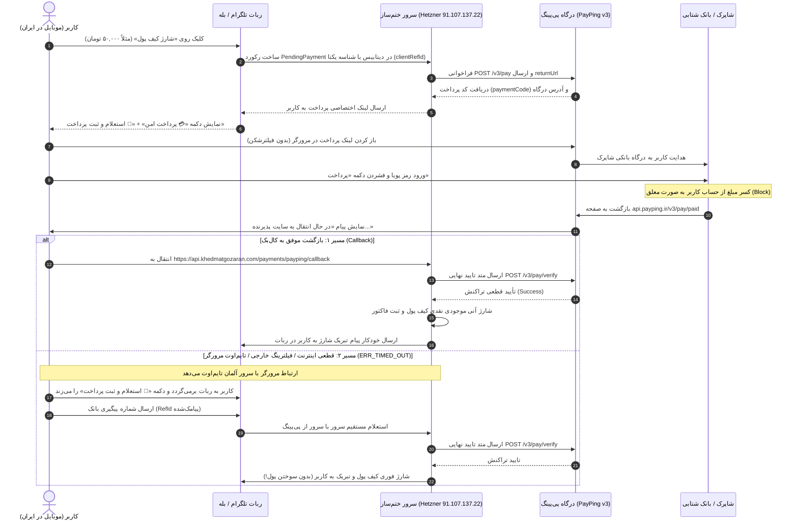

# 📙 مستر فرزند ۰۶: معماری جامع درگاه پرداخت، کال‌بک بانکی و زیرساخت شبکه پی‌پینگ
**(Child Master 06 — Payment Gateway Lifecycle, PayPing Callback, Network Routing & Server Topology)**

> **🔗 موقعیت در درختوارهٔ اسناد (والد و فرزندی):**
> - **⬆️ سند مادر (والد):** [ADMIN_PANEL_REDESIGN_MASTER.md](../ADMIN_PANEL_REDESIGN_MASTER.md) (مستر اصلی بازطراحی کامل پنل مدیریت)
> - **⬅️ اسناد هم‌خانواده (فرزندان دیگر):**
>   - **[مستر فرزند ۰۱](MASTER_01_KHATM_ENGINE_AND_MODES.md):** موتور ختم‌ها، تعهدی/آزاد و سهم‌بندی
>   - **[مستر فرزند ۰۲](MASTER_02_CONTENT_DEVOTIONALS_AND_MEDIA.md):** مدیریت محتوا، ادعیه، خطبه، قرآن و فایل‌های چندرسانه‌ای
>   - **[مستر فرزند ۰۳](MASTER_03_PLANS_BILLING_WALLET_AND_ADS.md):** پلن‌های پولی/رایگان، کیف پول، درگاه پرداخت، کد تخفیف و تبلیغات
>   - **[مستر فرزند ۰۴](MASTER_04_BOTS_USERS_MODERATION_AND_OPS.md):** معماری مولتی‌بات، کاربران، احراز شماره، صف‌های تأیید و عملیات سرور
>   - **[مستر فرزند ۰۵](MASTER_05_OPEN_KHATM_AND_KHUTBAH_FLOW.md):** فلوهای ختم باز، خطبه‌های تدریجی و رول‌اور
>   - **[مستر فرزند ۰۶ (همین فایل)](MASTER_06_PAYMENT_GATEWAY_AND_CALLBACK_ARCHITECTURE.md):** معماری پرداخت، رفع تایم‌اوت کال‌بک بانکی، ریورس‌پروکسی آپاچی و ثبات پورت‌ها
> - **🐛 مرجع باگ‌ها و نواقص کد:** [MASTER_BUG_AND_GAP_REPORT.md](../MASTER_BUG_AND_GAP_REPORT.md)

---

## ۱. راهنمای فوق‌ساده (جعبهٔ علامت سؤال `[؟]`)

### ❓ چرخهٔ حیات پرداخت در ختم‌ساز دقیقاً چگونه کار می‌کند؟
پرداخت برای شارژ کیف پول از ۶ گام پیوسته تشکیل شده است:


---

### ❓ چرا پول از حساب کم می‌شد اما کیف پول شارژ نمی‌شد؟ (تحلیل ریشه‌ای)
در شبکهٔ بانکی شاپرک، وقتی کاربر رمز پویا را می‌زند، بانک پول را از کارت کسر می‌کند اما این پول هنوز به حساب صاحب سایت واریز نشده است؛ به این وضعیت **تراکنش معلق (Pre-Auth / Pending Capture)** می‌گویند.
پذیرنده موظف است حداکثر ظرف **۱۵ الی ۲۰ دقیقه**، متد **تأیید پرداخت (`Verify`)** را از سمت سرور به درگاه (پی‌پینگ) ارسال کند.
اگر تا ۲۰ دقیقه متد Verify ارسال نشود:
- بانک تراکنش را **ناموفق (مغایرت بانکی)** تلقی کرده و مبلغ کسرشده را خودکار به حساب کارت خریدار عودت می‌دهد.
- در ختم‌ساز، چون صفحهٔ کال‌بک در مرورگر موبایل با خطای **`ERR_TIMED_OUT`** مواجه می‌شد، متد Verify هرگز به پی‌پینگ ارسال نمی‌شد؛ در نتیجه کاربر پیام کسر پول را دریافت می‌کرد اما کیف پولش شارژ نمی‌شد و دقایقی بعد پول به کارتش برمی‌گشت.

---

## ۲. کالبدشکافی وضعیت زیرساخت سرور زنده و شبکه (`91.107.137.22`)

### ۲.۱. اسناد قطعی و شواهد زنده‌ای که از سرور استخراج شد
در بررسی‌های انجام‌شده با دسترسی SSH به سرور لایو، اطلاعات زیر به دست آمد:

| مؤلفه زیرساخت | وضعیت در سرور | کاربرد / نکته حیاتی |
| :--- | :--- | :--- |
| **آی‌پی سرور ختم‌ساز** | `91.107.137.22` (هتزنر آلمان) | میزبانی سورس ختم‌ساز، وب‌سرور آپاچی، دیتابیس Postgres، ردیس و ربات‌های تلگرامی |
| **دامنه سایت اصلی خدمتگزاران** | `khedmatgozaran.com` -> `94.182.142.177` | سرور اختصاصی پارس‌آنلاین داخل ایران (شبکه ملی اطلاعات) — فروشگاه پرستاشاپ |
| **زیردامنه کال‌بک پرداخت** | `api.khedmatgozaran.com` -> `91.107.137.22` | رکورد مستقیم A به آی‌پی هتزنر آلمان |
| **سرویس‌های هم‌جوار در سرور** | `aiBOT` روی پورت `8000`<br>`khatmsaz` روی پورت `8080`<br>`apache2` روی پورت‌های `81` و `443`<br>`x-ui` / `xray` روی پورت‌های پروکسی | ⚠️ **خط قرمز مالک:** هیچ پورتی نباید تغییر کند تا سایر ربات‌ها و ابزارها قطع نشوند. |
| **وب‌سرور Nginx** | وضعیت: `Failed / Inactive` از تاریخ ۲۲ سپتامبر | به دلیل اشغال بودن پورت ۴۴۳ توسط آپاچی بالا نیامده است. |
| **وضعیت پورت ۸۰** | هیچ پروسه‌ای گوش نمی‌داد (Connection Refused) | پورت ۸۰ خاموش بود و درخواست‌های `http://` در مبدأ تایم‌اوت می‌خوردند. |

---

### ۲.۲. چرا مرورگر کروم موبایل خطای `ERR_TIMED_OUT` داد؟ (تحلیل شبکه ایران)
تصاویر ارسالی نشان می‌دهد کاربر پرداخت را در درگاه شاپرک انجام داده و پی‌پینگ صفحهٔ `api.payping.ir/v3/pay/paid` را باز کرده است. سپس هنگام انتقال به `api.khedmatgozaran.com` خطای زیر در کروم ظاهر شد:
```text
This site can't be reached
api.khedmatgozaran.com took too long to respond.
ERR_TIMED_OUT
```

#### علل فنی بروز این خطا:
1. **الزام به خاموش بودن VPN در شاپرک:** کاربر برای پرداخت در درگاه بانکی مجبور است فیلترشکن خود را خاموش کند.
2. **اختلال و بستن بسته‌های TCP روی دیتاسنترهای خارجی (Hetzner):** اپراتورهای موبایل ایران (همراه اول و ایرانسل) روی ترافیک بدون فیلترشکن به مقصد رنج آی‌پی‌های هتزنر (`91.107.xxx`)، پکت‌های TCP SYN را روی پورت ۴۴۳ مسدود یا به شدت کند می‌کنند.
3. **عدم وجود لایه CDN در ساب‌دامین `api`:** در حالی که دامنهٔ اصلی فروشگاه (`khedmatgozaran.com`) در سرور ایران (`94.182.142.177`) قرار دارد و بدون VPN با حداکثر سرعت باز می‌شود، ساب‌دامین `api.khedmatgozaran.com` به صورت مستقیم (Direct A Record) به آلمان اشاره می‌کرد و به دیوار فیلترینگ و پکت‌دراپ اینترنت ملی برخورد می‌کرد.
4. **نقص دایرکتیوهای ریورس‌پروکسی در آپاچی:** وب‌سرور آپاچی برای این ساب‌دامین فاقد تنظیمات استاندارد TLS و فاقد ارسال هدرهای پروکسی بود. لاگ آپاچی خطای `408 Request Timeout` را برای ارتباطات ناقص ثبت کرده بود:
   ```text
   95.217.95.111 - - [11/Oct/2026:08:29:00 +0000] "-" 408 323 "-" "-"
   ```

---

## ۳. کالبدشکافی نواقص نرم‌افزاری کشف‌شده در کد و اصلاحات انجام‌شده

### ۳.۱. باگ کشندهٔ اول: پارامتر اشتباه در `claim_pending_payment`
- **محل در کد:** [src/khatmsaz/modules/wallet/service.py](../../src/khatmsaz/modules/wallet/service.py#L588-L590)
- **شرح باگ:** در تابع `verify_payping_callback_and_credit`، کد مقدار `authority=authority` را به مخزن پاس می‌داد. اگر پی‌پینگ در کال‌بک خود فیلد `code` را ارسال نمی‌کرد (چون پی‌پینگ در v3 فیلد `refid` را می‌فرستد)، متغیر `authority` خالی (`""`) بود. مخزن دیتابیس شرط `PendingPayment.authority == ""` را جستجو می‌کرد و رکوردی پیدا نمی‌کرد؛ در نتیجه خطای `PaymentAlreadyProcessedError` یا عدم ثبت تراکنش رخ می‌داد!
- **اصلاح انجام‌شده:** متغیر به `authority=pending.authority` تغییر یافت تا همیشه با کد ارجاع معتبر دیتابیس انطباق داده شود.

---

### ۳.۲. باگ کشندهٔ دوم: خواندن بدنهٔ فرم پی‌پینگ (`BUG-23`)
- **محل در کد:** [src/khatmsaz/web/app.py](../../src/khatmsaz/web/app.py#L560-L640)
- **شرح باگ:** کد قبلی فرض می‌کرد اطلاعات پی‌پینگ درون یک فیلد JSON به نام `data` بسته‌بندی شده است. در نسخه ۳ پی‌پینگ، فیلدهای `refid`، `clientrefid` و `amount` مستقیماً به عنوان کلیدهای فرم یا پارامترهای Query ارسال می‌شوند. کد روت به‌گونه‌ای بازنویسی و انعطاف‌پذیر شد که از هر دو متد `GET` و `POST` و تمامی شیوه‌های ارسال پی‌پینگ (کوچک و بزرگ بودن حروف، فرم مسطح یا JSON) داده‌ها را استخراج کند.

---

### ۳.۳. نوآوری کلیدی: افزودن دکمهٔ «🔄 استعلام و ثبت پرداخت» به ربات تلگرام و بله
برای اینکه پرداخت کاربران حتی در بدترین شرایط قطعی اینترنت و مسدود شدن کامل مرورگر نسوزد، قابلیت **استعلام و ثبت درون‌بات (Self-Healing In-Bot Verification)** اضافه شد:
1. در پیامی که ربات همراه با لینک پرداخت صادر می‌کند، علاوه بر دکمهٔ پرداخت، دکمهٔ زیر قرار گرفت:
   ```text
   [💳 پرداخت امن ۵۰,۰۰۰ تومان]
   [🔄 استعلام و ثبت پرداخت (در صورت کسر وجه)]
   ```
2. اگر صفحه کال‌بک در مرورگر باز نشد، کاربر کافیست به ربات بازگردد و این دکمه را بزند.
3. ربات وضعیت را بررسی می‌کند:
   - اگر پرداخت در پس‌زمینه قبلاً ثبت شده باشد: فوراً پیام موفقیت و موجودی را نشان می‌دهد.
   - اگر هنوز تایید نشده باشد: ربات از کاربر می‌خواهد **شماره پیگیری بانک (RefId)** که در پیامک بانکش آمده است را ارسال کند.
4. با ارسال شماره پیگیری، سرور مستقیماً و از طریق شبکهٔ پرسرعت خود با API پی‌پینگ ارتباط برقرار کرده، متد `/v3/pay/verify` را فراخوانی می‌کند، کیف پول را همان لحظه شارژ کرده و فاکتور رسمی را ثبت می‌کند!

---

## ۴. پیکربندی ایمن آپاچی و ریورس‌پروکسی (بدون دستکاری پورت‌ها)

### ۴.۱. تعهد قطعی به حفظ پورت‌های سرور
همان‌طور که مالک پروژه تأکید کردند، پورت‌های زیر بدون هیچ‌گونه تغییری دست‌نخورده باقی ماندند:
- پورت `8000`: اختصاصی برای ربات دیگر سرور (`/root/aiBOT/app.py`)
- پورت `8080`: اختصاصی برای پنل ادمین و کال‌بک ختم‌ساز (`uvicorn`)
- پورت `81` و `443`: وب‌سرور آپاچی برای دامنه‌های `khedm.webcare.ir` و `api.khatmsaz.com`
- پورت‌های `2053`, `2096`, `8443`, `8444`: سرویس‌های پروکسی X-UI و Xray
- پورت‌های `5432` (PostgreSQL), `6379` (Redis), `3306` (MySQL)

---

### ۴.۲. فایل کانفیگ سخت‌سازی‌شدهٔ آپاچی
فایل `/etc/apache2/sites-available/khedmatgozaran-api.conf` روی سرور زنده به صورت استاندارد به‌روزرسانی و بارگذاری مجدد شد:

```apache
<VirtualHost *:443>
    ServerName api.khedmatgozaran.com
    ServerAdmin webmaster@khedmatgozaran.com

    SSLEngine on
    SSLCertificateFile /etc/letsencrypt/live/api.khedmatgozaran.com/fullchain.pem
    SSLCertificateKeyFile /etc/letsencrypt/live/api.khedmatgozaran.com/privkey.pem
    Include /etc/letsencrypt/options-ssl-apache.conf

    # حفظ کامل هدر Host اصلی و ارسال هدرهای استاندارد امنیتی
    ProxyPreserveHost On
    <IfModule mod_headers.c>
        RequestHeader set X-Forwarded-Proto "https"
        RequestHeader set X-Forwarded-Port "443"
    </IfModule>

    # ارسال امن ترافیک به سرویس ختم‌ساز روی پورت ۸۰۸۰
    ProxyPass / http://127.0.0.1:8080/ retry=0 timeout=60
    ProxyPassReverse / http://127.0.0.1:8080/

    # لاگ‌های مستقل برای رهگیری دقیق کال‌بک‌های پرداخت
    ErrorLog ${APACHE_LOG_DIR}/api_khedmatgozaran_error.log
    CustomLog ${APACHE_LOG_DIR}/api_khedmatgozaran_access.log combined
</VirtualHost>
```

دستورات اعتبارسنجی اجراشده روی سرور:
```bash
a2enmod headers
apache2ctl configtest   # خروجی: Syntax OK
systemctl restart apache2
```

---

## ۵. راهکار نهایی زیرساخت برای صفر کردن تایم‌اوت در ایران (پیشنهاد طلایی)

برای اینکه مرورگر هیچ کاربری در ایران حتی ۱ میلی‌ثانیه هم معطل نشود، دو راهکار زیرساختی وجود دارد:

### 🌟 راهکار اول (پیشنهادی و فوق‌العاده ساده): فعال‌سازی ابر (Proxy On) در CDN
بررسی DNS نشان داد که دامنهٔ `khedmatgozaran.com` روی نیم‌سرورهای شبکهٔ ابری دراک/آروان (`globalcdntech.com`) تنظیم است.
کافی است مالک در پنل CDN خود:
1. وارد بخش **رکوردهای DNS دامنه khedmatgozaran.com** شود.
2. رکورد ساب‌دامین `api` را پیدا کند:
   - نام: `api`
   - نوع: `A`
   - مقدار: `91.107.137.22`
3. وضعیت ابر (پروکسی CDN) را **روشن (فعال)** کند.

**نتیجه این کار:**
- هنگامی که کاربر در ایران به `api.khedmatgozaran.com` وصل می‌شود، به سرورهای لبهٔ CDN در داخل ایران (تهران/آسیاتک) وصل می‌شود که **۱۰۰٪ شبکه ملی و بدون فیلتر** است.
- ترافیک از سرور CDN به سرور آلمان منتقل می‌شود و خطای `ERR_TIMED_OUT` برای همیشه ریشه‌کن می‌شود!

---

### 🌟 راهکار دوم: ریورس‌پروکسی از سرور ایران فروشگاه (`94.182.142.177`)
چنانچه نخواهید CDN را روشن کنید، می‌توانید در کانفیگ Nginx سرور ایران فروشگاه (`94.182.142.177`) قطعه‌کد زیر را بگذارید:
```nginx
location /payments/ {
    proxy_pass https://91.107.137.22/payments/;
    proxy_set_header Host api.khedmatgozaran.com;
    proxy_set_header X-Forwarded-Proto https;
}
```
سپس در فایل `.env` آدرس کال‌بک را به دامنهٔ سرور ایران تغییر دهید:
`PAYPING_CALLBACK_URL=https://khedmatgozaran.com/payments/payping/callback`

---

## ۶. آموزش گام‌به‌گام و سناریوهای کاربری («مثل روشن کردن کامپیوتر»)

### 🔌 سناریوی ۱: شارژ عادی کیف پول توسط کاربر
1. **قدم اول:** کاربر در ربات دستور `/wallet` یا دکمهٔ «💰 کیف پول» را انتخاب می‌کند.
2. **قدم دوم:** یکی از مبالغ (مثلاً ۵۰,۰۰۰ تومان) را لمس می‌کند یا گزینهٔ «مبلغ دلخواه» را می‌زند.
3. **قدم سوم:** ربات پیامی شامل مشخصات پرداخت و دو دکمه ارسال می‌کند:
   - دکمهٔ اول: `💳 پرداخت امن ۵۰,۰۰۰ تومان`
   - دکمهٔ دوم: `🔄 استعلام و ثبت پرداخت (در صورت کسر وجه)`
4. **قدم چهارم:** کاربر دکمهٔ پرداخت را می‌زند، درگاه باز شده و پرداخت با رمز پویا تکمیل می‌شود.
5. **قدم پنجم:** پس از بازگشت به صفحه کال‌بک، پیام «پرداخت با موفقیت انجام شد» ظاهر شده و هم‌زمان ربات در تلگرام/بله پیام تبریک شارژ موجودی را ارسال می‌کند.

---

### 🔌 سناریوی ۲: بروز اختلال اینترنت یا تایم‌اوت مرورگر پس از پرداخت بانکی
1. **قدم اول:** کاربر پرداخت را در درگاه انجام داده و پیامک کسر پول از بانک برایش می‌آید، اما مرورگرش روی صفحهٔ سفید می‌ماند یا خطای `ERR_TIMED_OUT` می‌دهد.
2. **قدم دوم:** کاربر مرورگر را می‌بندد و وارد ربات ختم‌ساز می‌شود.
3. **قدم سوم:** کاربر در همان پیام فاکتور، دکمهٔ **`🔄 استعلام و ثبت پرداخت (در صورت کسر وجه)`** را لمس می‌کند.
4. **قدم چهارم:** ربات پیام می‌دهد:
   > *«💳 اگر مبلغ از حساب بانکی شما کسر شده اما صفحه بانک تایم‌اوت داد، لطفاً «شماره پیگیری بانک / کد مرجع (RefId)» که در پیامک بانکتان آمده را ارسال فرمایید تا پرداخت شما فوراً در سرور استعلام و کیف پول شارژ شود:»*
5. **قدم پنجم:** کاربر شماره پیگیری (مثلاً `12345678`) را به ربات ارسال می‌کند.
6. **قدم ششم:** سرور در همان ثانیه استعلام را از پی‌پینگ انجام داده و پیام زیر را صادر می‌کند:
   > *«🎉 پرداخت شما با موفقیت تأیید شد! مبلغ ۵۰,۰۰۰ تومان به موجودی کیف پول افزوده شد. شناسه پیگیری: ۱۲۳۴۵۶۷۸»*
   موجودی کیف پول به‌روز شده و فاکتور در وضعیت `PAID` قرار می‌گیرد.

---

### 🔌 سناریوی ۳: بررسی لاگ‌ها و تراکنش‌های درگاه توسط مدیر سیستم در سرور
اگر مدیر بخواهد لاگ‌های اختصاصی کال‌بک پی‌پینگ را به صورت زنده مشاهده کند، می‌تواند از دستور زیر در ترمینال سرور استفاده کند:
```bash
# مشاهده لاگ دسترسی‌های زنده به کال‌بک پرداخت
tail -f /var/log/apache2/api_khedmatgozaran_access.log

# مشاهده لاگ خطاهای احتمالی ارتباط با سرور
tail -f /var/log/apache2/api_khedmatgozaran_error.log

# بررسی لاگ‌های اپلیکیشن ختم‌ساز
journalctl -u khatmsaz -f | grep -iE "payping|payment|wallet"
```
تمام درخواست‌های وارده اکنون با جزئیات کامل و بدون تداخل با سایر ربات‌های سرور ثبت و تفکیک می‌شوند.
