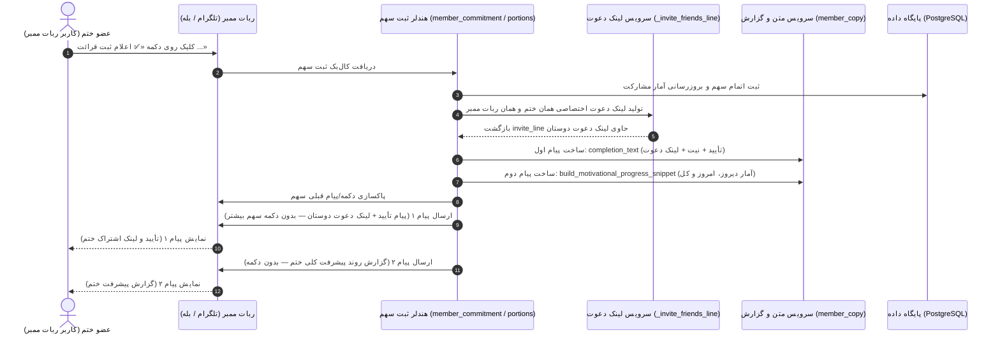

# 📙 مستر فرزند ۰۷: تفکیک پیام تأیید، لینک دعوت دوستان و گزارش پیشرفت پس از ثبت سهم در ربات‌های ممبر
**(Child Master 07 — Post-Completion Separate Confirmation + Invite Link & Progress Report Messages)**

> **🔗 موقعیت در درختوارهٔ اسناد (والد و فرزندی):**
> - **⬆️ سند مادر (والد):** [ADMIN_PANEL_REDESIGN_MASTER.md](../ADMIN_PANEL_REDESIGN_MASTER.md)
> - **⬅️ اسناد هم‌خانواده (فرزندان دیگر):**
>   - **[مستر فرزند ۰۱](MASTER_01_KHATM_ENGINE_AND_MODES.md):** موتور ختم‌ها، تعهدی/آزاد و سهم‌بندی
>   - **[مستر فرزند ۰۲](MASTER_02_CONTENT_DEVOTIONALS_AND_MEDIA.md):** مدیریت محتوا، ادعیه، خطبه، قرآن و فایل‌های چندرسانه‌ای
>   - **[مستر فرزند ۰۳](MASTER_03_PLANS_BILLING_WALLET_AND_ADS.md):** پلن‌های پولی/رایگان، کیف پول، درگاه پرداخت و تبلیغات
>   - **[مستر فرزند ۰۴](MASTER_04_BOTS_USERS_MODERATION_AND_OPS.md):** معماری مولتی‌بات، کاربران و عملیات سرور
>   - **[مستر فرزند ۰۵](MASTER_05_OPEN_KHATM_AND_KHUTBAH_FLOW.md):** فلوهای ختم باز، خطبه‌های تدریجی و رول‌اور
>   - **[مستر فرزند ۰۶](MASTER_06_PAYMENT_GATEWAY_AND_CALLBACK_ARCHITECTURE.md):** معماری پرداخت، کال‌بک بانکی و پورت‌های سرور
>   - **[مستر فرزند ۰۷ (همین فایل)](MASTER_07_MEMBER_DAILY_DIGEST_AND_MOTIVATIONAL_PROGRESS.md):** تفکیک پیام تأیید (همراه لینک دعوت) و پیام گزارش پیشرفت بلافاصله پس از ثبت سهم توسط عضو
>   - **[مستر فرزند ۰۸](MASTER_08_CREATOR_PANEL_AND_USER_EXPERIENCE.md):** بازطراحی کامل پنل کاربری سازندگان ختم (وب‌اپ)

---

## ۱. قوانین و نیازمندی‌های کلیدی (تثبیت‌شده توسط کارفرما)

### ۱.۱. حذف ارسال خودکار ساعت ۱۴:۰۰ برای اعضا (No Scheduled 14:00 Broadcast to Members)
1. **عدم ارسال پیام ناخواسته راس ساعت ۱۴:۰۰:** برودکست خودکار روزانه در ساعت ۱۴:۰۰ به اعضای ختم **انجام نمی‌شود** و از چرخهٔ زمان‌بند یادآورها (`reminder_engine/service.py`) خارج شده است.
2. **گزارش مبتنی بر اقدام کاربر (Action-Triggered Reporting):** گزارش پیشرفت ختم برای اعضا **صرفاً بلافاصله پس از زدن دکمهٔ ثبت/اعلام خواندن سهم** ارسال می‌گردد تا هم انگیزه‌بخش باشد و هم مزاحمتی در طول روز ایجاد نکند.
   *(نکته: گزارش شبانهٔ ساعت ۲۱:۰۰ ویژهٔ سازندگان ختم در ربات ختم‌ساز کماکان طبق روال خود برقرار است).*

---

### ۱.۲. تفکیک کامل «پیام تأیید» و «پیام گزارش» به دو پیام مجزا
پس از اینکه عضو روی دکمهٔ ثبت قرائت (مانند `share_done:`، `regular_done:`، `regular_early_done:` یا `done:`) کلیک می‌کند، ربات **دو پیام کاملاً جداگانه** به ترتیب زیر ارسال می‌نماید:

#### الف) پیام اول: پیام تأیید ثبت سهم + لینک دعوت دوستان به همان ختم
این پیام صرفاً شامل تأیید ثبت سهم، شریک شدن در ثواب و نیت ختم، دعای قبولی طاعات و **لینک اختصاصی دعوت دوستان به همان ختم در همان ربات ممبر** است:

```text
با سلام 🌱

✅ ۱ مرتبه ذکر تعیین‌شده انجام شد.

اعلام شما در سیستم ثبت شد و در ثواب ختم «...» به نیت سلامتی و فرج امام عصر علیه السلام شریک شدید.

خداوند از شما قبول فرماید. با تشکر.

با ارسال این لینک برای دوستانتون، اون‌ها رو هم به مشارکت در همین ثواب دعوت کنید:
https://t.me/salawat_Khatm_fa_bot?start=join_...
```

#### ب) پیام دوم: پیام گزارش روند پیشرفت کلی ختم (پیام مجزا)
بلافاصله پس از پیام اول، آمار به‌روزشدهٔ پیشرفت کل ختم در **یک پیام مستقل دوم** ارسال می‌شود:

```text
📊 روند پیشرفت کلی این ختم:
▫️ قرائت تا دیروز: ۳ دور و ۴ بخش
▫️ قرائت‌های امروز: ۲ بخش
▫️ مجموع قرائت‌شده: ۳ دور و ۶ بخش از ۱۰ دور (پیشرفت: ۳۷.۵٪)
```

---

### ۱.۳. حذف کامل دکمهٔ «📖 خواندن یک سهم دیگر»
- دکمهٔ شیشه‌ای `📖 خواندن یک سهم دیگر` (`today_pick:{part.id}`) به طور کامل از زیر پیام‌های تأیید و گزارش حذف شده است.
- هیچ دکمهٔ اضافه‌ای برای درخواست سهم بیشتر ذیل پیام تأیید یا پیام گزارش نمایش داده نمی‌شود.

---

## ۲. دیاگرام توالی (Sequence Diagram)



---

## ۳. پوشش در تمام مسیرهای ثبت سهم
این معماری دوپیامی به صورت یکپارچه در تمامی هندلرهای ثبت سهم اعمال شده است:
1. **`complete_share` (`share_done:{oid}` در `member_commitment.py`):**
   - تولید `invite_line` با `_invite_friends_line`
   - ارسال پیام اول (`completion_text` بدون `progress_snippet` و بدون دکمهٔ سهم دیگر)
   - ارسال پیام دوم (`snippet` پیشرفت ختم به صورت پیام مستقل)
2. **`confirm_regular_occurrence` (`regular_done:{pid}` و `regular_early_done:{pid}` در `member_commitment.py`):**
   - تولید `invite_line` با `_invite_friends_line`
   - ارسال پیام اول (`completion_text` حاوی لینک دعوت، بدون دکمهٔ سهم دیگر)
   - ارسال پیام دوم (`snippet` پیشرفت ختم به صورت پیام مستقل)
3. **`mark_portion_done` (`done:{khatm_id}` در `portions.py`):**
   - تولید `invite_line` با `_invite_friends_line`
   - ارسال پیام اول (`completion_text` حاوی لینک دعوت و وضعیت سهم)
   - ارسال پیام دوم (`snippet` پیشرفت ختم به صورت پیام مستقل)
4. **`enter_contribution_amount` و `complete_open_reservation` (در `portions.py`):**
   - ارسال پیام اول (`completion_text` حاوی لینک دعوت)
   - ارسال پیام دوم (`snippet` پیشرفت کلی ختم به صورت پیام مستقل)

---

## ۴. بسته‌های کاری (Work Packages Ledger)

| بسته | عنوان | وضعیت | شرح اقدامات |
|:---:|:---|:---:|:---|
| **WP-01** | بازنگری و به‌روزرسانی مستر فرزند ۰۷ | COMPLETED | ثبت دقیق قوانین دو پیام مجزا، لینک دعوت در پیام تأیید، حذف دکمه سهم بیشتر و لغو برودکست ساعت ۱۴ |
| **WP-02** | حذف فراخوانی برودکست ساعت ۱۴ اعضا از زمان‌بند | COMPLETED | حذف فراخوانی `deliver_member_daily_digests` از `reminder_engine/service.py:run_once` |
| **WP-03** | تفکیک پیام تأیید (با لینک دعوت) و پیام گزارش در هندلرها | COMPLETED | اصلاح `member_commitment.py` و `portions.py` برای ارسال ۲ پیام مجزا و حذف دکمه `📖 خواندن یک سهم دیگر` |
| **WP-04** | آزمون‌های واحد و یکپارچگی | COMPLETED | بروزرسانی و اجرای تست‌ها در `tests/test_member_daily_digest.py` و کل سوئیت تست پروژه |
| **WP-05** | استقرار امن روی سرور | COMPLETED | کامیت، پوش و ریستارت سرویس `khatmsaz` روی سرور بدون دستکاری پورت‌ها |

---

## ۵. دستورات اعتبارسنجی
```bash
python -m pytest tests/test_member_daily_digest.py -v
python -m pytest -q
```
