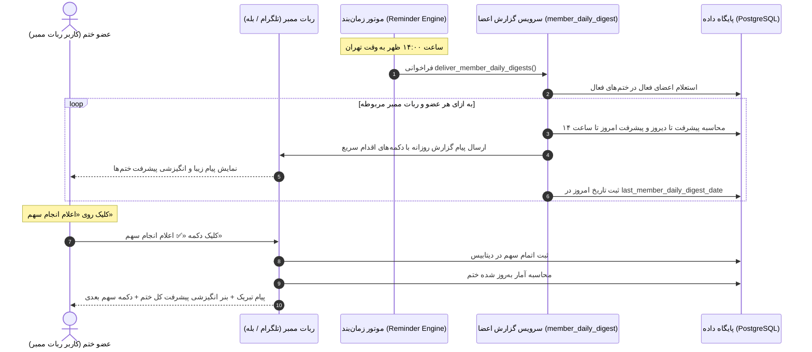

# 📙 مستر فرزند ۰۷: خلاصه روزانه اعضا و موتور پیشرفت انگیزشی در ربات‌های ممبر
**(Child Master 07 — Member Daily Progress Digest at 14:00 & Post-Completion Motivational Progress Banner)**

> **🔗 موقعیت در درختوارهٔ اسناد (والد و فرزندی):**
> - **⬆️ سند مادر (والد):** [ADMIN_PANEL_REDESIGN_MASTER.md](../ADMIN_PANEL_REDESIGN_MASTER.md)
> - **⬅️ اسناد هم‌خانواده (فرزندان دیگر):**
>   - **[مستر فرزند ۰۱](MASTER_01_KHATM_ENGINE_AND_MODES.md):** موتور ختم‌ها، تعهدی/آزاد و سهم‌بندی
>   - **[مستر فرزند ۰۲](MASTER_02_CONTENT_DEVOTIONALS_AND_MEDIA.md):** مدیریت محتوا، ادعیه، خطبه، قرآن و فایل‌های چندرسانه‌ای
>   - **[مستر فرزند ۰۳](MASTER_03_PLANS_BILLING_WALLET_AND_ADS.md):** پلن‌های پولی/رایگان، کیف پول، درگاه پرداخت و تبلیغات
>   - **[مستر فرزند ۰۴](MASTER_04_BOTS_USERS_MODERATION_AND_OPS.md):** معماری مولتی‌بات، کاربران و عملیات سرور
>   - **[مستر فرزند ۰۵](MASTER_05_OPEN_KHATM_AND_KHUTBAH_FLOW.md):** فلوهای ختم باز، خطبه‌های تدریجی و رول‌اور
>   - **[مستر فرزند ۰۶](MASTER_06_PAYMENT_GATEWAY_AND_CALLBACK_ARCHITECTURE.md):** معماری پرداخت، کال‌بک بانکی و پورت‌های سرور
>   - **[مستر فرزند ۰۷ (همین فایل)](MASTER_07_MEMBER_DAILY_DIGEST_AND_MOTIVATIONAL_PROGRESS.md):** گزارش روزانه ساعت ۱۴ اعضا در ربات‌های ممبر و موتور پیشرفت انگیزشی بعد از ثبت سهم

---

## ۱. اهداف و نیازمندی‌های کلیدی

### ۱.۱. گزارش روزانه ساعت ۱۴:۰۰ به اعضا (Member Daily 14:00 Digest)
1. **زمان‌بندی دقیق:** هر روز راس ساعت ۱۴:۰۰ به وقت تهران (`Asia/Tehran`) توسط موتور یادآورها اسکن و اجرا می‌شود.
2. **جامعه هدف و روتینگ ربات‌ها:**
   - تمام اعضایی که در ختم‌های فعال (`ACTIVE`) عضویت فعال (`ParticipationStatus.ACTIVE`) دارند.
   - پیام حتماً از طریق **ربات ممبری** که کاربر از طریق آن عضو شده (`joined_via_bot_instance_id`) ارسال می‌شود تا تداخلی بین ربات‌های تخصصی (قرآن، صلوات، ادعیه و ...) ایجاد نشود.
3. **تفکیک و شخصی‌سازی آمار هر ختم:**
   - عنوان ختم
   - پیشرفت کل ختم تا پایان دیروز (قبل از ۰۰:۰۰ بامداد)
   - قرائت‌های امروز ختم تا لحظه ارسال (ساعت ۱۴:۰۰)
   - مجموع کل قرائت‌شده و درصد پیشرفت کلی ختم
   - وضعیت سهم اختصاصی خود کاربر در روز جاری:
     - اگر امروز سهمش را خوانده: «✅ سهم امروز شما ثبت شده است؛ خداقوت 💐»
     - اگر هنوز سهمش را نخوانده: «⏳ سهم امروز شما منتظر قرائت است.»
     - در ختم‌های آزاد: «✨ آماده ثبت مشارکت امروز»
4. **دکمه‌های اقدام سریع (Interactive Keyboards):**
   - دکمه شیشه‌ای «📖 دریافت و انجام سهم امروز» یا «🤲 مشارکت بیشتر» با ارجاع مستقیم به اکشن تحویل سهم (`today_pick:{participation.id}`).
5. **ارسال بدون تکرار (Idempotent):**
   - ثبت تاریخ ارسال در `UserSettings.last_member_daily_digest_date` (مثلاً `2026-10-11`) برای تضمین حداکثر ۱ بار ارسال در شبانه‌روز.

---

### ۱.۲. بنر انگیزشی پس از ثبت سهم (Post-Completion Motivational Progress)
1. **انگیزش آنی:** پس از اینکه کاربر دکمه «✅ اعلام انجام سهم» یا «ثبت انجام» را می‌زند، در کنار تبریک و ثواب، بنر موجز پیشرفت کل ختم نمایش داده می‌شود:
   ```text
   با سلام 🌱
   ✅ بخش ۱ خطبه غدیر قرائت شد.
   اعلام شما در سیستم ثبت شد و در ثواب ختم «...» شریک شدید.

   📊 روند پیشرفت کلی این ختم:
   ▫️ قرائت تا دیروز: ۳ دور و ۴ بخش
   ▫️ قرائت‌های امروز: ۲ بخش
   ▫️ مجموع قرائت‌شده: ۳ دور و ۶ بخش از ۱۰ دور (پیشرفت: ۳۷.۵٪)

   خداوند از شما قبول فرماید. با تشکر 💐
   ```
2. **دعوت به ادامه:** نمایش دکمه شیشه‌ای «📖 خواندن یک سهم دیگر» جهت تشویق فوری عضو به مشارکت بیشتر در صورت تمایل.

---

## ۲. دیاگرام توالی (Sequence Diagram)



---

## ۳. بسته‌های کاری (Work Packages Ledger)

| بسته | عنوان | وضعیت | شرح اقدامات |
|:---:|:---|:---:|:---|
| **WP-01** | سرویس ساخت گزارش روزانه ممبرها | COMPLETED | تدوین `src/khatmsaz/modules/reporting/member_daily_digest.py` با محاسبه آمار دیروز، امروز، وضعیت کاربر و روتینگ ربات ممبر |
| **WP-02** | بنر پیشرفت انگیزشی در `completion_text` | COMPLETED | افزودن `build_motivational_progress_snippet` در `member_copy.py` و اعمال در هندلرهای ثبت سهم |
| **WP-03** | ارتقای اسکیمای دیتابیس و مدل تنظیمات | COMPLETED | افزودن فیلدهای `last_member_daily_digest_date` و `member_daily_digest_enabled` در `UserSettings` و `bootstrap.py` |
| **WP-04** | اتصال به زمان‌بند یادآورها | COMPLETED | فراخوانی `deliver_member_daily_digests` در `reminder_engine/service.py:run_once` |
| **WP-05** | آزمون‌های واحد و اعتبارسنجی | COMPLETED | نگارش تست‌های جامع در `tests/test_member_daily_digest.py` و اعتبارسنجی با کل سوئیت تست |
| **WP-06** | استقرار و راه‌اندازی زنده روی سرور | COMPLETED | پوش به گیت‌هاب، پول در سرور `91.107.137.22`، مایگریشن و ریستارت امن سرویس `khatmsaz` |

---

## ۴. دستورات اعتبارسنجی
```bash
python -m pytest tests/test_member_daily_digest.py -v
python -m pytest -q
```
