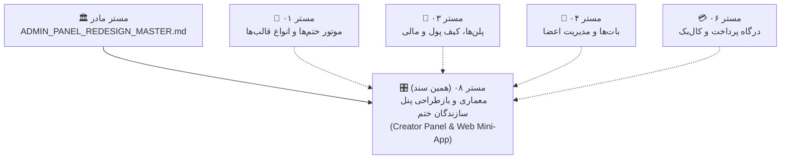
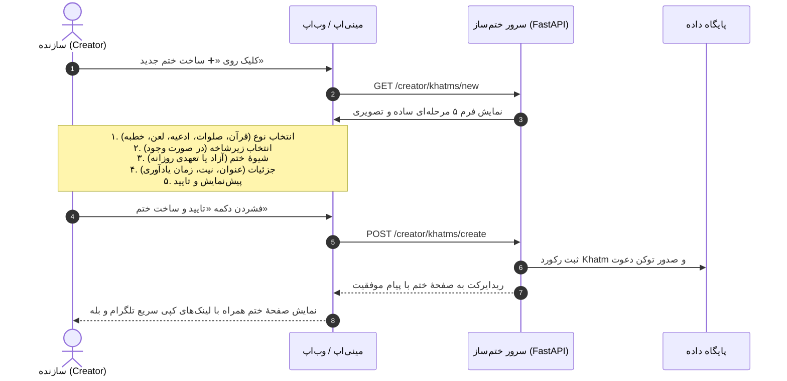
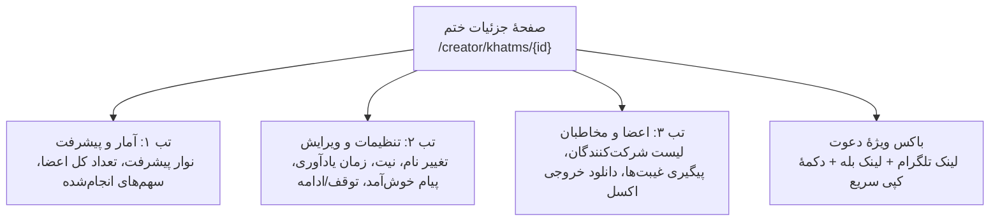

# 🎛 مستر فرزند ۰۸: معماری، بازطراحی و تجربهٔ کاربری پنل سازندگان ختم (Creator Panel & User Experience)
**(Child Master 08 — Ground-Up Redesign, Architecture, and UX of the Creator Panel & Mini-App)**

> **📅 تاریخ تدوین:** `2026-10-11` · **نسخه:** `1.0.0 (نهایی و جامع)` · **وضعیت:** `طراحی، تحلیل خط‌به‌خط و راهنمای پیاده‌سازی کامل` · **نگارنده:** `Antigravity`

---

## 🌳 ۱. نقشهٔ درختی اسناد و جایگاه مستر ۰۸

این سند **مستر فرزند هشتم (Child Master 08)** از زنجیره اسناد فنی پروژه است که مستقیماً به مستر مادر [ADMIN_PANEL_REDESIGN_MASTER.md](../ADMIN_PANEL_REDESIGN_MASTER.md) متصل است و مرجع استاندارد برای بازسازی ۱۰۰٪ پنل سازندگان (هم در وب‌اپ/مینی‌اپ و هم در بات تلگرام و بله) می‌باشد.

---

## 🎯 ۲. فلسفهٔ بازطراحی و تجربهٔ کاربری سازندگان (Creator Persona & Core UX)

### ۲.۱. سازندهٔ ختم کیست؟
سازندهٔ ختم (Creator) کاربری است که با نیتی خیر (طلب مغفرت برای رفتگان، دعا برای شفای بیمار، ظهور امام زمان علیه‌السلام یا شکرگزاری) اقدام به برپایی یک برنامهٔ جمعی قرائت قرآن، صلوات، ادعیه یا خطبه می‌نماید. 

### ۲.۲. ویژگی‌ها و نیازهای کلیدی سازنده:
1. **کاربری بر بستر موبایل (Mobile-First):** بیش از ۹۰٪ سازندگان از طریق تلفن همراه و با فشردن دکمهٔ «🎛 پنل سازنده» در بات تلگرام یا بله وارد مینی‌اپ می‌شوند؛ بنابراین طراحی باید ۱۰۰٪ بهینه برای نمایشگرهای کوچک، با ناوبری لمسی روان (Bottom Navigation Bar) باشد.
2. **سادگی و آرامش بصری (Calm & Intuitive):** کاربر نباید با مفاهیم گیج‌کنندهٔ فنی روبرو شود. فونت چشم‌نواز «استعداد»، رنگ‌بندی گرم سبز زمردی (Emerald) و پس‌زمینهٔ ملایم و تیره، دسترسی با حداکثر ۱ یا ۲ کلیک به تمام بخش‌ها.
3. **دسترسی بی‌واسطه به لینک‌های دعوت:** اولین نیاز سازنده پس از ایجاد ختم، انتشار لینک اختصاصی تلگرام و بله در گروه‌ها و کانال‌های خانوادگی است؛ این لینک‌ها باید همیشه با دکمهٔ کپی سریع و متن آمادهٔ اشتراک‌گذاری در بالای صفحهٔ ختم در دسترس باشند.
4. **شفافیت کامل آمار و پیشرفت:** سازنده باید بتواند در یک نگاه ببیند چند نفر عضو شده‌اند، چقدر از ختم باقی مانده، و چه کسانی سهم خود را خوانده‌اند.
5. **استقلال کامل سازنده:** امکان تغییر عنوان، زمان یادآوری روزانه، متن پیام خوش‌آمد، توقف موقت و شروع مجدد ختم، بدون نیاز به پیام دادن به ادمین سیستم.

---

## 🗺 ۳. دیاگرام‌های جریان کاربری سازنده (Creator Workflows)

### ۳.۱. جریان ساخت ختم جدید در پنل وب (Creation Wizard Flow)

### ۳.۲. جریان مدیریت ختم و اعضا (Khatm Management Flow)

---

## 📊 ۴. کالبدشکافی وضعیت موجود و شکاف‌های پنل سازنده (Audit & Gap Analysis)

در بررسی دقیق قالب‌های موجود (`src/khatmsaz/web/templates/creator_*.html`) و روت‌های مربوطه در `src/khatmsaz/web/app.py`، نقاط ضعف و کمبودهای زیر شناسایی شدند:

| بخش | وضعیت فعلی | نقطه ضعف و باگ | راهکار در بازطراحی جدید |
| :--- | :--- | :--- | :--- |
| **لینک‌های دعوت** | ❌ وجود ندارد! | در صفحهٔ جزئیات ختم هیچ لینک دعوتی برای تلگرام یا بله نمایش داده نمی‌شود! سازنده مجبور بود دوباره به بات برگردد. | اضافه شدن باکس شیک و برجستهٔ لینک‌های دعوت تلگرام و بله همراه با دکمهٔ کپی ۱-کلیکه و دکمهٔ اشتراک‌گذاری در صدر صفحهٔ جزئیات ختم. |
| **نوار پیشرفت (Progress Bar)** | ❌ عددی خشک | فقط اعداد سهم نوشته شده و هیچ بازنمایی بصری از درصد پیشرفت ختم و دورهای باقیمانده وجود ندارد. | نوار پیشرفت گرادیانی با نمایش دقیق درصد تکمیل و سهم‌های باقیمانده. |
| **تب‌بندی صفحهٔ ختم** | ❌ فرم زیر هم و نامرتب | تنظیمات در یک تگ `
` جمع‌شونده مخفی شده بود و لیست اعضا به شکل کارت‌های بزرگ و شلوغ در زیر آن رها شده بود. | ایجاد سیستم تب‌بندی ماژولار و بسیار تمیز (۱. آمار و پیشرفت ۲. تنظیمات ختم ۳. مدیریت اعضا). |
| **توقف و ادامهٔ ختم (Pause/Resume)** | ❌ غیرقابل‌دسترس | متدی در بک‌اند وجود داشت اما سازنده دکمه‌ای برای توقف موقت و ادامهٔ ختم در وب نداشت. | دکمهٔ تاگل وضعیت ختم (فعال / متوقف موقت) با تاییدیهٔ ایمن. |
| **جستجو و فیلتر اعضا** | ⚠️ محدود | فقط جستجوی سادهٔ متنی بدون دسته‌بندی سهم‌ها یا فیلتر متعهد/آزاد. | جستجوی بهینه با فیلتر سریع اعضا و دکمهٔ دانلود اکسل کامل بدون قطعی. |
| **داشبورد سازنده** | ⚠️ متنی و شلوغ | کارت‌های بدون تعامل و بدون نمایش نمودار وضعیت. | داشبورد مدرن با کارت‌های KPI شفاف، میانبرهای سریع و کارت‌های پویا از آخرین ختم‌ها. |
| **ویزارد ساخت ختم** | ⚠️ فرم بلند تک‌صفحه‌ای | فیلدها در هم تنیده بودند و جاوااسکریپت آن ساده و شکننده بود. | ویزارد گام‌به‌گام با کارت‌های بزرگ انتخابی، آیکون‌های رسا و اعتبارسنجی آنی. |
| **کیف پول و پلن** | ⚠️ فاقد راهنمای ملموس | سازنده تفاوت‌های پلن‌ها را متوجه نمی‌شد و بسته‌های شارژ مشخص نبودند. | کارت‌های بسته‌های شارژ محبوب (۵۰، ۱۰۰، ۲۰۰، ۵۰۰ هزار تومان)، مقایسهٔ شفاف پلن‌ها (Free, Basic, Pro) و نمایش تعداد مخاطب مجاز. |

---

## 🎨 ۵. مشخصات معماری و طراحی صفحات جدید پنل سازنده

### ۵.۱. پایهٔ مشترک (`creator_base.html`):
- **هدر (Topbar):** لوگوی رسمی ختم‌ساز، نام سازنده با خوش‌آمدگویی گرم، موجودی سریع کیف پول با لینک مستقیم به شارژ، دکمهٔ خروج امن.
- **داک موبایل (Bottom Dock):** ناوبری ۴ قسمته با آیکون‌های استاندارد SVG، طراحی ارگونومیک مخصوص شست دست (Thumb-friendly):
  1. `🏠 پیشخوان` (`/creator`)
  2. `🕋 ختم‌های من` (`/creator/khatms`)
  3. `➕ ساخت ختم` (`/creator/khatms/new`)
  4. `💳 کیف پول` (`/creator/wallet`)
- **سایدبار دسکتاپ:** نوار کناری مینیمال و شیک برای نمایشگرهای تبلت و کامپیوتر.
- **تایپوگرافی و ظاهر:** فونت زیبای استعداد ۵.۳.۰، رنگ‌بندی تم تاریک مدرن (`#020617` با هاله‌های فیروزه‌ای و زمردی)، انیمیشن‌های نرم بدون افت فریم.

### ۵.۲. پیشخوان سازنده (`creator_dashboard.html`):
- **کارت خوش‌آمد شخصی:** سلام و عرض ادب به نام سازنده، همراه با تاریخ هجری/شمسی.
- **۴ کارت شاخص کلیدی (KPIs):**
  - ختم‌های فعال
  - کل مخاطبان و اعضا
  - اعتبار کیف پول (با دکمهٔ شارژ سریع)
  - پلن جاری کاربری
- **ردیف میانبرهای پرکاربرد (Quick Actions):** «ساخت ختم جدید»، «ارسال پیام گروهی»، «شارژ کیف پول».
- **کارت‌های آخرین ختم‌ها:** نمایش وضعیت، تعداد اعضا، درصد تکمیل بصری و دکمهٔ مدیریت مستقیم.

### ۵.۳. لیست ختم‌ها (`creator_khatms.html`):
- **فیلتر وضعیت شاخه‌ها:** تب‌های «فعال و در جریان» و «تکمیل‌شده و بایگانی».
- **تفکیک دسته‌ها:** قرآن، صلوات، ادعیه و زیارات، لعن، خطبه‌ها.
- **کارت‌های ختم:** دارای برچسب رنگی نوع ختم، وضعیت، تعداد شرکت‌کنندگان و لینک ورود به پنل همان ختم.

### ۵.۴. صفحهٔ جامع مدیریت ختم (`creator_khatm_detail.html`):
- **بخش دعوت فوری (Hero Invite Box):**
  - لینک تلگرام با دکمهٔ «کپی لینک تلگرام»
  - لینک بله با دکمهٔ «کپی لینک بله»
  - دکمهٔ «اشتراک‌گذاری متن دعوت» (Web Share API برای باز شدن منوی اشتراک‌گذاری موبایل)
- **تب‌های سه‌گانه:**
  1. **📊 آمار و کارنامه:** نوار پیشرفت کل، درصد تکمیل، نسبت سهم‌های خوانده‌شده به کل، میانگین مشارکت روزانه.
  2. **⚙️ تنظیمات ختم:** ویرایش عنوان، نیت، زمان یادآوری روزانه، لحن پیام‌ها، پیام خوش‌آمد، وضعیت توقف/ادامهٔ ختم.
  3. **👥 لیست اعضا و دانلود:** جدول مرتب اعضا با نام نمایشی، تاریخ عضویت، وضعیت (متعهد/همراه)، سهم‌های خوانده‌شده، غیبت‌ها، و دکمهٔ دانلود فایل اکسل جامع (`export.xlsx`).

### ۵.۵. ویزارد ساخت ختم جدید (`creator_khatm_new.html`):
- **گام ۱: موضوع ختم:** انتخاب تصویری از میان ۵ قالب (📖 قرآن، 🕊 صلوات، 🤲 دعا و زیارت، ✨ لعن، 🎤 خطبه).
- **گام ۲: محتوای خاص:** باز شدن منوی انتخابی ادعیه/زیارات/خطبه‌ها به محض انتخاب موضوع.
- **گام ۳: نوع مشارکت:** انتخاب واضح بین «ختم آزاد (همگانی و منعطف)» و «ختم تعهدی (با سهمیه و یادآوری منظم روزانه)».
- **گام ۴: مشخصات:** عنوان دلخواه، نیت ختم، تعداد مورد نظر یا تعداد دور.
- **گام ۵: ثبت نهایی:** محاسبه و نمایش هزینه (رایگان بودن در حالت عادی) و دکمهٔ درخشان ساخت ختم.

### ۵.۶. کیف پول و پلن‌ها (`creator_wallet.html`):
- **موجودی و اعتبار:** نمایش بزرگ موجودی به تومان و تراز مالی.
- **بسته‌های شارژ سریع:** دکمه‌های تک‌کلیکه ۵۰، ۱۰۰، ۲۰۰ و ۵۰۰ هزار تومان به علاوه ورودی مبلغ دلخواه متصل به درگاه شاپرک/پی‌پینگ.
- **جدول امکانات پلن جاری:** مقایسهٔ مزایای پلن فعلی با پلن حرفه‌ای (PRO) و امکان ارتقای فوری با یک کلیک.

### ۵.۷. پیام گروهی (`creator_broadcasts.html`):
- انتخاب ختم مبدأ یا همهٔ مخاطبان یکتا.
- فیلتر اختیاری استان و جنسیت.
- انتخاب شبکهٔ ارسال (تلگرام، بله، پیامک).
- نمایش هوشمند سهمیهٔ ۲ پیام رایگان برای تلگرام و بله.

---

## 🛠 ۶. تغییرات مورد نیاز در بک‌اند (`src/khatmsaz/web/app.py`)

برای پشتیبانی ۱۰۰٪ از رابط کاربری جدید سازنده، روت‌های زیر در `app.py` بهینه‌سازی و تثبیت می‌شوند:
1. **تزریق لینک‌های دعوت در `creator_khatm_detail`:**
   - فراخوانی `invitation_service.get_or_create_for_khatm` جهت دریافت توکن اختصاصی ختم.
   - تولید `telegram_invite_url` و `bale_invite_url` با استفاده از `build_web_invite_url`.
   - آماده‌سازی `share_text` جهت کپی و انتشار سریع توسط سازنده.
2. **محاسبهٔ درصد پیشرفت و پیش‌نمایش گرافیکی:**
   - محاسبهٔ `progress_percent` بر مبنای `completed_portions` و `total_portions` یا `repetition_target` به شکلی ایمن (بدون تقسیم بر صفر).
3. **اکشن تغییر وضعیت توقف/ادامه ختم (`POST /creator/khatms/{khatm_id}/toggle-pause`):**
   - افزودن امکان تغییر سریع وضعیت بین فعال (`ACTIVE`) و متوقف (`SUSPENDED`).
4. **حفظ پایداری و اعتبارسنجی ورودی‌ها:**
   - بررسی دقیق دسترسی‌ها (`creator_user_id == creator.id`) و حفاظت با توکن‌های CSRF.

---

## 🧪 ۷. استراتژی اعتبارسنجی و تست

1. **تست‌های واحد (Unit Tests):** نوشتن تست‌های جامع روت‌های سازنده در `tests/test_creator_panel_routes.py`.
2. **پوشش تست‌های مینی‌اپ:** بررسی احراز هویت توکن‌های تلگرام و کوکی‌های سازنده.
3. **عدم اختلال در سایر سرویس‌ها:** گذر کامل تمام تست‌های سیستم (`python -m pytest`).

---
*(این سند مرجع تغییرات و استقرار فاز بازطراحی پنل سازنده می‌باشد).*
