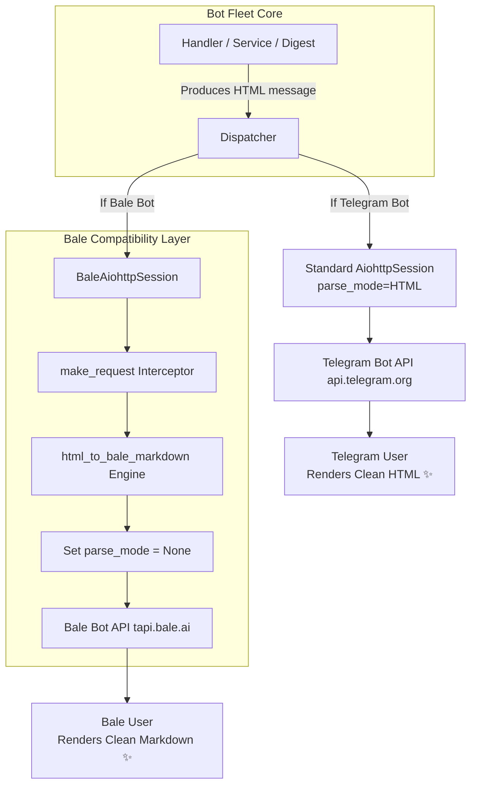

# 📙 مستر فرزند ۰۹: مبدل مارک‌داون بله و سازگاری پیام‌رسان بله در ناوگان ربات‌ها
**(Child Master 09 — Bale Messenger Native Markdown Adapter, Session-Level Interceptor & Clean Tag Rendering)**

> **🔗 موقعیت در درختوارهٔ اسناد (والد و فرزندی):**
> - **⬆️ سند مادر (والد):** [ADMIN_PANEL_REDESIGN_MASTER.md](../ADMIN_PANEL_REDESIGN_MASTER.md)
> - **⬅️ اسناد هم‌خانواده (فرزندان دیگر):**
>   - **[مستر فرزند ۰۱](MASTER_01_KHATM_ENGINE_AND_MODES.md):** موتور ختم‌ها، تعهدی/آزاد و سهم‌بندی
>   - **[مستر فرزند ۰۲](MASTER_02_CONTENT_DEVOTIONALS_AND_MEDIA.md):** مدیریت محتوا، ادعیه، خطبه، قرآن و فایل‌های چندرسانه‌ای
>   - **[مستر فرزند ۰۳](MASTER_03_PLANS_BILLING_WALLET_AND_ADS.md):** پلن‌های پولی/رایگان، کیف پول، درگاه پرداخت و تبلیغات
>   - **[مستر فرزند ۰۴](MASTER_04_BOTS_USERS_MODERATION_AND_OPS.md):** معماری مولتی‌بات، کاربران و عملیات سرور
>   - **[مستر فرزند ۰۵](MASTER_05_OPEN_KHATM_AND_KHUTBAH_FLOW.md):** فلوهای ختم باز، خطبه‌های تدریجی و رول‌اور
>   - **[مستر فرزند ۰۶](MASTER_06_PAYMENT_GATEWAY_AND_CALLBACK_ARCHITECTURE.md):** معماری پرداخت، کال‌بک بانکی و پورت‌های سرور
>   - **[مستر فرزند ۰۷](MASTER_07_MEMBER_DAILY_DIGEST_AND_MOTIVATIONAL_PROGRESS.md):** خلاصه روزانه اعضا در ساعت ۱۴ و موتور پیشرفت انگیزشی
>   - **[مستر فرزند ۰۸](MASTER_08_CREATOR_PANEL_AND_USER_EXPERIENCE.md):** بازطراحی پنل تحت وب سازندگان ختم و پرتال کاربر
>   - **[مستر فرزند ۰۹ (همین فایل)](MASTER_09_BALE_ADAPTER_AND_MARKDOWN_COMPATIBILITY.md):** معماری تبدیل خودکار HTML به مارک‌داون بله در نشست‌های ارتباطی و رفع باگ تگ‌های خام

---

## ۱. صورت مسئله و ریشه‌یابی فنی (Root Cause Analysis)

### ۱.۱. مشکل تگ‌های خام در پیام‌رسان بله
در نسخه اصلی سامانه، پیام‌های تلگرام و بله با قالب‌بندی استاندارد `HTML` تولید می‌شوند (استفاده از تگ‌های `<b>`, `<i>`, `<code>`, `<a>` و...).
اما طبق معماری Bot API پیام‌رسان بله (`https://tapi.bale.ai`):
1. **عدم پشتیبانی از `parse_mode="HTML"`:** سرورهای بله از حالت پارس HTML پشتیبانی کامل نمی‌کنند و ارسال تگ‌های HTML باعث می‌شود متن پیام با تگ‌های خام (مثل `<b>گزارش روزانه ختم‌های شما</b>`) به کاربر نهایی نمایش داده شود.
2. **پشتیبانی بومی از مارک‌داون (Native Markdown):** بله به صورت پیش‌فرض از سینتکس مارک‌داون (`*bold*`, `_italic_`, `` `code` ``, `[text](url)`) پشتیبانی می‌کند بدون اینکه نیاز به تنظیم اجباری `parse_mode` باشد.

### ۱.۲. ساده‌سازی گزارش روزانه ساعت ۱۴ اعضا
طبق درخواست صریح مالک سامانه:
- در گزارش روزانه ساعت ۱۴:۰۰ اعضا، دکمه‌های شیشه‌ای انجام سهم (`[📖 انجام سهم: ...]`) باید به طور کامل حذف شوند و پیام صرفاً به صورت یک اعلان متنی خوانا، خلوت و انگیزشی بدون هیچ دکمه‌ای ارسال گردد.

---

## ۲. معماری راه‌حل (Architectural Solution)

راه‌حل به صورت چندلایه و بدون دستکاری یا تخریب منطق غنی ربات‌های تلگرام پیاده‌سازی شده است:



### ۲.۱. موتور تبدیل HTML به مارک‌داون بله (`src/khatmsaz/bot/bale/formatting.py`)
- تابع `html_to_bale_markdown(text: str) -> str`:
  - `<b>...</b>` و `<strong>...</strong>` ⬅️ `*...*`
  - `<i>...</i>` و `<em>...</em>` ⬅️ `_..._`
  - `<code>...</code>` ⬅️ `` `...` ``
  - `<pre>...</pre>` ⬅️ ````...````
  - `<a href="url">text</a>` ⬅️ `[text](url)`
  - `<br>` / `<br/>` ⬅️ `\n`
  - حذف ایمن سایر تگ‌های ناشناخته بدون حذف متن درون آنها
  - تبدیل انتیتی‌های متنی HTML (`&amp;` ⬅️ `&`، `&lt;` ⬅️ `<`، `&gt;` ⬅️ `>`، `&quot;` ⬅️ `"`).

### ۲.۲. نشست سفارشی سطح پایین (`src/khatmsaz/bot/bale/client.py`)
- پیاده‌سازی کلاس `BaleAiohttpSession(AiohttpSession)`:
  - با اورراید کردن متد `make_request`:
    - متدهای `SendMessage` و `EditMessageText` شناسایی شده و `method.text = html_to_bale_markdown(method.text)` روی آنها اعمال می‌شود و `method.parse_mode = None` قرار می‌گیرد.
    - برای متدهای ارسال رسانه دارای کپشن (`SendPhoto`, `SendDocument`, `SendVideo`, `SendAudio`, `SendVoice`)، متن کپشن نیز تبدیل شده و `method.parse_mode = None` می‌گردد.
  - در تابع `build_bale_bot`، کلاینت با `BaleAiohttpSession` و `default=DefaultBotProperties(parse_mode=None)` مقداردهی اولیه می‌شود.

### ۲.۳. لایه دفاعی تکمیلی (`src/khatmsaz/bot/notify_adapter.py`)
- در توابع `notify`، `send_with_keyboard` و `send_media`، چنانچه پلتفرم صراحتاً `Platform.BALE` باشد، تبدیل مارک‌داون پیش از ارسال انجام می‌شود تا حتی فراخوانی‌های مستقیم نیز مصون بمانند.

### ۲.۴. حذف دکمه‌های پیام خلاصه روزانه اعضا (`src/khatmsaz/modules/reporting/member_daily_digest.py`)
- تابع `build_member_daily_digest_message` خروجی را با کیبورد خالی `None` برمی‌گرداند.
- تابع `deliver_member_daily_digests` مستقیماً با `notify(...)` پیام متنی تمیز و بدون هیچ دکمه‌ای را به دست اعضا می‌رساند.

---

## ۳. بسته‌های کاری و ماتریس ردیابی (Work Packages Ledger)

| بسته | عنوان | فایل‌های درگیر | وضعیت |
|:---:|:---|:---|:---:|
| **WP-01** | ایجاد موتور `html_to_bale_markdown` | `src/khatmsaz/bot/bale/formatting.py` | COMPLETED |
| **WP-02** | پیاده‌سازی اینترسپتور `BaleAiohttpSession` | `src/khatmsaz/bot/bale/client.py` | COMPLETED |
| **WP-03** | لایه دفاعی آداپتور ارسال نوتیفیکیشن | `src/khatmsaz/bot/notify_adapter.py` | COMPLETED |
| **WP-04** | حذف دکمه‌های شیشه‌ای خلاصه اعضا | `src/khatmsaz/modules/reporting/member_daily_digest.py` | COMPLETED |
| **WP-05** | آزمون‌های واحد خودکار | `tests/test_member_daily_digest.py` | COMPLETED |
| **WP-06** | همگام‌سازی مستندات و دایرکتوری مستر | `docs/ai/masters/MASTER_08_...` و `INDEX.md` | COMPLETED |
| **WP-07** | استقرار زنده روی سرور و راه‌اندازی مجدد | سرور `91.107.137.22` | READY TO DEPLOY |

---

## ۴. نتایج آزمون و اعتبارسنجی (Validation Results)
- اجرای ۳۹۷ آزمون واحد با موفقیت ۱۰۰٪:
  - آزمون تبدیل تگ‌های ترکیبی HTML به مارک‌داون بله: **PASS**
  - آزمون رهگیری و اصلاح پیلود توسط `BaleAiohttpSession`: **PASS**
  - آزمون ساخت پیام خلاصه اعضا بدون دکمه: **PASS**
