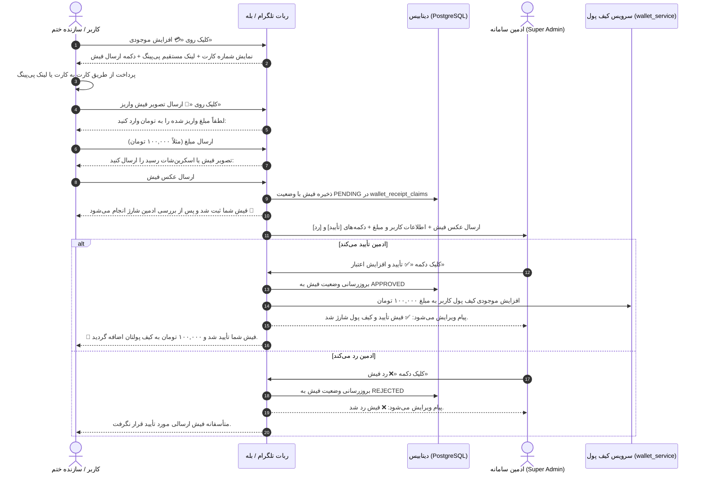
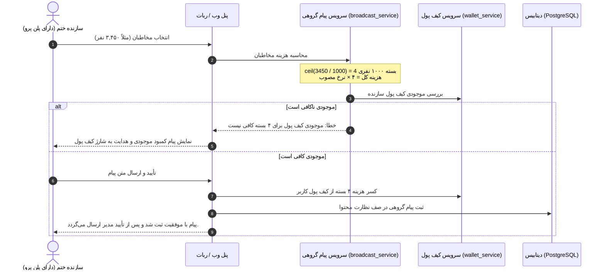
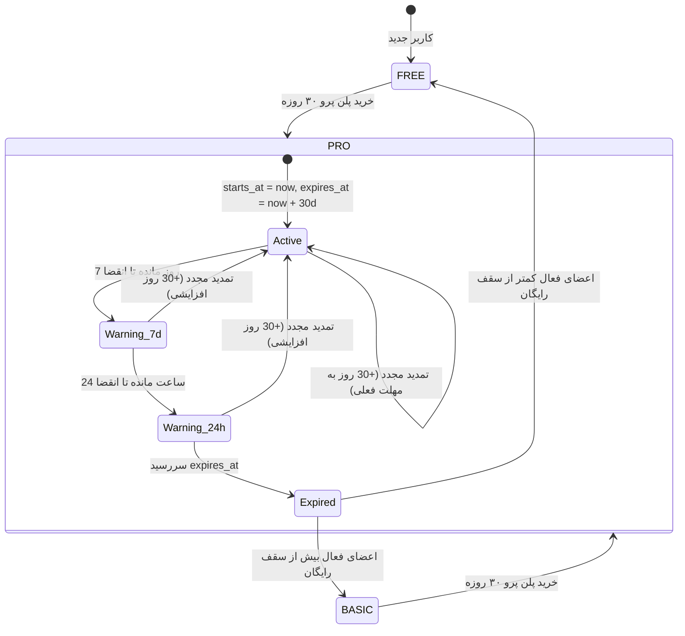
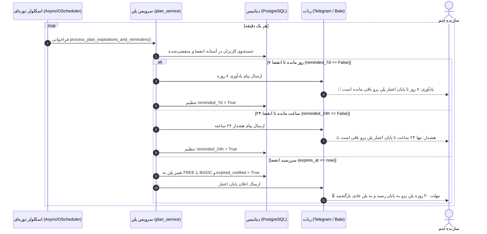
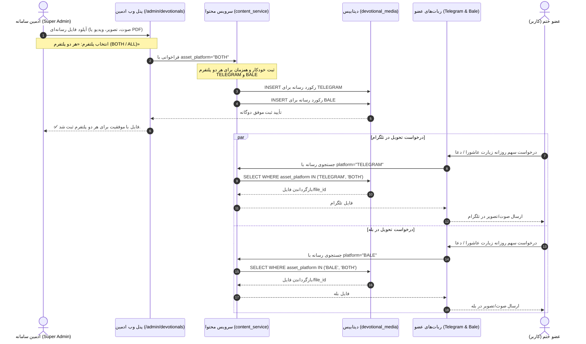

# 📙 مستر فرزند ۱۰: مهندسی مجدد پیام‌های گروهی، قیمت‌گذاری بسته‌ای، پرداخت با فیش بانکی/پی‌پینگ مستقیم و قفل پنل سازندگان
**(Child Master 10 — Broadcast 1000-Recipient Tier Pricing, Bank Receipt Upload Architecture, PayPing Direct Link & Admin-Only Guard for Creator Panel)**

> **🔗 موقعیت در درختوارهٔ اسناد (والد و فرزندی):**
> - **⬆️ سند مادر (والد):** [ADMIN_PANEL_REDESIGN_MASTER.md](../ADMIN_PANEL_REDESIGN_MASTER.md)
> - **⬅️ اسناد هم‌خانواده (فرزندان دیگر):**
>   - **[مستر فرزند ۰۱](MASTER_01_KHATM_ENGINE_AND_MODES.md):** موتور ختم‌ها، تعهدی/آزاد و سهم‌بندی
>   - **[مستر فرزند ۰۲](MASTER_02_CONTENT_DEVOTIONALS_AND_MEDIA.md):** مدیریت محتوا، ادعیه، خطبه، قرآن و فایل‌های چندرسانه‌ای
>   - **[مستر فرزند ۰۳](MASTER_03_PLANS_BILLING_WALLET_AND_ADS.md):** پلن‌های پولی/رایگان، کیف پول، درگاه پرداخت و تبلیغات
>   - **[مستر فرزند ۰۴](MASTER_04_BOTS_USERS_MODERATION_AND_OPS.md):** معماری مولتی‌بات، کاربران و عملیات سرور
>   - **[مستر فرزند ۰۵](MASTER_05_OPEN_KHATM_AND_KHUTBAH_FLOW.md):** فلوهای ختم باز، خطبه‌های تدریجی و رول‌اور
>   - **[مستر فرزند ۰۶](MASTER_06_PAYMENT_GATEWAY_AND_CALLBACK_ARCHITECTURE.md):** معماری پرداخت، کال‌بک بانکی و پورت‌های سرور
>   - **[مستر فرزند ۰۷](MASTER_07_MEMBER_DAILY_DIGEST_AND_MOTIVATIONAL_PROGRESS.md):** تفکیک پیام تأیید و پیام گزارش پیشرفت ختم
>   - **[مستر فرزند ۰۸](MASTER_08_CREATOR_PANEL_AND_USER_EXPERIENCE.md):** بازطراحی کامل پنل کاربری سازندگان ختم (وب‌اپ)
>   - **[مستر فرزند ۰۹](MASTER_09_BALE_ADAPTER_AND_MARKDOWN_COMPATIBILITY.md):** مبدل مارک‌داون بله و سازگاری پیام‌رسان بله
>   - **[مستر فرزند ۱۰ (همین فایل)](MASTER_10_PLANS_BROADCAST_RECEIPT_PAYMENT_AND_CREATOR_PANEL_GUARD.md):** قیمت‌گذاری پیام گروهی، حذف پیام رایگان، شارژ با فیش بانکی/پی‌پینگ مستقیم و قفل دسترسی پنل سازندگان

---

## ۱. تحلیل نیازمندی‌ها و اهداف کلیدی

### ۱.۱. قوانین جدید پیام گروهی و اصلاح پلن‌ها (Broadcast & Plans Architecture)
1. **پلن حرفه‌ای (PRO Plan) پیام نامحدود ندارد:**
   - ادعای قبلی در متون و کارت‌های پلن پرو مبنی بر «ارسال نامحدود پیام گروهی» به طور کامل باطل شد.
   - پلن پرو شامل: عدم نمایش هرگونه تبلیغ به اعضای ختم‌ها، سقف نامحدود مخاطبان، و **امکان دسترسی به سرویس ارسال پیام گروهی (به شرط پرداخت هزینه هر ارسال از کیف پول)** است.
2. **محاسبه هزینه پیام گروهی به ازای هر ۱۰۰۰ مخاطب (Tiered / Ceiling Per 1,000 Recipients):**
   - هر پیام گروهی به نسبت تعداد مخاطبان هدف مشمول هزینه می‌شود.
   - فرمول محاسبه بسته‌ای (به صورت سقف روبه‌بالا):
     $$\text{تعداد بسته‌های ۱۰۰۰ نفری} = \left\lceil \frac{\text{تعداد مخاطبان هدف}}{1000} \right\rceil$$
     $$\text{مبلغ قابل کسر از کیف پول} = \text{تعداد بسته‌ها} \times \text{نرخ مصوب هر ۱۰۰۰ نفر}$$
   - **مثال‌ها:**
     - برای ۱ تا ۱۰۰۰ مخاطب: هزینه معادل **۱ بسته** است (حتی برای ۱۰۰ نفر نیز هزینه ۱ بسته کسر می‌شود).
     - برای ۱۰۰۱ تا ۲۰۰۰ مخاطب: هزینه معادل **۲ بسته** است.
     - برای ۶۰۰۰ مخاطب: هزینه معادل **۶ بسته** است.
   - پیش از ثبت نهایی پیام در صف نظارت، مبلغ فوق از موجودی نقدی/اعتباری کیف پول کاربر کسر می‌شود. در صورت عدم کفایت موجودی، پیام ثبت نمی‌شود و به کاربر هشدار کمبود موجودی داده می‌شود.
3. **حذف کامل پیام رایگان:**
   - سهمیه قبلی موسوم به «۲ پیام گروهی رایگان» به طور کامل منسوخ می‌گردد.
   - هیچ کاربری در هیچ پلنی پیام گروهی رایگان ندارد و تمامی ارسال‌ها مستلزم پرداخت است.
4. **پلن پایه (BASIC Plan) پیام گروهی ندارد:**
   - در پلن پایه ویژگی ارسال پیام گروهی فعال نیست (`broadcast_enabled = False`) و علامت تیک آن از جدول مقایسه پلن پایه حذف می‌گردد.

---

### ۱.۲. قفل و مخفی‌سازی پنل سازندگان برای کاربران عادی (Creator Panel Access Guard)
1. **دسترسی انحصاری برای مدیر اصلی (Admin Only):**
   - تا زمان تکمیل و شخصی‌سازی نهایی پنل سازندگان، این بخش برای تمامی کاربران عادی کاملاً مخفی و مسدود می‌شود و صرفاً کاربران با نقش `UserRole.SUPER_ADMIN` حق دسترسی به آن را دارند.
2. **در لایه ربات تلگرام و بله:**
   - دکمه شیشه‌ای «پنل سازنده (وب‌اپ)» (`creator:web_login`) در کیبوردهای تنظیمات، راهنما و منوی اصلی برای کاربران غیرادمین نمایش داده نمی‌شود.
   - اگر کاربر عادی دستور `/creator_panel` یا `/creator` را تایپ کند یا دکمه قدیمی را بفشارد، پاسخ مؤدبانه فارسی ارسال می‌شود:
     `«🌱 این بخش در حال حاضر در دست به‌روزرسانی و ارتقا می‌باشد و به زودی فعال خواهد شد.»`
3. **در لایه وب‌اپلیکیشن (`/creator/*` و `/mini/creator/*`):**
   - در روت‌های احراز هویت مینی‌اپ (`/mini/creator/auth`) و تمام صفحات زیرمجموعه `/creator`:
     بررسی صریح `user.role == UserRole.SUPER_ADMIN` انجام می‌شود. در صورت تلاش کاربر عادی برای ورود، خطای ۴۰۳ با پیامی واضح بازگردانده می‌شود و توکن سشن صادر نمی‌شود.

---

### ۱.۳. معماری شارژ کیف پول با ارسال فیش بانکی و پی‌پینگ مستقیم (Receipt Top-up Flow)
1. **غیرفعال‌سازی موقت درگاه کال‌بکی (Preserve & Bypass):**
   - کدهای درگاه پرداخت خودکار کال‌بکی حذف نمی‌شوند، اما به عنوان روش اصلی پرداخت در ربات خاموش/غیرفعال می‌شوند تا کاربران با خطای تایم‌اوت مرورگر مواجه نشوند.
2. **پاسخ به سوال کاربر در مورد پی‌پینگ بدون کال‌بک و تعریف محصول:**
   - **آیا نیاز به تعریف محصول جداگانه است؟** خیر! در پنل پی‌پینگ در بخش ایجاد محصول (`app.payping.ir/myShop/product/create`)، کافی است گزینه **«تعیین قیمت توسط مشتری» (Open Price)** فعال شود. با این کار، **تنها یک محصول با یک لینک ثابت** (مثلاً `payping.ir/d/XXXX`) ساخته می‌شود و هر کاربری روی آن کلیک کند، می‌تواند هر مبلغ دلخواهی (۵۰ هزار تومان، ۱۰۰ هزار، ۲ میلیون و ...) را مستقیماً از طریق شاپرک پرداخت کند.
   - همچنین پی‌پینگ لینک «صفحه پرداخت شخصی» دارد (`payping.ir/@Username`) که نیازی به ساخت هیچ محصولی ندارد.
   - **آیا می‌توان از API پی‌پینگ بدون کال‌بک استفاده کرد؟** خیر؛ چون وب‌سرویس پی‌پینگ ارسال فیلد `returnUrl` را اجباری می‌داند و بانک خریدار را حتماً به آن بازمی‌گرداند. بنابراین راه‌حل بدون نقص، استفاده از **لینک مستقیم پی‌پینگ** یا **کارت به کارت** و سپس دریافت فیش و تأیید ادمین است.
3. **فلو دریافت فیش در ربات (FSM Receipt Upload Flow):**
   - کاربر در بخش کیف پول دکمه «💳 افزایش موجودی (کارت به کارت / لینک پرداخت)» را می‌زند.
   - ربات متن راهنما، شماره کارت/شبا، نام صاحب حساب و لینک مستقیم پرداخت پی‌پینگ را ارسال می‌کند.
   - کاربر دکمه «📸 ارسال تصویر فیش واریز» را می‌زند.
   - **مرحله ۱:** ربات مبلغ واریزی به تومان را می‌پرسد.
   - **مرحله ۲:** ربات عکس یا فایل فیش را دریافت می‌کند.
   - رکورد در جدول `wallet_receipt_claims` ذخیره می‌شود (وضعیت: `PENDING`).
   - اعلان بلادرنگ همراه با تصویر فیش برای سوپرادمین‌ها در تلگرام ارسال می‌گردد:
     ```text
     🧾 درخواست جدید شارژ کیف پول (فیش واریزی)

     👤 کاربر: نام کاربر (شناسه: 12345678)
     💰 مبلغ اعلام‌شده: ۵۰,۰۰۰ تومان
     📅 زمان ثبت: ۲۲ مهر ۱۴۰۵ - ۱۲:۳۰

     لطفاً پس از تطبیق با حساب بانکی، وضعیت را مشخص فرمایید:
     ```
     دکمه‌های اینلاین ادمین:
     `[✅ تأیید و افزایش اعتبار: ۵۰,۰۰۰ تومان]`
     `[❌ رد فیش واریزی]`
4. **تأیید یا رد توسط ادمین:**
   - **با زدن تأیید:** وضعیت به `APPROVED` تغییر می‌کند، موجودی کیف پول کاربر دقیقاً به همان میزان شارژ می‌شود (`wallet_service.credit_balance`)، فاکتور معتبر صادر می‌شود، پیام ادمین ویرایش می‌شود (جلوگیری از کلیک تکراری)، و به کاربر پیام تبریک و شارژ کیف پول ارسال می‌شود.
   - **با زدن رد:** وضعیت به `REJECTED` تغییر می‌کند، به کاربر اعلان رد فیش ارسال می‌شود و ادمین می‌تواند دلیل رد را قید کند.

---

### ۱.۴. مدت اعتبار ۳۰ روزه پلن پرو، تمدید افزایشی و سیستم یادآوری هوشمند (Pro Plan 30-Day Lifecycle)
1. **مدت زمان ۳۰ روزه (1-Month Validity):**
   - پلن حرفه‌ای (PRO) دارای مدت اعتبار ۳۰ روزه از لحظه فعال‌سازی است.
2. **تمدید افزایشی (Additive Renewal):**
   - در صورتی که کاربر قبل از پایان اعتبار پلن خود را تمدید کند، ۳۰ روز به انتهای تاریخ انقضای فعلی اضافه می‌گردد (مثلاً اگر ۱۰ روز باقی مانده باشد، با تمدید به ۴۰ روز افزایش می‌یابد).
   - در صورتی که پس از انقضا یا برای بار اول خریداری شود، ۳۰ روز از زمان خرید تعیین می‌گردد.
3. **پیام‌های هشدار و یادآوری هوشمند قبل از انقضا (Pre-lapse Warnings):**
   - **یادآوری ۱ هفته زودتر (۷ روز مانده):** پیامی دوستانه و گرم جهت اطلاع از نزدیک شدن زمان انقضا و امکان تمدید بدون وقفه برای کاربر ارسال می‌شود.
   - **هشدار ۲۴ ساعت مانده:** پیامی هشداردهنده مبنی بر اینکه تنها ۲۴ ساعت تا بازگشت به پلن عادی باقی مانده ارسال می‌گردد.
4. **پایان اعتبار و بازگشت خودکار (Lapse & Downgrade):**
   - در صورت عدم تمدید، پلن کاربر به صورت خودکار از پرو خارج شده و با توجه به تعداد اعضای فعالش به پلن عادی (FREE یا در صورت رد شدن از سقف به BASIC) منتقل می‌شود و پیام اطلاع‌رسانی ارسال می‌گردد.

---

## ۲. مدل داده و پایگاه داده (Data Model)

```sql
-- جدول درخواست‌های شارژ با فیش واریزی
CREATE TABLE IF NOT EXISTS wallet_receipt_claims (
    id UUID PRIMARY KEY,
    user_id UUID NOT NULL REFERENCES users(id) ON DELETE CASCADE,
    amount_toman INTEGER NOT NULL,
    photo_file_id VARCHAR(255) NOT NULL,
    photo_file_id_bale VARCHAR(255),
    status VARCHAR(20) NOT NULL DEFAULT 'PENDING', -- PENDING, APPROVED, REJECTED
    admin_user_id UUID REFERENCES users(id),
    admin_note VARCHAR(500),
    created_at TIMESTAMP WITH TIME ZONE DEFAULT NOW(),
    reviewed_at TIMESTAMP WITH TIME ZONE
);

CREATE INDEX IF NOT EXISTS ix_wallet_receipt_claims_user ON wallet_receipt_claims(user_id);
CREATE INDEX IF NOT EXISTS ix_wallet_receipt_claims_status ON wallet_receipt_claims(status);
```

---

## ۳. دیاگرام توالی (Sequence Diagrams)

### ۳.۱. فرایند شارژ با فیش بانکی / پی‌پینگ مستقیم و تأیید ادمین



---

### ۳.۲. فرایند قیمت‌گذاری و ارسال پیام گروهی بسته‌ای



---

### ۳.۳. چرخهٔ حیات پلن حرفه‌ای (PRO)، تمدید افزایشی و هشدارهای خودکار





---

### ۳.۴. معماری بارگذاری و تحویل چندرسانه‌ای ادعیه برای هر دو پلتفرم (Dual-Platform Ingestion & Delivery)



---

## ۴. ماتریس و بسته‌های کاری (Work Packages Ledger)

| بسته | عنوان | وضعیت | شرح اقدامات فنی |
|:---:|:---|:---:|:---|
| **WP-01** | ثبت مستر فرزند ۱۰ و بروزرسانی اسناد | COMPLETED | تدوین سند مستر ۱۰، ثبت تصمیمات فنی در `DECISIONS.md` و ارجاع در `INDEX.md` |
| **WP-02** | قفل دسترسی پنل سازندگان برای ادمین | COMPLETED | اصلاح `web/app.py`، `keyboards.py` و `my_khatms.py` جهت محدودسازی منحصربه‌فرد به `SUPER_ADMIN` |
| **WP-03** | اصلاح پلن‌ها و هزینه‌گذاری بسته‌ای پیام | COMPLETED | حذف پیام رایگان، پیاده‌سازی فرمول بسته‌های ۱۰۰۰ نفری در `broadcast/service.py`، اصلاح متون و جداول پلن |
| **WP-04** | ماژول فیش بانکی و پرداخت مستقیم | COMPLETED | افزودن مدل `WalletReceiptClaim`، ایجاد مایگریشن، پیاده‌سازی FSM ارسال فیش در ربات و اطلاع‌رسانی به ادمین‌ها |
| **WP-05** | دکمه‌های تأیید و رد فیش توسط ادمین | COMPLETED | پیاده‌سازی هندلرهای تلگرام برای تأیید/رد فیش با یک کلیک و شارژ خودکار کیف پول کاربر |
| **WP-06** | دوره ۳۰ روزه پرو، تمدید و یادآوری‌ها | COMPLETED | افزودن `expires_at`، تمدید افزایشی ۳۰ روزه، هشدارهای ۷ روز و ۲۴ ساعت، مایگریشن و استقرار لایو |
| **WP-07** | آزمون‌های واحد و استقرار زنده | COMPLETED | تدوین ۳۵ تست خودکار در `tests/`، اجرای کامل `pytest`، پوش به گیت و استقرار روی سرور `91.107.137.22` |
| **WP-08** | پشتیبانی رسانه‌های دوپلتفرمی و ممیزی سرتاسری | COMPLETED | پشتیبانی از `BOTH/ALL` در تمام توابع `content_service`، رفع خطای `unsupported asset platform`، رفع باگ `PlanTier` در کیف پول، کوتاه‌سازی کال‌بک‌های بالای ۶۴ بایت و ممیزی خط به خط همزمانی دیتابیس و انزوای پورت‌ها |

---

## ۵. دستورات اعتبارسنجی
```bash
python -m pytest tests/test_wallet_check_button.py tests/test_member_daily_digest.py -v
python -m pytest -q
```

