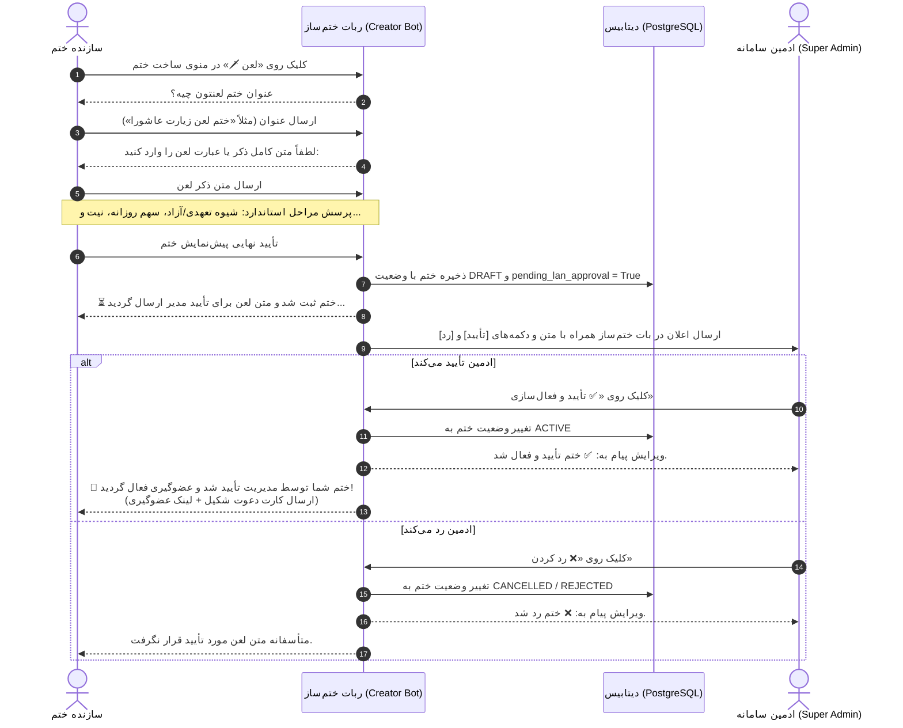
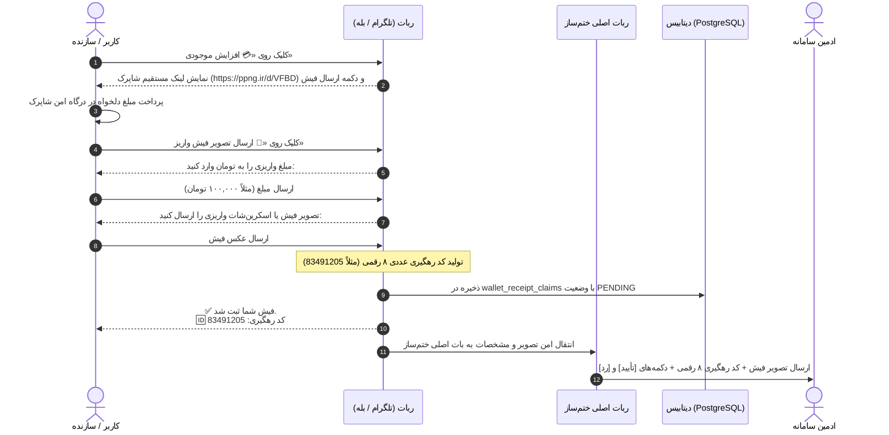

# 📗 مستر فرزند ۱۱: بازطراحی کامل ساخت ختم لعن، پرداخت مستقیم پی‌پینگ، کد رهگیری عددی و ارسال اعلان‌های مدیریت از ربات ختم‌ساز
**(Child Master 11 — Laan Wizard Redesign, Direct PayPing Checkout, Numeric Tracking Code & Centralized Admin Bot Notifications)**

> **🔗 موقعیت در درختوارهٔ اسناد (والد و فرزندی):**
> - **⬆️ سند مادر (والد):** [ADMIN_PANEL_REDESIGN_MASTER.md](../ADMIN_PANEL_REDESIGN_MASTER.md) (مستر اصلی بازطراحی کامل پنل مدیریت)
> - **⬅️ اسناد هم‌خانواده (فرزندان دیگر):**
>   - **[مستر فرزند ۰۱](MASTER_01_KHATM_ENGINE_AND_MODES.md):** موتور ختم‌ها، تعهدی/آزاد و سهم‌بندی
>   - **[مستر فرزند ۰۴](MASTER_04_BOTS_USERS_MODERATION_AND_OPS.md):** معماری مولتی‌بات، کاربران و صف‌های تأیید
>   - **[مستر فرزند ۱۰](MASTER_10_PLANS_BROADCAST_RECEIPT_PAYMENT_AND_CREATOR_PANEL_GUARD.md):** پلن‌های ۳۰ روزه، محاسبه بسته پیام و تأیید فیش بانکی
>   - **[مشخصات فنی نسخه ۳ لعن](../v3_specs/04_LAAN_MODERATION_AND_ADMIN_SYSTEM.md):** سیستم تأیید متون لعن
> - **🐛 مرجع تصمیمات و مستندات ثبت‌شده:** `DEC-PY-0123`، `DEC-PY-0124` در [DECISIONS.md](../DECISIONS.md)

---

## ۱. راهنمای فوق‌ساده و رفتار مطلوب سیستم (جعبهٔ علامت سؤال `[؟]`)

### ❓ ۱. ویزارد ساخت ختم لعن چگونه کار می‌کند و چرا دکمه‌های آماده حذف شدند؟
در نسخه‌های قبلی، دکمه‌های ثابتی مثل «لعن عمر»، «لعن ابوبکر»، «لعن عایشه» و... به کاربر نشان داده می‌شد. طبق دستور جدید:
1. **حذف گزینه‌های آماده:** تمامی این دکمه‌ها و دسته‌بندی‌ها به طور کامل از دیتابیس (`khatm_categories`) و پنل وب ادمین حذف می‌شوند و هیچ گزینهٔ پیش‌فرضی به کاربر پیشنهاد نمی‌گردد.
2. **پرسش مستقیم عنوان:** به محض این که سازنده در منوی ساخت ختم روی گزینهٔ «لعن 🗡️» کلیک می‌کند، ربات بلافاصله می‌پرسد:
   > «عنوان ختم لعنتون چیه؟\n(لطفاً عنوان ختم لعن مورد نظر خود را ارسال فرمایید، مثلاً: «ختم لعن زیارت عاشورا» یا «ختم لعن اختصاصی»):»
3. **دریافت متن کامل ذکر لعن:** پس از ارسال عنوان، ربات پیام دوم را می‌فرستد:
   > «متن ذکر لعن را وارد کنید:\n(لطفاً متن کامل ذکر یا عبارت لعن مورد نظر خود را بنویسید. این متن پس از تکمیل ثبت ختم، جهت بررسی و تأیید برای مدیر سامانه ارسال خواهد شد 🌱):»
4. **ادامهٔ ویزارد استاندارد:** سپس ربات سوالات استاندارد ویزارد را به ترتیب می‌پرسد:
   - انتخاب شیوه (تعهدی یا آزاد)
   - هدف کلی یا تعداد سهم روزانه
   - بازه زمانی و ساعت یادآوری
   - نیت ختم
5. **ثبت در صف تأیید:** ختم با وضعیت در انتظار بررسی (`status = DRAFT` یا `pending_lan_approval = True`) ثبت شده و پیام زیر به سازنده داده می‌شود:
   > «⏳ ختم «{عنوان}» شما ثبت شد و متن ذکر لعن سفارشی برای بررسی و تأیید مدیر ارسال گردید.\n\nتا پیش از تأیید مدیر، عضوگیری در این ختم غیرفعال است و به‌محض تأیید، کارت و لینک دعوت همین‌جا برایتان ارسال خواهد شد 🌱»
6. **ارسال به ادمین و فعال‌سازی:** پیام بررسی متن با دکمه‌های «[✅ تأیید و فعال‌سازی]» و «[❌ رد کردن]» به پیوی ادمین در ربات «ختم‌ساز» ارسال می‌شود. به محض تأیید ادمین، ختم فعال شده و **کارت دعوت آمادهٔ فوروارد همراه با لینک اختصاصی عضوگیری مستقیماً برای سازنده ارسال می‌گردد**.

---

### ❓ ۲. شارژ کیف پول با لینک مستقیم شاپرک و حذف شماره کارت
در صفحهٔ افزایش موجودی کیف پول:
- **شماره کارت بانکی و نام دارنده کارت به طور کامل حذف گردید.**
- تنها یک لینک پرداخت مستقیم و امن شاپرک با شناسهٔ معتبر خدمتگزاران نمایش داده می‌شود:
  `https://ppng.ir/d/VFBD`
- کاربر پس از پرداخت از طریق این لینک، روی دکمهٔ «📸 ارسال تصویر فیش واریز» زده و تصویر رسید را می‌فرستد.

---

### ❓ ۳. کد رهگیری عددی تمیز (Numeric Tracking Code)
قبلاً کد رهگیری به صورت برش ۸ کاراکتری از شناسه UUID (مثلاً `01a134f0`) نمایش داده می‌شد که در چیدمان راست‌به‌چپ پیام‌های فارسی ناقص و نامفهوم به نظر می‌رسید.
اکنون کد رهگیری به صورت یک **عدد تمیز و خوانای ۸ رقمی** (مثلاً `83491205`) تولید می‌شود تا هم برای کاربر و هم برای حسابداری و بررسی ادمین کاملاً واضح و خوانا باشد.

---

### ❓ ۴. چرا تمام اعلان‌های مدیریتی باید از ربات «ختم‌ساز» (`Khatm_Saz_bot`) ارسال شود؟
ربات سازنده ختم‌ساز (`@Khatm_Saz_bot`) به عنوان پل ارتباطی رسمی میان سرور و مدیر سامانه عمل می‌کند. 
- در نسخه قبلی، چنانچه چت‌آیدی ادمین در متغیر `.env` خالی می‌بود، پیامی ارسال نمی‌شد.
- در معماری جدید، سیستم شناسه ادمین‌ها را **هم از متغیر محیطی و هم مستقیماً از جدول کاربران دیتابیس (`role = 'SUPER_ADMIN'`)** واکشی می‌کند؛ بنابراین اعلان‌ها هرگز گم نمی‌شوند.
- همچنین تمامی پیام‌های نظارتی (فیش‌های واریزی کیف پول و متون درخواستی لعن) منحصراً توسط **بات اصلی ختم‌ساز** برای ادمین ارسال می‌گردند. اگر کاربری تصویر فیش را در یک ربات عضو آپلود کرده باشد، سرور تصویر را دانلود کرده و از طریق بات ختم‌ساز برای ادمین فوروارد/آپلود می‌کند تا خطای پلتفرم رخ ندهد.

---

## ۲. دیاگرام‌های توالی فرآیند (Sequence Diagrams)

### ۲.۱. فرایند ویزارد ثبت ختم لعن، تأیید مدیر و ارسال خودکار کارت دعوت به سازنده



---

### ۲.۲. فرایند پرداخت مستقیم شاپرک، کد رهگیری عددی و ارسال فیش به ادمین



---

## ۳. ماتریس بسته‌های کاری (Work Packages Ledger)

| بسته | عنوان | وضعیت | شرح اقدامات فنی |
|:---:|:---|:---:|:---|
| **WP-01** | ثبت سند مستر ۱۱ و تصمیمات معماری | COMPLETED | تدوین سند مستر ۱۱، ثبت تصمیمات فنی در `DECISIONS.md` و ارجاع به اسناد والد |
| **WP-02** | حذف دسته‌بندی‌های آماده لعن | PLANNED | حذف رکوردهای `group == LAAN` از جدول `khatm_categories` و پاکسازی در استارت‌آپ |
| **WP-03** | جریان تعاملی عنوان و متن در ویزارد لعن | PLANNED | افزودن FSM states برای عنوان و متن لعن، حذف گزینه‌های آماده و اتصال به سؤالات بعدی ویزارد |
| **WP-04** | ارسال خودکار کارت دعوت به سازنده پس از تأیید لعن | PLANNED | ارسال مستقیم کارت و لینک دعوت به پیوی سازنده در `notify_creator_laan_decision` |
| **WP-05** | اصلاح صفحه شارژ کیف پول و لینک شاپرک | PLANNED | حذف شماره کارت، تنظیم لینک مستقیم `https://ppng.ir/d/VFBD` و تولید کد رهگیری عددی ۸ رقمی |
| **WP-06** | ارسال تضمینی اعلان‌های مدیریت از ربات ختم‌ساز | PLANNED | اتصال هوشمند به چت‌آیدی ادمین‌های دیتابیس و ارسال متمرکز اعلان‌ها از طریق `Khatm_Saz_bot` |
| **WP-07** | آزمون‌های واحد، استقرار زنده و اعتبارسنجی سرور | PLANNED | اجرای تست‌های خودکار، پوش به گیت، استقرار روی سرور و بررسی لاگ‌های لایو |

---

## ۴. دستورات اعتبارسنجی
```bash
python -m pytest tests/test_laan_wizard_and_admin_dispatch.py -v
python -m pytest -q
```
