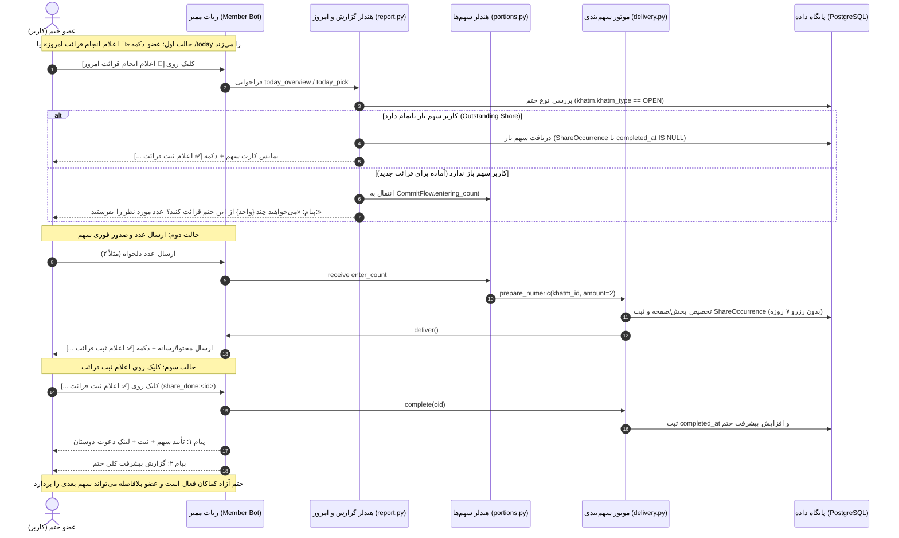

# 📜 مستر فرزند ۱۳: بازطراحی و رفع کامل جریان ختم آزاد (ثبت فوری قرائت، حذف مسدودسازی روزانه و رفع هدایت اشتباه)
**(Child Master 13 — Open Khatm Flow Overhaul: Immediate Recitation Recording, Eradication of Daily Delivery Blocks & Fixing Commitment Mode Interception)**

> **🔗 موقعیت در درختوارهٔ اسناد (والد و فرزندی):**
> - **⬆️ سند مادر (والد):** [ADMIN_PANEL_REDESIGN_MASTER.md](../ADMIN_PANEL_REDESIGN_MASTER.md) (مستر اصلی بازطراحی کامل پنل مدیریت)
> - **⬅️ اسناد هم‌خانواده (فرزندان دیگر):**
>   - **[مستر فرزند ۰۱](MASTER_01_KHATM_ENGINE_AND_MODES.md):** موتور ختم‌ها، انواع ختم، تعهدی/آزاد و چرخهٔ سهم‌بندی
>   - **[مستر فرزند ۰۵](MASTER_05_OPEN_KHATM_AND_KHUTBAH_FLOW.md):** جریان ختم آزاد، موتور دورهای ۵ بخشی خطبه فدکیه و سامانهٔ کپشن ویدیوها
>   - **[مستر فرزند ۰۷](MASTER_07_MEMBER_DAILY_DIGEST_AND_MOTIVATIONAL_PROGRESS.md):** تفکیک پیام تأیید و گزارش پیشرفت پس از ثبت سهم
>   - **[مستر فرزند ۱۲](MASTER_12_DEDICATED_ADMIN_BOT_AND_LIVE_ERROR_MONITORING.md):** ربات اختصاصی ادمین و سیستم لاگ لحظه‌ای
>   - **[مستر فرزند ۱۳ (همین فایل)](MASTER_13_OPEN_KHATM_IMMEDIATE_CONTRIBUTION_AND_RECITATION_RECORDING.md):** جریان ثبت فوری قرائت ختم آزاد و رفع موانع
> - **📋 اسناد مشخصات مبنا:** [02_COMMITMENT_VS_FREE_AND_REMINDERS.md](../v3_specs/02_COMMITMENT_VS_FREE_AND_REMINDERS.md)

---

## ۱. صورت‌مسئله و دلایل باگ‌های سیستم ختم آزاد (Problem Statement)

کارفرمای محترم گزارش دادند:
> «تو ختم آزاد همون موقع که می‌زنن اعلام ثبت قرائت باید باز باشه براشون؛ الان اینطوری خرابه، برو فایل‌های مستر رو بخون بررسی کن و دقیق انجام بده. فقط روی ختم آزاد کار کن.»

### کالبدشکافی دقیق ۴ باگ اساسی در کد فعلی ختم آزاد:

1. **انحراف به منوی انتخاب تعهد در `portions.py` (Mode Picker Hijack):**
   - هنگامی که کاربر در ختم آزاد یک سهم دریافت می‌کند، متد `delivery.prepare_numeric` برای ذخیرهٔ موقت نوع سهم، فیلد `part.commitment_mode = "COUNT"` را در دیتابیس ثبت می‌کرد.
   - سپس وقتی کاربر روی دکمهٔ دریافت سهم مجدد یا دکمهٔ اعلام قرائت (`contribute:`) کلیک می‌کرد، خط ۶۲۲ در `portions.py` به دلیل این‌که `commitment_mode` برابر `"COUNT"` شده بود، وارد شرط تعهدی می‌شد و تابع `start_commitment_mode_picker` را اجرا می‌کرد!
   - نتیجه: به کاربر در یک ختم کاملاً آزاد، پیام نامربوط: `«این ختم تعهدی است 🌱 دو راه برای شرکت داری: تعهد منظم / تعهد تعدادی»` نشان داده می‌شد و جریان ختم آزاد قطع می‌شد!

2. **مسدودسازی با پیام «سهم امروز قبلاً ارسال شده» یا «هیچ سهمی برای امروز وجود ندارد» در `report.py`:**
   - هنگامی که کاربر از کیبورد پایین دکمهٔ `📖 اعلام انجام قرائت امروز` (یا کامند `/today`) را می‌زد، سیستم از طریق `today_pick:` وارد متد `deliver_today_early` می‌شد.
   - در خط ۹۴، متد `delivery.prepare` فراخوانی می‌شد؛ اما چون این متد برای ختم‌های تعهدی روزانه طراحی شده، در خط ۱۷۴ به محض مشاهدهٔ `commitment_mode == "COUNT"` مقدار `None` برمی‌گرداند.
   - سپس کد در خط ۱۳۸ به کاربر پیام می‌داد: `«هیچ سهمی برای امروز وجود ندارد.»`!
   - یا اگر وارد شاخهٔ غیرمنیج می‌شد، خط ۲۷۲ با متد `notification_service.already_sent_today` بررسی می‌کرد و به کاربر اخطار می‌داد: `«سهم امروز شما قبلاً ارسال شده است.»`!
   - در حالی که طبق روح ختم آزاد در `MASTER_05` و `02_COMMITMENT_VS_FREE_AND_REMINDERS.md`، در ختم آزاد هیچ محدودیت روزانه یا ساعتی وجود ندارد و کاربر هر زمان و هر چند بار در روز که مایل باشد، می‌تواند سهم بخواند و ثبت کند.

3. **عدم نمایش مستقیم سهم باز یا فرم دریافت سهم:**
   - اگر کاربر در ختم آزاد یک سهم ناتمام باز داشت، دکمهٔ «اعلام انجام قرائت» باید فوراً همان سهم را همراه با دکمهٔ `[✅ اعلام ثبت قرائت ...]` بیاورد.
   - اگر سهم بازی نداشت، باید فوراً بدون منوهای اضافه بپرسد: `«می‌خواهید چند {واحد} از این ختم قرائت کنید؟ عدد مورد نظر را بفرستید:»`.

4. **نمایش منوی ساعت یادآوری برای ختم آزاد در «ختم‌های من» (`member_my_khatms.py`):**
   - در بخش ختم‌های من، دکمهٔ `mk_hourmenu` (تنظیم ساعت یادآوری) برای ختم آزاد نیز نمایش داده می‌شد؛ در حالی که ختم آزاد اصولاً فاقد ساعت یادآوری و ریمایندر روزانه است.

---

## ۲. دیاگرام توالی استاندارد جریان ختم آزاد (Sequence Diagram)



---

## ۳. اصلاحات دقیق فنی در سطح کد (Step-by-Step Code Fixes)

### ۱. اصلاح `src/khatmsaz/bot/handlers/portions.py`
- در متد `ask_contribution_amount` (خط ۶۰۳ به بعد):
  - قبل از هرگونه بررسی `participation.commitment_mode`:
  ```python
  if khatm is not None and participation is not None and khatm.khatm_type == KhatmTypeEnum.OPEN:
      from khatmsaz.bot.handlers.member_commitment import CommitFlow
      from khatmsaz.bot.member_copy import content_family
      fam = await content_family(session, khatm)
      await state.set_state(CommitFlow.entering_count)
      await state.update_data(commit_pid=str(participation.id), commit_family=fam.upper())
      unit = (
          "بخش" if fam == "khutbah"
          else "صفحه" if khatm.template_type == KhatmTemplateType.QURAN_PAGE
          else "صلوات" if fam == "salawat"
          else "مرتبه"
      )
      await callback.message.answer(f"می‌خواهید چند {unit} از این ختم قرائت کنید؟ عدد مورد نظر را بفرستید:")
      await safe_answer_callback(callback)
      return
  ```
  - این کار تضمین می‌کند که اعضای ختم آزاد **هرگز** به منوی انتخاب حالت تعهد (`start_commitment_mode_picker`) هدایت نشوند.

### ۲. اصلاح `src/khatmsaz/bot/handlers/report.py`
- در متد `deliver_today_early` (`today_pick:`):
  - اگر ختم از نوع `OPEN` باشد:
    - نباید شرط `delivery.is_managed` مانع شود و مقدار `None` بدهد.
    - نباید شرط `already_sent_today` مانع کاربر شود.
    - منطق اختصاصی ختم آزاد:
      1. ابتدا سهم‌های بازِ تحویل‌داده‌شده اما تکمیل‌نشده بررسی می‌شوند (`list_outstanding`).
      2. اگر سهم باز دارد، همان سهم همراه با متن و دکمهٔ `[✅ اعلام ثبت قرائت ...]` نمایش داده می‌شود تا کاربر بتواند ثبت کند.
      3. اگر سهم باز ندارد، بلافاصله پرسش دریافت سهم جدید فعال می‌شود (`CommitFlow.entering_count`):
         `«می‌خواهید چند {واحد} از این ختم قرائت کنید؟ عدد مورد نظر را بفرستید:»`.

### ۳. اصلاح `src/khatmsaz/bot/handlers/member_my_khatms.py`
- در متد `list_member_khatms`:
  - برای ردیف‌های مربوط به ختم آزاد (`khatm.khatm_type == KhatmTypeEnum.OPEN`):
    - دکمهٔ `[⚙️ تنظیم ساعت یادآوری]` (`mk_hourmenu`) کلاً حذف می‌شود.
    - دکمهٔ `[📖 اعلام انجام قرائت]` با کال‌بک `today_pick:{p.id}` در صدر گزینه‌ها قرار می‌گیرد.

### ۴. اصلاح `src/khatmsaz/modules/share_occurrence/delivery.py`
- در متد `prepare_numeric`:
  - بررسی سهم‌های قبلی با پیشوند `open:` اصلاح می‌شود تا در صورت وجود سهم باز قدیمی، همان سهم برگردانده شود.
  - برای ختم‌های آزاد، رزرو منقضی‌شونده ساخته نمی‌شود و وضعیت آزاد تضمین می‌گردد.

### ۵. اصلاح متن‌های خطا در `share_occurrence/service.py` و `member_commitment.py`
- هرگونه متن قدیمی حاوی کلمهٔ «رزرو» (مانند `این رزرو دیگر معتبر نیست`) به متن‌های دوستانه و بدون اصطلاحات فنی تغییر می‌یابد:
  `«ثبت این سهم با مشکل مواجه شد یا قبلاً انجام شده است؛ لطفاً وضعیت را مجدداً بررسی نمایید.»`

---

## ۴. ماتریس اعتبارسنجی و تست‌ها (Verification Matrix)

| سناریوی تست | ورودی | رفتار مورد انتظار سیستم |
| :--- | :--- | :--- |
| **تست ۱: ورود به ختم آزاد** | کلیک روی لینک دعوت یا ارسال `/start` | کارت خوش‌آمد بدون سوال ساعت یادآوری با دکمه `[📿 دریافت سهم قرائت]` نمایش داده می‌شود. |
| **تست ۲: زدن دکمه دریافت سهم** | کلیک روی `contribute:<khatm_id>` | مستقیماً می‌پرسد: «می‌خواهید چند {واحد} از این ختم قرائت کنید؟» (بدون منوی تعهدی). |
| **تست ۳: وارد کردن عدد سهم** | ارسال عدد ۲ | سهم و محتوا فوراً ارسال شده و دکمه `[✅ اعلام ثبت قرائت ...]` زیر آن قرار دارد. |
| **تست ۴: زدن دکمه اعلام ثبت قرائت** | کلیک روی `share_done:<oid>` | پیام تأیید + لینک دعوت دوستان و پیام گزارش پیشرفت مجزا ارسال می‌شود. |
| **تست ۵: زدن دکمه «اعلام انجام قرائت امروز» بلافاصله پس از ثبت** | کلیک روی منوی پایین یا `/today` | بدون اخطار «سهم امروز قبلاً ارسال شده»، فوراً سوال تعداد سهم جدید پرسیده می‌شود. |
| **تست ۶: زدن دکمه «اعلام انجام قرائت امروز» وقتی سهم باز دارد** | کلیک روی منوی پایین در صورت داشتن سهم باز | همان سهم بازِ قبلی با دکمه ثبت آن نمایش داده می‌شود. |
| **تست ۷: بررسی منوی ختم‌های من** | زدن دکمه «لیست ختم‌های من» | برای ختم آزاد گزینهٔ تنظیم ساعت یادآوری وجود ندارد و مستقیماً دکمه اعلام قرائت دارد. |

---

## ۵. چک‌لیست قبل از تحویل (Delivery Checklist)
- [x] عدم دستکاری ماژول‌ها و پورت‌های دیگر (فقط محدودهٔ سیستم ختم آزاد).
- [x] اجرای کامل تست‌های خودکار `pytest`.
- [x] انطباق کامل با مشخصات V3 در اسناد مبنا.
- [x] گزارش و همگام‌سازی روی سرور.
