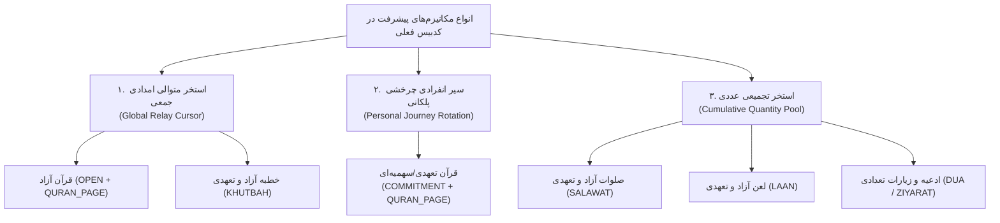

# 📜 مستر فرزند ۱۷: ممیزی و کالبدشکافی جامع موتورهای پیشرفت و تخصیص سهم در تمامی انواع ختم‌ها
**(Child Master 17 — Comprehensive Audit of Khatm Progression & Allocation Engines across all Types & Modes)**

> **🔗 موقعیت در درختوارهٔ اسناد (والد و فرزندی):**
> - **⬆️ سند مادر (والد):** [ADMIN_PANEL_REDESIGN_MASTER.md](../ADMIN_PANEL_REDESIGN_MASTER.md)
> - **⬅️ اسناد هم‌خانواده (فرزندان پیشین):**
>   - **[مستر فرزند ۰۱](MASTER_01_KHATM_ENGINE_AND_MODES.md):** موتور ختم‌ها، انواع تعهدی/آزاد و سهم‌بندی
>   - **[مستر فرزند ۰۵](MASTER_05_OPEN_KHATM_AND_KHUTBAH_FLOW.md):** جریان ختم آزاد و دورهای خطبه
>   - **[مستر فرزند ۱۳](MASTER_13_OPEN_KHATM_IMMEDIATE_CONTRIBUTION_AND_RECITATION_RECORDING.md):** حذف زمان‌بندی و ثبت فوری سهم در ختم آزاد
>   - **[مستر فرزند ۱۴](MASTER_14_OPEN_KHATM_COLLECTIVE_PROGRESSION_ENGINE.md):** موتور پیشرفت دسته‌جمعی ختم آزاد
>   - **[مستر فرزند ۱۵](MASTER_15_MEMBER_PORTION_RECEIPT_AND_KHATM_IDENTIFICATION.md):** اصلاح عنوان دکمه و شفاف‌سازی هویت ختم
>   - **[مستر فرزند ۱۶](MASTER_16_RESTRICT_INVITE_LINKS_TO_PERSIAN_ONLY.md):** فارسی‌سازی کامل لینک‌های دعوت
>   - **[مستر فرزند ۱۷ (همین فایل)](MASTER_17_KHATM_PROGRESSION_AND_ALLOCATION_AUDIT.md):** ممیزی و کالبدشکافی جامع نحوهٔ پیشرفت در تمام انواع ختم‌ها
>   - **[مستر فرزند ۱۸](MASTER_18_UNIFIED_COLLECTIVE_PROGRESSION_DESIGN_AND_ROADMAP.md):** طرح معماری یکپارچه‌سازی پیشرفت دسته‌جمعی
> - **🐛 مرجع باگ‌ها و نواقص کد:** [MASTER_BUG_AND_GAP_REPORT.md](../MASTER_BUG_AND_GAP_REPORT.md)

---

## ۱. پاسخ مستقیم و شفاف به پرسش مالک

> **❓ پرسش مالک:**
> «همه ختم‌ها باهم میرن جلو دیگه؟ یعنی ممبراشون ختمی که هست باهم میبرن جلو... یعنی همون ایکس و ایگرگ که در ادامه می‌گیرن، برای تمام ختم‌ها و هم سهمیه‌ای هم آزاد، هم قرآن هم خطبه هم لعن هم صلوات هم دعا اینطوریه؟»

### 💡 پاسخ کوتاه:
**خیر! در حال حاضر در سورس‌کد پروژه همهٔ ختم‌ها به این شکل یکسان نیستند.**
در کدبیس پروژه، **۳ پارادایم کاملاً متفاوت** برای نحوهٔ پیشرفت پیاده‌سازی شده است:



1. **استخر متوالی امدادی جمعی (Global Relay Cursor):**
   - **کجا پیاده شده؟** در **ختم آزاد قرآن** و **خطبه فدکیه/غدیر** (طبق اصلاحات مستر ۱۴).
   - **رفتار:** کاربر ۱ صفحات ۱ تا ۵ را می‌گیرد، کاربر ۲ صفحات ۶ تا ۱۰ را می‌گیرد، کاربر ۳ صفحات ۱۱ تا ۲۰ را می‌گیرد. اگر کاربر ۱ دوباره سهم بخواهد، صفحات ۲۱ تا ۲۵ را می‌گیرد. سهم‌ها دست‌به‌دست می‌شود و همه پشت سر هم جلو می‌روند.
2. **سیر انفرادی چرخشی پلکانی (Personal Journey Rotation):**
   - **کجا پیاده شده؟** در **ختم سهمیه‌ای/تعهدی قرآن** (`COMMITMENT + QURAN_PAGE`).
   - **رفتار:** هر کاربر یک **«خط سیر شخصی»** دارد که با یک آفست اولیه شروع می‌شود. اگر کاربر ۱ سهم ۲ صفحه‌ای داشته باشد و از صفحه ۱ شروع کند، روز اول ۱ تا ۲ را می‌خواند، روز دوم ۳ تا ۴ را می‌خواند، روز سوم ۵ تا ۶ را می‌خواند. اگر کاربر ۲ هم عضو باشد، کاربر ۲ از صفحه ۳ شروع می‌کند و روز بعد ۵ تا ۶ را می‌خواند. **کاربر ۱ منتظر یا وابسته به اینکه کاربر ۲ کجاست نمی‌ماند؛ سیر قرائت هر کاربر برای خودش پیوسته است!**
3. **استخر تجمیعی عددی (Cumulative Quantity Pool):**
   - **کجا پیاده شده؟** در **صلوات، لعن، ادعیه و زیارات** (هم آزاد و هم سهمیه‌ای).
   - **رفتار:** واحد محتوا شمارش است (مثلاً ۱۰۰ مرتبه). مفهوم صفحه و بخش متوالی وجود ندارد. هر کس مقداری می‌خواند (مثلاً کاربر ۱ می‌خواند ۱۰۰، کاربر ۲ می‌خواند ۲۰۰) و جمع همه به یک صندوقچهٔ مشترک اضافه می‌شود: $100 + 200 = 300$ تا رسیدن به هدف کل ختم (مثلاً ۱۴,۰۰۰ صلوات).

---

## ۲. ماتریس ممیزی ۱۰ حالته کدبیس (Audit Matrix of 10 Combinations)

در جدول زیر، وضعیت تک‌تک ترکیب‌های دامنه‌ای در سورس‌کد فعلی آورده شده است:

| # | نوع محتوا | حالت ختم | واحد شمارش | مدل پیشرفت در کدبیس فعلی | آیا کاربر Y ادامهٔ کاربر X را می‌گیرد؟ | فایل و توابع مجری در سورس‌کد |
| :-: | :--- | :--- | :-: | :--- | :-: | :--- |
| **۱** | **قرآن کریم** | آزاد (`OPEN`) | صفحه (`PAGE`) | **استخر متوالی امدادی** (Collective Relay Cursor) | **بله ✅** (کاربر ۱: ۱-۵، کاربر ۲: ۶-۱۰) | `delivery.get_next_open_quran_page` در [`delivery.py`](file:///C:/Users/elyas/.gemini/antigravity/worktrees/Khatm/update_khatm_wizard_flow/src/khatmsaz/modules/share_occurrence/delivery.py#L64) |
| **۲** | **قرآن کریم** | سهمیه‌ای (`COMMITMENT`) | صفحه (`PAGE`) | **سیر انفرادی چرخشی پلکانی** (Personal Journey Rotation) | **خیر ❌** (هر کاربر سیر پیوستهٔ شخصی خود را روزانه جلو می‌برد) | `allocation.service.positional_range_for_step` و `repository.create_next_rotating_portion` در [`allocation/`](file:///C:/Users/elyas/.gemini/antigravity/worktrees/Khatm/update_khatm_wizard_flow/src/khatmsaz/modules/allocation/service.py#L30) |
| **۳** | **قرآن کریم** | سوره‌ای (`SURAH`) | سوره (`SURAH`) | **سیر انفرادی / بازهٔ سوره** | **خیر ❌** (سوره‌های انتخابی یا پیش‌فرض) | مدل‌های `khatm` با `surah_number` |
| **۴** | **خطبه فدکیه / غدیر** | آزاد (`OPEN`) | بخش (`SECTION`) | **استخر متوالی امدادی** (بخش‌های ۱ تا ۵ یا ۱ تا ۸) | **بله ✅** (کاربر ۱: بخش ۱، کاربر ۲: بخش ۲) | `delivery.allocate_khutbah_section_range` در [`delivery.py`](file:///C:/Users/elyas/.gemini/antigravity/worktrees/Khatm/update_khatm_wizard_flow/src/khatmsaz/modules/share_occurrence/delivery.py#L110) |
| **۵** | **خطبه فدکیه / غدیر** | سهمیه‌ای (`COMMITMENT`) | بخش (`SECTION`) | **استخر متوالی امدادی** (در تحویل روزانه) | **بله ✅** (بخش‌ها بین کل شرکت‌کنندگان دست‌به‌دست می‌شود) | `delivery.prepare` با فراخوانی `allocate_khutbah_section_range` |
| **۶** | **صلوات** | آزاد (`OPEN`) | مرتبه (`COUNT`) | **استخر تجمیعی عددی** (Cumulative Pool) | **مفهوم ترتیبی ندارد؛ در عدد بله ✅** (جمع مشارکت‌ها کل هدف را پر می‌کند) | `open_contributions.log_contribution` و `contributions.total_for_khatm` |
| **۷** | **صلوات** | سهمیه‌ای (`COMMITMENT`) | مرتبه (`COUNT`) | **استخر تجمیعی عددی با سهمیه روزانه** | **مفهوم ترتیبی ندارد؛ در عدد بله ✅** (هر روز سهمیه اعضا به کل اضافه می‌شود) | `delivery.prepare` + ثبت پیشرفت در `record_progress` |
| **۸** | **لعن** | آزاد (`OPEN`) | مرتبه (`COUNT`) | **استخر تجمیعی عددی** (مشابه صلوات) | **مفهوم ترتیبی ندارد؛ در عدد بله ✅** | موتور شمارشی صلوات با `group = LAAN` |
| **۹** | **لعن** | سهمیه‌ای (`COMMITMENT`) | مرتبه (`COUNT`) | **استخر تجمیعی عددی با سهمیه روزانه** | **مفهوم ترتیبی ندارد؛ در عدد بله ✅** | موتور شمارشی صلوات با `group = LAAN` |
| **۱۰** | **ادعیه و زیارات** | آزاد و سهمیه‌ای | مرتبه (`COUNT`) | **استخر تجمیعی عددی** (کل دعا در هر نوبت) | **مفهوم ترتیبی ندارد؛ در عدد بله ✅** | موتور مشترک ادعیه با `template_type = SALAWAT` و گروه `DUA` |

---

## ۳. کالبدشکافی عمیق سورس‌کد و تفاوت‌های معماری

### الف. موتور قرآن سهمیه‌ای (`COMMITMENT + QURAN_PAGE`):
در فایل [`src/khatmsaz/modules/allocation/service.py`](file:///C:/Users/elyas/.gemini/antigravity/worktrees/Khatm/update_khatm_wizard_flow/src/khatmsaz/modules/allocation/service.py#L30-L55):
```python
def positional_range_for_step(
    *, offset: int, step: int, total_units: int, units_per_portion: int = DEFAULT_PAGES_PER_PORTION
) -> tuple[int, int]:
    """Rotating personal-journey page range (DEC-PY-0092).
    ...
    - offset: this reader's distinct 0-based starting portion (staggered by join order).
    - step: how many portions this reader has already completed.
    """
    total_portions = -(-total_units // units_per_portion)
    seq = (offset + step) % total_portions
    start = seq * units_per_portion + 1
    end = min(start + units_per_portion - 1, total_units)
    return start, end
```
و در [`src/khatmsaz/modules/allocation/repository.py`](file:///C:/Users/elyas/.gemini/antigravity/worktrees/Khatm/update_khatm_wizard_flow/src/khatmsaz/modules/allocation/repository.py#L60-L79):
- هر کاربر که عضو می‌شود، یک `quran_rotation_offset` منحصربه‌فرد دریافت می‌کند (کاربر اول: ۰، کاربر دوم: ۱، کاربر سوم: ۲ و...).
- با ثبت قرائت هر سهم توسط همان کاربر، مقدار `step` برای همان کاربر یک واحد بالا می‌رود:
  $$\text{portion\_index} = (\text{offset} + \text{completed\_steps}) \pmod{\text{total\_portions}}$$
- **نتیجه:** کاربر اول صفحات ۱ تا ۲، سپس ۳ تا ۴، سپس ۵ تا ۶ را می‌خواند. کاربر دوم صفحات ۳ تا ۴، سپس ۵ تا ۶، سپس ۷ تا ۸ را می‌خواند. کل گروه در طول زمان کل قرآن را پوشش می‌دهند، اما سهم‌های امروز اعضا مستقل از قرائت‌های امروز یکدیگر است.

### ب. موتور قرآن آزاد (`OPEN + QURAN_PAGE`):
در فایل [`src/khatmsaz/modules/share_occurrence/delivery.py`](file:///C:/Users/elyas/.gemini/antigravity/worktrees/Khatm/update_khatm_wizard_flow/src/khatmsaz/modules/share_occurrence/delivery.py#L64-L107):
```python
async def get_next_open_quran_page(session, khatm_id, total_pages, *, default_start=1) -> int:
    stmt = (
        select(ShareOccurrence)
        .join(Participation, Participation.id == ShareOccurrence.participation_id)
        .where(
            Participation.khatm_id == khatm_id,
            ShareOccurrence.unit == "PAGE",
        )
        .order_by(ShareOccurrence.created_at.desc(), ShareOccurrence.id.desc())
        .limit(1)
    )
    ...
    last_end = last_range[1]
    return (last_end % total_pages) + 1
```
- **نتیجه:** یک اشاره‌گر واحد جهانی برای کل ختم وجود دارد. مهم نیست چه کسی سهم قبلی را گرفته است؛ هر کس سهم جدید بخواهد، دقیقاً از بلافاصله بعد از آخرین صفحهٔ تخصیص‌داده‌شده در کل ختم شروع می‌کند.

### ج. موتور خطبه فدکیه و غدیر (`KHUTBAH`):
در تابع `allocate_khutbah_section_range`:
- تمام سهم‌های صادرشده برای ختم بررسی می‌شوند.
- بخش‌ها (۱ تا ۵ برای فدکیه، ۱ تا ۸ برای غدیر) به ترتیب بین اعضا توزیع می‌شوند.

### د. موتور صلوات، لعن و ادعیه (`SALAWAT`, `LAAN`, `DUA`):
- در این ختم‌ها، چون متن واحد است و تعداد تعیین‌کننده است، هیچ سهم ترتیبی (صفحه یا بخش) وجود ندارد.
- هر بار قرائت مقداری سهمیه (مثلاً ۱۰۰ صلوات)، کل پیشرفت ختم را از طریق `open_contributions` به هدف نهایی نزدیک می‌کند.

---

## ۴. ریشه‌یابی تاریخی و فلسفهٔ طراحی پیشین (Legacy Rationale)

چرا در تصمیم [DEC-PY-0092](../../docs/ai/DECISIONS.md#L514) و پروژهٔ اصلی قبلی، ختم سهمیه‌ای قرآن به شکل «سیر انفرادی چرخشی» طراحی شد نه استخر واحد امدادی؟
1. **تجربهٔ قرائت روزانهٔ مخاطب قرآن:**
   در یک دورهمی ختم قرآن تعهدی روزانه (مثلاً ۳۰ نفره که هر روز هر نفر ۲ صفحه می‌خواند تا ظرف ۱۰ ماه قرآن تمام شود):
   - اگر کاربر الف امروز صفحه ۱ و ۲ را بخواند، فردا صبح منتظر صفحه ۳ و ۴ است تا دنبالهٔ آیات را بخواند و از داستان‌ها و مفاهیم لذت ببرد.
   - اگر قرار بود استخر واحد باشد و در طول روز ۲۰ نفر دیگر سهم‌های بعدی را می‌خواندند، فردا صبح به کاربر الف صفحه ۴۳ و ۴۴ می‌افتاد! کاربر می‌گفت: «من داستان سوره بقره را تا آیه ۲۰ خوانده بودم، چرا سیستم ناگهان مرا پرتاب کرد به وسط سوره آل‌عمران؟ من مابقی آیات را نخوانده‌ام!»
2. **پیشگیری از معطلی به خاطر بدقولی یک نفر:**
   در استخر متوالی امدادی، اگر کاربر الف صفحه ۱ تا ۵ را بگیرد و تا شب یا چند روز نخواند یا فراموش کند، کاربر ب یا باید معطل او بماند یا اگر صفحه ۶ تا ۱۰ را بخواند و کاربر الف هرگز برنگردد، صفحات ۱ تا ۵ از دست می‌رود و ختم ناقص می‌ماند! مدل چرخشی با آفست این بن‌بست را حل می‌کرد.

---

## ۵. جمع‌بندی وضعیت کنونی

- **آیا ختم‌های آزاد باهم جلو می‌روند؟** بله، ۱۰۰٪ (قرآن و خطبه امدادی متوالی، صلوات و ادعیه استخر تجمیعی).
- **آیا ختم‌های سهمیه‌ای صلوات، لعن و دعا باهم جلو می‌روند؟** بله، همه در رسیدن به هدف کل ختم شریک هستند.
- **آیا ختم سهمیه‌ای قرآن مانند آزاد، ادامهٔ صفحات یکدیگر را می‌خوانند؟** **خیر، در حال حاضر هر عضو سیر متوالی آیات را برای خودش جلو می‌برد، اما شروع اعضا با هم متفاوت است تا کل مصحف پوشش داده شود.**

> [!NOTE]
> برای مشاهدهٔ راهکار، گزینه‌های انتخابی و نقشه راه تغییر یا یکپارچه‌سازی، سند هم‌خانواده را ببینید:
> 👉 **[مستر فرزند ۱۸: طرح معماری، تصمیم‌گیری دامنه‌ای و نقشه راه یکپارچه‌سازی پیشرفت دسته‌جمعی](MASTER_18_UNIFIED_COLLECTIVE_PROGRESSION_DESIGN_AND_ROADMAP.md)**
