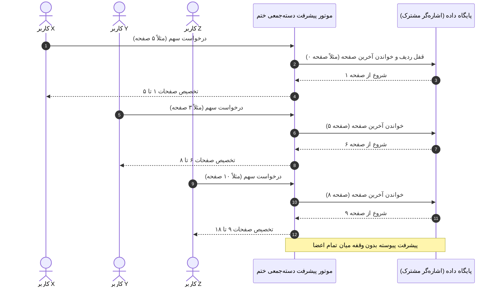
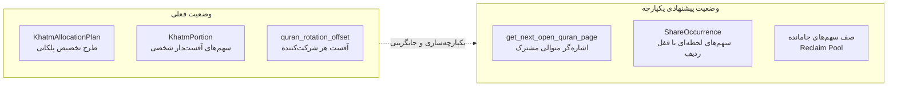

# 📜 مستر فرزند ۱۸: طرح معماری، تصمیم‌گیری دامنه‌ای و نقشه راه یکپارچه‌سازی پیشرفت دسته‌جمعی
**(Child Master 18 — Architectural Design, Domain Decisions & Roadmap for Unified Collective Progression)**

> **🔗 موقعیت در درختوارهٔ اسناد (والد و فرزندی):**
> - **⬆️ سند مادر (والد):** [ADMIN_PANEL_REDESIGN_MASTER.md](../ADMIN_PANEL_REDESIGN_MASTER.md)
> - **⬅️ اسناد هم‌خانواده (فرزندان پیشین):**
>   - **[مستر فرزند ۰۱](MASTER_01_KHATM_ENGINE_AND_MODES.md):** موتور ختم‌ها، انواع تعهدی/آزاد و سهم‌بندی
>   - **[مستر فرزند ۰۵](MASTER_05_OPEN_KHATM_AND_KHUTBAH_FLOW.md):** جریان ختم آزاد و دورهای خطبه
>   - **[مستر فرزند ۱۳](MASTER_13_OPEN_KHATM_IMMEDIATE_CONTRIBUTION_AND_RECITATION_RECORDING.md):** حذف زمان‌بندی و ثبت فوری سهم در ختم آزاد
>   - **[مستر فرزند ۱۴](MASTER_14_OPEN_KHATM_COLLECTIVE_PROGRESSION_ENGINE.md):** موتور پیشرفت دسته‌جمعی ختم آزاد
>   - **[مستر فرزند ۱۵](MASTER_15_MEMBER_PORTION_RECEIPT_AND_KHATM_IDENTIFICATION.md):** اصلاح عنوان دکمه و شفاف‌سازی هویت ختم
>   - **[مستر فرزند ۱۶](MASTER_16_RESTRICT_INVITE_LINKS_TO_PERSIAN_ONLY.md):** فارسی‌سازی کامل لینک‌های دعوت
>   - **[مستر فرزند ۱۷](MASTER_17_KHATM_PROGRESSION_AND_ALLOCATION_AUDIT.md):** ممیزی و کالبدشکافی وضعیت فعلی پیشرفت ختم‌ها
>   - **[مستر فرزند ۱۸ (همین فایل)](MASTER_18_UNIFIED_COLLECTIVE_PROGRESSION_DESIGN_AND_ROADMAP.md):** طرح معماری یکپارچه‌سازی پیشرفت دسته‌جمعی
> - **🐛 مرجع باگ‌ها و نواقص کد:** [MASTER_BUG_AND_GAP_REPORT.md](../MASTER_BUG_AND_GAP_REPORT.md)

---

## ۱. صورت‌مسئله و هدف معماری

مالک محترم سیستم چنین پرسیده‌اند:
> «همه ختم‌ها باهم میرن جلو دیگه؟ یعنی ممبراشون ختمی که هست باهم میبرن جلو... یعنی همون ایکس و ایگرگ که در ادامه می‌گیرن، برای تمام ختم‌ها و هم سهمیه‌ای هم آزاد، هم قرآن هم خطبه هم لعن هم صلوات هم دعا اینطوریه؟ فایل مسترشو بساز بررسی بکن از روی فایل و بعد تو یه فایل مستر دیگه بزن که اگر نیازه چیزی عوض بشه باید چی باشه و چی عوض بشه...»

طبق ممیزی انجام‌شده در **[مستر فرزند ۱۷](MASTER_17_KHATM_PROGRESSION_AND_ALLOCATION_AUDIT.md)**:
- **ختم آزاد قرآن** و **خطبه‌ها** هم‌اکنون به صورت دسته‌جمعی متوالی (کاربر Y بلافاصله ادامهٔ صفحات/بخش‌های کاربر X را می‌گیرد) عمل می‌کنند.
- **ختم صلوات، لعن و ادعیه** (هم آزاد و هم سهمیه‌ای) نیز هم‌اکنون به صورت استخر تجمیعی عمل می‌کنند و جمع قرائت تمام اعضا سقف هدف (مثلاً ۱۴,۰۰۰) را پر می‌کند.
- **تنها بخشی که در حال حاضر رفتاری متفاوت دارد، «ختم سهمیه‌ای/تعهدی قرآن کریم» است** که به صورت «سیر انفرادی چرخشی» (Personal Journey Rotation) طراحی شده بود تا صفحات هر کاربر به صورت مستقل در روزهای متوالی ۱-۲، ۳-۴، ۵-۶ و... باشد.

این سند، معماری دقیق و الزامات فنی تبدیل **تمامی ختم‌ها** (از جمله سهمیه‌ای قرآن) به مدل **پیشرفت دسته‌جمعی متوالی (Unified Collective Relay)** را تشریح می‌کند.

---

## ۲. مدل پیشرفت دسته‌جمعی متوالی برای تمامی انواع ختم‌ها

در صورت یکپارچه‌سازی، منطق توزیع سهم‌ها در تمام انواع محتوا به شرح زیر خواهد بود:



### الف. قرآن کریم (صفحه‌ای)
- **اشاره‌گر کل:** از صفحه ۱ تا ۶۰۴ عثمان طه.
- **قاعده:** هر عضوی که سهم می‌گیرد (چه در ختم آزاد با دکمه، چه در ختم سهمیه‌ای با تحویل خودکار ساعت مقرر)، صفحات بعد از آخرین سهم صادرشده را دریافت می‌کند.
- **عبور از مرز دور (Wrap-Around):** وقتی اشاره‌گر به ۶۰۴ رسید، دور اول تمام شده، دور شمارش یک واحد افزایش می‌یابد و کاربر بعدی از صفحه ۱ دور دوم را آغاز می‌کند.

### ب. خطبه‌ها (فدکیه و غدیر)
- **اشاره‌گر کل:** بخش‌های ۱ تا ۵ (فدکیه) یا ۱ تا ۸ (غدیر).
- **قاعده:** بخش‌ها به ترتیب بین اعضا دست‌به‌دست می‌شود. اگر کاربر اول بخش ۱ و ۲ را گرفت، کاربر دوم بخش ۳ را می‌گیرد.

### ج. صلوات، لعن و اذکار
- **اشاره‌گر کل:** شمارش تجمعی از ۰ تا هدف کل (مثلاً ۱۴,۰۰۰).
- **قاعده:** هر عضوی هر مقداری که قرائت کند، بلافاصله به مجموع ختم اضافه شده و درصد پیشرفت بالا می‌رود تا دور ختم کامل شود.

### د. ادعیه و زیارات
- **حالت ۱ (تکرار کامل دعا):** مثلاً ختم ۴۰ روزه زیارت عاشورا یا دعای عهد. هر عضو یک بار کامل دعا را می‌خواند و به عدد کل اضافه می‌شود.
- **حالت ۲ (ادعیهٔ دارای بند و فراز، مثل جوشن کبیر با ۱۰۰ بند):** مشابه خطبه، بندهای ۱ تا ۱۰ به کاربر اول، ۱۱ تا ۲۰ به کاربر دوم و به همین ترتیب تخصیص داده می‌شود.

### ه. قرآن کریم (سوره‌ای)
- **اشاره‌گر کل:** ۱۱۴ سوره از فاتحه تا ناس به ترتیب مصحف.

---

## ۳. چالش‌های فنی و سناریوهای بحرانی در مدل تعهدی (Edge Cases)

اگر در **ختم سهمیه‌ای (تعهدی)** تمام اعضا بخواهند پشت سر هم جلو بروند، سه چالش فنی بسیار مهم وجود دارد که باید دقیقاً مدیریت شوند:

### چالش ۱: مسئلهٔ «سهم سوخته / منقضی‌شده» (Missed / Expired Shares)
> **سناریو:**
> کاربر الف ساعت ۰۸:۰۰ صبح سهمیهٔ روزانه‌اش را تحویل می‌گیرد (صفحات ۱ تا ۵).
> کاربر ب ساعت ۰۹:۰۰ صبح سهمیه می‌گیرد (صفحات ۶ تا ۱۰).
> شب ساعت ۲۴:۰۰ می‌شود؛ کاربر ب سهمش را خوانده، اما کاربر الف نخوانده و فراموش کرده یا تلگرام را باز نکرده است!
> **سؤال حیاتی:** آیا صفحات ۱ تا ۵ در هوا معلق می‌مانند؟ دور ختم چطور تمام می‌شود؟

**راهکار معماری استاندارد (Reclaim Queue / صف بازپس‌گیری):**
۱. اگر مهلت سهم کاربر الف گذشت (`deadline_at` سپری شد)، سیستم وضعیت سهم او را به `MISSED` یا `EXPIRED` تغییر می‌دهد.
۲. بازهٔ صفحات [۱ تا ۵] به یک **«صف جبران / سهم‌های جامانده» (Reclaim Pool)** برمی‌گردد.
۳. در اولین نوبت بعدی، سیستم پیش از تخصیص صفحات جلوتر، ابتدا سهم‌های جامانده را به اعضای آماده یا در بخش «سهم اضافه / داوطلبانه» عرضه می‌کند تا هیچ شکافی در ختم قرآن باقی نماند.

### چالش ۲: تداخل ارسال همزمان ساعت صبح (Morning Rush Hour)
> **سناریو:**
> اگر در یک ختم سهمیه‌ای، ۲۰ نفر ساعت ۰۸:۰۰ صبح را برای تحویل روزانه انتخاب کرده باشند:
> ساعت ۰۸:۰۰ صبح ربات همزمان برای هر ۲۰ نفر سهم صادر می‌کند:
> - نفر ۱: صفحات ۱ تا ۲
> - نفر ۲: صفحات ۳ تا ۴
> - ...
> - نفر ۲۰: صفحات ۳۹ تا ۴۰
> **فردا صبح ساعت ۰۸:۰۰:**
> - نفر ۱: صفحات ۴۱ تا ۴۲ را می‌گیرد!

**پیامد برای تجربهٔ کاربر:**
کاربر روز اول صفحات ۱ و ۲ را خوانده، و روز دوم صفحات ۴۱ و ۴۲ را می‌خواند! او دیگر یک سوره را پیوسته نمی‌خواند، بلکه مانند کارگران یک کارخانه هر روز تکه‌ای از کل پروژه را جلو می‌برد.
این مدل از نظر «ثواب کار جمعی و مشارکت در ختم کل قرآن» بسیار جذاب است، اما کاربر باید بداند که سیر آیات برای خودش انفرادی نخواهد بود.

---

## ۴. طرح تغییرات فنی مورد نیاز در دیتابیس و کد

برای تبدیل رسمی ختم سهمیه‌ای قرآن به مدل پیشرفت دسته‌جمعی متوالی، اقدامات زیر لازم است:



### ۱. اصلاح تابع `prepare` در [`delivery.py`](file:///C:/Users/elyas/.gemini/antigravity/worktrees/Khatm/update_khatm_wizard_flow/src/khatmsaz/modules/share_occurrence/delivery.py):
در حال حاضر در خط ۲۷۶ کد زیر وجود دارد:
```python
if part.is_committed:
    ranges = await allocation.allocate_page_amount(session, khatm.id, part.id, amount)
```
این کد باید بازنویسی شود تا برای ختم‌های تعهدی نیز از اشاره‌گر دسته‌جمعی `get_next_open_quran_page` (همراه با بررسی صف سهم‌های جامانده) استفاده کند.

### ۲. اصلاح تابع `prepare_numeric` در [`delivery.py`](file:///C:/Users/elyas/.gemini/antigravity/worktrees/Khatm/update_khatm_wizard_flow/src/khatmsaz/modules/share_occurrence/delivery.py):
در خط ۳۵۸:
```python
if part.is_committed:
    portions = await allocation.allocate_page_amount(...)
```
تغییر کند تا هر دو حالت سهمیه‌ای و آزاد از کرسر متوالی یکسان تغذیه شوند.

### ۳. ایجاد موتور بازپس‌گیری سهم‌های منقضی (`Reclaim Engine`):
یک تسک پس‌زمینه یا هوک در انقضای ددلاین، سهم‌های خوانده‌نشده را علامت‌گذاری کرده تا در اولویت واگذاری مجدد قرار گیرند.

---

## ۵. گزینه‌های انتخابی برای تصمیم نهایی مالک (Decision Fork)

برای اینکه رفتار سیستم دقیقاً منطبق بر خواست شما باشد، **سه گزینهٔ شفاف** پیش رو داریم:

### 🟢 گزینهٔ ۱ (یکپارچه‌سازی کامل تمام ختم‌ها — مدل کاروانی امدادی):
- **تعریف:** تمام ختم‌ها (چه سهمیه‌ای، چه آزاد، چه قرآن، چه خطبه، صلوات، لعن و ادعیه) **دقیقاً یکسان** عمل کنند.
- هر کس سهم بگیرد (چه دستی، چه سر ساعت روزانه)، ادامهٔ آخرین صفحه/بخش تخصیص‌داده‌شده را می‌گیرد.
- سهم‌های خوانده‌نشده پس از پایان مهلت روز به استخر بازمی‌گردند تا دیگران بخوانند.
- **مزیت:** سادگی فوق‌العاده در درک سیستم، هماهنگی کامل بین تمام بات‌ها، احساس واقعی حرکت دسته‌جمعی کاروان ختم.

### 🟡 گزینهٔ ۲ (اختیار سازنده در ویزارد ساخت ختم):
- **تعریف:** در ویزارد ساخت ختم سهمیه‌ای قرآن، یک سؤال از سازنده پرسیده شود:
  - «مدل پیشرفت قرآن چگونه باشد؟»
    1. 🏃‍♂️ **حرکت دسته‌جمعی پیوسته (سهم بعدی از کل گروه):** همه با هم قرآن را جلو می‌برند (پیشنهادی).
    2. 📖 **سیر پیوستهٔ شخصی هر عضو:** هر عضو صفحات را برای خودش از ابتدا تا انتها منظم می‌خواند.
- **مزیت:** انعطاف‌پذیری حداکثری و رضایت هر دو دسته مخاطبان سنتی و مدرن.

### 🔵 گزینهٔ ۳ (حفظ تمایز اصیل تعهدی و آزاد):
- **تعریف:**
  - ختم آزاد = همیشه دسته‌جمعی امدادی (کاربر Y ادامهٔ کاربر X).
  - ختم تعهدی = همیشه سیر شخصی منظم روزانه با یادآور ساعتی.

---

## ۶. نقشه راه پیاده‌سازی گام‌به‌گام (Implementation Roadmap)

در صورت انتخاب **گزینهٔ ۱ (یکپارچه‌سازی کامل)**:

1. **گام اول (آزمون‌های شبیه‌سازی):** طراحی تست‌های جامع در `tests/test_unified_collective_progression.py` برای شبیه‌سازی خواندن همزمان چند کاربر در حالت تعهدی.
2. **گام دوم (یکپارچه‌سازی `delivery.py`):** هدایت تمام درخواست‌های سهم قرآن در `prepare` و `prepare_numeric` به اشاره‌گر `get_next_open_quran_page`.
3. **گام سوم (موتور سهم‌های جامانده Reclaim):** پیاده‌سازی بازتوزیع صفحات خوانده‌نشده پس از انقضای ساعت ۲۴:۰۰.
4. **گام چهارم (اطلاع‌رسانی و پیام‌رسانی):** اصلاح متن پیام تحویل سهم به کاربر («سهم شما از کاروان ختم: صفحات X تا Y»).
5. **گام پنجم (استقرار روی سرور):** اعمال روی مخزن گیت و سرور پروداکشن با نظارت کامل بر لاگ‌ها و پورت ۸۰۸۰.
