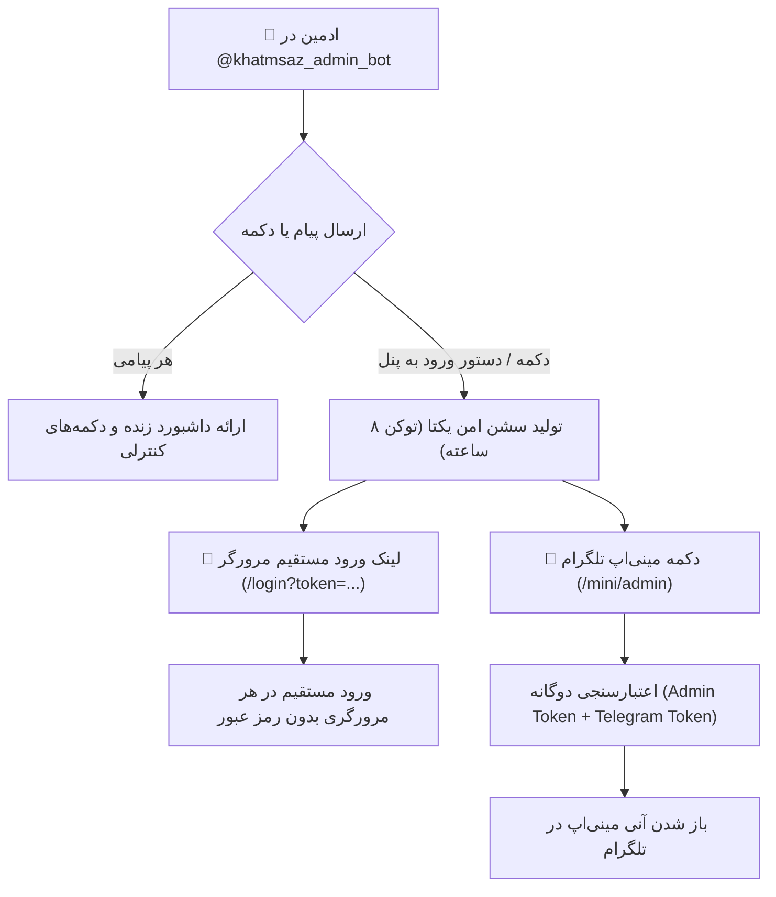

# 🛡 مستر فرزند ۱۹: بازطراحی دسترسی پنل مدیریت، احراز هویت وب و مینی‌اپ، و مخفی‌سازی کامل دکمهٔ پنل سازندگان
**(Child Master 19 — Admin Bot & Panel Access Redesign, Web/Mini-App Dual Auth, and Creator Panel Button Guard)**

> **🔗 موقعیت در درختوارهٔ اسناد (والد و فرزندی):**
> - **⬆️ سند مادر (والد):** [ADMIN_PANEL_REDESIGN_MASTER.md](../ADMIN_PANEL_REDESIGN_MASTER.md)
> - **⬅️ اسناد هم‌خانواده (فرزندان پیشین):**
>   - **[مستر فرزند ۰۸](MASTER_08_CREATOR_PANEL_AND_USER_EXPERIENCE.md):** معماری و تجربه کاربری پنل سازندگان
>   - **[مستر فرزند ۱۰](MASTER_10_PLANS_BROADCAST_RECEIPT_PAYMENT_AND_CREATOR_PANEL_GUARD.md):** مهندسی مجدد پرداخت و قفل اولیه پنل سازندگان
>   - **[مستر فرزند ۱۱](MASTER_11_LAAN_WIZARD_DIRECT_PAYPING_AND_ADMIN_BOT_DISPATCH.md):** توزیع کارتابل ربات ادمین
>   - **[مستر فرزند ۱۲](MASTER_12_DEDICATED_ADMIN_BOT_AND_LIVE_ERROR_MONITORING.md):** ربات ادمین اختصاصی و پایش خطاها
>   - **[مستر فرزند ۱۸](MASTER_18_UNIFIED_COLLECTIVE_PROGRESSION_DESIGN_AND_ROADMAP.md):** پیشرفت دسته‌جمعی متوالی
>   - **[مستر فرزند ۱۹ (همین فایل)](MASTER_19_ADMIN_BOT_ACCESS_AND_CREATOR_PANEL_BUTTON_GUARD.md):** دسترسی جامع به پنل ادمین و مسدودسازی دکمهٔ پنل سازنده
> - **🐛 مرجع باگ‌ها و نواقص کد:** [MASTER_BUG_AND_GAP_REPORT.md](../MASTER_BUG_AND_GAP_REPORT.md)

---

## ۱. صورت‌مسئله و مطالبات مالک محترم

مالک محترم سیستم دو دستور مشخص صادر فرمودند:
1. **دسترسی به ربات و پنل ادمین:**
   > «بات ادمین درست کار نمیکنه من دسترسی به پنل هم ندارم چیزی برام نمیفرسته»
   - عدم پاسخگویی ربات ادمین (`@khatmsaz_admin_bot`) به پیام‌های متنی عادی (سکوت ربات).
   - عدم امکان ورود به پنل تحت وب (`https://api.khatmsaz.com/` یا `/mini/admin`).
   - خطای ۴۰۴ در مسیر `/admin`.
   - خطای اعتبارسنجی در مینی‌اپ به دلیل اعتبارسنجی با توکن اشتباه.
2. **مخفی‌سازی کامل دکمهٔ پنل سازنده‌ها:**
   > «بعد یمورد دیگ اون دکمه ک تو بات ختم ساز هست و پنل سازده هاست اون دکمشم میخوام فعلا مخفی بشه برام هم تویه بله هم تلگرام»
   - دکمهٔ «ورود به پنل سازنده» (`creator:web_login`) در کیبوردهای بات ختم‌ساز (تنظیمات، راهنما، پنل مدیریت) حتی برای مدیران ارشد نیز باید کاملاً مخفی و حذف شود.
3. **رفع خطای مهلک در ناوبری بات‌های مخاطبان:**
   - خطای `AttributeError: 'NoneType' object has no attribute 'value'` در `keyboards.py:1202` که باعث کرش کردن لمس دکمه‌های منو در بات‌های ممبر می‌شد.

---

## ۲. ریشه‌یابی فنی عیوب (Root Cause Analysis)

### ۲.۱. نقص‌های دسترسی به پنل ادمین
1. **اعتبارسنجی مینی‌اپ با توکن نامربوط (`src/khatmsaz/web/app.py:792`):**
   تابع `_authenticate_telegram_mini_app` داده‌های امضاشدهٔ `initData` را صرفاً با `telegram_bot_token` (ربات ختم‌ساز) بررسی می‌کرد؛ در حالی که مینی‌اپ ادمین از داخل `@khatmsaz_admin_bot` (با توکن `admin_bot_token`) باز می‌شد و در نتیجه امضای HMAC تلگرام تطابق نداشت و با خطای ۴۰۱ رد می‌شد.
2. **فقدان لینک ورود مستقیم مرورگر (Magic Link):**
   صفحهٔ `/login` ورود عادی با لینک را غیرفعال کرده بود. اگر مدیر در مرورگر کامپیوتر یا موبایل آدرس سایت را باز می‌کرد، هیچ راهی برای لاگین وجود نداشت.
3. **خطای ۴۰۴ در مسیر `/admin`:**
   کاربران به طور طبیعی آدرس `/admin` را وارد می‌کردند، اما تنها مسیر موجود `/` بود و هیچ ریدایرکتی برای `/admin` تعریف نشده بود.
4. **سکوت ربات ادمین در برابر پیام‌های عادی:**
   ربات ادمین هیچ هندلر Fallback برای پیام‌های متنی نداشت و اگر کاربر متنی مانند «سلام» می‌فرستاد، ربات واکنشی نشان نمی‌داد.
5. **ارتقای خودکار شناسه‌های ادمین در محیط:**
   اگر شناسه‌ای در `SUPER_ADMIN_TELEGRAM_CHAT_IDS` بود اما در پایگاه‌داده هنوز نقش `SUPER_ADMIN` نگرفته بود، برخی کوئری‌ها رد می‌شدند.

### ۲.۲. نمایش دکمهٔ پنل سازنده برای ادمین
در مستر ۱۰، دکمهٔ پنل سازنده برای کاربران عادی قفل شده بود اما برای `SUPER_ADMIN` فعال مانده بود. طبق دستور جدید مالک، این دکمه باید برای همگان (از جمله ادمین، هم در تلگرام و هم در بله) ۱۰۰٪ مخفی شود.

---

## ۳. تغییرات اعمال‌شده و معماری نهایی

### ۳.۱. تغییرات در سرویس وب (`src/khatmsaz/web/app.py` و تمپلیت‌ها)
- **پشتیبانی از ورود توکنی مستقیم در `/login`:**
  اگر پارامتر `token` در کوئری باشد، با `session_service.authenticate_admin` تایید شده، کوکی ایمن `khatmsaz_admin_session` ست می‌شود و بلافاصله با HTTP 303 به `/` هدایت می‌گردد.
- **ریدایرکت مسیرهای `/admin` و `/admin/`:**
  هدایت خودکار به `/` با کد ۳۰۳ جهت جلوگیری از خطای ۴۰۴.
- **اعتبارسنجی چندتوکنه مینی‌اپ:**
  امضای تلگرام به ترتیب با `admin_bot_token` و `telegram_bot_token` آزمایش می‌شود تا از هر رباتی معتبر باشد.

### ۳.۲. ارتقای ربات ادمین (`src/khatmsaz/bot/handlers/admin_bot/handlers.py`)
- **ارتقای خودکار ادمین‌ها:** در `_is_super_admin`، شناسه‌های موجود در تنظیمات به طور خودکار به `SUPER_ADMIN` ارتقا می‌یابند.
- **پیام رد دسترسی شفاف:** در صورت عدم دسترسی، شناسه عددی تلگرام کاربر به صورت خوانا نمایش داده می‌شود.
- **دستور و دکمهٔ دریافت لینک وب:** اضافه شدن دستورهای `/web_login`, `/panel`, `/web`, `/login` و کال‌بک `admin:web_link` جهت ارسال لینک ورود مستقیم ۸ ساعته.
- **هندلر پیش‌فرض:** هر پیامی از سوی ادمین با ارسال داشبورد و کیبورد پاسخ داده می‌شود تا ربات هرگز ساکت نماند.

### ۳.۳. مخفی‌سازی کامل دکمهٔ پنل سازنده در تمام ربات‌ها
- **`src/khatmsaz/bot/handlers/settings_menu.py`:** تابع `_can_open_creator_panel` همواره `False` برمی‌گرداند.
- **`src/khatmsaz/bot/handlers/panel.py`:** حذف دکمهٔ `creator:web_login` از `creator_panel_keyboard`.
- **`src/khatmsaz/bot/keyboards.py`:** حذف دکمهٔ `help.button.creator_panel` از `help_manage_actions_keyboard`.
- **رفع باگ `keyboards.py:1202`:** بررسی ایمن `getattr(role, "value", role) == "SUPER_ADMIN"` جهت جلوگیری از خطای `NoneType`.

---

## ۴. نتایج آزمون‌ها و اعتبارسنجی

- اجرای تست اختصاصی مستر ۱۹:
  - `test_bail_if_menu_button_handles_none_role`: **PASSED**
  - `test_creator_panel_button_hidden_in_all_keyboards`: **PASSED**
  - `test_admin_redirect_route`: **PASSED**
  - `test_direct_browser_token_login`: **PASSED** (Integration)
- اجرای تست‌های رگرسیون مرتبط (`test_help`, `test_mini_app_entry`, `test_master_10`): **۱۴ تست PASSED**
- اجرای کل تست‌های ریپازیتوری: **۴۵۶ تست PASSED** (۰ شکست).

---

*(این مستر سند رسمی و مرجع فنی اصلاح دسترسی ربات ادمین و بستن کامل دکمه پنل سازنده است).*
