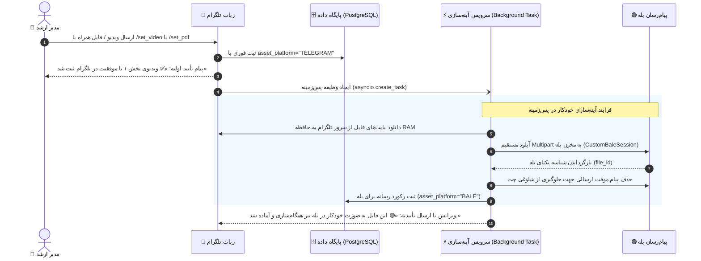

# 📜 مستر فرزند ۲۰: آینه‌سازی و همگام‌سازی آنی دوطرفهٔ رسانه‌ها (Real-Time Dual-Platform Media Mirroring)
**(Child Master 20 — Real-Time Cross-Platform Media Mirroring for Telegram & Bale)**

> **🔗 موقعیت در درختوارهٔ اسناد (والد و فرزندی):**
> - **⬆️ سند مادر (والد):** [ADMIN_PANEL_REDESIGN_MASTER.md](../ADMIN_PANEL_REDESIGN_MASTER.md)
> - **⬅️ اسناد هم‌خانواده (فرزندان پیشین):**
>   - **[مستر فرزند ۰۲](MASTER_02_CONTENT_DEVOTIONALS_AND_MEDIA.md):** محتوا، ادعیه، خطبه‌ها و رسانه‌ها
>   - **[مستر فرزند ۰۹](MASTER_09_BALE_ADAPTER_AND_MARKDOWN_COMPATIBILITY.md):** تطبیق‌دهنده پیام‌رسان بله و Markdown
>   - **[مستر فرزند ۱۲](MASTER_12_DEDICATED_ADMIN_BOT_AND_LIVE_ERROR_MONITORING.md):** ربات اختصاصی ادمین و لاگینگ پیوسته
>   - **[مستر فرزند ۱۴](MASTER_14_OPEN_KHATM_COLLECTIVE_PROGRESSION_ENGINE.md):** پیشرفت دسته‌جمعی ختم‌های آزاد
>   - **[مستر فرزند ۱۹](MASTER_19_ADMIN_BOT_ACCESS_AND_CREATOR_PANEL_BUTTON_GUARD.md):** دسترسی بات ادمین و پنل وب
>   - **[سند مهاجرت دسته‌ای رسانه‌ها](../TELEGRAM_TO_BALE_MIGRATION_MASTER.md):** موتور مهاجرت کلی تلگرام به بله
> - **🌱 تصمیم محصول:** `DEC-PY-0128` در [DECISIONS.md](../DECISIONS.md)

---

## ۱. صورت‌مسئله و هدف
در پیام‌رسان‌های تلگرام و بله، شناسه‌های رسانه (`file_id`) کاملاً محلی و انحصاری همان پیام‌رسان هستند. پیش از این:
1. ادمین یک ویدیو یا فایل را از طریق تلگرام با دستوراتی مثل `/set_video khutbah-fadakiah 1` یا `/set_pdf` ثبت می‌کرد.
2. سیستم این فایل را فقط برای تلگرام (`asset_platform="TELEGRAM"`) ثبت می‌کرد.
3. در بله، اعضا به دلیل نبود شناسهٔ بله نمی‌توانستند ویدیو یا فایل را دریافت کنند، مگر آنکه ادمین به صورت دستی دستور مهاجرت دسته‌ای (`/admin_sync_bale`) را اجرا می‌کرد یا فایل را دوباره در بله آپلود می‌کرد.

### ✅ هدف مستر ۲۰:
با پیاده‌سازی این مستر:
- **آینه‌سازی خودکار و درلحظه (Real-Time Background Mirroring):** به محض اینکه ادمین هر ویدیو، فایل PDF یا صوتی را در تلگرام ثبت کند، ربات فوراً آن را در تلگرام ذخیره کرده و به صورت غیرمسدودکننده (Non-blocking Background Task) همان فایل را استریم کرده، به مخزن بله منتقل می‌کند، شناسهٔ بله را استخراج نموده و در جدول `devotional_media` با `asset_platform="BALE"` ثبت می‌نماید.
- **تجربه کاربری یکپارچه:** ادمین فقط یک‌بار فایل را می‌فرستد و سیستم خودبه‌خود محتوا را برای هر دو پلتفرم (تلگرام + بله) آماده و فعال می‌سازد.
- **امنیت دسترسی:** دستورات مدیریتی با بررسی شناسه عددی ادمین در ربات اصلی ختم‌ساز (`@Khatm_Saz_bot`)، ربات اختصاصی ادمین (`@khatmsaz_admin_bot`) و ربات‌های عضویار برای ادمین‌های مجاز معتبر است.

---

## ۲. جریان معماری و چرخه حیات آینه‌سازی (Lifecycle Flow)

---

## ۳. بسته‌های کاری و تعهدات فنی (Work Packages)

### WP-01: هسته آینه‌سازی رسانه‌ها (`mirror_devotional_media_to_bale`)
- ساخت تابع مستقل در ماژول محتوا (`src/khatmsaz/modules/content/migrator.py` یا `mirroring.py`).
- ورودی‌ها: `devotional_asset_id`، `kind`، `page_number`، `asset_ref`، `caption`، `reciter_id`، `reciter_label`.
- پشتیبانی از لینک‌های فوروارد کانال (`tg_forward:@ch:mid`) و شناسه‌های مستقیم تلگرام.
- استریم مستقیم در حافظه موقت (`io.BytesIO`) بدون مصرف هارد دیسک.
- استفاده از `BaleAiohttpSession` با فرمت‌دهی Multipart جهت دریافت `file_id` معتبر بله.
- پاک‌سازی پیام ارسالی در مخزن بله جهت حفظ نظم چت.

### WP-02: ارتقای هندلرهای ثبت محتوا در ربات (`manage_content.py` و `admin.py`)
- فراخوانی غیرمسدودکننده (`asyncio.create_task`) در:
  - `/set_video` (و `/add_video`)
  - `/set_pdf` (و `/add_pdf`, `/set_file`)
  - `/set_audio` (و `/add_audio`)
  - روال تعاملی `/manage_content`
- عدم مسدودسازی درخواست ادمین در صورت بروز تأخیر اینترنت یا خطای لحظه‌ای بله (Graceful Degradation).

### WP-03: اصلاح و استحکام `AdminFilter` برای ادمین‌های مجاز
- ارتقای `AdminFilter` در `src/khatmsaz/bot/filters.py` برای اعتبارسنجی چت‌آیدی با `SUPER_ADMIN_TELEGRAM_CHAT_IDS`.
- تضمین کارکرد دستورات ادمین در ربات اصلی `@Khatm_Saz_bot` بدون تداخل با منوهای کاربران عادی.

### WP-04: آزمون‌ها و اعتبارسنجی نهایی
- تست‌های واحد با Mock برای پوشش فرآیند آینه‌سازی پس‌زمینه.
- آزمون یکپارچگی روی ۴۴۰ تست موجود پروژه بدون بروز رگرسیون.
- استقرار بر روی سرور عملیاتی و تست میدانی.
