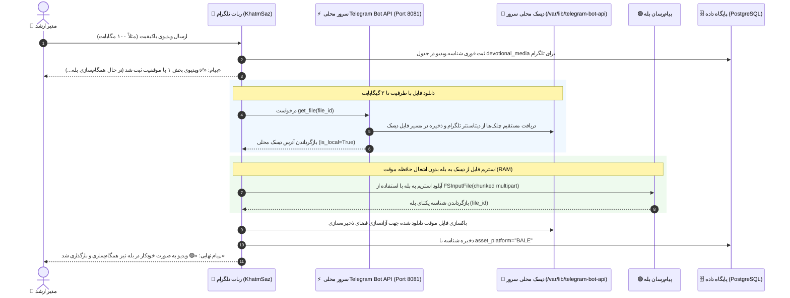

# 📜 مستر فرزند ۲۱: پشتیبانی از فایل‌های سنگین و حجیم تلگرام (تا ۲ گیگابایت) و سرور اختصاصی Bot API محلی
**(Child Master 21 — Telegram Local Bot API & Heavy Media Mirroring up to 2GB)**

> **🔗 موقعیت در درختوارهٔ اسناد (والد و فرزندی):**
> - **⬆️ سند مادر (والد):** [ADMIN_PANEL_REDESIGN_MASTER.md](../ADMIN_PANEL_REDESIGN_MASTER.md)
> - **⬅️ اسناد هم‌خانواده (فرزندان پیشین):**
>   - **[مستر فرزند ۰۲](MASTER_02_CONTENT_DEVOTIONALS_AND_MEDIA.md):** محتوا، ادعیه، خطبه‌ها و رسانه‌ها
>   - **[مستر فرزند ۰۹](MASTER_09_BALE_ADAPTER_AND_MARKDOWN_COMPATIBILITY.md):** تطبیق‌دهنده بله و استریم فرمت‌های رسانه‌ای
>   - **[مستر فرزند ۲۰](MASTER_20_REALTIME_DUAL_PLATFORM_MEDIA_MIRRORING.md):** آینه‌سازی و همگام‌سازی آنی دوطرفهٔ رسانه‌ها
> - **🌱 تصمیم محصول:** `DEC-PY-0129` در [DECISIONS.md](../DECISIONS.md)

---

## ۱. صورت‌مسئله و ریشه فنی خطا (Root Cause)

در تلگرام، سرورهای ابری استاندارد Bot API (`https://api.telegram.org`) دارای یک محدودیت سفت‌وسخت و غیرقابل‌تغییر برای ربات‌ها هستند:
- **سقف دانلود فایل برای ربات‌ها:** دقیقاً **۲۰ مگابایت** (`20,971,520 bytes`).
- اگر ادمین ویدیویی با حجم بالاتر از ۲۰ مگابایت (مانند قسمت‌های مختلف خطبه فدکیه یا غدیر که عموماً بین ۳۰ تا ۲۰۰ مگابایت هستند) ارسال یا فوروارد کند، فراخوانی `bot.get_file(file_id)` با خطای زیر متوقف می‌شود:
  ```text
  Telegram server says - Bad Request: file is too big
  ```

### چرا کار دستی یا روش‌های نصفه‌نیمه مردود است؟
طبق دستور صریح مالک پروژه («برو ارتقا بده برای فایلای سنگینم بتونه اینطوری بدرد نمیخوره»)، سیستم باید کاملاً خودکار و بدون نیاز به آپلود دستی یا دخالت مجدد انسان بتواند فایل‌های بزرگ، ویدیوهای باکیفیت و صوت‌های طولانی را مستقیماً دریافت، استریم و در پیام‌رسان بله نیز آینه‌سازی کند.

---

## ۲. راهکار معماری: سرور محلی تلگرام (Local Telegram Bot API Server)

تلگرام رسماً نرم‌افزار سرور Bot API را به صورت متن‌باز منتشر کرده است (`tdlib/telegram-bot-api`). با راه‌اندازی این سرور به صورت محلی در کنار سامانه ختم‌ساز:

| قابلیت / محدودیت | سرور ابری تلگرام (`api.telegram.org`) | سرور محلی (`telegram-bot-api --local`) |
| :--- | :--- | :--- |
| **سقف دانلود فایل توسط ربات** | حداکثر ۲۰ مگابایت | **تا ۲۰۰۰ مگابایت (۲ گیگابایت)** |
| **سقف آپلود فایل توسط ربات** | حداکثر ۵۰ مگابایت | **تا ۲۰۰۰ مگابایت (۲ گیگابایت)** |
| **نحوه انتقال فایل به سرور** | دانلود تحت وب (فشار شدید روی رم) | ذخیره مستقیم روی دیسک محلی سرور (`Zero RAM Spike`) |
| **هماهنگی با فریمورک aiogram** | پیش‌فرض | **پشتیبانی بومی (Native)** با `TelegramAPIServer.from_base(..., is_local=True)` |

---

## ۳. جریان تبادل داده بدون افت رم (Zero-RAM Streaming Pipeline)



---

## ۴. اجزای فنی و فایل‌های تحت تغییر

### ۱. تنظیمات پیکربندی (`src/khatmsaz/config.py`)
افزودن متغیرهای محیطی:
- `telegram_api_server_url: str | None = None` (مثلاً `http://127.0.0.1:8081`)
- `telegram_api_server_is_local: bool = True`
- `telegram_api_id: int | None = None`
- `telegram_api_hash: str | None = None`
- `telegram_local_bot_api_dir: str = "/var/lib/telegram-bot-api"`

### ۲. کارخانه ربات تلگرام (`src/khatmsaz/bot/telegram/client.py`)
- بررسی مقدار `settings.telegram_api_server_url`.
- در صورت وجود، ایجاد `TelegramAPIServer.from_base(settings.telegram_api_server_url, is_local=True)`.
- تزریق به `AiohttpSession(api=...)`.

### ۳. موتور استریم و مهاجرت رسانه (`src/khatmsaz/modules/content/migrator.py`)
- ارتقای متد `upload_to_bale`: پذیرش همزمان `file_bytes: bytes | None` یا `file_path: str | Path | None`.
- در صورت دریافت مسیر فایل محلی، استفاده از `FSInputFile(file_path)` برای استریم مستقیم قطعه‌قطعه (Streaming Multipart) به بله بدون بارگذاری کل فایل روی رم.
- در متد `mirror_devotional_media_to_bale`:
  - ابتدا درخواست `bot.get_file(file_id)` داده می‌شود.
  - اگر فایل محلی باشد (`file.file_path` روی دیسک سرور)، مستقیم از همان فایل برای آپلود به بله استفاده می‌گردد.
  - پس از آپلود موفق به بله، فایل موقت از دیسک پاکسازی می‌شود.

### ۴. راهنمایی و نیازمندی احراز هویت تلگرام (`TELEGRAM_API_ID` و `TELEGRAM_API_HASH`)
برای اجرای سرور محلی Telegram Bot API یا اتصال به کلاینت MTProto تلگرام:
- تلگرام نیازمند یک `api_id` و `api_hash` معتبر از پورتال رسمی توسعه‌دهندگان https://my.telegram.org است.
- این مشخصات یک‌بار دریافت شده و در فایل `.env` سرور قرار می‌گیرد.
- سرور محلی از طریق داکر کانتینر رسمی `aiogram/telegram-bot-api:latest` یا سرویس سیستم‌دی راه‌اندازی می‌گردد.

---

## ۵. معیارهای پذیرش و آزمون‌ها (Acceptance Criteria)

1. [x] **فایل مستر و تصمیم معماری:** ثبت مستر ۲۱ و `DEC-PY-0129`.
2. [ ] **یکپارچه‌سازی کد aiogram:** ربات تلگرام در صورت تنظیم بودن آدرس سرور محلی، بدون تغییر در سایر ماژول‌ها تمام درخواست‌ها را از سرور محلی دریافت کند.
3. [ ] **جلوگیری از نشت حافظه (RAM Protection):** فایل‌های سنگین از طریق `FSInputFile` به صورت استریم به بله ارسال شوند و هیچ‌گاه بافر چندصد مگابایتی در رم ایجاد نشود.
4. [ ] **آزمون‌های خودکار:** آزمون‌های واحد برای استریم فایل‌های دیسک و سناریوهای سرور محلی اضافه شده و تست‌های پروژه ۱۰۰٪ پاس شوند.
5. [ ] **مستندسازی و استقرار:** به‌روزرسانی مستندات حافظه پروژه و گزارش جامع وظیفه.
