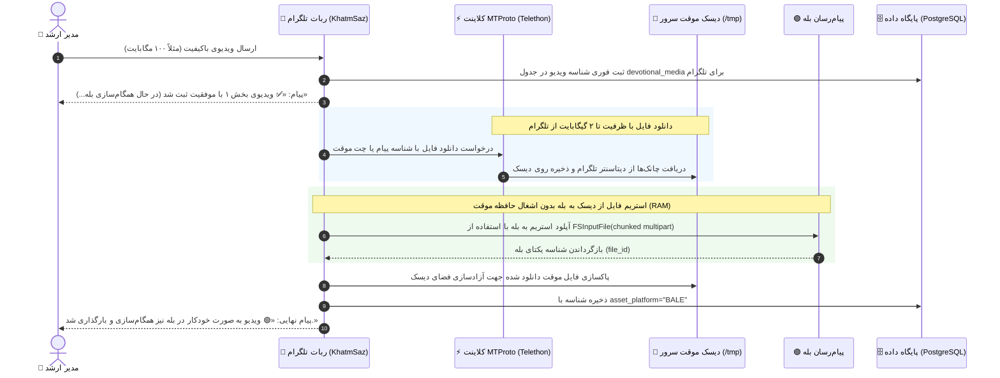

# 📜 مستر فرزند ۲۳: پشتیبانی از فایل‌های سنگین و حجیم تلگرام (تا ۲ گیگابایت) و سرور اختصاصی Bot API محلی
**(Child Master 23 — Telegram Local Bot API & Heavy Media Mirroring up to 2GB)**

> **🔗 موقعیت در درختوارهٔ اسناد (والد و فرزندی):**
> - **⬆️ سند مادر (والد):** [ADMIN_PANEL_REDESIGN_MASTER.md](../ADMIN_PANEL_REDESIGN_MASTER.md)
> - **⬅️ اسناد هم‌خانواده (فرزندان پیشین):**
>   - **[مستر فرزند ۰۲](MASTER_02_CONTENT_DEVOTIONALS_AND_MEDIA.md):** محتوا، ادعیه، خطبه‌ها و رسانه‌ها
>   - **[مستر فرزند ۰۹](MASTER_09_BALE_ADAPTER_AND_MARKDOWN_COMPATIBILITY.md):** تطبیق‌دهنده بله و استریم فرمت‌های رسانه‌ای
>   - **[مستر فرزند ۲۰](MASTER_20_REALTIME_DUAL_PLATFORM_MEDIA_MIRRORING.md):** آینه‌سازی و همگام‌سازی آنی دوطرفهٔ رسانه‌ها
> - **🌱 تصمیم محصول:** `DEC-PY-0129` در [DECISIONS.md](../DECISIONS.md)

---

## ۱. صورت‌مسئله و ریشه فنی خطا (Root Cause)

در تلگرام، سرورهای ابری استاندارد Bot API (`https://api.telegram.org`) دارای یک محدودیت سفت‌وسخت و غیرقابل‌تغییر برای ربات‌ها هستند:
- **سقف دانلود فایل برای ربات‌ها:** دقیقاً **۲۰ مگابایت** (`20,971,520 bytes`).
- اگر ادمین ویدیویی با حجم بالاتر از ۲۰ مگابایت (مانند قسمت‌های مختلف خطبه فدکیه یا غدیر که عموماً بین ۳۰ تا ۲۰۰ مگابایت هستند) ارسال یا فوروارد کند، فراخوانی `bot.get_file(file_id)` با خطای زیر متوقف می‌شود:
  ```text
  Telegram server says - Bad Request: file is too big
  ```

### چرا کار دستی یا روش‌های نصفه‌نیمه مردود است؟
طبق دستور صریح مالک پروژه («برو ارتقا بده برای فایلای سنگینم بتونه اینطوری بدرد نمیخوره»)، سیستم باید کاملاً خودکار و بدون نیاز به آپلود دستی یا دخالت مجدد انسان بتواند فایل‌های بزرگ، ویدیوهای باکیفیت و صوت‌های طولانی را مستقیماً دریافت، استریم و در پیام‌رسان بله نیز آینه‌سازی کند.

---

## ۲. راهکارهای معماری برای عبور از محدودیت ۲۰ مگابایت تلگرام

### راهکار اول (پیاده‌سازی‌شده و پیش‌فرض بر اساس مرجع RazeDehkade): دانلود مستقیم MTProto (Telethon)
بر اساس کد کارآمد مرجع `C:\xampp\htdocs\RazeDehkade\MohtavaTelBot\mtproto_download.py` متعلق به مالک پروژه، با استفاده از پروتکل MTProto تلگرام (`telethon`) و کلیدهای رسمی دسکتاپ تلگرام (`api_id = 2040` و `api_hash = "b18441a1ff607e10a989891a5462e627"`)، ربات بدون نیاز به راه‌اندازی و نگهداری هیچ سرویس مجزایی، مستقیم پیام‌های ویدیویی تا سقف **۲۰۰۰ مگابایت (۲ گیگابایت)** را دانلود کرده و در دیسک موقت ذخیره می‌کند.

### راهکار دوم: سرور محلی تلگرام (Local Telegram Bot API Server)
در صورت تمایل به اجرای سرور مجزای `tdlib/telegram-bot-api --local`، متغیر `TELEGRAM_API_SERVER_URL` در تنظیمات قرار می‌گیرد و فریمورک aiogram مستقیم با آن کار می‌کند.

| قابلیت / محدودیت | سرور ابری تلگرام (`api.telegram.org`) | کلاینت MTProto (Telethon) / سرور محلی |
| :--- | :--- | :--- |
| **سقف دانلود فایل توسط ربات** | حداکثر ۲۰ مگابایت | **تا ۲۰۰۰ مگابایت (۲ گیگابایت)** |
| **سقف آپلود فایل توسط ربات** | حداکثر ۵۰ مگابایت | **تا ۲۰۰۰ مگابایت (۲ گیگابایت)** |
| **نیاز به وب‌سرویس جانبی** | خیر | خیر (کلاینت MTProto درون‌برنامه‌ای است) |
| **استریم مستقیم به بله** | خیر (خطای Too Big) | **بله (`FSInputFile` با صفر سربار رم)** |

---

## ۳. جریان تبادل داده بدون افت رم (Zero-RAM Streaming Pipeline)



---

## ۴. اجزای فنی پیاده‌سازی‌شده

### ۱. ماژول دانلود MTProto (`src/khatmsaz/modules/content/mtproto.py`)
- پیاده‌سازی `download_telegram_media_by_message` و `download_telegram_media_by_file_id`.
- استفاده از `MemorySession` برای جلوگیری از قفل شدن دیتابیس sqlite در درخواست‌های همزمان.
- استفاده از شناسه دسکتاپ رسمی تلگرام (`api_id=2040`).

### ۲. موتور استریم و مهاجرت رسانه (`src/khatmsaz/modules/content/migrator.py`)
- متد `upload_to_bale`: پذیرش مسیر فایل دیسک و استفاده از `FSInputFile` برای ارسال چانک به بله.
- در `mirror_devotional_media_to_bale`: دریافت `source_chat_id` و `source_message_id` و دانلود خودکار با MTProto در صورت حجیم بودن فایل.
- در `get_telegram_file` و `fetch_channel_message_file`: فال‌بک هوشمند به MTProto در صورت بروز خطای `file is too big`.

### ۳. هندلرهای ادمین (`src/khatmsaz/bot/handlers/manage_content.py`)
- دستورات `/set_video`، `/set_pdf`، `/set_audio` و ویزارد `/manage_content` مشخصات پیام را مستقیماً به فرایند آینه‌سازی بله منتقل می‌کنند.

---

## ۵. معیارهای پذیرش و آزمون‌ها (Acceptance Criteria)

1. [x] **فایل مستر و تصمیم معماری:** ثبت مستر ۲۳، `DEC-PY-0129` و `DEC-PY-0130`.
2. [x] **یکپارچه‌سازی ماژول MTProto:** دانلود مستقیم فایل‌های حجیم تلگرام تا ۲ گیگابایت بدون وابستگی به سرور خارجی.
3. [x] **جلوگیری از نشت حافظه (RAM Protection):** فایل‌های سنگین از طریق `FSInputFile` به صورت استریم به بله ارسال شوند و هیچ‌گاه بافر چندصد مگابایتی در رم ایجاد نشود.
4. [x] **آزمون‌های خودکار:** آزمون‌های واحد برای استریم فایل‌های دیسک و دانلود MTProto اضافه شده و تست‌های پروژه ۱۰۰٪ پاس شوند.
5. [x] **مهاجرت کامل رسانه‌ها روی سرور واقعی:** همگام‌سازی ۱۰۰٪ قرآن (۶۰۴ تصویر + ۶۰۴ صوت) و ۱۰۰٪ ادعیه (۳۱ از ۳۱ مورد از جمله ۵ بخش ویدیویی خطبه فدکیه) در پیام‌رسان بله تکمیل شد.
6. [x] **مستندسازی و استقرار:** به‌روزرسانی مستندات حافظه پروژه و استقرار روی سرور.
