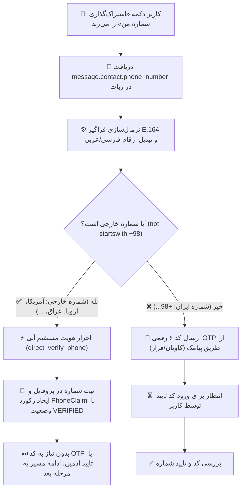

# 📜 مستر فرزند ۲۴: ثبت و احراز هویت مستقیم شماره‌های خارجی از طریق دکمه اشتراک‌گذاری مخاطب (Contact Share) و تفکیک جریان احراز پیامکی ایران
**(Child Master 24 — Foreign Phone Contact Share Direct Registration & Domestic OTP Segregation)**

> **🔗 موقعیت در درختوارهٔ اسناد (والد و فرزندی):**
> - **⬆️ سند مادر (والد):** [MASTER_22_FOREIGN_PHONE_DIRECT_VERIFICATION.md](MASTER_22_FOREIGN_PHONE_DIRECT_VERIFICATION.md)
> - **⬅️ اسناد هم‌خانواده (فرزندان پیشین):**
>   - **[مستر فرزند ۰۴](MASTER_04_BOTS_USERS_MODERATION_AND_OPS.md):** کاربران، بات‌ها، احراز هویت و مدیریت دسترسی
>   - **[مستر فرزند ۲۲](MASTER_22_FOREIGN_PHONE_DIRECT_VERIFICATION.md):** لغو تایید دستی شماره‌های خارجی و ایجاد احراز هویت مستقیم
> - **🌱 تصمیم محصول:** `DEC-PY-0131` در [DECISIONS.md](../DECISIONS.md)

---

## ۱. صورت‌مسئله و ریشهٔ فنی خطا (Root Cause)

در تصویر ارسالی کارفرما، کاربر در مرحلهٔ تکمیل پروفایل سازنده برای ساخت ختم با دکمهٔ «اشتراک‌گذاری شماره من» شمارهٔ خارجی خود را ارسال نموده اما با پیام خطای زیر مواجه شده و فرآیند ثبت‌نام متوقف شده است:
> «لطفاً یک شماره موبایل معتبر بنویسید یا از دکمه اشتراک‌گذاری استفاده کنید.»

### ریشهٔ فنی خطا:
۱. در پروتکل Telegram Bot API، هنگام لمس دکمهٔ `request_contact` (اشتراک‌گذاری مخاطب)، شیء `message.contact.phone_number` برای اکثر شماره‌های بین‌المللی و خارجی (مانند آمریکا، بریتانیا، آلمان، عراق، ترکیه و...) **بدون علامت مثبت (`+`) اولیه** ارسال می‌شود (مانند `"14155552671"` یا `"447911123456"` یا `"9647701234567"`).
۲. تابع پیشین `normalize_e164` تنها در صورتی پیشوند `+` اضافه می‌کرد که شماره با `00` یا `98` آغاز می‌شد. در نتیجه، برای تمام شماره‌های خارجی فاقد `+`، شرط `if not value.startswith("+")` فعال شده و خطای `OtpError("phone must be a valid E.164 number")` پرتاب می‌شد.
۳. در هندلرهای پروفایل (`profile.py`)، با دریافت این خطا، پیام خطای نامعتبر بودن شماره نمایش داده شده و کاربر خارجی نمی‌توانست ثبت‌نام یا ختم ایجاد کند.

---

## ۲. دستور صریح کارفرما (Owner Mandate)

> "الان شماره های خارجی نمیتونن ثبت نام بکنن و احراز هویت بشن.
> وقتی یکی این دکمه شیر پایین رو میزنه و شمارش با پیش شماره خارجی هست باید همون لحظه شمارش ثبت بشه (احراز هویت نمیخواد تایید بشه).
> فقط برای شماره هایی با پیش شماره ایران و یا شماره های ایران هست باید احراز هویت ارسال بشه.
> اینطوری میخوام باشه اینو درست بکن."

---

## ۳. قوانین تجاری و جریان کار (Business Rules & Flow)

### ۱. نرمال‌سازی فراگیر E.164 (`normalize_e164`):
- تبدیل تمام ارقام فارسی (`۰-۹`) و عربی (`٠-٩`) به ارقام انگلیسی.
- حذف کاراکترهای فاصله‌انداز، خط تیره، پرانتز و فاصله.
- اگر شماره با `00` آغاز شود -> تبدیل به `+`.
- اگر شماره با `09` (۱۱ رقم) آغاز شود -> تبدیل به `+989...`.
- اگر شماره با `98` (۱۲ رقم) یا `9` (۱۰ رقم با سرشماره‌های 90 تا 99) آغاز شود -> تبدیل به `+98...`.
- برای هر رشته رقمی بین ۷ تا ۱۵ رقم بدون علامت مثبت (فرمت پیش‌فرض کانتکت‌های خارجی تلگرام) -> افزودن خودکار علامت `+`.

### ۲. ثبت و احراز مستقیم آنی شماره‌های خارجی:
- به محض دریافت شمارهٔ خارجی از طریق کانتکت یا ورودی، شماره مستقیماً توسط `phone_service.direct_verify_phone` بررسی و تایید می‌شود:
  - اعمال قفل پایگاه داده (`lock_phone`).
  - اطمینان از عدم تعلق شماره به حسابی دیگر.
  - ثبت رکورد ادعای تاییدشده (`PhoneClaim` با وضعیت `VERIFIED`).
  - ثبت در تنظیمات کاربر (`UserSettings.contact_phone`).
  - ثبت در لاگ حسابرسی (`AuditLog`) با اکشن `PHONE_VERIFY` و نشان `foreign=True`.
- هیچ پیامک یا کد اعتبارسنجی برای شماره‌های خارجی ارسال نمی‌شود و هیچ تاییدیه‌ای از سوی مدیر لازم نیست.

### ۳. حفظ احراز هویت سخت‌گیرانه پیامکی برای شماره‌های ایران:
- تمامی شماره‌های متعلق به ایران (`+98...`) ملزم به دریافت کد اعتبارسنجی پیامکی (OTP) و ورود کد ۶ رقمی در ربات هستند و تا زمان ورود کد، سازنده اجازه نهایی‌سازی ساخت ختم را نخواهد داشت.

---

## ۴. ماژول‌ها و تغییرات اعمال‌شده (Architecture & File Changes)

۱. **`src/khatmsaz/modules/phone/service.py`:**
   - افزودن تابع کمکی `to_ascii_digits` جهت پشتیبانی کامل از ارقام فارسی/عربی.
   - ارتقای تابع `normalize_e164` برای شناسایی و نرمال‌سازی خودکار شماره‌های بین‌المللی ارسالی از Telegram Contact Share.
   - ارتقای تابع `is_foreign_phone` جهت تمایز دقیق شماره‌های بین‌المللی از ایران.

۲. **`src/khatmsaz/bot/handlers/profile.py` (`enter_phone` & `choose_gender`):**
   - پشتیبانی امن از شیء `message.contact` بدون ریسک خطای ویژگی.
   - احراز و ثبت مستقیم آنی شماره خارجی در لحظهٔ اشتراک‌گذاری مخاطب (`PROFILE_CONTACT_SHARE_FOREIGN_DIRECT_VERIFY`).
   - اتصال مستقیم به جریان ساخت ختم (`resume_khatm_creation_if_pending`) بدون وقفه یا بازگشت به منو.

۳. **`src/khatmsaz/bot/handlers/registration.py`:**
   - احراز و ثبت مستقیم آنی شماره خارجی هنگام ثبت‌نام اولیه در هر دو حالت اشتراک کانتکت تلگرام و تایپ دستی بله.

۴. **`src/khatmsaz/bot/handlers/member_registration.py`:**
   - احراز و ثبت مستقیم آنی شماره خارجی اعضای شرکت‌کننده در ختم هنگام ارسال کانتکت.

۵. **`src/khatmsaz/bot/handlers/change_phone.py`:**
   - افزودن دکمهٔ اشتراک کانتکت در دستور `/change_phone` برای راحتی کاربران.
   - پشتیبانی از `message.contact` و احراز هویت مستقیم شماره‌های خارجی در تغییر شماره.

۶. **`tests/test_master_24_foreign_contact_share.py`:**
   - مجموعه آزمون‌های جامع واحد و یکپارچه‌سازی جهت صحه‌گذاری بر نرمال‌سازی شماره‌های کانتکت، احراز مستقیم شماره‌های خارجی، و ارسال OTP فقط برای شماره‌های ایران.

---

## ۵. چک‌لیست اعتبارسنجی (Validation Checklist)

- [x] تست‌های واحد `normalize_e164` برای انواع پیش‌شماره‌های بین‌المللی بدون `+` (آمریکا، انگلستان، آلمان، عراق، ترکیه، افغانستان، امارات).
- [x] تست عدم شمول شماره‌های ایران در احراز مستقیم و الزام آن‌ها به کد OTP.
- [x] تست تبدیل صحیح ارقام فارسی و عربی به ارقام استاندارد.
- [x] تست هندلر کانتکت پروفایل (`ProfileEdit.entering_phone`) و ثبت آنی شماره خارجی.
- [x] تست هندلر ثبت‌نام اعضا و ثبت‌نام اولیه.
- [x] اجرای کامل آزمون‌های pytest پروژه با موفقیت ۱۰۰٪.
