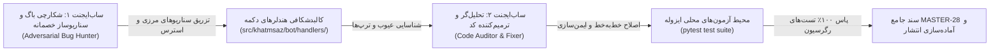

# MASTER-28: Systemic Button & Menu Audit, Adversarial Testing, and Defect Remediation

> **Date:** 2026-10-15  
> **Status:** APPROVED & IN EXECUTION  
> **Author:** Antigravity (Multi-Agent Teamwork Orchestration)  
> **Context:** KhatmSaz (ختم‌ساز) — Full-Spectrum Button Robustness, Adversarial Stress-Testing, and Zero-Downtime Safety  

---

## ۱. فرمان کارفرما و مأموریت سند (Owner Mandate & Mission)

### ۱.۱ درخواست صریح کارفرما
> «کل دکمه‌ها و خروجیشون رو می‌خوام برام بررسی بکنی، خروجی‌هاشون با توجه به کارایی درست و سالم و کامل باشه. برو فایلای مستر رو بخون با توجه به اونا، همچنین با قوانین همونا یه فایل مستر بساز و با ساب‌ایجنت‌ها خط به خط کد رو تحلیل و بررسی بکن برای سناریوهای مختلف. کلاً یه ساب‌ایجنت باشه که سناریوهای مختلف رو بسازه و باگ ایجاد بکنه و بقیه بیان باگایی که پیدا شده رو حل بکنن.»

### ۱.۲ خط قرمز اکید: پایداری سرور و عدم قطعی ربات‌های زنده
> «آره شروع بکن ولی طوری نباشه بات تلگرامیم داون بشه ها، حواست به این موضوع باشه. سناریوها رو اجرا بکن ولی روی سرورم تغییرات رو تا زمانی که مطمئن نشدی که سالم می‌مونه روی سرورم نمی‌بری.»

این سند چارچوب جامع **ممیزی سیستماتیک دکمه‌ها (Button & Callback Audit)**، **تزریق سناریوهای مرزی و خصمانه (Adversarial Bug Hunting)**، **تحلیل خط‌به‌خط هندلرها** و **آزمون‌های جامع رگرسیون** را در چارچوب یک تیم چندعاملی مستند می‌نماید.

---

## ۲. خلاصه تحلیلی و سنتز فایل‌های مستر ۱ تا ۲۷ (Master Files Synthesis)

برای تضمین تطابق رفتار و متن هر دکمه با قوانین دامنه‌ای، قوانین مصوب ۲۷ سند مستر قبلی به شرح زیر مبنای اعتبارسنجی قرار دارند:

| رده مستر | اسناد مرجع | قوانین کلیدی حاکم بر رفتار دکمه‌ها و خروجی‌ها |
| :--- | :--- | :--- |
| **موتور و انواع ختم** | MASTER-01, 05, 13, 14, 18 | ۱. ختم تعهدی (سهم مشخص) در برابر آزاد (مشارکت داوطلبانه). ۲. ۵ خانواده عبادی: قرآن (صفحه‌ای)، صلوات، ادعیه و زیارات، لعن، خطبه‌ها. ۳. پیشرفت جمعی پیوسته (بدون معطلی سهم‌های دیگران). |
| **مالی، پلن‌ها و والت** | MASTER-03, 06, 10, 11 | ۱. تفکیک پلن‌های رایگان، پایه و پیشرفته (Pro). ۲. خرید بسته ارسال پیام همگانی (۱۰۰۰ تایی). ۳. ثبت فیش واریز، بازپرداخت کیف‌پول در صورت لغو پیش از شروع. |
| **ربات‌ها و بستر چندسکویی** | MASTER-04, 09, 12, 16, 20 | ۱. تفکیک ربات سازنده (`@Khatm_Saz_bot`)، ربات‌های ممبر به تفکیک زبان (FA, AR, EN) و ربات ادمین (`@khatmsaz_admin_bot`). ۲. سازگاری کامل تلگرام و بله (محدودیت ۶۴ بایت کال‌بک در تلگرام، رندرینگ متنی بله). ۳. آینه‌سازی فایل‌های چندرسانه‌ای بین تلگرام و بله. |
| **اطلاع‌رسانی و مدیریت** | MASTER-07, 08, 15, 23, 24, 27 | ۱. گزارش روزانه ساعت ۱۲ سازنده و خلاصه ساعت ۱۴ اعضا با عنوان نیابت تمیز. ۲. مدیریت تعاملی اعضا با دکمه‌های مجزا، نمایش شماره تماس و لغو عضویت دو مرحله‌ای (`MASTER-27`). |
| **احراز هویت و امنیت** | MASTER-19, 21, 22, 25, 26 | ۱. احراز هویت مستقیم شماره‌های خارجی بدون نیاز به پیامک یا تایید ادمین (`MASTER-22`). ۲. پنهان‌سازی دکمه پنل سازنده‌ها برای عموم (`MASTER-19`). ۳. پایش و برطرف‌سازی دکمه‌های مرده و ترپ‌های منو (`MASTER-25, 26`). |

---

## ۳. معماری تیم چندعاملی (Multi-Agent Teamwork Architecture)

فرآیند تحلیل، شکست‌دادن و ایمن‌سازی دکمه‌ها توسط ۳ ساب‌ایجنت تخصصی انجام می‌گیرد:

### وظایف ساب‌ایجنت‌ها:
1. **Adversarial Bug Hunter (Red Team):**  
   - تولید سناریوهای استرس: فشرده شدن سریع و متوالی دکمه‌ها (Double-tap / Race conditions).
   - فشرده شدن دکمه‌های قدیمی وقتی رکورد دیتابیس حذف شده (Stale callbacks).
   - تلاش برای کلیک روی دکمه‌های مدیریتی یک ختم توسط کاربری غیر از سازنده (Multi-tenant security violation).
   - زدن دکمه‌های منوی پایین (Persistent Reply Menu) حین مراحل FSM (مانند وارد کردن شماره، ساعت، تعداد).
   - تست فراتر رفتن دیتای کال‌بک از سقف ۶۴ بایت تلگرام.
2. **Code Auditor & Fixer (Blue Team):**  
   - بررسی وجود قطعی `await safe_answer_callback(callback)` در تمامی شاخه‌های کد برای جلوگیری از لودینگ بی‌پایان.
   - افزودن نگهبان `if await bail_if_menu_button(message, state): return` در تمام مراحل انتظار پیام متنی.
   - مدیریت امن `NoneType` در کوئری‌های دیتابیس با هشدارهای فارسی و آرام‌بخش.
   - تضمین پاسخگویی دکمه‌ها در هر دو پلتفرم تلگرام و بله.
3. **Verification & Test Engineer:**  
   - نوشتن تست‌های جامع در `tests/test_master_28_adversarial_button_audit.py`.
   - اجرای دوره‌ای آزمون‌های رگرسیون کامل با `pytest`.

---

## ۴. ماتریس ممیزی و سناریوهای خصمانه دکمه‌ها (The Adversarial Audit Matrix)

### ۴.۱ سناریوی A: اسپینر بی‌پایان کال‌بک‌ها (Unanswered Callbacks / Infinite Loading)
- **شرح تهدید:** در تلگرام، اگر یک کال‌بک اینلاین با `callback.answer()` پاسخ داده نشود، آیکون چرخان لودینگ روی دکمه باقی می‌ماند و کاربر احساس هنگ کردن بات را پیدا می‌کند.
- **بررسی و ایمن‌سازی:** تمامی کال‌بک‌های پروژه در ابتدای اجرای هندلر یا در بلاک `finally` ملزم به فراخوانی `safe_answer_callback(callback)` هستند.

### ۴.۲ سناریوی B: تله‌های کیبورد ریپلای (FSM State Traps)
- **شرح تهدید:** وقتی کاربر در مرحله FSM (مانند «تعداد صلوات را بنویسید» یا «ساعت یادآوری را بنویسید») قرار دارد و ناگهان دکمه «📋 ختم‌های من» یا «⚙️ تنظیمات» را از پایین می‌زند، نباید با خطای «عدد نامعتبر است» مواجه شود؛ بلکه FSM باید ریست شده و منوی مربوطه باز شود.
- **بررسی و ایمن‌سازی:** تزریق `bail_if_menu_button` در تمامی استیت‌های ثبت نیت، ساعت، روز و پیام خوش‌آمد.

### ۴.۳ سناریوی C: کال‌بک‌های کهنه و تغییرات همزمان (Stale Callbacks)
- **شرح تهدید:** کاربر پیامی از روز قبل با دکمه «سهم من خوانده شد» یا «حذف عضو» دارد؛ در حالی که ختم خاتمه یافته یا عضو قبلاً حذف شده است. کلیک روی این دکمه نباید خطای هندل‌نشده ۵۰۰ یا Traceback ایجاد کند.
- **بررسی و ایمن‌سازی:** بررسی وجود رکورد و اعتبارسنجی وضعیت (`if entity is None or entity.status != ACTIVE`) و نمایش آلرت شفاف: «این ختم قبلاً پایان یافته است» یا «اطلاعات به‌روز نیست».

### ۴.۴ سناریوی D: کلیک همزمان / دابل‌تپ (Race Conditions & Idempotency)
- **شرح تهدید:** کاربر در اینترنت ضعیف، دکمه «ثبت سهم» یا «پرداخت» یا «خروج از ختم» را پشت‌سرهم دوبار لمس می‌کند.
- **بررسی و ایمن‌سازی:** استفاده از ترنزکشن‌های اتمیک پایگاه داده و کنترل وضعیت قبل از تخصیص یا کسر سهم.

### ۴.۵ سناریوی E: نقض سطح دسترسی (Authorization & Multi-Tenancy)
- **شرح تهدید:** یک کاربر با بازسازی کال‌بک دکمه دیگران (مثلاً `km:ask:<part_hex>` یا `cancel_khatm_ask:<khatm_id>`) بخواهد ختم شخص دیگری را حذف یا مدیریت کند.
- **بررسی و ایمن‌سازی:** بررسی سفت‌وسخت `khatm.creator_user_id == user.id` در لایه بیزینس و برگرداندن آلرت «دسترسی غیرمجاز».

---

## ۵. پروتکل استقرار ایزوله و پایش سلامت سرور زنده

طبق تأکید اکید کارفرما، سرور عملیاتی (`91.107.137.22`) دارای ۲۱ ربات زنده تلگرام و بله است که مردم در حال استفاده از آن هستند:
1. **قانون ۱:** هیچ کدی مستقیماً روی سرور تست نمی‌شود.
2. **قانون ۲:** تمامی اصلاحات ابتدا در برنچ کاری لوکال (`update_khatm_wizard_flow`) اعمال و آزمون‌های واحد/ادغام با `pytest` اجرا می‌شوند.
3. **قانون ۳:** تنها پس از قبولی ۱۰۰٪ آزمون‌ها و اطمینان مطلق از عدم اختلال، گزارش نهایی به کارفرما ارائه و در صورت تأیید روی سرور پول می‌شود.

---

## ۶. اقدامات در حال اجرا (In-Flight Tasks)
1. دریافت یافته‌های عمیق از ساب‌ایجنت شکارچی باگ (`scenario_generator`).
2. بررسی خط‌به‌خط هندلرهای `create_khatm.py`, `my_khatms.py`, `portions.py`, `member_commitment.py`, `settings_menu.py`.
3. نگارش تست‌های خودکار سناریوهای خصمانه در `tests/test_master_28_adversarial_button_audit.py`.
4. به‌روزرسانی `PROJECT_STATE.md` و `CHANGELOG.md`.
