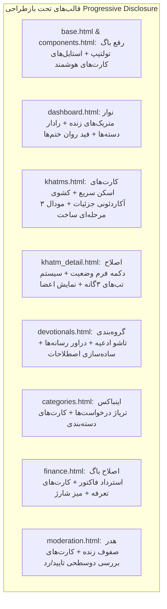

# MASTER-37 — بازطراحی جامع تجربه کاربری، حسابرسی خط‌به‌خط و معماری Progressive Disclosure پنل وب مدیریت ختم‌ساز

این سند مستر بر اساس ارزیابی چندبعدی ۶ دیدگاه تخصصی (**یوزر خیلی خنگ**، **تحلیل‌گر رفتار کاربر**، **طراح UI Pro Max**، **طراح UX Pro Max**، **نقاد و منتقد سرسخت کد**، و **ایده‌پرداز و معمار سیستم**) و به دنبال درخواست کاربر پیرامون بازطراحی کامل پنل وب مدیریت، حذف سردرگمی‌ها، پیاده‌سازی اصل **Progressive Disclosure** (خلاصه بودن همه چیز و باز شدن جزئیات با کلیک روی کارت‌ها) و فهرست تفصیلی و بی‌قیدوشرط **«نبایدها» (Non-Negotiable Guardrails)** تدوین شده است.

---

## ۱. تحلیل و ارزیابی ۶ دیدگاه تخصصی (Six Perspectives Audit)

### ۱.۱. دیدگاه یوزر خیلی خنگ (Naive User Perspective - سادگی محض و واژگان فارسی)
- **شوک واژگانی (Jargon Paralysis):** در مواجهه با واژه‌هایی مثل `slug`, `UUID`, `DevotionalMedia`, `asset_platform`, `asset_ref`, `FREE_TARGET`, `reciter_label`, کاربر کاملاً احساس بی‌سوادی می‌کند و جرات کلیک روی دکمه‌ها را از دست می‌دهد.
  - *راه‌حل:* جایگزینی کامل با اصطلاحات ملموس و خودمانی:
    - `slug` ➔ شناسه سیستمی (انگلیسی ساده برای آدرس‌دهی)
    - `UUID` ➔ کد رهگیری سیستمی
    - `asset_platform` ➔ پیام‌رسان (تلگرام / بله)
    - `asset_ref` ➔ آدرس فایل، لینک تلگرام یا شناسه
    - `reciter_label` ➔ نام مداح / قاری یا کپشن ویدیو
    - `FREE_TARGET` ➔ شمارنده آزاد (بدون سقف)
- **سردرگمی فرم‌های طولانی:** وقتی کاربر وارد صفحه ادعیه یا جزئیات ختم می‌شود و با فرم‌های ۲۰ فیلدی مواجه می‌گردد، نمی‌داند برای یک ویرایش ساده عنوان چه کار باید بکند.
  - *راه‌حل:* پیش‌فرض فرم‌ها بسته باشند. فقط عنوان و وضعیت مشخص باشد؛ با کلیک دکمه «ویرایش سریع»، فقط فیلدهای همان بخش باز شوند.

### ۱.۲. دیدگاه تحلیل‌گر رفتار کاربر (Behavioral Analyst Perspective - رفع خستگی تصمیم)
- **پدیده Always-Open Fatigue:** در صفحات فعلی، تمام فرم‌های افزودن دعا، ثبت رسانه، ویرایش پلن‌ها و متن‌های بلند به صورت همزمان باز هستند. چشم انسان به صورت ناخودآگاه با بیش از ۷ المان تصمیم‌گیری همزمان دچار اضطراب و خستگی مفرط می‌شود.
- **اصل سه‌گانه Glance ➔ Inspect ➔ Act:**
  1. **Glance (اسکن در ۲ ثانیه):** کاربر در صفحه باید با یک نگاه وضعیت کلی، تعداد اعضا، وضعیت فعال/غیرفعال و نام ختم یا دعا را بفهمد.
  2. **Inspect (بررسی با کلیک):** اگر کاربر روی کارت کلیک کرد، لایه دوم باز شده و نیت، فایل‌ها، نام سازنده و لینک‌ها نمایش یابد.
  3. **Act (اقدام):** دکمه‌های تایید، ویرایش، حذف یا تغییر وضعیت فقط در این لایه با تاییدیه دو مرحله‌ای در دسترس باشند.

### ۱.۳. دیدگاه طراح UI Pro Max (UI Designer Perspective - زیبایی و هویت Dark / Emerald)
- **رنگ‌بندی مدرن شیشه‌ای (Glassmorphism & Contrast):**
  - پس‌زمینه اصلی: تیره عمیق سرمه‌ای/مشکی (`#020617` / Slate 950).
  - کارت‌های داده: شیشه‌ای با شفافیت کنترل‌شده (`bg-slate-900/60 backdrop-blur-md border border-white/10`).
  - هویت برند زمردی: سبز زمردی درخشان (`#10b981` Emerald) برای تاییدها و رشد.
  - هشدارها: کهربایی ملایم (`#f59e0b` Amber) برای موارد نیازمند بررسی و نظارت.
  - عملیات پرخطر: زرشکی متمایز (`#f43f5e` Rose) برای رد، استرداد یا لغو.
- **تایپوگرافی و خوانایی اعداد:**
  - فونت «استعداد» (Estedad) در تمامی وزن‌ها.
  - اعداد پولی و شمارنده‌ها به صورت مونو (`font-mono`) با جداکننده سه‌رقمی فارسی (`{:,}`).

### ۱.۴. دیدگاه طراح UX Pro Max (UX Designer Perspective - تعاملات روان و Progressive Disclosure)
- **سیستم کارت هوشمند با آکاردئون بازشونده (Accordion Disclosure):**
  - بدون نیاز به بارگذاری مجدد یا تغییر صفحه، با کلیک روی هر آیتم، بخش پایینی کارت با یک بازشدن روان اطلاعات عمیق‌تر را نشان می‌دهد.
- **تایید دوسطحی برای اقدامات پرخطر:**
  - تغییر وضعیت ختم، استرداد وجه فاکتور، یا رد درخواست نظارتی باید دارای بازخورد بصری و تاییدیه صریح باشد تا از کلیک‌های تصادفی جلوگیری شود.
- **تولتیپ‌های هوشمند و غیرمزاحم:**
  - اصلاح قطعی تداخل کلاس `group` در آکاردئون‌ها با تولتیپ‌ها؛ تولتیپ‌ها با شناسه اختصاصی `group/tip` فقط و فقط روی هاور دکمه علامت سوال فعال می‌شوند.

### ۱.۵. دیدگاه نقاد و منتقد سرسخت کد (Critic / Code Auditor Perspective - رفع باگ‌های پنهان)
حسابرسی خط‌به‌خط قالب‌ها دو باگ بحرانی را آشکار کرد:
1. **باگ استرداد فاکتور در `finance.html` (خط ۲۹۷):**
   - اکشن فرم به صورت اشتباه درج شده بود: `/finance/invoices/{ invoice.id }/refund` (یک آکولاد به جای دو آکولاد!). این باگ موجب خطای ۴۰۴ در استرداد می‌شد و باید به `{{ invoice.id }}` اصلاح گردد.
2. **باگ نبود دکمه ثبت تغییر وضعیت در `khatm_detail.html` (خط ۶۸ تا ۸۵):**
   - فرم تغییر وضعیت ختم دارای سلکتور وضعیت و چک‌باکس استرداد بود ولی فاقد هرگونه دکمه ارسال (`<button type="submit">`) بود؛ در نتیجه ادمین امکان تغییر وضعیت ختم از این بخش را نداشت!
3. **عدم هماهنگی در تب‌ها و فرم‌های پراکنده:**
   - ادغام فرم افزودن رسانه و متن در قالب کشوهای مینی‌مال.

### ۱.۶. دیدگاه ایده‌پرداز و معمار سیستم (Solution Ideator Perspective)
- افزودن قابلیت فیلتر سریع بر اساس متن و وضعیت در کلاینت.
- دکمه کپی سریع لینک با بازخورد «کپی شد!».
- استفاده از پیش‌نمایش زنده در صف نظارت به جای اسکرول‌های طولانی.

---

## ۲. فهرست جامع و تخلف‌ناپذیر «نبایدها» (Non-Negotiable Guardrails)

این خطوط قرمز تحت هیچ شرایطی نباید نقض شوند:

1. **نباید هیچ روت (URL) در `src/khatmsaz/web/app.py` تغییر کند.**
   - تمام فرم‌های بازطراحی‌شده باید دقیقاً به همان روت‌های قبلی با همان متد (POST یا GET) ارسال شوند.
2. **نباید نام هیچ فیلد فرم (Input name) تغییر کند.**
   - فیلدهای `csrf`, `title`, `niyyat`, `content_kind`, `category_id`, `khatm_type`, `commitment_policy`, `amount`, `visibility`, `new_status`, `status`, `refund_wallet`, `decision`, `updated_description`, `note`, `slug`, `kind`, `platform`, `page_number`, `reciter_label`, `file`, `asset_ref` باید دقیقاً حفظ شوند.
3. **نباید توکن CSRF از هیچ فرمی حذف شود.**
   - ارسال فرم بدون توکن معتبر منجر به خطای ۴۰۳ می‌گردد.
4. **نباید هیچ مدل پایگاه داده (SQLAlchemy Models) یا مایگریشن Alembic دستکاری شود.**
5. **نباید فرایند پولینگ ربات‌های تلگرام و بله (aiogram polling) یا Bot Registry دستخوش تغییر گردد.**
6. **نباید هیچ منطق بیزنس (قانون ۵ واگذاری، تعرفه‌های پیام گروهی، تایید تلفن خارجی، فرآیند تقسیم سهم) دگرگون شود.**
7. **نباید صفحات ضروری مدیریتی حذف شوند؛ بلکه باید با رویکرد Progressive Disclosure ساده‌سازی و فشرده شوند.**

---

## ۳. نقشه اجرایی بازطراحی قالب‌ها با رویکرد Progressive Disclosure

---

## ۴. برنامه آزمون، اعتبارسنجی و استقرار

1. **آزمون‌های خودکار رگرسیون:** اجرای تست جامع برای سلامت رندرینگ تمپلیت‌ها، توکن‌های CSRF، و تطابق پارامترهای فرم با روت‌های `app.py`.
2. **اجرای pytest:** تضمین پاس شدن ۱۰۰٪ تست‌های موجود بدون هیچ‌گونه شکست.
3. **به‌روزرسانی حافظه پروژه:** ثبت تغییرات در `PROJECT_STATE.md` و `CHANGELOG.md`.
4. **استقرار و اعمال زنده بر سرور VPS:** پوش به گیت و اجرای اسکریپت دپلو بر روی سرور `91.107.137.22` و تایید لایو بودن سرویس.
