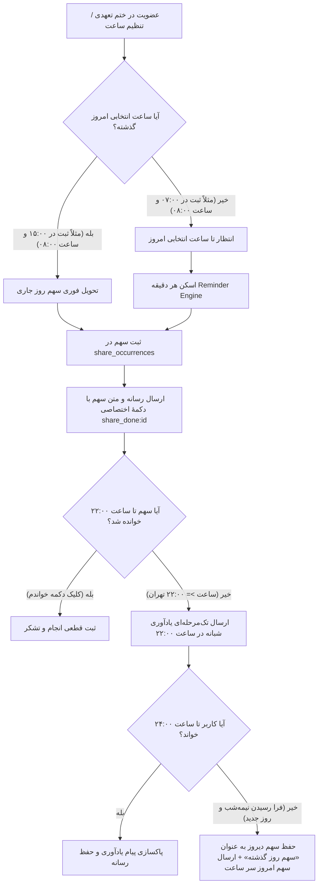

# MASTER-41: موتور زمان‌بندی، تحویل سهم روزانه و یادآوری تک‌مرحله‌ای شبانه (Khatm Delivery & Reminder Engine Redesign)

**تاریخ تدوین:** ۲۶ مهر ۱۴۰۵ / 2026-10-18  
**وضعیت:** مصوب بر اساس تصمیمات قطعی کارفرما و پیاده‌سازی‌شده (Approved & Implemented)  
**دامنه:** ماژول نوبت مستقل (`share_occurrence`)، موتور زمان‌بندی و یادآوری (`reminder_engine`)، آداپتورهای بات (`occurrence_adapter` و `member_commitment` و `join_flow`)  
**وابستگی‌ها:** MASTER-01 (موتور ختم‌ها)، MASTER-05 (ختم آزاد)، MASTER-13 (ثبت فوری سهم)، MASTER-14 (موتور پیشرفت دسته‌جمعی)، REMINDER_REDESIGN_MASTER

---

## ۱. چرایی و تصمیمات قطعی کارفرما (Mandate & User Decisions)

بر اساس استعلام مستقیم و مصوبات اخذشده از کارفرما در تاریخ ۲۶ مهر ۱۴۰۵، قوانین کسب‌وکار موتور ارسال سهم و یادآوری به شرح زیر تعیین و تثبیت گردید:

1. **تصمیم شماره ۱ (تحویل فوری در روز اول):**
   - چنانچه کاربری ساعتی را به عنوان ساعت دریافت روزانه برگزیده باشد (مثلاً ساعت ۰۸:۰۰ صبح)، اما در ساعتی دیرتر در طول روز (مثلاً ساعت ۱۵:۰۰ بعدازظهر) عضو ختم تعهدی روزانه شود یا تعهد خود را نهایی کند:
   - **مصوبه:** سهم روز جاری بلافاصله در همان زمان عضویت (ساعت ۱۵) صادر و برای کاربر تحویل داده می‌شود، و از فردای آن روز ارسال‌ها طبق ساعت انتخابی عضو (ساعت ۰۸:۰۰ صبح) ادامه می‌یابد.
2. **تصمیم شماره ۲ (یادآوری تک‌مرحله‌ای شبانه در ساعت ۲۲):**
   - برای سهم‌های تعهدی روزانه‌ای که کاربر هنوز دکمهٔ «خواندم» را روی آن‌ها لمس نکرده است:
   - **مصوبه:** سیستم تک‌مرحله‌ای عمل می‌کند؛ یعنی یادآوری میانی ۲ ساعته (`FOLLOWUP`) به طور کامل حذف می‌گردد تا چت کاربر با پیام‌های تکراری شلوغ نشود. سیستم تنها یک‌بار در ساعت ۲۲:۰۰ شب (به وقت تهران — دقیقاً ۲ ساعت قبل از مهلت پایان روز در ساعت ۲۴) یادآوری شبانه ارسال می‌کند.
3. **تصمیم شماره ۳ (ماندگاری سهم دیروز و ممنوعیت واژهٔ «دین شرعی»):**
   - اگر کاربری تا پایان شب (ساعت ۲۴) سهم روز جاری را قرائت نکند و وارد روز بعد شویم:
   - **مصوبه:** سهم روز گذشته برای کاربر حفظ می‌شود و شناسه و دکمهٔ اختصاصی ثبت انجام خود را نگه می‌دارد، و سهم روز جدید نیز سر ساعت مقرر برای وی صادر و ارسال می‌گردد.
   - **قانون لحن و متن:** به دستور صریح کارفرما، تحت هیچ شرایطی از واژهٔ «دین شرعی» در پیام‌های بات، منوها یا کارنامه استفاده نمی‌شود؛ بلکه با ادبیاتی محترمانه از عناوینی مانند «سهم روز گذشته» یا «سهم‌های باقیمانده» استفاده می‌گردد.
4. **تصمیم شماره ۴ (ختم آزاد بدون ارسال خودکار سر ساعت):**
   - با توجه به حذف رزرو ۷ روزه در ختم آزاد طبق اصلاحات V3:
   - **مصوبه:** ختم‌های آزاد هیچ‌گونه ارسال سر ساعت خودکار یا ریمایندر روزانه ندارند؛ صدور سهم در ختم آزاد منحصراً لحظه‌ای و با فشردن دستی دکمهٔ «دریافت سهم» توسط خود کاربر انجام می‌پذیرد.
5. **تصمیم شماره ۵ (پاکسازی خودکار پیام یادآوری پس از انجام):**
   - پس از زدن دکمهٔ «خواندم / انجام شد»:
   - **مصوبه:** پیام متنیِ یادآوری شبانه پاکسازی (Delete) می‌شود، در حالی که پیام‌های محتوای اصلی (متن دعا، صفحات قرآن، فایل صوتی مداح یا ویدیوی خطبه) برای مطالعه و بهره‌برداری‌های بعدی در چت کاربر باقی می‌مانند.

---

## ۲. دیاگرام جریان تحویل و یادآوری (Delivery & Reminder Architecture)

---

## ۳. تغییرات فنی در ماژول‌ها و فایل‌ها (File Mutation Matrix)

| ردیف | فایل تغییریافته | شرح تغییر فنی |
| :---: | :--- | :--- |
| **۱** | `src/khatmsaz/modules/share_occurrence/delivery.py` | ۱) در تابع `remind`: حذف کامل یادآوری ۲ ساعته (`FOLLOWUP`) و تنظیم ارسال یادآوری شبانه در ساعت ۲۲:۰۰ محلی برای سهم‌های انجام‌نشده. ۲) در تابع `is_regular_due`: اطمینان از صدور سهم روز جاری در صورت عضویت پس از ساعت انتخابی. ۳) عدم صدور سهم یا ریمایندر برای ختم‌های آزاد در حالت خودکار. |
| **۲** | `src/khatmsaz/modules/reminder_engine/service.py` | ۱) حذف یا بایگانی ارسال‌های خودکار برای ختم آزاد (`_send_open_schedule_reminders`). ۲) اجرای پاکسازی (`cleanup_completed_shares`) به محض ثبت انجام سهم برای حذف پیام یادآوری شبانه. |
| **۳** | `src/khatmsaz/bot/handlers/member_commitment.py` | پس از ذخیرهٔ برنامهٔ منظم در `_save_regular`، در صورتی که ساعت انتخابی عضو برای امروز گذشته باشد، سهم روز جاری را فوراً آماده و ارسال می‌کند تا کاربر همان روز اولین سهمش را دریافت نماید. |
| **۴** | `src/khatmsaz/bot/handlers/join_flow.py` | در توابع ذخیره ساعت (`_save_delivery_time`)، اعمال تحویل سهم روز اول برای عضو جدید در صورت گذشتن ساعت انتخابی. |
| **۵** | `src/khatmsaz/bot/occurrence_adapter.py` | اصلاح متن‌های یادآوری شبانه و پاکسازی پیام کنترل یادآوری پس از کلیک روی `share_done` با حفظ فایل‌های چندرسانه‌ای. |
| **۶** | `src/khatmsaz/i18n/__init__.py` | پالایش هرگونه متن مرتبط با بدهی و تأکید بر عبارات «سهم روز گذشته» یا «سهم‌های باقیمانده» به جای «دین شرعی». |

---

## ۴. طرح تست و اعتبارسنجی (Test Plan)

1. **تست عضویت دیرهنگام در روز اول:**
   - ثبت عضویت در ساعت ۱۵:۰۰ با ساعت انتخابی ۰۸:۰۰ صبح -> تأیید صدور و تحویل فوری سهم امروز.
   - ثبت عضویت در ساعت ۰۷:۰۰ با ساعت انتخابی ۰۸:۰۰ صبح -> تأیید عدم ارسال تا رسیدن به ساعت ۰۸:۰۰.
2. **تست یادآوری تک‌مرحله‌ای ساعت ۲۲:**
   - عدم ارسال پیام در ساعت ۲ ساعت پس از تحویل (حذف `FOLLOWUP`).
   - ارسال موفق پیام یادآوری شبانه در ساعت ۲۲:۰۰ تهران برای سهم خوانده‌نشده.
3. **تست ماندگاری سهم دیروز (Rollover):**
   - عبور از نیمه‌شب -> سهم دیروز با شناسه یکتای خود فعال می‌ماند؛ سهم امروز نیز سر ساعت ۸ صبح صادر می‌شود.
   - زدن دکمه سهم دیروز باعث تکمیل سهم دیروز می‌شود؛ زدن دکمه سهم امروز باعث تکمیل سهم امروز می‌گردد بدون هیچ تداخلی.
4. **تست پاکسازی یادآوری پس از انجام:**
   - پس از زدن دکمه «خواندم»، پیام یادآوری ساعت ۲۲ از چت پاک می‌شود اما عکس/صوت/متن اصلی در چت باقی می‌ماند.
