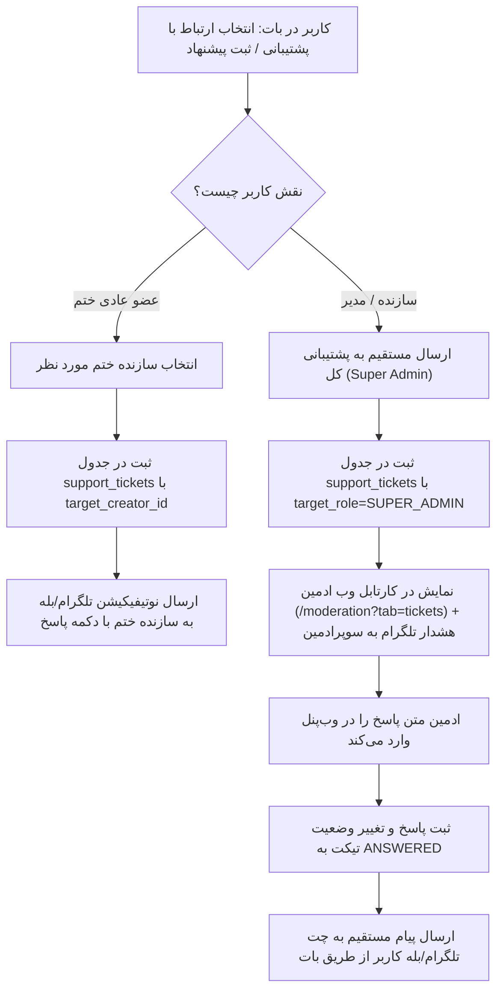

# MASTER-42: مرکز تیکت‌ها، پیشنهادات و پیام‌های پشتیبانی در پنل وب و ناوگان بات‌ها (Support Tickets & Direct Messaging Hub)

**تاریخ تدوین:** ۲۶ مهر ۱۴۰۵ / 2026-10-18  
**وضعیت:** مصوب بر اساس تصمیمات قطعی کارفرما و در حال پیاده‌سازی (Approved & In-Progress)  
**دامنه:** ماژول جدید `support_ticket`، پایگاه‌داده و مدل‌های ماندگار، وب‌پنل مدیریت (`/moderation?tab=tickets`)، هندلر بات `suggestions.py`، و آداپتور پیام‌رسان (`notify_adapter`)  
**وابستگی‌ها:** MASTER-04 (معماری کاربران، بات‌ها و صف‌های نظارت)، MASTER-37 (بازطراحی پنل مدیریت)، DEC-PY-0118 (مرکز نظارت و صف‌های تایید)

---

## ۱. چرایی و تصمیمات قطعی کارفرما (Mandate & User Decisions)

بر اساس استعلام مستقیم و مصوبات اخذشده از کارفرما در تاریخ ۲۶ مهر ۱۴۰۵:

1. **تصمیم شماره ۱ (تکمیل صف هشتم نظارت):**
   - تا پیش از این، پیام‌ها و پیشنهادات ارسالی از بات صرفاً در لاگ‌های ممیزی (`audit_logs`) و به صورت پیام موقت فورواردی تلگرام ارسال می‌شد و هیچ جدول اختصاصی، وضعیت پیگیری (در انتظار / پاسخ داده شده) و کارتابل وبی نداشت.
   - **مصوبه:** ایجاد جدول و ماژول اختصاصی `support_ticket` با چرخهٔ حیات کامل (`PENDING`, `ANSWERED`, `CLOSED`) و افزودن تب اختصاصی «💬 تیکت‌های پشتیبانی» در مرکز نظارت وب (`/moderation?tab=tickets`) همراه با امکان مشاهده پیام کاربر و پاسخ مستقیم از پنل وب به چت تلگرام یا بله کاربر.
2. **تصمیم شماره ۲ (محدودهٔ ارتباطی کاربران عادی و سازندگان):**
   - **مصوبه:** اعضای عادی ختم‌ها منحصراً پیام خود را برای سازندهٔ همان ختم ارسال می‌کنند (تفکیک ارتباط اعضا با سازندگان جهت جلوگیری از شلوغی چت سوپرادمین). سازندگان ختم‌ها و مدیران مجازند مستقیماً به پشتیبانی کل سامانه (سوپرادمین) تیکت ارسال کنند. تیکت‌های ثبت‌شده برای سوپرادمین در کارتابل وب‌پنل `/moderation` نمایش داده می‌شوند.
3. **تصمیم شماره ۳ (ارسال پاسخ مستقیم به کاربر):**
   - به محض درج پاسخ توسط ادمین در پنل وب، وضعیت تیکت به `ANSWERED` تغییر یافته، هویت ادمین پاسخ‌دهنده و زمان پاسخ ثبت شده و متن پاسخ از طریق بات رسمی به چت کاربر مخابره می‌گردد.

---

## ۲. دیاگرام جریان تیکت و پاسخ‌دهی (Ticket Lifecycle Architecture)

---

## ۳. ماتریس تغییرات فایل‌ها و ماژول‌ها (File Mutation Matrix)

| ردیف | فایل تغییریافته / ایجادشده | شرح تغییر فنی |
| :---: | :--- | :--- |
| **۱** | `src/khatmsaz/modules/support_ticket/models.py` | تعریف مدل دیتابیس `SupportTicket` و Enum وضعیت `SupportTicketStatus` (`PENDING`, `ANSWERED`, `CLOSED`). |
| **۲** | `src/khatmsaz/modules/support_ticket/repository.py` | توابع درج تیکت، خواندن با صفحه‌بندی، شمارش تیکت‌های منتظر، ثبت پاسخ و بستن تیکت. |
| **۳** | `src/khatmsaz/modules/support_ticket/service.py` | منطق بیزنس تیکت‌ها، احراز صلاحیت، ارسال پاسخ به چت کاربر از طریق `notify_adapter` و ثبت لاگ ممیزی `SUPPORT_TICKET_REPLY`. |
| **۴** | `src/khatmsaz/core/model_registry.py` | اضافه کردن ایمپورت مدل `support_ticket.models` جهت رجیستری متادیتا در Alembic. |
| **۵** | `src/khatmsaz/bootstrap.py` | افزودن DDL خودترمیم `CREATE TABLE IF NOT EXISTS support_tickets` در استارتاپ پروژه. |
| **۶** | `src/khatmsaz/bot/handlers/suggestions.py` | اتصال فرم ورود متن در بات به `support_ticket_service.submit_ticket` جهت ماندگاری دائمی تیکت‌ها. |
| **۷** | `src/khatmsaz/web/app.py` | افزودن تب `tickets` در `/moderation`، شمارنده تیکت‌ها، روت `POST /moderation/tickets/{ticket_id}/reply` و روت `POST /moderation/tickets/{ticket_id}/close`. |
| **۸** | `src/khatmsaz/web/templates/moderation.html` | طراحی تب «💬 تیکت‌های پشتیبانی»، نمایش مشخصات کاربر، متن پیام، فرم پاسخ متنی و وضعیت‌ها. |
| **۹** | `migrations/versions/support2026101801_support_tickets.py` | مایگریشن استاندارد Alembic برای ساخت جدول و ایندکس‌ها. |
| **۱۰** | `tests/test_master_42_support_tickets.py` | آزمون‌های کامل واحد و یکپارچه‌سازی ماژول تیکت، وب‌پنل و ارسال پاسخ. |

---

## ۴. طرح تست و معیارهای پذیرش (Test & Acceptance Plan)

1. **تست ثبت تیکت پایگاه‌داده:**
   - ثبت تیکت از طرف سازنده با مقصد سوپرادمین و بررسی فیلدهای `status=PENDING` و `target_role='SUPER_ADMIN'`.
   - ثبت تیکت از طرف عضو به سازنده مشخص و بررسی `target_creator_id`.
2. **تست کارتابل وب و شمارنده:**
   - فراخوانی روت `GET /moderation?tab=tickets` و اعتبارسنجی نمایش تیکت‌های معلق در شمارنده و جدول.
3. **تست پاسخ مستقیم ادمین:**
   - ارسال پاسخ متنی از فرم وب‌پنل -> تغییر وضعیت به `ANSWERED`، پر شدن `reply_text` و `replied_at`، و فراخوانی آداپتور ارسال پیام به کاربر.
4. **تست بستن تیکت:**
   - ارسال درخواست Close -> تغییر وضعیت به `CLOSED`.
