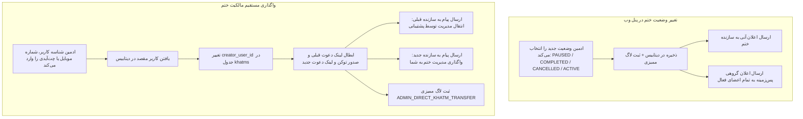

# MASTER-43: مدیریت جامع ختم‌ها، واگذاری مستقیم مالکیت و اعلانات خودکار در پنل وب (Admin Khatm Management & Direct Controls)

**تاریخ تدوین:** ۲۶ مهر ۱۴۰۵ / 2026-10-18  
**وضعیت:** مصوب بر اساس تصمیمات قطعی کارفرما و در حال پیاده‌سازی (Approved & In-Progress)  
**دامنه:** پنل وب مدیریت (`web/templates/khatm_detail.html` و `web/app.py`)، ماژول گردش کار ختم (`khatm_workflow`)، و آداپتور ارسال اعلان بات (`notify_adapter`)  
**وابستگی‌ها:** MASTER-01 (موتور ختم و وضعیت‌ها)، MASTER-33 (غیرفعال‌سازی و واگذاری)، MASTER-35 (عمومی‌سازی و چرخش لینک دعوت)، MASTER-37 (بازطراحی پنل وب)

---

## ۱. چرایی و تصمیمات قطعی کارفرما (Mandate & User Decisions)

بر اساس استعلام مستقیم از کارفرما در تاریخ ۲۶ مهر ۱۴۰۵:

1. **تصمیم شماره ۱ (اطلاع‌رسانی خودکار تغییر وضعیت ختم به اعضا و سازنده):**
   - در صورت تغییر وضعیت ختم توسط ادمین در پنل وب (مانند توقف موقت `PAUSED`، فعال‌سازی مجدد `ACTIVE`، اتمام زودهنگام `COMPLETED` یا لغو `CANCELLED`)، پیام محترمانه و خودکار از طریق بات به سازنده و کلیهٔ اعضای فعال ارسال می‌گردد تا در جریان وضعیت روزانهٔ ختم خود قرار گیرند.
2. **تصمیم شماره ۲ (واگذاری مستقیم مالکیت توسط ادمین ارشد):**
   - سوپرادمین مجاز است مالکیت هر ختم را مستقیماً به هر کاربری (بر اساس شناسه کاربری، شماره تلفن یا چت‌آیدی) منتقل کند؛ حتی اگر کاربر مقصد شماره تلفن احرازشده نداشته باشد.
3. **تصمیم شماره ۳ (امنیت و چرخش لینک در واگذاری):**
   - به محض انتقال مستقیم مالکیت، توکن و لینک دعوت قبلی منقضی شده و لینک دعوت جدید برای سازنده جدید صادر می‌شود. پیام تبریک و اطلاع‌رسانی به سازنده جدید، و پیام تشکر و اطلاع‌رسانی به سازنده قبلی ارسال می‌گردد.
4. **تصمیم شماره ۴ (پشتیبانی از توقف موقت در فرم وضعیت):**
   - گزینهٔ «⏸ توقف موقت» (`PAUSED`) به انتخابگر وضعیت در پنل وب اضافه می‌شود تا ادمین بتواند موقتاً ارسال سهم‌ها را متوقف کرده و مجدداً آن را فعال سازد.

---

## ۲. دیاگرام فرآیند واگذاری مستقیم و اعلانات تغییر وضعیت (Lifecycle & Process Flow)

---

## ۳. ماتریس تغییرات فایل‌ها و ماژول‌ها (File Mutation Matrix)

| ردیف | فایل تغییریافته / ایجادشده | شرح تغییر فنی |
| :---: | :--- | :--- |
| **۱** | `src/khatmsaz/web/app.py` | ۱. به‌روزرسانی روت `POST /khatms/{khatm_id}/status` جهت ارسال اعلان‌های محترمانه به سازنده و اعضای فعال ختم. ۲. افزودن روت `POST /khatms/{khatm_id}/transfer/direct` جهت واگذاری مستقیم مالکیت به کاربر مقصد همراه با چرخش لینک دعوت و ارسال نوتیفیکیشن دوطرفه. |
| **۲** | `src/khatmsaz/web/templates/khatm_detail.html` | ۱. افزودن گزینهٔ «⏸ توقف موقت» به فرم وضعیت ختم. ۲. افزودن کارت و فرم «🤝 واگذاری مستقیم مدیریت ختم به کاربر دیگر» همراه با فیلد ورودی شناسه/شماره/آیدی کاربر. ۳. به‌روزرسانی پیام‌های هشدار موفقیت (`saved=direct_transferred`, `saved=status_changed`). |
| **۳** | `docs/ai/DECISIONS.md` | ثبت تصمیم معماری `DEC-PY-0135`. |
| **۴** | `docs/ai/PROJECT_STATE.md` و `CHANGELOG.md` | ثبت ورودی مستندات پروژه در صدر فایل‌ها. |
| **۵** | `docs/ai/INDEX.md` | ایندکس‌گذاری MASTER-43. |
| **۶** | `tests/test_master_43_khatm_management.py` | آزمون‌های جامع اعتبارسنجی واگذاری مستقیم، اعلانات وضعیت و روت‌های وب. |

---

## ۴. معیارهای پذیرش و آزمون (Acceptance Criteria)

1. **آزمون اعلانات تغییر وضعیت:**
   - تغییر وضعیت به `PAUSED`: بررسی ثبت وضعیت و فراخوانی تابع ارسال پیام به سازنده و اعضا با متن توقف موقت.
   - تغییر وضعیت به `COMPLETED`: بررسی ثبت `completed_at` و ارسال پیام اتمام به سازنده و اعضا.
   - تغییر وضعیت به `CANCELLED`: بررسی استرداد وجه در صورت انتخاب تیک و ارسال پیام لغو.
   - تغییر وضعیت به `ACTIVE`: بررسی فعال‌سازی مجدد و ارسال پیام به اعضا.
2. **آزمون واگذاری مستقیم مالکیت:**
   - واگذاری به کاربر دیگر بر اساس UUID، شماره موبایل یا Chat ID عددی.
   - تغییر `creator_user_id` به کاربر مقصد.
   - چرخش لینک دعوت (تولید توکن جدید) و ارسال اعلان به هر دو طرف.
   - ثبت دقیق رویداد `ADMIN_DIRECT_KHATM_TRANSFER` در لاگ‌های ممیزی.
