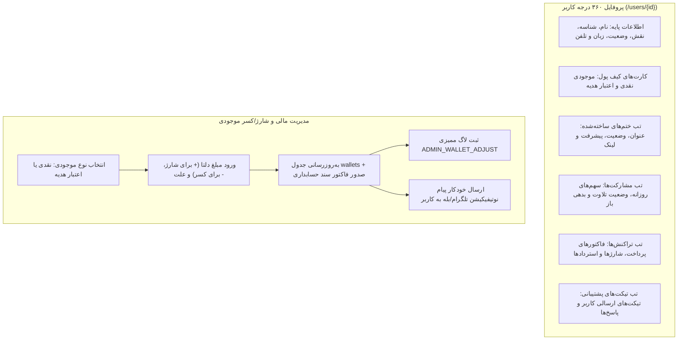

# MASTER-44: پروفایل ۳۶۰ درجه کاربران، سوابق عضویت و مدیریت مالی/کیف پول در پنل وب (User 360 Profile & Wallet Hub)

**تاریخ تدوین:** ۲۶ مهر ۱۴۰۵ / 2026-10-18  
**وضعیت:** مصوب بر اساس تصمیمات قطعی کارفرما و در حال پیاده‌سازی (Approved & In-Progress)  
**دامنه:** پنل وب مدیریت (`web/app.py` و صفحه اختصاصی جدید `web/templates/user_detail.html`)، ماژول کیف پول (`modules/wallet`)، ماژول هویت (`modules/identity`) و آداپتور ارسال اعلان (`notify_adapter`)  
**وابستگی‌ها:** MASTER-03 (پلن‌ها، کیف پول و تراکنش‌ها)، MASTER-04 (کاربران و هویت)، MASTER-37 (بازطراحی پنل وب)، MASTER-40 (مدیریت مدیران)، MASTER-42 (تیکت‌های پشتیبانی)

---

## ۱. چرایی و تصمیمات قطعی کارفرما (Mandate & User Decisions)

بر اساس استعلام مستقیم از کارفرما در تاریخ ۲۶ مهر ۱۴۰۵:

1. **تصمیم شماره ۱ (پروفایل ۳۶۰ درجه جامع کاربر):**
   - تا پیش از این، در پنل مدیریت هیچ صفحهٔ مجزایی برای مشاهده جزئیات یک کاربر خاص (`/users/{user_id}`) وجود نداشت و کلیه اطلاعات به صورت کارت‌های فشرده در صفحه لیست کاربران قرار داشت.
   - **مصوبه:** ایجاد روت اختصاصی `GET /users/{user_id}` و قالب کامل `user_detail.html` جهت مشاهده هویت کاربر، شماره‌های ثبت‌شده، سوابق ختم‌های ساخته‌شده، مشارکت‌ها و وضعیت سهم‌ها، تاریخچه فاکتورها و تیکت‌های پشتیبانی.
2. **تصمیم شماره ۲ (شارژ و کسر دستی کیف پول با تفکیک نوع موجودی):**
   - ادمین در فرم مدیریت کیف پول کاربر می‌تواند نوع موجودی را انتخاب کند:
     - **موجودی نقدی (Cash Balance):** قابل استفاده برای ساخت ختم، پرداخت پلن و خدمات.
     - **اعتبار هدیه / تبلیغاتی (Reward Credit):** اعتبارات تشویقی و تبلیغاتی سامانه.
3. **تصمیم شماره ۳ (اطلاع‌رسانی خودکار تغییر موجودی به کاربر):**
   - به محض شارژ یا کسر موجودی توسط ادمین در پنل وب، یک پیام محترمانه رسمی به همراه مبلغ تغییریافته، موجودی جدید و علت ثبت‌شده از طریق بات رسمی به چت کاربر مخابره می‌گردد.
4. **تصمیم شماره ۴ (ثبت دقیق سند حسابداری و ممیزی):**
   - هرگونه تغییر موجودی توسط ادمین علاوه بر ثبت در جدول `invoices` با نوع `MANUAL_ADJUSTMENT`، رویدادی ممیزی با کد `ADMIN_WALLET_ADJUST` ثبت خواهد کرد.

---

## ۲. دیاگرام ساختار پروفایل ۳۶۰ درجه و مدیریت کیف پول (Architecture Diagram)

---

## ۳. ماتریس تغییرات فایل‌ها و ماژول‌ها (File Mutation Matrix)

| ردیف | فایل تغییریافته / ایجادشده | شرح تغییر فنی |
| :---: | :--- | :--- |
| **۱** | `src/khatmsaz/web/templates/user_detail.html` | صفحهٔ اختصاصی جدید پروفایل ۳۶۰ درجه کاربر با چیدمان واکنش‌گرا و تب‌های مجزا. |
| **۲** | `src/khatmsaz/web/app.py` | ۱. افزودن روت `GET /users/{user_id}` با بارگذاری اطلاعات جامع کاربر، ختم‌ها، سهم‌ها، کیف پول و تیکت‌ها. ۲. به‌روزرسانی روت `POST /users/{user_id}/wallet` با پشتیبانی از اعلان خودکار بات به کاربر و پیام موفقیت. |
| **۳** | `src/khatmsaz/web/templates/users.html` | افزودن لینک «مشاهده پروفایل ۳۶۰°» روی نام و شناسه کاربر در جدول و کارت‌های لیست کاربران. |
| **۴** | `docs/ai/DECISIONS.md` | ثبت تصمیم معماری `DEC-PY-0136`. |
| **۵** | `docs/ai/PROJECT_STATE.md` و `CHANGELOG.md` | ثبت ورودی مستندات پروژه در صدر فایل‌ها. |
| **۶** | `docs/ai/INDEX.md` | ایندکس‌گذاری MASTER-44. |
| **۷** | `tests/test_master_44_user_profile.py` | آزمون‌های جامع اعتبارسنجی روت پروفایل، فرم کیف پول و ارسال اعلان. |

---

## ۴. معیارهای پذیرش و آزمون (Acceptance Criteria)

1. **آزمون صفحه پروفایل ۳۶۰ درجه:**
   - فراخوانی `GET /users/{user_id}` و اطمینان از برگرداندن کد وضعیت ۲۰۰ و حضور بخش‌های اطلاعات هویتی، کیف پول، مشارکت‌ها و ختم‌ها.
2. **آزمون شارژ و کسر کیف پول:**
   - شارژ موجودی نقدی و بررسی افزایش `balance_toman` و ارسال اعلان به کاربر.
   - شارژ اعتبار هدیه و بررسی افزایش `credit_toman` و ارسال اعلان به کاربر.
   - کسر موجودی و ثبت سند حسابداری منفی در صورت کفایت موجودی.
3. **آزمون اعلان به ربات:**
   - بررسی متن پیام اعلان شارژ/کسر و وجود مبلغ و علت در پیام.
