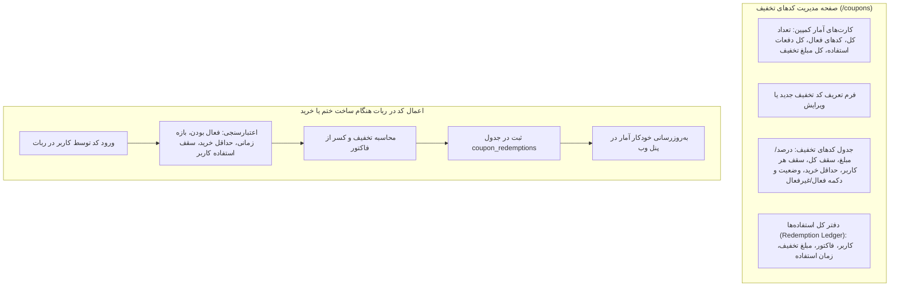

# MASTER-45: مرکز مدیریت کدهای تخفیف، گزارش استفاده و کمپین‌های بازاریابی در پنل وب (Discount Coupons & Campaign Hub)

**تاریخ تدوین:** ۲۶ مهر ۱۴۰۵ / 2026-10-18  
**وضعیت:** مصوب بر اساس تصمیمات قطعی کارفرما و در حال پیاده‌سازی (Approved & In-Progress)  
**دامنه:** پنل وب مدیریت (`web/app.py`، `web/templates/base.html`، صفحه مستقل جدید `web/templates/coupons.html`)، ماژول مالی و کیف پول (`modules/wallet`)  
**وابستگی‌ها:** MASTER-03 (پلن‌ها، کیف پول و تراکنش‌ها)، MASTER-37 (بازطراحی پنل وب)، MASTER-44 (پروفایل ۳۶۰ درجه کاربران و کیف پول)

---

## ۱. چرایی و تصمیمات قطعی کارفرما (Mandate & User Decisions)

بر اساس استعلام مستقیم از کارفرما در تاریخ ۲۶ مهر ۱۴۰۵:

1. **تصمیم شماره ۱ (صفحه اختصاصی و مستقل `/coupons` در منوی اصلی نوار کناری):**
   - کدهای تخفیف از یک تب ساده در صفحه مالی خارج شده و دارای صفحهٔ فرماندهی مستقل در منوی کناری (`/coupons`) با دسترسی مدیران مالی (`FINANCE_MANAGE`) می‌گردد.
2. **تصمیم شماره ۲ (عدم حذف فیزیکی جهت حفظ یکپارچگی حسابداری):**
   - کدهای تخفیف هرگز حذف فیزیکی (DELETE) نمی‌شوند. هر کد وضعیت فعال/غیرفعال (`enabled = True/False`) داشته و کلیه سوابق استفاده (Redemptions) برای ممیزی حسابداری دائمی می‌مانند.
3. **تصمیم شماره ۳ (پشتیبانی از انواع تخفیف، سقف استفاده و بازه زمانی):**
   - امکان تعریف کدهای تخفیف درصدی (`PERCENT`) با تعیین حداکثر مبلغ تخفیف (`max_discount_toman`) و کدهای مبلغ ثابت (`FIXED`).
   - پشتیبانی از حداقل مبلغ خرید (`min_purchase_toman`)، سقف کل دفعات استفاده (`total_redemption_limit`) و سقف مجاز برای هر کاربر (`per_user_limit`).
   - پشتیبانی از تاریخ و ساعت شروع و پایان اعتبار کمپین (`starts_at`, `ends_at`).
4. **تصمیم شماره ۴ (گزارش جامع ردگیری و استفاده کاربران - Redemption Ledger):**
   - نمایش جدول شفاف و برخط از کلیه دفعات استفاده‌شده شامل نام کاربر، شناسه کاربری، اکانت متصل، شناسه فاکتور، مبلغ تخفیف‌داده‌شده و تاریخ دقیق استفاده به وقت تهران.

---

## ۲. دیاگرام ساختار مرکز کدهای تخفیف و چرخه استفاده (Architecture Diagram)

---

## ۳. ماتریس تغییرات فایل‌ها و ماژول‌ها (File Mutation Matrix)

| ردیف | فایل تغییریافته / ایجادشده | شرح تغییر فنی |
| :---: | :--- | :--- |
| **۱** | `src/khatmsaz/web/templates/coupons.html` | صفحه اختصاصی جدید مرکز مدیریت کدهای تخفیف و دفتر کل استفاده‌ها. |
| **۲** | `src/khatmsaz/web/templates/base.html` | افزودن لینک مستقیم «کدهای تخفیف و کمپین‌ها» در منوی دسکتاپ و داک موبایل. |
| **۳** | `src/khatmsaz/modules/wallet/repository.py` | افزودن متد `list_coupon_redemptions` برای واکشی دفتر کل استفاده‌ها همراه با کاربر و فاکتور، و پشتیبانی از تاریخ در `upsert_coupon`. |
| **۴** | `src/khatmsaz/modules/wallet/service.py` | افزودن متدهای `list_coupon_redemptions` و تکمیل `set_coupon` با پارامترهای تاریخ انقضا. |
| **۵** | `src/khatmsaz/web/app.py` | افزودن روت `GET /coupons` و روت‌های `POST /coupons/create` و `POST /coupons/{code}/toggle`. |
| **۶** | `docs/ai/DECISIONS.md` | ثبت تصمیم معماری `DEC-PY-0137`. |
| **۷** | `docs/ai/PROJECT_STATE.md` و `CHANGELOG.md` | ثبت مستندات پروژه در صدر فایل‌ها. |
| **۸** | `docs/ai/INDEX.md` | ایندکس‌گذاری MASTER-45. |
| **۹** | `tests/test_master_45_coupons_hub.py` | آزمون‌های جامع اعتبارسنجی مرکز تخفیف و دفتر استفاده. |

---

## ۴. معیارهای پذیرش و آزمون (Acceptance Criteria)

1. **آزمون دسترسی و روتینگ:**
   - دسترسی به `/coupons` با مجوز `FINANCE_MANAGE` برقرار بوده و قالب با کد ۲۰۰ لود شود.
2. **آزمون ایجاد کد تخفیف:**
   - ایجاد کد تخفیف درصدی و اعتبارسنجی سقف ۱۰۰ درصد.
   - ایجاد کد تخفیف مبلغ ثابت و ذخیره در دیتابیس.
3. **آزمون تغییر وضعیت (Toggle Active):**
   - تغییر وضعیت کد از فعال به غیرفعال و برعکس بدون حذف فیزیکی رکورد.
4. **آزمون دفتر کل استفاده‌ها (Redemption Ledger):**
   - نمایش صحیح رکوردهای استفاده با نام کاربر، کد فاکتور و مبلغ تخفیف.
