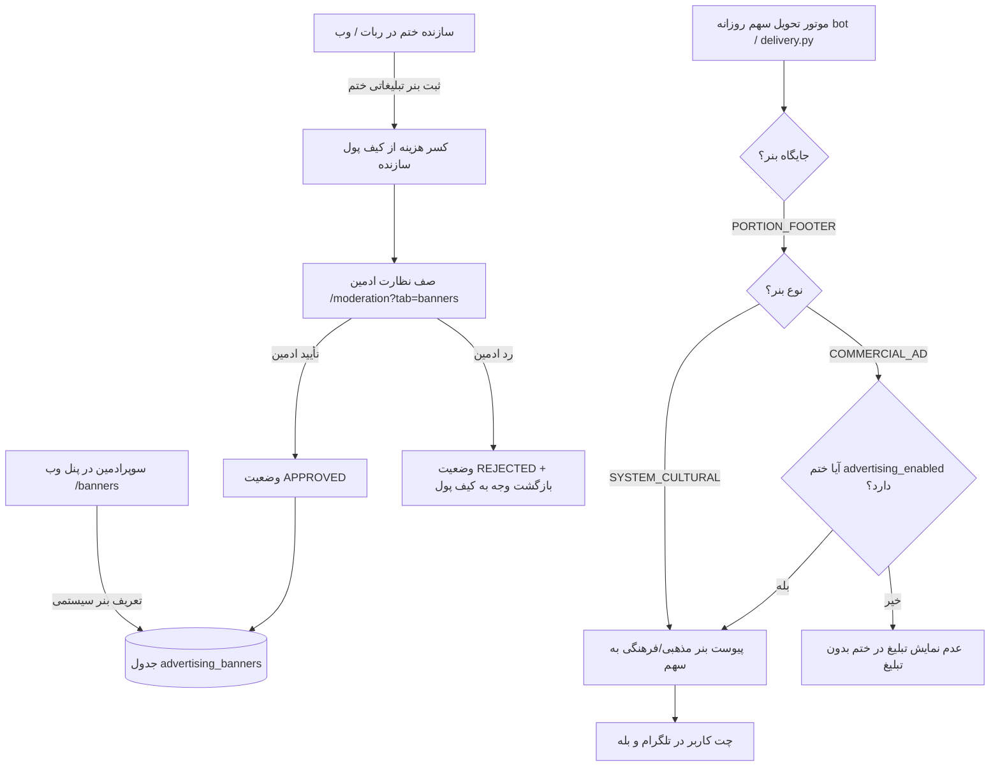

# MASTER-46: مرکز پایش و مدیریت بنرهای تبلیغاتی و اطلاعیه‌ها در پنل وب و ناوگان ربات‌ها (Advertising & Banner Hub)

> **Date:** 2026-10-18  
> **Status:** APPROVED & IN PROGRESS  
> **Author:** Antigravity  
> **Context:** KhatmSaz (ختم‌ساز) — Full-Stack Python Rewrite (Web Admin + Fleet Bots + PostgreSQL)  

---

## ۱. خلاصه اجرایی و تصمیمات قطعی کارفرما (Owner Mandates)

بر اساس تصمیمات قطعی و پرسش‌وپاسخ با کارفرما در تاریخ ۲۶ مهر ۱۴۰۵:
1. **مرکز مستقل مدیریت بنرها در پنل وب (`/banners`):**
   - ایجاد صفحه جامع وب با دسترسی مستقیم در سایدبار اصلی پنل مدیریت جهت تعریف، زمان‌بندی، فعال‌سازی و پایش عملکرد بنرها و اطلاعیه‌ها.
2. **تفکیک ماهیتی بنرها بر اساس فرهنگ و تجارت (Cultural vs Commercial):**
   - **اطلاعیه‌های فرهنگی و مذهبی سیستمی (`SYSTEM_CULTURAL`):** اطلاعیه‌های مناسبتی، ادعیه، احادیث و پیام‌های عمومی سامانه که می‌توانند به صورت سراسری در تمامی ختم‌ها نمایش داده شوند.
   - **تبلیغات تجاری (`COMMERCIAL_AD`):** پیام‌ها و بنرهای تبلیغاتی که **صرفاً و منحصراً** در ختم‌هایی نمایش داده می‌شوند که سازنده رضایت تبلیغات (`advertising_enabled = True`) را فعال کرده باشد؛ بدین ترتیب حریم و خواسته سازندگان و اعضای ختم‌های بدون تبلیغ به صورت قطعی محفوظ می‌ماند.
3. **پشتیبانی از جایگاه‌های چندگانه نمایش (Placements):**
   - **پاورقی سهم روزانه ربات‌ها (`PORTION_FOOTER`):** درج خودکار متن بنر و دکمه شیشه‌ای متصل به لینک مقصد در انتهای پیام تحویل سهم یا پیام اعلام پایان سهم.
   - **صفحه عمومی وب دعوت به ختم (`INVITE_PAGE`):** نمایش کارت بصری بنر با تصویر و لینک در صفحه وب معرفی ختم (`join.html`).
   - **ارسال مستقیم به مخاطبان (`DIRECT_BROADCAST`):** امکان ارسال آنی پیام یا تست بنر توسط ادمین به صورت مستقیم.
4. **امکان ثبت بنر توسط سازندگان ختم و تأیید در صف نظارت:**
   - سازندگان ختم می‌توانند درخواست ارسال بنر/پیام تبلیغاتی برای اعضای ختم خود ثبت کنند.
   - درخواست در صف نظارت ادمین (`/moderation?tab=banners`) قرار می‌گیرد.
   - با تأیید ادمین، پیام تبلیغاتی بلافاصله به اعضای ختم مخابره می‌شود.
   - هزینه ارسال از کیف پول سازنده بر مبنای بسته‌های استاندارد پیام گروهی کسر می‌گردد. در صورت رد توسط ادمین، مبلغ به کیف پول سازنده بازگردانده (Refund) می‌شود.
5. **شاخص‌های کلیدی عملکرد (KPIs) و عدم حذف فیزیکی:**
   - ثبت آمار دقیق تعداد دفعات نمایش (Impressions) و کلیک‌ها (Clicks) برای هر بنر.
   - کلید فعال/غیرفعال‌سازی سریع (`POST /banners/{id}/toggle`) بدون حذف داده‌های تاریخی.

---

## ۲. نمودار جریان داده و تصمیم‌گیری بنرها (Mermaid Flow)

---

## ۳. ماتریس فایل‌ها و تغییرات (File Mutation Matrix)

| فایل | نوع تغییر | شرح وظیفه در معماری |
| :--- | :--- | :--- |
| `src/khatmsaz/modules/advertising/models.py` | ویرایش / افزودن | مدل‌های `AdvertisingBanner`، `BannerType`، `BannerPlacement`، `BannerStatus` |
| `src/khatmsaz/modules/advertising/repository.py` | ایجاد | توابع پایگاه داده برای درج، بازیابی، کوئری جایگاه‌ها، ثبت ایمپرشن و آمار |
| `src/khatmsaz/modules/advertising/service.py` | ویرایش / گسترش | منطق تجاری ایجاد بنر، تغییر وضعیت، بررسی در صف نظارت، بازیابی بنر متناسب با ختم |
| `src/khatmsaz/bootstrap.py` | ویرایش | ایجاد جدول خودترمیم `advertising_banners` و ایندکس‌های مربوطه |
| `migrations/versions/banners2026101801_add_advertising_banners.py` | ایجاد | مایگریشن Alembic برای جدول بنرهای تبلیغاتی با تک‌هدینگ سالم |
| `src/khatmsaz/web/templates/base.html` | ویرایش | افزودن منوی «بنرها و اطلاعیه‌ها» به سایدبار و نوار موبایل |
| `src/khatmsaz/web/templates/banners.html` | ایجاد | داشبورد مدیریت بنرها، کارت‌های KPI، فرم ثبت بنر و جدول عملیات |
| `src/khatmsaz/web/templates/moderation.html` | ویرایش | افزودن تب بنرها (`tab=banners`) به صف‌های نظارت و کارت‌های تأیید/رد |
| `src/khatmsaz/web/app.py` | ویرایش | اندپوینت‌های `/banners`، `/banners/create`، `/banners/{id}/toggle`، `/moderation/banners/{id}/decide` |
| `src/khatmsaz/modules/share_occurrence/delivery.py` | ویرایش | تزریق ایمن بنر فعال متناسب با وضعیت تبلیغات ختم به پیام سهم |
| `tests/test_master_46_advertising_hub.py` | ایجاد | تست‌های جامع واحد و یکپارچگی کارتابل بنرها و قواعد تفکیک فرهنگی/تجاری |

---

## ۴. معیارهای پذیرش و آزمون (Acceptance Criteria)

1. روت `GET /banners` با دسترسی مدیران با کد وضعیت ۲۰۰ و بدون خطا رندر شود.
2. ایجاد بنر نوع `SYSTEM_CULTURAL` و `COMMERCIAL_AD` با ولیدیشن فیلدها و ثبت لاگ ممیزی `ADMIN_BANNER_CREATE` انجام گیرد.
3. کلید فعال/غیرفعال‌سازی (`POST /banners/{id}/toggle`) وضعیت `is_active` را بدون حذف رکورد معکوس نماید.
4. بنرهای تجاری (`COMMERCIAL_AD`) منحصراً در ختم‌هایی با `advertising_enabled = True` بازگردانده شوند و در ختم‌های بدون رضایت تبلیغات، مسدود بمانند.
5. صف نظارت بنرها در `/moderation?tab=banners` امکان تصمیم‌گیری تأیید و رد به همراه ثبت لاگ ممیزی را فراهم کند.
6. مجموعه تست‌های رگرسیون پروژه بدون هیچ‌گونه خطا یا افت کیفیت پاس شوند.
