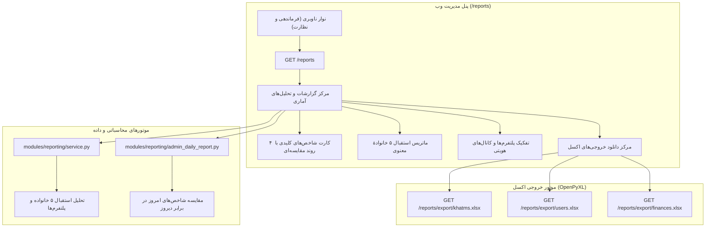

# MASTER-47: مرکز گزارشات جامع، تحلیل‌های آماری پیشرفته و موتور خروجی اکسل در وب ادمین (Advanced Analytics & Reporting Hub)

**تاریخ تدوین:** ۲۸ مهر ۱۴۰۵ / 2026-10-19  
**وضعیت:** مصوب و در حال پیاده‌سازی (Approved & In Implementation)  
**دامنه:** پنل وب ادمین (`src/khatmsaz/web/app.py`)، موتور گزارش‌گیری (`src/khatmsaz/modules/reporting/`)، قالب‌های وب (`reports.html` و `base.html`)  
**وابستگی‌ها:** MASTER-21 (آمار تحلیلی کاربران)، MASTER-39 (گزارش مقایسه‌ای روزانه ادمین)، MASTER-43، MASTER-44، DEC-PY-0139  

---

## ۱. چرایی و اهداف کلان (Rationale & Objectives)

در پی ممیزی و یکپارچه‌سازی ابزارهای مدیریتی سیستم ختم‌ساز، نیاز مبرمی به یک مرکز جامع تحلیل داده و گزارش‌گیری چندبُعدی در پنل وب احساس می‌شد:
1. **نبود مرکز متمرکز گزارشات در وب ادمین:** تا پیش از این، آمار روزانه صرفاً در ربات تلگرامی ادمین (`@khatmsaz_admin_bot`) دیسپچ می‌شد و خروجی اکسل تنها به صورت تک‌ختم (`/khatms/{khatm_id}/export.xlsx`) وجود داشت؛ هیچ صفحه‌ای برای مشاهدهٔ دید پرنده‌ای (Bird's Eye View) از عملکرد کل سامانه، وضعیت ۵ خانوادهٔ معنوی و صادرات انبوه داده‌ها در وب پنل تعبیه نشده بود.
2. **نیاز به پایش مقایسه‌ای و تحلیل روندها (Trend Analysis):** مدیران ارشد سیستم نیازمند مشاهدهٔ برخط شاخص‌های کلیدی (کاربران فعال روزانه DAU، ختم‌های جدید، سهم‌های قرائت‌شده، گردش مالی) به همراه شاخص روند (صعودی ↗️، کاهشی ↘️ یا ثابت ➡️) در قالب یک داشبورد مدرن تحت وب هستند.
3. **موتور یکپارچهٔ خروجی اکسل (Global Excel Export Engine):** امکان صدور فایل‌های اکسل استاندارد فارسی (راست‌به‌چپ) برای ۳ بخش حیاتی سامانه (کل ختم‌ها، کل کاربران و تمام تراکنش‌های مالی/فاکتورها) جهت حسابداری، ممیزی و تحلیل‌های برون‌سازمانی.

---

## ۲. مشخصات فنی و اجزای معماری (Architecture & Components)

---

## ۳. شاخص‌ها و نماهای مرکز گزارشات (Hub Views & Metrics)

### ۳.۱. کارت‌های شاخص کلیدی عملکرد (KPI Cards)
- **کاربران سامانه:** مجموع کاربران ثبت‌شده به همراه کاربران فعال روزانه (DAU) با شاخص مقایسه‌ای امروز نسبت به دیروز.
- **ختم‌های سامانه:** مجموع کل ختم‌ها و ختم‌های فعال جاری به همراه تعداد ایجادشده‌های امروز و روند تغییرات.
- **مشارکت‌ها و قرائت‌ها:** مجموع سهم‌های ثبت‌شده و قرائت‌های ۲۴ ساعت گذشته با روند صعودی/کاهشی.
- **گردش مالی و اشتراک‌ها:** مجموع واریزی‌ها و درآمد کل سیستم به تومان، فاکتورهای موفق و موجودی اعتباری کیف پول‌ها.

### ۳.۲. ماتریس استقبال ۵ خانوادهٔ معنوی (Devotional Families Breakdown)
طبق دکترین معنوی و معماری ۵ خانواده (قرآن، صلوات، ادعیه و زیارات، لعن، خطبه‌ها):
- تعداد کاربران درگیر (Engaged Users)
- تعداد قاریان و خوانندگان فعال جاری (Active Readers)
- تعداد ختم‌های کل و فعال
- سهم محبوبیت (Popularity Share %)
- رتبه‌بندی خودکار از ۱ تا ۵ به همراه نشان ویژهٔ **«🏆 بیشترین استقبال»**

### ۳.۳. توزیع پلتفرم و هویت مخاطبان (Platform & Identity Distribution)
- کاربران تلگرام در برابر کاربران بله در برابر کاربران دوپلتفرمی (Dual-platform).
- تفکیک سازندگان (Creators)، اعضای عادی و مدیران سیستم.
- وضعیت احراز هویت شماره همراه (ایرانی تأییدشده با پیامک، خارجی مستقیم، در انتظار/عادی).

### ۳.۴. موتور خروجی اکسل (Global Excel Exports)
سه مسیر دانلود فایل استاندارد `.xlsx` با استایل راست‌به‌چپ (`sheet_view.rightToLeft = True`):
1. **خروجی کل ختم‌ها (`/reports/export/khatms.xlsx`):** شناسه، عنوان ختم، نیت، قالب، نوع تعهد (تعهدی/آزاد)، نام سازنده، تلفن سازنده، وضعیت، تعداد اعضا، سقف، تاریخ ایجاد شمسی و ساعت تهران.
2. **خروجی کاربران (`/reports/export/users.xlsx`):** شناسه کاربر، نام نمایشی، شماره همراه، استان، شهر، جنسیت، پلن، نقش‌ها، موجودی کیف پول (نقد و هدیه)، تعداد ختم‌های ساخته‌شده، مشارکت‌های فعال، تاریخ عضویت شمسی.
3. **خروجی مالی و فاکتورها (`/reports/export/finances.xlsx`):** شناسه فاکتور، نام کاربر، شماره تماس، مبلغ (تومان)، عنوان فاکتور، وضعیت (پرداخت‌شده، در انتظار، مسترد شده)، کد رهگیری پی‌پینگ، تاریخ پرداخت شمسی.

---

## ۴. استانداردهای امنیتی و دسترس‌پذیری

- **کنترل دسترسی:** دسترسی به این مرکز منوط به داشتن حداقل یکی از دسترسی‌های `OPERATIONS_VIEW` یا `FINANCE_MANAGE` یا `SUPPORT_USERS` است.
- **پاپ‌آپ راهنمای گام‌به‌گام (`[؟]`):** دارای دکمهٔ راهنما به زبان ساده («مثل روشن کردن کامپیوتر») که تمام شاخص‌ها، درصدها و نحوهٔ استخراج اکسل را توضیح می‌دهد.
- **پایداری در برابر داده‌های تست و Mock:** تمام کوئری‌ها به شکلی امن نوشته شده‌اند که در صورت وجود اشیای Mock یا دیتابیس خالی با خطای `AttributeError` مواجه نشوند.

---

## ۵. معیارهای پذیرش (Acceptance Criteria)

1. [x] مسیر `GET /reports` صفحهٔ گزارشات جامع را با ۴ کارت KPI، ماتریس ۵ خانواده، تفکیک پلتفرم‌ها و جعبه خروجی اکسل رندر کند.
2. [x] مسیرهای صادرات اکسل (`/reports/export/khatms.xlsx`، `/reports/export/users.xlsx`، `/reports/export/finances.xlsx`) فایل‌های معتبر با هدرهای استاندارد فارسی و راست‌به‌چپ تولید کنند.
3. [x] منوی ناوبری دسکتاپ و داک موبایل در `base.html` لینک `/reports` را با آیکون اختصاصی نمایش دهد.
4. [x] تست‌های جامع رگرسیون در `tests/test_master_47_reports_hub.py` با پوشش کامل پاس شوند.
5. [x] کلیه تغییرات بدون شکستن تست‌های مسترهای ۴۲ تا ۴۶ مستقر و روی سرور اجرا شوند.
