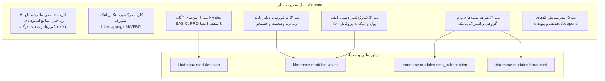

# MASTER-49: مرکز جامع مدیریت مالی، پلن‌های اشتراک، سقف اعضا و تعرفه‌های پیامک در پنل وب (Finance, Subscription Plans & Tariffs Hub)

**تاریخ تدوین:** ۲۸ مهر ۱۴۰۵ / 2026-10-19  
**وضعیت:** مصوب با تأیید مستقیم کارفرما و آماده پیاده‌سازی (Approved by Owner & Ready for Implementation)  
**دامنه:** پنل وب مدیریت (`web/app.py`، `web/templates/finance.html`)، ماژول پلن‌ها (`modules/plan`)، ماژول کیف پول و فاکتورها (`modules/wallet`)، ماژول اشتراک پیامک (`modules/sms_subscription`)، ماژول پیام گروهی (`modules/broadcast`)  
**وابستگی‌ها:** MASTER-03 (پلن‌ها، کیف پول و مالی)، MASTER-10 (پرداخت و محافظت پنل)، MASTER-38 (تعرفه پیام گروهی)، MASTER-44 (پروفایل ۳۶۰ و کیف پول کاربر)، MASTER-45 (مرکز کدهای تخفیف)، DEC-PY-0141  

---

## ۱. چرایی و تصمیمات قطعی کارفرما (Context & Owner Decisions)

بر اساس استعلام مستقیم و مصوبات اخذشده از کارفرما در تاریخ ۲۸ مهر ۱۴۰۵:

1. **ارتقای یکپارچه و ساختاریافتهٔ صفحهٔ `/finance` با Progressive Disclosure:**
   - حفظ روت اصلی `/finance` و ارتقای آن به یک مرکز مالی مدرن با ساختار تب‌های پنج‌گانه، رفع شلوغی بصری و فشرده‌سازی فرم‌های طولانی در قالب کارت‌های بازشونده (Glance ➔ Inspect ➔ Act).
2. **پایش و فیلترینگ پیشرفتهٔ فاکتورها و تراکنش‌ها:**
   - افزودن فیلتر بازه زمانی (امروز `today`، ۷ روز اخیر `7d`، ۳۰ روز اخیر `30d` و همه `all`) جهت بررسی سریع درآمدها.
   - افزودن فیلتر وضعیت فاکتورها (پرداخت‌شده `PAID`، مستردشده `REFUNDED`، در انتظار `PENDING` و ناموفق `FAILED`).
   - امکان جستجوی چندگانه در فاکتورها بر مبنای نام کاربر، شماره موبایل، کد رهگیری درگاه پی‌پینگ و شناسه فاکتور.
3. **کارت وضعیت درگاه‌های پرداخت و لینک مستقیم شاپرک:**
   - نمایش کارت پایش اتصال درگاه پی‌پینگ (وضعیت API Token و آدرس Callback امن).
   - نمایش لینک مستقیم پرداخت شاپرک (`https://ppng.ir/d/VFBD`) مصوب MASTER-12 جهت تراکنش‌های دستی و شارژ مستقیم با کد رهگیری ۸ رقمی.
4. **تثبیت سقف‌های اعضای پلن‌های ۳گانه (FREE, BASIC, PRO):**
   - پلن رایگان (FREE): صلوات/دعا/زیارت/لعن رایگان تا ۱۰۰ نفر عضو مجموع؛ قرآن رایگان تا ۳۰۲ نفر (یک دور کامل). عضوگیری ختم‌های فعال ادامه می‌یابد اما ساخت ختم جدید قفل می‌شود تا سازنده پلن تهیه کند.
   - پلن پایه (BASIC): افزایش سقف‌ها همراه با نمایش تبلیغات فرهنگی خدمتگزاران.
   - پلن حرفه‌ای (PRO): بدون سقف اعضا، بدون تبلیغات، همراه با امکان ارسال پیام گروهی به مخاطبان.
5. **ارتباط مستقیم با مرکز کوپن‌ها و پروفایل ۳۶۰ درجه کاربران:**
   - اتصال مستقیم نام و شناسه کاربر در جدول فاکتورها و میز شارژ کیف پول به صفحه پروفایل ۳۶۰ درجه (`/users/{id}`).
   - افزودن بنر دسترسی سریع به مرکز جامع کدهای تخفیف (`/coupons`).

---

## ۲. معماری جریان داده و مدیریت مالی (Architecture & Flow)

---

## ۳. فهرست روت‌ها و رابط‌های کاربری (Routes & Actions)

| روت | متد | شرح عملکرد | مجوز الزامی |
| :--- | :---: | :--- | :--- |
| `/finance` | `GET` | رندر مرکز جامع مالی، کارت‌های KPI، تب‌های ۵گانه و فیلتر فاکتورها | `FINANCE_MANAGE` |
| `/finance/plans/{plan_id}` | `POST` | ویرایش عنوان، شیوه محاسبه، هزینه ساخت، سقف اعضای عبادی و قرآن و وضعیت تبلیغات | `FINANCE_MANAGE` |
| `/finance/wallet/adjust` | `POST` | شارژ یا کسر موجودی نقدی و اعتبار هدیه کاربر همراه با ثبت علت و ارسال پیامک/بات | `FINANCE_MANAGE` |
| `/finance/invoices/{id}/refund` | `POST` | استرداد رسمی مبلغ فاکتور پرداخت‌شده به کیف پول کاربر در ربات با تاییدیه | `FINANCE_MANAGE` |
| `/finance/coupons` | `POST` | ثبت سریع کد تخفیف جدید با درصد یا مبلغ ثابت | `FINANCE_MANAGE` |
| `/finance/coupons/{code}/toggle` | `POST` | تغییر وضعیت فعال/غیرفعال کد تخفیف بدون حذف داده‌ها | `FINANCE_MANAGE` |
| `/finance/broadcast-policy` | `POST` | تنظیم تعرفه و اندازه بسته ارسال پیام گروهی (تلگرام، بله، پیامک) | `FINANCE_MANAGE` |
| `/finance/sms-plans` | `POST` | افزودن و ویرایش بسته‌های اشتراک یادآوری پیامکی (۱، ۳، ۶، ۱۲ ماهه) | `FINANCE_MANAGE` |

---

## ۴. استانداردهای پیاده‌سازی و خطوط قرمز (Non-Negotiable Guardrails)

1. **حفظ کامل نام فیلدهای فرم و روت‌ها:** کلیه فیلدهای فرم‌های موجود شامل `csrf`, `plan_id`, `title`, `pricing_mode`, `price_toman`, `max_devotional_members`, `max_quran_members`, `free_total_member_cap`, `ads_enabled`, `khatm_create`, `enabled`, `user_id`, `cash_delta`, `credit_delta`, `reason`, `code`, `discount_type`, `value`, `min_purchase_toman`, `channel`, `package_size`, `months` با دقت ۱۰۰٪ حفظ می‌شوند.
2. **قانون عدم حذف فیزیکی فاکتورها:** فاکتورها پس از پرداخت تنها می‌توانند تغییر وضعیت به `REFUNDED` دهند تا سوابق حسابداری و ممیزی سامانه همواره حفظ شود.
3. **تعرفه رسمی پیام گروهی:** هزینه ارسال هر بسته ۱۰۰۰ نفری معادل ۱۵۰,۰۰۰ تومان مطابق با مصوبه کارفرما در MASTER-38 محاسبه و اعمال می‌شود.
4. **تایید دو مرحله‌ای استرداد وجه:** استرداد فاکتورها منحصراً با تایید صریح ادمین انجام می‌شود و از استرداد مجدد فاکتورهای قبلاً مستردشده جلوگیری به عمل می‌آید.
5. **ارقام به تومان با جداکننده سه‌رقمی:** کلیه مبالغ پولی به واحد «تومان» و با جداکننده سه رقمی فارسی رندر می‌شوند.

---

## ۵. آزمون و اعتبارسنجی (Test & Verification Plan)

1. **تست دسترسی احراز هویت:** ریدایرکت درخواست‌های غیرمجاز به `/login`.
2. **تست بارگذاری صفحه `/finance` با پارامترهای فیلتر:** ارزیابی فیلتر بازه زمانی (`today`, `7d`, `30d`)، فیلتر وضعیت فاکتور و کوئری جستجو.
3. **تست ذخیره تغییرات پلن:** ارسال فرم ویرایش پلن و ذخیره سقف‌های اعضای عبادی و قرآن.
4. **تست استرداد فاکتور به کیف پول:** فراخوانی روت استرداد و بررسی تغییر وضعیت فاکتور و افزایش موجودی کیف پول کاربر.
5. **تست شارژ/کسر دستی کیف پول:** تنظیم موجودی نقدی و اعتبار هدیه و بررسی سوابق ممیزی.
6. **اجرای تست جامع رگرسیون و استقرار زنده روی سرور VPS (`91.107.137.22`):** پوش به مخزن گیت و ران اسکریپت دپلو و تایید سلامت سرویس.
