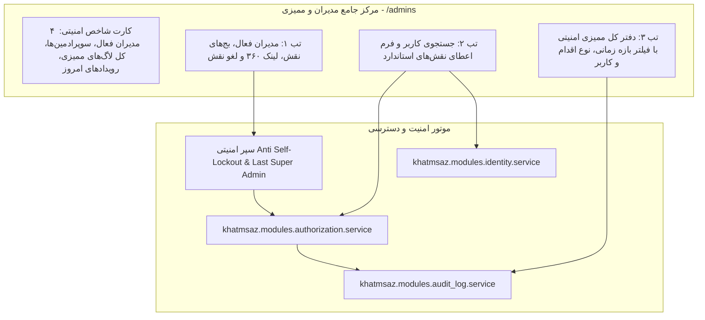

# MASTER-50: مرکز جامع مدیران، نقش‌ها، سطوح دسترسی (RBAC) و ممیزی امنیتی در پنل وب (Admins, Roles, Permissions & Security Audit Hub)

**تاریخ تدوین:** ۲۸ مهر ۱۴۰۵ / 2026-10-19  
**وضعیت:** مصوب با تأیید مستقیم کارفرما و آماده پیاده‌سازی (Approved by Owner & Ready for Implementation)  
**دامنه:** پنل وب مدیریت (`web/app.py`، `web/templates/admins.html`، `web/templates/audit.html`)، ماژول احراز هویت و دسترسی (`modules/authorization`)، ماژول ثبت ممیزی (`modules/audit_log`)، ماژول هویت کاربران (`modules/identity`)  
**وابستگی‌ها:** MASTER-04 (مدیران و ممیزی)، MASTER-12 (پایش خطا و ادمین بات)، MASTER-40 (ارتقای ادمین‌ها)، MASTER-44 (پروفایل ۳۶۰ کاربران)، DEC-PY-0142  

---

## ۱. چرایی و تصمیمات قطعی کارفرما (Context & Owner Decisions)

بر اساس استعلام مستقیم و مصوبات اخذشده از کارفرما در تاریخ ۲۸ مهر ۱۴۰۵:

1. **مدیریت سطوح دسترسی مبتنی بر نقش (RBAC) استاندارد و سفارشی:**
   - پشتیبانی از نقش‌های از پیش‌تعریف‌شدهٔ استاندارد: مدیر جامع (`ADMIN`)، مدیر مالی (`FINANCE_ADMIN`)، مدیر محتوا (`CONTENT_ADMIN`)، ناظر محتوا و تاییدات (`MODERATION_ADMIN`)، کارشناس پشتیبانی (`SUPPORT_ADMIN`)، مدیر تبلیغات (`MARKETING_ADMIN`) و مدیر عملیات و زیرساخت (`OPERATIONS_ADMIN`).
   - امکان ارتقای کاربر به سطح مدیر ارشد (`SUPER_ADMIN`) توسط سایر مدیران ارشد با ثبت ردپای امنیتی.
   - امکان اعطا و لغو دسترسی‌های تخصصی بدون نیاز به تغییر دستی پایگاه‌داده.
2. **یکپارچه‌سازی مدرن و تب‌بندی صفحهٔ `/admins` با دفتر کل ممیزی:**
   - سازمان‌دهی صفحه به ۳ تب اصلی:
     - **تب ۱ (مدیران فعال و نقش‌ها):** نمایش لیست کامل مدیران فعال با بج‌های رنگی نقش‌ها، تاریخ اعطا، نام اعطاکننده و دکمهٔ لغو دسترسی همراه با پنجرهٔ تایید دو مرحله‌ای (Two-Step Revoke Confirmation).
     - **تب ۲ (اعطای نقش و افزودن مدیر جدید):** موتور جستجوی چندگانه کاربر (نام، شماره، شناسه عددی تلگرام/بله، یا UUID) همراه با انتخاب نقش استاندارد و ارسال پیامک/پیام بات اطلاع‌رسانی.
     - **تب ۳ (دفتر کل ممیزی و ردپای امنیتی):** پایش کلیهٔ رویدادهای حساس، تغییرات کیف پول، تایید/رد ختم‌ها، ثبت بنرها و تغییر نقش‌ها با قابلیت فیلتر بر اساس نوع عملیات (`action`)، بازه زمانی (`today`, `7d`, `30d`, `all`)، انجام‌دهنده و کاربر هدف.
   - حفظ روت `/audit` و هدایت هوشمند یا نمایش محتوا با هماهنگی کامل با تب ممیزی.
3. **مکانیزم‌های ایمنی ضد قفل‌شدگی خودکار و محافظت از آخرین مدیر ارشد (Safety Guardrails):**
   - **محافظت Anti Self-Lockout:** یک مدیر ارشد هرگز نمی‌تواند از طریق پنل وب نقش یا دسترسی‌های خود را لغو کند تا از قفل شدن تصادفی حساب جلوگیری شود.
   - **محافظت Last Super Admin Guard:** در صورتی که تعداد مدیران ارشد فعال در سامانه برابر با ۱ نفر باشد، عملیات لغو نقش یا تنزل او مسدود شده و خطای صریح امنیتی بازگردانده می‌شود.
4. **شاخص‌های کلیدی عملکرد امنیتی (Security KPIs):**
   - کارت ۱: تعداد کل مدیران فعال سامانه (Active Admins).
   - کارت ۲: تعداد مدیران ارشد دارای دسترسی کامل (Super Admins).
   - کارت ۳: تعداد کل رویدادهای ممیزی ثبت‌شده (Total Audit Events).
   - کارت ۴: رویدادهای امنیتی ثبت‌شده در ۲۴ ساعت اخیر (Security Events Today).
5. **اتصال دوسویه به پروفایل ۳۶۰ درجه کاربران:**
   - پیوند مستقیم نام و شناسه تمام ادمین‌ها و کاربران هدف در جدول مدیران و لاگ ممیزی به صفحهٔ `/users/{id}`.

---

## ۲. معماری جریان داده و مدیریت نقش‌ها (Architecture & Flow)

---

## ۳. فهرست روت‌ها و رابط‌های کاربری (Routes & Actions)

| روت | متد | شرح عملکرد | مجوز الزامی |
| :--- | :---: | :--- | :--- |
| `/admins` | `GET` | رندر مرکز جامع مدیران، کارت‌های شاخص KPI، تب‌های سه‌گانه و فیلترهای ممیزی | `ADMIN_ROLES_MANAGE` |
| `/admins/{user_id}/roles` | `POST` | اعطا (`action=grant`) یا لغو (`action=revoke`) نقش مدیریتی به کاربر | `ADMIN_ROLES_MANAGE` |
| `/admins/{user_id}/promote-super` | `POST` | ارتقای کاربر به نقش سوپرادمین با تاییدیه دو مرحله‌ای | `ADMIN_ROLES_MANAGE` |
| `/audit` | `GET` | دسترسی مستقیم به دفتر کل ممیزی و هدایت به تب ۳ ممیزی امنیتی | `OPERATIONS_VIEW` |

---

## ۴. استانداردهای پیاده‌سازی و خطوط قرمز (Non-Negotiable Guardrails)

1. **عدم حذف فیزیکی رکوردهای ممیزی:** جدول `audit_logs` به صورت اکیداً افزایشی (Append-Only) است و هیچ اندپوینت یا دستوری برای حذف رکوردهای حسابرسی وجود ندارد.
2. **بررسی الزامی سوپرادمین برای مدیریت نقش‌ها:** منحصراً کاربرانی که دارای `UserRole.SUPER_ADMIN` هستند حق ورود به این صفحه و اعطا یا لغو نقش‌ها را دارند.
3. **اعمال قطعی سپر ضد قفل‌شدگی (Anti Self-Lockout):** بررسی `actor.id != target.id` هنگام لغو نقش و بررسی تعداد کل سوپرادمین‌های فعال قبل از هرگونه لغو نقش مدیر ارشد.
4. **اطلاع‌رسانی بلادرنگ تغییر نقش:** در صورت اعطای نقش جدید، پیام رسمی امنیتی از طریق ربات تلگرام/بله به کاربر ارسال می‌شود تا از تغییر سطح دسترسی خود مطلع گردد.
5. **سازگاری کامل پارامترهای فرم:** پارامترهای فرم شامل `csrf`, `role`, `action`, `q` با حفظ ۱۰۰٪ سازگاری نگهداری می‌شوند.

---

## ۵. آزمون و اعتبارسنجی (Test & Verification Plan)

1. **تست احراز هویت و مجوز:** ممانعت از ورود کاربران فاقد مجوز `ADMIN_ROLES_MANAGE` و ریدایرکت به لاگین یا نمایش خطای ۴۰۳.
2. **تست بارگذاری صفحه `/admins`:** ارزیابی شاخص‌های KPI، تب‌های سه‌گانه و رندر لیست مدیران و رویدادهای ممیزی.
3. **تست اعطای نقش جدید (`action=grant`):** اعطای نقش `FINANCE_ADMIN` به یک کاربر و بررسی ایجاد رکورد گرنت و لاگ ممیزی `WEB_ADMIN_ROLE_GRANTED`.
4. **تست لغو نقش (`action=revoke`):** لغو نقش ادمین و ثبت رویداد `WEB_ADMIN_ROLE_REVOKED`.
5. **تست سپر امنیتی Anti Self-Lockout:** تلاش ادمین برای لغو نقش خود و بازگشت خطای ۴۰۰ با پیام مناسب.
6. **تست سپر آخرین سوپرادمین:** تلاش برای لغو نقش تنها سوپرادمین فعال سامانه و جلوگیری قطعی از عملیات.
7. **اجرای تست جامع رگرسیون (مسترهای ۴۲ تا ۵۰) و استقرار زنده روی سرور VPS (`91.107.137.22`):** پوش به مخزن گیت و ران اسکریپت دپلو و تایید سلامت سرویس.
