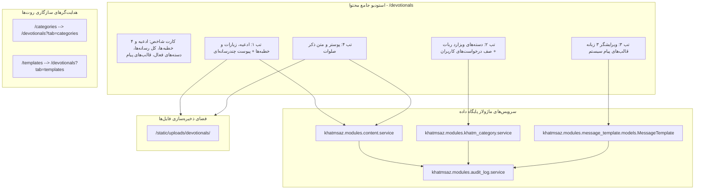

# MASTER-51: استودیو جامع ادعیه، زیارات، خطبه‌ها، دسته‌بندی‌های ویزارد و قالب‌های پیام سیستم در پنل وب (Devotionals, Categories & Message Templates Studio)

**تاریخ تدوین:** ۲۸ مهر ۱۴۰۵ / 2026-10-19  
**وضعیت:** مصوب با تأیید مستقیم کارفرما و آماده پیاده‌سازی (Approved by Owner & Ready for Implementation)  
**دامنه:** پنل وب مدیریت (`web/app.py`، `web/templates/devotionals.html`، `web/templates/categories.html`، `web/templates/templates.html`)، ماژول‌های محتوا و ادعیه (`modules/content`)، دسته‌بندی‌های ختم (`modules/khatm_category`)، قالب‌های پیام سیستم (`modules/message_template`) و ممیزی رویدادها (`modules/audit_log`)  
**وابستگی‌ها:** MASTER-02 (ادعیه و مدیا)، MASTER-05 (خطبه فدکیه)، MASTER-11 (ویزارد لعن)، MASTER-20 (آینه‌سازی مدیا)، MASTER-43 (مدیریت ختم‌ها)، DEC-PY-0143  

---

## ۱. چرایی و تصمیمات قطعی کارفرما (Context & Owner Decisions)

بر اساس استعلام مستقیم و مصوبات اخذشده از کارفرما در تاریخ ۲۸ مهر ۱۴۰۵:

1. **یکپارچه‌سازی استودیو محتوا در روت اصلی `/devotionals` با معماری ۴ تب:**
   - به جای پراکندگی صفحات محتوا، یک استودیوی مدرن، زیبا و منسجم تحت روت `/devotionals` (با نام مستعار `/content`) با ساختار ۴ زبانه پیاده‌سازی می‌شود:
     - **تب ۱ (ادعیه، زیارات و خطبه‌ها):** مدیریت متن کامل، بخش‌بندی خودکار، وضعیت فعال/غیرفعال، و فایل‌های چندرسانه‌ای ضمیمه (شامل خطبه فدکیه ۵ بخشی با کپشن اختصاصی).
     - **تب ۲ (دسته‌بندی‌های ویزارد ختم):** صف درخواست‌های مردمی دعاهای جدید (تأیید و تبدیل به دسته، یا رد با یک کلیک)، فرم افزودن دسته جدید به ویزارد ربات، تنظیم اولویت نمایش (`display_position`) و اتصال به متن آماده در استودیو.
     - **تب ۳ (قالب‌های پیام سیستم):** ویرایشگر ۳ زبانه پیام‌های ربات (`fa`، `ar`، `en`)، نگهداری تاریخچه نسخه‌ها با شماره نسخه خودکار (`version`)، فیلتر زبان و فعال/غیرفعال‌سازی لحظه‌ای.
     - **تب ۴ (ذکر مقدس صلوات و پوسترها):** نمایش متن ثابت صلوات، آپلود مستقیم پوستر/تصویر صلوات یا درج لینک خارجی و پیش‌نمایش زنده.
   - روت‌های قدیمی `/categories` و `/templates` به صورت خودکار با کد وضعیت استاندارد به `/devotionals?tab=categories` و `/devotionals?tab=templates` هدایت (Redirect) می‌شوند تا هیچ بوک‌مارک یا پیوندی شکسته نشود.
2. **مدیریت چندرسانه‌ای با آپلود مستقیم و پیوند خارجی:**
   - پشتیبانی از آپلود مستقیم فایل‌های صوتی (صدای مداحان مختلف)، ویدیوهای بخش‌بندی‌شده (ویدیوهای خطبه با کپشن)، تصاویر باکیفیت و فایل‌های PDF به دایرکتوری امن `/static/uploads/devotionals/` همراه با تولید نام‌های غیرتکراری بر پایه زمان.
   - حفظ و پشتیبانی همزمان از لینک‌های خارجی (`https://...`) و فوروارد تلگرام (`tg_forward:@channel:msg_id`).
   - ارتقای بخش پوستر صلوات جهت پشتیبانی از آپلود مستقیم فایل علاوه بر درج URL.
3. **شاخص‌های کلیدی عملکرد استودیو محتوا (Content Studio KPIs):**
   - کارت ۱: مجموع ادعیه، زیارات و خطبه‌ها (`total_devotionals`).
   - کارت ۲: مجموع کل فایل‌های چندرسانه‌ای ضمیمه‌شده (`total_media_files`).
   - کارت ۳: دسته‌بندی‌های فعال در ویزارد ربات (`active_categories`).
   - کارت ۴: قالب‌های پیام فعال سیستم (`total_templates`).
4. **طراحی واکنش‌گرا و تجربه کاربری مدرن (UX/UI with Progressive Disclosure):**
   - استفاده از المان‌های بازشونده (`
`) برای فرم‌های طولانی افزودن دعا، آپلود مدیا، ثبت دسته و ویرایش قالب پیام تا صفحه سبک و منظم بماند.
   - حفظ تب فعال و نمایش بنرهای سبز تأیید پس از هر عملیات (`tab=categories&saved=created`، `tab=templates&saved=template_saved` و ...).
   - پنجره‌های تایید دو مرحله‌ای بومی و مدال‌های راهنمای شفاف فارسی.
5. **ممیزی امنیتی و ثبت تغییرات:**
   - کلیه عملیات ثبت دعا، حذف مدیا، تغییر وضعیت دسته و ویرایش قالب‌های متنی در ماژول `audit_service` ثبت می‌شوند.

---

## ۲. معماری جریان داده و مدیریت استودیو (Architecture & Flow)

---

## ۳. شاخص‌های ۴ گانه عملکرد (Studio KPIs)

| شاخص | کلید | روش محاسبه | توضیح |
| :--- | :--- | :--- | :--- |
| **مجموع ادعیه و خطبه‌ها** | `total_devotionals` | تعداد کل دارایی‌های متنی غیر از صلوات در دیتابیس | شامل کلیه دعاها، زیارت‌ها، خطبه‌ها و لعن‌ها |
| **فایل‌های چندرسانه‌ای ضمیمه** | `total_media_files` | مجموع تعداد رسانه‌های ضمیمه به تمام ادعیه | ویدیوها، صوت‌ها، تصاویر و PDFها |
| **دسته‌بندی‌های فعال ویزارد** | `active_categories` | تعداد رکوردهای فعال دسته‌بندی ویزارد ختم | دسته‌هایی که در منوی ساخت ختم ربات نمایش داده می‌شوند |
| **قالب‌های پیام سیستم** | `total_templates` | تعداد کل قالب‌های متنی ۳ زبانه ثبت‌شده | قالب‌های اعلان، خوش‌آمد، یادآوری و گزارشات |

---

## ۴. طرح تفصیلی تب‌های استودیو محتوا

### تب ۱: ادعیه، زیارات و خطبه‌ها (`tab=devotionals`)
- فرم بازشونده افزودن دعای جدید (گروه محتوا، عنوان، شناسه یکتا انگلیسی slug، متن کامل با بخش‌بندی خودکار).
- فیلتر محتوا بر مبنای نوع (`همه`، `🤲 دعا`، `🕌 زیارت`، `🎤 خطبه`، `🔥 لعن`) و جستجوی متنی.
- کارت‌های شیشه‌ای اختصاصی برای هر محتوا با امکان فعال/غیرفعال‌سازی آنی.
- پنل آکاردئونی مدیریت فایل‌های چندرسانه‌ای:
  - صوت‌ها (با تفکیک نام مداح و پیش‌نمایش صوتی).
  - ویدیوها (شامل ویدیوهای ۵ بخشی خطبه فدکیه با شماره پارت و کپشن).
  - صفحات تصویری و اسناد PDF.
  - فرم آپلود مستقیم فایل از دستگاه کاربر یا درج آدرس خارجی.

### تب ۲: دسته‌بندی‌های ویزارد ختم (`tab=categories`)
- بخش اضطراری درخواست‌های دعای جدید ارسالی توسط کاربران (درخواست‌دهنده، عنوان، دکمه رد درخواست و فرم سریع تأیید و افزودن به ویزارد).
- فرم بازشونده ساخت دسته‌بندی جدید با اولویت نمایش عددی (`display_position`) و امکان پیوند به متن آماده در استودیو یا ثبت متن کوتاه مستقیم.
- لیست دسته‌بندی‌ها به تفکیک گروه‌های `DUA`، `KHUTBAH`، `LAAN` با کلید تغییر وضعیت فعال/غیرفعال.

### تب ۳: قالب‌های پیام سیستم (`tab=templates`)
- فیلتر بر مبنای زبان‌های سامانه (`همه`، `فارسی fa`، `عربی ar`، `انگلیسی en`).
- فرم بازشونده ثبت نسخه جدید از قالب با محاسبه خودکار نسخه بعدی و انتشار آنی در ناوگان ربات‌ها.
- جدول و کارت‌های قالب‌های ثبت‌شده با پیش‌نمایش متن، تاریخ به‌روزرسانی و سوابق نگارش.

### تب ۴: ذکر صلوات و پوسترها (`tab=salawat`)
- کارت متن مقدس و ثابت صلوات با جلوه خطاطی و تذهیب قرآنی.
- فرم تغییر تصویر صلوات با پشتیبانی ۲ گانه: آپلود مستقیم فایل پوستر یا درج لینک اینترنتی.
- پیش‌نمایش زنده تصویر فعلی صلوات.

---

## ۵. ماتریس آزمون‌های رگرسیون (Validation & Test Matrix)

1. `test_devotionals_hub_unauthenticated_redirect`: کاربر احرازهویت‌نشده به `/login` هدایت شود.
2. `test_devotionals_hub_authenticated_view`: صفحه با ۴ شاخص عملکردی و تب‌های ۴ گانه بارگذاری شود.
3. `test_categories_redirect_to_devotionals_tab`: روت `/categories` به `/devotionals?tab=categories` ریدایرکت کند.
4. `test_templates_redirect_to_devotionals_tab`: روت `/templates` به `/devotionals?tab=templates` ریدایرکت کند.
5. `test_devotional_save_and_toggle`: ثبت و تغییر وضعیت دعا انجام شده و کاربر به تب ادعیه بازگردد.
6. `test_devotional_media_upload_and_delete`: آپلود فایل ضمیمه و حذف آن با موفقیت پردازش شود.
7. `test_category_create_and_toggle`: ثبت دسته‌بندی و تغییر وضعیت آن در ویزارد کار کند.
8. `test_category_request_fulfill_and_decline`: تأیید یا رد درخواست دعای کاربر تست و اعتبارسنجی شود.
9. `test_template_save_version_increment`: ذخیره قالب پیام منجر به افزایش شماره نسخه شود.
10. `test_salawat_image_update`: بروزرسانی تصویر صلوات با موفقیت ذخیره شود.
