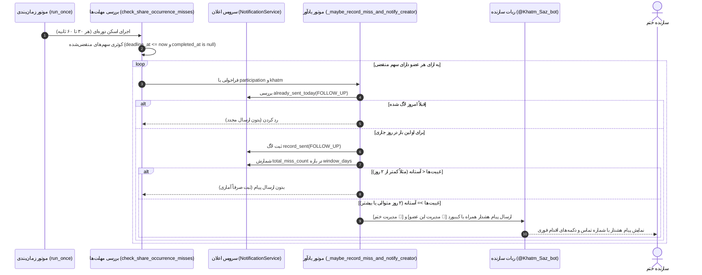

# MASTER-58: موتور جامع اعلان‌های انگیزشی، هشدارهای غیبت مکرر اعضا به سازنده و زمان‌بندی یادآوری‌های روزانه
**(Child Master 58 — Motivational Reminders, Creator Inactivity Alerts & Daily Digest Engine)**

> **📅 تاریخ تدوین:** `2026-10-20` (۲۹ مهر ۱۴۰۵) · **وضعیت:** `تثبیت‌شده، پیاده‌سازی‌شده و مستقر روی سرور زنده` · **نگارنده:** `Antigravity`  
> **مرجع تصمیمات دامنه‌ای:** `DEC-PY-0150` در [DECISIONS.md](../DECISIONS.md) · **مستندات مادر:** [ADMIN_PANEL_REDESIGN_MASTER.md](../ADMIN_PANEL_REDESIGN_MASTER.md)

---

## ۱. صورت‌مسئله و اهداف محصولی

در سامانه ختم‌ساز، پایداری و به سرانجام رسیدن یک ختم گروهی (اعم از قرآن، صلوات، ادعیه و خطبه‌ها) وابستگی مستقیمی به دو عامل کلیدی دارد:
1. **انگیزه و حس همراهی اعضا (Member Motivation):** اعضا پس از قرائت سهم روزانه، باید فوراً اثر مشارکت خود را در پیشرفت کل ختم مشاهده کنند و احساس نکنند قرائت آنان در یک خلأ رخ داده است.
2. **نظارت هوشمند و اختیارات مستقیم سازنده (Creator Operational Oversight):** اگر عضوی به هر دلیل ۲ روز متوالی سهم تعهدی خود را ثبت نکرد، سهم او در هوا معلق نماند و در عین حال بدون رضایت سازنده لغو عضویت خودکار رخ ندهد. سازنده باید هشداری شفاف حاوی شماره تماس و دکمه‌های اقدام فوری دریافت کند تا بتواند مستقیماً وضعیت را پیگیری یا مدیریت نماید.

---

## ۲. اصول سه‌گانه معماری اعلان‌ها و یادآوری‌ها

### ۲.۱. تفکیک کامل پیام‌های پس از قرائت (Action-Triggered Two-Message Split)
بر اساس تصمیمات قطعی کارفرما (منطبق بر MASTER-07):
- **پیام اول (تأیید و دعوت دوستان):** بلافاصله پس از ثبت سهم، پیام تشکر صمیمانه و اعلام قبولی همراه با **لینک اختصاصی دعوت به همان ختم در همان ربات ممبر** ارسال می‌شود.
- **پیام دوم (روند پیشرفت کلی):** در پیامی مستقل، آمار لحظه‌ای قرائت تا دیروز، قرائت‌های امروز، مجموع قرائت‌شده و درصد پیشرفت به کاربر نشان داده می‌شود.
- **حذف برودکست‌های ناخواسته:** هیچ پیام خودکار مزاحمی در طول روز به صورت انبوه برای اعضا فرستاده نمی‌شود؛ گزارش‌گیری اعضا کاملاً بر اساس اقدام (Action-Triggered) است.

### ۲.۲. هشدارهای هوشمند غیبت مکرر اعضا به سازنده (Creator Miss Alerts with Direct Actions)
هنگامی که مهلت روزانه (`deadline_at`) یک سهم تعهدی منقضی شود و کاربر آن را تکمیل نکرده باشد:
- **عدم ارسال پیام سرزنش به عضو:** هیچ پیام توبیخی به عضو ارسال نمی‌شود.
- **بررسی آستانه غیبت (Miss Threshold):** در صورتی که غیبت‌های پیاپی عضو به حد نصاب ختم (`miss_notice_threshold`، پیش‌فرض ۲ روز) برسد، هشداری محترمانه در ربات ختم‌ساز برای **سازنده** فرستاده می‌شود.
- **دکمه‌های اقدام تعاملی (Interactive Inline Buttons):**
  - دکمه ۱: `[👤 بررسی و مدیریت این عضو]` متصل به کال‌بک امن `km:v:{participation.id.hex}` که کارت مشخصات، پیشرفت، شماره تماس و جریان حذف دومرحله‌ای ایمن عضو را در اختیار سازنده می‌گذارد.
  - دکمه ۲: `[🕋 مدیریت ختم]` متصل به `my_khatms:manage:{khatm.id}` جهت مشاهده و ویرایش کل تنظیمات ختم.
- **جلوگیری از ارسال تکراری (Deduplication):** بررسی `already_sent_today` با لاگ `NotificationKind.FOLLOW_UP` تضمین می‌کند سازنده در یک روز بیش از یک بار برای یک عضو هشدار دریافت نکند.

### ۲.۳. گزارش تجمیعی روزانه سازندگان در ساعت ۱۲:۰۰ ظهر (Creator Daily 12:00 PM Report)
سازندگانی که دارای ختم فعال هستند، هر روز راس ساعت ۱۲:۰۰ ظهر به وقت تهران، پیامی تجمیعی از وضعیت تمام ختم‌های فعال خود شامل پیشرفت تا دیروز، ثبت‌های امروز، مجموع قرائت‌ها در برابر هدف کل و تعداد همراهان فعال دریافت می‌کنند؛ همراه با دکمه‌های مدیریت هر ختم و دکمه دسترسی به پنل وب سازندگان.

---

## ۳. دیاگرام توالی جریان هشدار غیبت به سازنده (Sequence Diagram)

---

## ۴. ساختار فنی و فایل‌های تغییریافته

1. **`src/khatmsaz/modules/reminder_engine/service.py`:**
   - ارتقای متد `_maybe_record_miss_and_notify_creator` با کیبورد اینلاین دکمه‌های مستقیم (`km:v:{participation.id.hex}` و `my_khatms:manage:{khatm.id}`).
   - ارسال از طریق `_notify_user_with_keyboard` به ربات سازنده در هر دو پلتفرم تلگرام و بله.
   - بهینه‌سازی `check_share_occurrence_misses` با فیلتر عدم تکرار شناسه مشارکت در یک چرخه اسکن.
2. **`src/khatmsaz/modules/reporting/creator_daily_report.py`:**
   - تضمین شمارش دقیق تمامی مشارکت‌ها و سهم‌های قرآنی، روایی، صلوات و ادعیه.
   - چیدمان منسجم دکمه‌های مدیریت ختم در کیبورد گزارش ۱۲:۰۰ ظهر.
3. **`tests/test_master_58_creator_alerts_and_daily_digest.py`:**
   - تست‌های جامع برای بررسی شرایط آستانه غیبت، جلوگیری از ارسال تکراری، ارسال دکمه‌های اینلاین و پایداری در زمان اجرا.

---

## ۵. ماتریس اعتبارسنجی و نتایج آزمون‌ها

| ردیف | سناریوی آزمون | نتیجه مورد انتظار | وضعیت |
| :---: | :--- | :--- | :---: |
| ۱ | غیبت کمتر از آستانه (روز اول) | ثبت لاگ غیبت بدون مزاحمت برای سازنده | ✅ PASS |
| ۲ | غیبت معادل یا بیشتر از آستانه (روز دوم) | ارسال پیام هشدار با نام، شماره تماس و کیبورد دو دکمه‌ای | ✅ PASS |
| ۳ | تلاش مجدد برای ارسال در همان روز | مسدود شدن با `already_sent_today` جهت جلوگیری از اسپم | ✅ PASS |
| ۴ | اسکن سهم‌های منقضی‌شده (`ShareOccurrence`) | تفکیک دقیق سهم‌های موعدگذشته از سهم‌های تکمیل‌شده | ✅ PASS |
| ۵ | ساخت گزارش روزانه سازندگان | محاسبه دقیق سهم دیروز، امروز و درصد کل | ✅ PASS |
